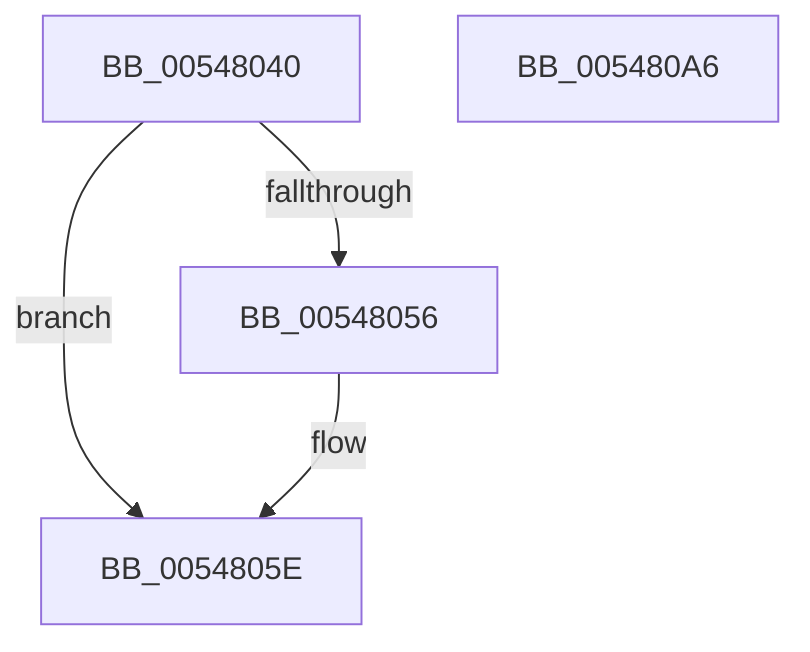

# x86BiosWritePciDataPort

- RVA: `0x00548040`–`0x005480A7` (길이 `103` bytes)
- VA: `0x0000000140548040`
- 실행 섹션: `.text`
- PDB 이름 있음: `예`; PDB Function 태그: `아니요`
- unwind 정보 RVA: `0x0006BDBC`
- 디코드: `26`개 명령, `103/103` bytes 표시
- 미해석 바이트: `0` (있으면 어셈블리에 `.byte`로 보존)

> 이 문서는 커널 이미지의 기계어와 PDB 기호를 분석해 생성했습니다. 4번과 5번은 함수 원형과 자료형을 바이너리 사용 방식에서 추정한 C 해석이며 원본 소스 복구 결과는 아닙니다.

## 1. Dependencies

- 직접 호출 지점: **1**; 고유 호출 대상: **1**
- 직접 호출자로 확인된 함수: **1**
- RIP 상대 이미지 참조: **3**

### Outgoing calls
- `0x0054809C` → [guard_dispatch_icall](../6B/guard_dispatch_icall_function_006BAAD0.md) (function, `0x006BAAD0`)

### Direct callers
- [x86BiosWriteIoSpace](../47/x86BiosWriteIoSpace_function_00472E00.md) at `0x00472E74`

### Static image references
- `0x0054805E` → RVA `0x00E1032C` (`.data`; read)
- `0x00548068` → RVA `0x00E1032E` (`.data`; read)
- `0x0054808F` → RVA `0x00FC2308` (`.data`; read)

## 2. Other-region calls and transfers

- 다른 실행 섹션으로 향하는 call: **0**
- 별도 외부 분기/꼬리 이동을 확인하지 못했습니다.

## 3. Assembly (complete function range)

```asm
00548040  44 89 44 24 18                  mov dword ptr [rsp + 0x18], r8d
00548045  48 83 EC 38                     sub rsp, 0x38
00548049  44 0F B7 D2                     movzx r10d, dx
0054804D  41 8D 04 0A                     lea eax, [r10 + rcx]
00548051  83 F8 03                        cmp eax, 3
00548054  7E 08                           jle 0x14054805e
00548056  B9 03 00 00 00                  mov ecx, 3
0054805B  41 2B CA                        sub ecx, r10d
0054805E  8B 05 C8 82 8C 00               mov eax, dword ptr [rip + 0x8c82c8]
00548064  44 8D 41 01                     lea r8d, [rcx + 1]
00548068  0F B6 0D BF 82 8C 00            movzx ecx, byte ptr [rip + 0x8c82bf]
0054806F  8B D0                           mov edx, eax
00548071  C1 EA 08                        shr edx, 8
00548074  44 0F B6 C8                     movzx r9d, al
00548078  81 E2 F8 00 00 00               and edx, 0xf8
0054807E  25 00 07 00 00                  and eax, 0x700
00548083  44 89 44 24 20                  mov dword ptr [rsp + 0x20], r8d
00548088  0B D0                           or edx, eax
0054808A  4C 8D 44 24 50                  lea r8, [rsp + 0x50]
0054808F  48 8B 05 72 A2 A7 00            mov rax, qword ptr [rip + 0xa7a272]
00548096  45 0B CA                        or r9d, r10d
00548099  C1 EA 03                        shr edx, 3
0054809C  E8 2F 2A 17 00                  call 0x1406baad0
005480A1  48 83 C4 38                     add rsp, 0x38
005480A5  C3                              ret
005480A6  CC                              int3
```

## 4. C-style interpretation (structured pseudocode)

```c
__int64 __fastcall x86BiosWritePciDataPort(__int64 a1, unsigned __int16 a2, int a3)
{
    __int64 result;
    __int64 v_rsp;
    unsigned int v_stack_m18;
    unsigned int v_stack_p18;

    v_stack_p18 = a3;
    v_rsp = (v_rsp) - (56);
    if (((unsigned int)(a2 + a1 * 1)) >= = 3) {
        a1 = 3;
        a1 = (unsigned int)((a1) - (a2));
    }
    a2 = (unsigned int)(((unsigned int)((unsigned int)((unsigned int)(*(unsigned int *)(v_rip + 9208520))))) >> (8));
    a2 = (unsigned int)((a2) & (248));
    result = (unsigned int)(((unsigned int)(*(unsigned int *)(v_rip + 9208520))) & (0x700ULL));
    v_stack_m18 = (unsigned int)(a1 + 1);
    a2 = (unsigned int)((a2) | ((unsigned int)(result)));
    a4 = (unsigned int)(((unsigned __int8)((unsigned int)(*(unsigned int *)(v_rip + 9208520)))) | (a2));
    a2 = (unsigned int)((a2) >> (3));
    result = guard_dispatch_icall(*(unsigned __int8 *)(v_rip + 9208511), a2, v_stack_p18, a4);
    v_rsp = (v_rsp) + (56);
    return result;
}
```

## 5. (Beta) C Style

```c
int64_t x86BiosWritePciDataPort(int64_t Arg1, void *Arg2, int32_t Arg3)
{
    uint8_t *arg2 = (uint8_t *)Arg2;

    int64_t result;
    int64_t local_rsp;
    uint32_t v_stack_m18;
    uint32_t v_stack_p18;

    v_stack_p18 = Arg3;
    local_rsp = (local_rsp) - (56);
    if (((uint32_t)(Arg2 + Arg1 * 1)) >= = 3) {
        Arg1 = 3;
        Arg1 = (uint32_t)((Arg1) - (Arg2));
    }
    Arg2 = (uint32_t)(((uint32_t)((uint32_t)((uint32_t)(*(uint32_t *)(v_rip + 0x8C82C8))))) >> (8));
    Arg2 = (uint32_t)((Arg2) & (248));
    result = (uint32_t)(((uint32_t)(*(uint32_t *)(v_rip + 0x8C82C8))) & (0x700ULL));
    v_stack_m18 = (uint32_t)(Arg1 + 1);
    Arg2 = (uint32_t)((Arg2) | ((uint32_t)(result)));
    a4 = (uint32_t)(((uint8_t)((uint32_t)(*(uint32_t *)(v_rip + 0x8C82C8)))) | (Arg2));
    Arg2 = (uint32_t)((Arg2) >> (3));
    result = guard_dispatch_icall(*(uint8_t *)(v_rip + 0x8C82BF), Arg2, v_stack_p18, a4);
    local_rsp = (local_rsp) + (56);
    return result;
}
```

### 관측된 메모리 오프셋

구조체 형식이 확인되지 않은 접근은 인자 기준의 오프셋으로만 기록했습니다.

| 기준 인자 | 오프셋 표현 | 폭 (bit) | 접근 |
|---|---:|---:|---|
| `Arg2` | `+ 0x0 + rcx*1` | `32` | `R` |

## 6. Execution-region graph

[열기: 2D/3D 그래프와 함수 탐색 컨트롤 패널](../../../control-panel.html?section=text&rva=0x00548040&view=graph)

- 2D 그래프는 위에서 아래로 흐르고, 3D 그래프는 빈 공간을 드래그해 회전합니다. Shift+드래그는 이동, 휠은 확대·축소, 함수 노드 선택은 대상 보고서 이동입니다.

### Static fallback


