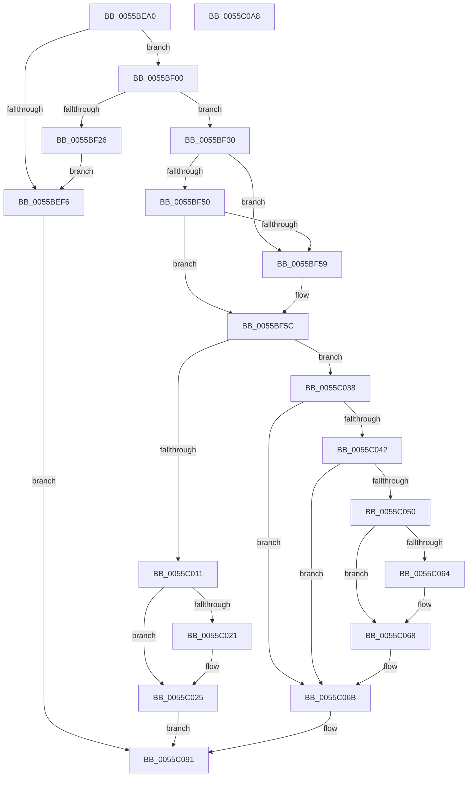

# EmonAddProfileSource

- RVA: `0x0055BEA0`–`0x0055C0A9` (길이 `521` bytes)
- VA: `0x000000014055BEA0`
- 실행 섹션: `.text`
- PDB 이름 있음: `예`; PDB Function 태그: `아니요`
- unwind 정보 RVA: `0x00083688`
- 디코드: `143`개 명령, `521/521` bytes 표시
- 미해석 바이트: `0` (있으면 어셈블리에 `.byte`로 보존)

> 이 문서는 커널 이미지의 기계어와 PDB 기호를 분석해 생성했습니다. 4번과 5번은 함수 원형과 자료형을 바이너리 사용 방식에서 추정한 C 해석이며 원본 소스 복구 결과는 아닙니다.

## 1. Dependencies

- 직접 호출 지점: **15**; 고유 호출 대상: **10**
- 직접 호출자로 확인된 함수: **0**
- RIP 상대 이미지 참조: **2**

### Outgoing calls
- `0x0055BED7` → [wcsnlen](../50/wcsnlen_function_00501D60.md) (function, `0x00501D60`)
- `0x0055BEE9` → [HalpMmAllocCtxAlloc](../3E/HalpMmAllocCtxAlloc_function_003E10B8.md) (function, `0x003E10B8`)
- `0x0055BF0B` → [wcsncpy_s](../50/wcsncpy_s_function_00506650.md) (function, `0x00506650`)
- `0x0055BF19` → [HalpMmAllocCtxAlloc](../3E/HalpMmAllocCtxAlloc_function_003E10B8.md) (function, `0x003E10B8`)
- `0x0055BF29` → [HalpMmAllocCtxFree](../3E/HalpMmAllocCtxFree_function_003E1904.md) (function, `0x003E1904`)
- `0x0055BF38` → [memset](../6C/memset_function_006C6C40.md) (function, `0x006C6C40`)
- `0x0055BFD1` → [memset](../6C/memset_function_006C6C40.md) (function, `0x006C6C40`)
- `0x0055BFE2` → [KiCopyAffinityEx](../2C/KiCopyAffinityEx_function_002CE860.md) (function, `0x002CE860`)
- `0x0055BFF5` → [HalpAcquireHighLevelLock](../2D/HalpAcquireHighLevelLock_function_002D2390.md) (function, `0x002D2390`)
- `0x0055C008` → [HalpInsertProfileSource](../54/HalpInsertProfileSource_function_00547468.md) (function, `0x00547468`)
- `0x0055C02F` → [HalpReleaseHighLevelLock](../2D/HalpReleaseHighLevelLock_function_002D1C58.md) (function, `0x002D1C58`)
- `0x0055C05A` → [KeOrAffinityEx2](../2C/KeOrAffinityEx2_function_002CF930.md) (function, `0x002CF930`)
- `0x0055C075` → [HalpReleaseHighLevelLock](../2D/HalpReleaseHighLevelLock_function_002D1C58.md) (function, `0x002D1C58`)
- `0x0055C081` → [HalpMmAllocCtxFree](../3E/HalpMmAllocCtxFree_function_003E1904.md) (function, `0x003E1904`)
- `0x0055C089` → [HalpMmAllocCtxFree](../3E/HalpMmAllocCtxFree_function_003E1904.md) (function, `0x003E1904`)

### Direct callers
- 이 함수 시작 RVA로 연결되는 직접 call은 확인되지 않았습니다. 간접 호출은 완전히 역산할 수 없습니다.

### Static image references
- `0x0055BFE7` → RVA `0x00FC2BD0` (`.data`; read)
- `0x0055C016` → RVA `0x00FC2C20` (`.data`; read/write)

## 2. Other-region calls and transfers

- 다른 실행 섹션으로 향하는 call: **0**
- 별도 외부 분기/꼬리 이동을 확인하지 못했습니다.

## 3. Assembly (complete function range)

```asm
0055BEA0  48 89 5C 24 10                  mov qword ptr [rsp + 0x10], rbx
0055BEA5  48 89 6C 24 18                  mov qword ptr [rsp + 0x18], rbp
0055BEAA  56                              push rsi
0055BEAB  57                              push rdi
0055BEAC  41 54                           push r12
0055BEAE  41 56                           push r14
0055BEB0  41 57                           push r15
0055BEB2  48 83 EC 20                     sub rsp, 0x20
0055BEB6  48 83 64 24 50 00               and qword ptr [rsp + 0x50], 0
0055BEBC  4C 8D B9 18 01 00 00            lea r15, [rcx + 0x118]
0055BEC3  48 8B F2                        mov rsi, rdx
0055BEC6  48 8B E9                        mov rbp, rcx
0055BEC9  49 8B CF                        mov rcx, r15
0055BECC  BA FE 00 00 00                  mov edx, 0xfe
0055BED1  41 BE 01 00 00 C0               mov r14d, 0xc0000001
0055BED7  E8 84 5E FA FF                  call 0x140501d60
0055BEDC  41 BC 01 00 00 00               mov r12d, 1
0055BEE2  41 8D 1C 04                     lea ebx, [r12 + rax]
0055BEE6  8D 14 1B                        lea edx, [rbx + rbx]
0055BEE9  E8 CA 51 E8 FF                  call 0x1403e10b8
0055BEEE  48 8B F8                        mov rdi, rax
0055BEF1  48 85 C0                        test rax, rax
0055BEF4  75 0A                           jne 0x14055bf00
0055BEF6  B8 17 00 00 C0                  mov eax, 0xc0000017
0055BEFB  E9 91 01 00 00                  jmp 0x14055c091
0055BF00  8B D3                           mov edx, ebx
0055BF02  4D 8B C7                        mov r8, r15
0055BF05  44 8B CB                        mov r9d, ebx
0055BF08  48 8B CF                        mov rcx, rdi
0055BF0B  E8 40 A7 FA FF                  call 0x140506650
0055BF10  41 BF 40 01 00 00               mov r15d, 0x140
0055BF16  41 8B D7                        mov edx, r15d
0055BF19  E8 9A 51 E8 FF                  call 0x1403e10b8
0055BF1E  48 8B D8                        mov rbx, rax
0055BF21  48 85 C0                        test rax, rax
0055BF24  75 0A                           jne 0x14055bf30
0055BF26  48 8B D7                        mov rdx, rdi
0055BF29  E8 D6 59 E8 FF                  call 0x1403e1904
0055BF2E  EB C6                           jmp 0x14055bef6
0055BF30  4D 8B C7                        mov r8, r15
0055BF33  33 D2                           xor edx, edx
0055BF35  48 8B CB                        mov rcx, rbx
0055BF38  E8 03 AD 16 00                  call 0x1406c6c40
0055BF3D  B9 FF FF FF 7F                  mov ecx, 0x7fffffff
0055BF42  44 88 63 1C                     mov byte ptr [rbx + 0x1c], r12b
0055BF46  8B 45 08                        mov eax, dword ptr [rbp + 8]
0055BF49  89 43 18                        mov dword ptr [rbx + 0x18], eax
0055BF4C  3B C1                           cmp eax, ecx
0055BF4E  77 09                           ja 0x14055bf59
0055BF50  B9 00 10 00 00                  mov ecx, 0x1000
0055BF55  3B C1                           cmp eax, ecx
0055BF57  73 03                           jae 0x14055bf5c
0055BF59  89 4B 18                        mov dword ptr [rbx + 0x18], ecx
0055BF5C  C6 43 1D 00                     mov byte ptr [rbx + 0x1d], 0
0055BF60  4C 8D 7B 20                     lea r15, [rbx + 0x20]
0055BF64  0F B6 4D 02                     movzx ecx, byte ptr [rbp + 2]
0055BF68  33 D2                           xor edx, edx
0055BF6A  0F B6 45 03                     movzx eax, byte ptr [rbp + 3]
0055BF6E  83 E1 0F                        and ecx, 0xf
0055BF71  03 C9                           add ecx, ecx
0055BF73  41 23 C4                        and eax, r12d
0055BF76  0B C8                           or ecx, eax
0055BF78  41 B8 00 01 00 00               mov r8d, 0x100
0055BF7E  0F B6 45 04                     movzx eax, byte ptr [rbp + 4]
0055BF82  C1 E1 02                        shl ecx, 2
0055BF85  41 23 C4                        and eax, r12d
0055BF88  0B C8                           or ecx, eax
0055BF8A  0F B6 45 05                     movzx eax, byte ptr [rbp + 5]
0055BF8E  C1 E1 03                        shl ecx, 3
0055BF91  41 23 C4                        and eax, r12d
0055BF94  0B C8                           or ecx, eax
0055BF96  41 BC 25 00 00 00               mov r12d, 0x25
0055BF9C  0F B6 45 01                     movzx eax, byte ptr [rbp + 1]
0055BFA0  C1 E1 0A                        shl ecx, 0xa
0055BFA3  0B C8                           or ecx, eax
0055BFA5  0F B6 45 00                     movzx eax, byte ptr [rbp]
0055BFA9  81 C9 00 03 00 00               or ecx, 0x300
0055BFAF  44 89 A3 38 01 00 00            mov dword ptr [rbx + 0x138], r12d
0055BFB6  C1 E1 08                        shl ecx, 8
0055BFB9  0B C8                           or ecx, eax
0055BFBB  89 8B 30 01 00 00               mov dword ptr [rbx + 0x130], ecx
0055BFC1  49 8D 4F 08                     lea rcx, [r15 + 8]
0055BFC5  41 83 67 04 00                  and dword ptr [r15 + 4], 0
0055BFCA  41 C7 07 01 00 20 00            mov dword ptr [r15], 0x200001
0055BFD1  E8 6A AC 16 00                  call 0x1406c6c40
0055BFD6  41 0F B7 57 02                  movzx edx, word ptr [r15 + 2]
0055BFDB  4C 8D 45 10                     lea r8, [rbp + 0x10]
0055BFDF  49 8B CF                        mov rcx, r15
0055BFE2  E8 79 28 D7 FF                  call 0x1402ce860
0055BFE7  48 8D 0D E2 6B A6 00            lea rcx, [rip + 0xa66be2]
0055BFEE  48 89 BB 28 01 00 00            mov qword ptr [rbx + 0x128], rdi
0055BFF5  E8 96 63 D7 FF                  call 0x1402d2390
0055BFFA  4C 8D 4C 24 50                  lea r9, [rsp + 0x50]
0055BFFF  45 8B C4                        mov r8d, r12d
0055C002  48 8B CB                        mov rcx, rbx
0055C005  40 8A E8                        mov bpl, al
0055C008  E8 5B B4 FE FF                  call 0x140547468
0055C00D  84 C0                           test al, al
0055C00F  74 27                           je 0x14055c038
0055C011  41 8D 44 24 DC                  lea eax, [r12 - 0x24]
0055C016  01 05 04 6C A6 00               add dword ptr [rip + 0xa66c04], eax
0055C01C  48 85 F6                        test rsi, rsi
0055C01F  74 04                           je 0x14055c025
0055C021  8B 03                           mov eax, dword ptr [rbx]
0055C023  89 06                           mov dword ptr [rsi], eax
0055C025  40 8A D5                        mov dl, bpl
0055C028  48 8D 0D A1 6B A6 00            lea rcx, [rip + 0xa66ba1]
0055C02F  E8 24 5C D7 FF                  call 0x1402d1c58
0055C034  33 C0                           xor eax, eax
0055C036  EB 59                           jmp 0x14055c091
0055C038  48 8B 7C 24 50                  mov rdi, qword ptr [rsp + 0x50]
0055C03D  48 85 FF                        test rdi, rdi
0055C040  74 29                           je 0x14055c06b
0055C042  8B 83 30 01 00 00               mov eax, dword ptr [rbx + 0x130]
0055C048  39 87 30 01 00 00               cmp dword ptr [rdi + 0x130], eax
0055C04E  75 1B                           jne 0x14055c06b
0055C050  48 8D 4F 20                     lea rcx, [rdi + 0x20]
0055C054  49 8B D7                        mov rdx, r15
0055C057  4C 8B C1                        mov r8, rcx
0055C05A  E8 D1 38 D7 FF                  call 0x1402cf930
0055C05F  48 85 F6                        test rsi, rsi
0055C062  74 04                           je 0x14055c068
0055C064  8B 07                           mov eax, dword ptr [rdi]
0055C066  89 06                           mov dword ptr [rsi], eax
0055C068  45 33 F6                        xor r14d, r14d
0055C06B  40 8A D5                        mov dl, bpl
0055C06E  48 8D 0D 5B 6B A6 00            lea rcx, [rip + 0xa66b5b]
0055C075  E8 DE 5B D7 FF                  call 0x1402d1c58
0055C07A  48 8B 93 28 01 00 00            mov rdx, qword ptr [rbx + 0x128]
0055C081  E8 7E 58 E8 FF                  call 0x1403e1904
0055C086  48 8B D3                        mov rdx, rbx
0055C089  E8 76 58 E8 FF                  call 0x1403e1904
0055C08E  41 8B C6                        mov eax, r14d
0055C091  48 8B 5C 24 58                  mov rbx, qword ptr [rsp + 0x58]
0055C096  48 8B 6C 24 60                  mov rbp, qword ptr [rsp + 0x60]
0055C09B  48 83 C4 20                     add rsp, 0x20
0055C09F  41 5F                           pop r15
0055C0A1  41 5E                           pop r14
0055C0A3  41 5C                           pop r12
0055C0A5  5F                              pop rdi
0055C0A6  5E                              pop rsi
0055C0A7  C3                              ret
0055C0A8  CC                              int3
```

## 4. C-style interpretation (structured pseudocode)

```c
__int64 __fastcall EmonAddProfileSource(__int64 a1, __int64 a2)
{
    __int64 result;
    __int64 v_r14;
    __int64 v_rsp;
    unsigned __int64 v_stack_p10;
    unsigned __int64 v_stack_p18;
    unsigned __int64 v_stack_p8;

    v_stack_p10 = v_rbx;
    v_stack_p18 = v_rbp;
    v_rsp = (v_rsp) - (32);
    result = wcsnlen(a1 + 280, 254, a3, a4);
    result = HalpMmAllocCtxAlloc(a1 + 280, 1 + result * 1 + 1 + result * 1 * 1, a3, a4);
    if (result != 0) goto loc_0055BF00;
loc_0055BEF6:
    goto loc_0055C091;
loc_0055BF00:
    result = wcsncpy_s(result, (unsigned int)((unsigned int)(1 + result * 1)), a1 + 280, (unsigned int)((unsigned int)(1 + result * 1)));
    result = HalpMmAllocCtxAlloc(result, 320, a1 + 280, (unsigned int)((unsigned int)(1 + result * 1)));
    if (result != 0) goto loc_0055BF30;
    result = HalpMmAllocCtxFree(result, result, a1 + 280, (unsigned int)((unsigned int)(1 + result * 1)));
    goto loc_0055BEF6;
loc_0055BF30:
    a2 = 0;
    result = memset(result, a2, 320, (unsigned int)((unsigned int)(1 + result * 1)));
    *(unsigned __int8 *)(result + 28) = 1;
    *(unsigned int *)(result + 24) = (unsigned int)((unsigned int)(*(unsigned int *)(a1 + 8)));
    if (((unsigned int)((unsigned int)(*(unsigned int *)(a1 + 8)))) > ((unsigned int)((unsigned int)(0x7FFFFFFFULL)))) goto loc_0055BF59;
    if (((unsigned int)((unsigned int)(*(unsigned int *)(a1 + 8)))) < ((unsigned int)((unsigned int)(0x1000ULL)))) {
        *(unsigned int *)(result + 24) = (unsigned int)((unsigned int)(0x1000ULL));
    }
    *(unsigned __int8 *)(result + 29) = 0;
    a2 = 0;
    a1 = (unsigned int)((*(unsigned __int8 *)(a1 + 2)) & (15));
    a1 = (unsigned int)((a1) + ((unsigned int)(a1)));
    result = (unsigned int)((*(unsigned __int8 *)(a1 + 3)) & (1));
    a1 = (unsigned int)((a1) | ((unsigned int)(result)));
    a1 = (unsigned int)((a1) << (2));
    result = (unsigned int)((*(unsigned __int8 *)(a1 + 4)) & (1));
    a1 = (unsigned int)((a1) | ((unsigned int)(result)));
    a1 = (unsigned int)((a1) << (3));
    result = (unsigned int)((*(unsigned __int8 *)(a1 + 5)) & (1));
    a1 = (unsigned int)((a1) | ((unsigned int)(result)));
    a1 = (unsigned int)((a1) << (10));
    a1 = (unsigned int)((a1) | ((unsigned int)(*(unsigned __int8 *)(a1 + 1))));
    a1 = (unsigned int)((a1) | (768));
    *(unsigned int *)(result + 312) = 37;
    a1 = (unsigned int)((a1) << (8));
    a1 = (unsigned int)((a1) | ((unsigned int)(*(unsigned __int8 *)(a1))));
    *(unsigned int *)(result + 304) = (unsigned int)(a1);
    *(unsigned int *)(result + 32) = 0x200001ULL;
    result = memset(result + 32 + 8, a2, 256, (unsigned int)((unsigned int)(1 + result * 1)));
    result = KiCopyAffinityEx(result + 32, *(unsigned __int16 *)(result + 32 + 2), a1 + 16, (unsigned int)((unsigned int)(1 + result * 1)));
    *(unsigned __int64 *)(result + 296) = result;
    result = HalpAcquireHighLevelLock(v_rip + 10906594, *(unsigned __int16 *)(result + 32 + 2), a1 + 16, (unsigned int)((unsigned int)(1 + result * 1)));
    result = HalpInsertProfileSource(result, *(unsigned __int16 *)(result + 32 + 2), 37, v_stack_p8);
    if ((unsigned __int8)(result) == 0) goto loc_0055C038;
    result = 37 - 36;
    if (0 != 0) {
        result = *(unsigned int *)(result);
        *(unsigned int *)(a2) = (unsigned int)(result);
    }
    result = HalpReleaseHighLevelLock(v_rip + 10906529, (unsigned __int8)((unsigned __int8)(result)), 37, v_stack_p8);
    result = 0;
    goto loc_0055C091;
loc_0055C038:
    if (v_stack_p8 == 0) goto loc_0055C06B;
    if ((*(unsigned int *)(v_stack_p8 + 304)) != ((unsigned int)((unsigned int)(*(unsigned int *)(result + 304))))) goto loc_0055C06B;
    result = KeOrAffinityEx2(v_stack_p8 + 32, result + 32, v_stack_p8 + 32, v_stack_p8);
    if (0 != 0) {
        result = *(unsigned int *)(v_stack_p8);
        *(unsigned int *)(a2) = (unsigned int)(result);
    }
    v_r14 = 0;
loc_0055C06B:
    result = HalpReleaseHighLevelLock(v_rip + 10906459, (unsigned __int8)((unsigned __int8)(result)), v_stack_p8 + 32, v_stack_p8);
    result = HalpMmAllocCtxFree(v_rip + 10906459, *(unsigned __int64 *)(result + 296), v_stack_p8 + 32, v_stack_p8);
    result = HalpMmAllocCtxFree(v_rip + 10906459, result, v_stack_p8 + 32, v_stack_p8);
loc_0055C091:
    v_rsp = (v_rsp) + (32);
    return 0;
}
```

## 5. (Beta) C Style

```c
int64_t EmonAddProfileSource(void *Arg1, int64_t Arg2)
{
    uint8_t *arg1 = (uint8_t *)Arg1;

    int64_t result;
    int64_t local_r14;
    int64_t local_rsp;
    uint64_t v_stack_p10;
    uint64_t v_stack_p18;
    uint64_t v_stack_p8;

    v_stack_p10 = local_rbx;
    v_stack_p18 = local_rbp;
    local_rsp = (local_rsp) - (32);
    result = wcsnlen(Arg1 + 280, 254, a3, a4);
    result = HalpMmAllocCtxAlloc(Arg1 + 280, 1 + result * 1 + 1 + result * 1 * 1, a3, a4);
    if (result != 0) goto loc_0055BF00;
loc_0055BEF6:
    goto loc_0055C091;
loc_0055BF00:
    result = wcsncpy_s(result, (uint32_t)((uint32_t)(1 + result * 1)), Arg1 + 280, (uint32_t)((uint32_t)(1 + result * 1)));
    result = HalpMmAllocCtxAlloc(result, 320, Arg1 + 280, (uint32_t)((uint32_t)(1 + result * 1)));
    if (result != 0) goto loc_0055BF30;
    result = HalpMmAllocCtxFree(result, result, Arg1 + 280, (uint32_t)((uint32_t)(1 + result * 1)));
    goto loc_0055BEF6;
loc_0055BF30:
    Arg2 = 0;
    result = memset(result, Arg2, 320, (uint32_t)((uint32_t)(1 + result * 1)));
    *(uint8_t *)(result + 0x1C) = 1;
    *(uint32_t *)(result + 0x18) = (uint32_t)((uint32_t)(*(uint32_t *)(arg1 + 0x8)));
    if (((uint32_t)((uint32_t)(*(uint32_t *)(arg1 + 0x8)))) > ((uint32_t)((uint32_t)(0x7FFFFFFFULL)))) goto loc_0055BF59;
    if (((uint32_t)((uint32_t)(*(uint32_t *)(arg1 + 0x8)))) < ((uint32_t)((uint32_t)(0x1000ULL)))) {
        *(uint32_t *)(result + 0x18) = (uint32_t)((uint32_t)(0x1000ULL));
    }
    *(uint8_t *)(result + 0x1D) = 0;
    Arg2 = 0;
    Arg1 = (uint32_t)((*(uint8_t *)(arg1 + 0x2)) & (15));
    Arg1 = (uint32_t)((Arg1) + ((uint32_t)(Arg1)));
    result = (uint32_t)((*(uint8_t *)(arg1 + 0x3)) & (1));
    Arg1 = (uint32_t)((Arg1) | ((uint32_t)(result)));
    Arg1 = (uint32_t)((Arg1) << (2));
    result = (uint32_t)((*(uint8_t *)(arg1 + 0x4)) & (1));
    Arg1 = (uint32_t)((Arg1) | ((uint32_t)(result)));
    Arg1 = (uint32_t)((Arg1) << (3));
    result = (uint32_t)((*(uint8_t *)(arg1 + 0x5)) & (1));
    Arg1 = (uint32_t)((Arg1) | ((uint32_t)(result)));
    Arg1 = (uint32_t)((Arg1) << (10));
    Arg1 = (uint32_t)((Arg1) | ((uint32_t)(*(uint8_t *)(arg1 + 0x1))));
    Arg1 = (uint32_t)((Arg1) | (768));
    *(uint32_t *)(result + 0x138) = 37;
    Arg1 = (uint32_t)((Arg1) << (8));
    Arg1 = (uint32_t)((Arg1) | ((uint32_t)(*(uint8_t *)(arg1))));
    *(uint32_t *)(result + 0x130) = (uint32_t)(Arg1);
    *(uint32_t *)(result + 0x20) = 0x200001ULL;
    result = memset(result + 32 + 8, Arg2, 256, (uint32_t)((uint32_t)(1 + result * 1)));
    result = KiCopyAffinityEx(result + 32, *(uint16_t *)(result + 0x20 + 0x2), Arg1 + 16, (uint32_t)((uint32_t)(1 + result * 1)));
    *(uint64_t *)(result + 0x128) = result;
    result = HalpAcquireHighLevelLock(v_rip + 10906594, *(uint16_t *)(result + 0x20 + 0x2), Arg1 + 16, (uint32_t)((uint32_t)(1 + result * 1)));
    result = HalpInsertProfileSource(result, *(uint16_t *)(result + 0x20 + 0x2), 37, v_stack_p8);
    if ((uint8_t)(result) == 0) goto loc_0055C038;
    result = 37 - 36;
    if (0 != 0) {
        result = *(uint32_t *)(result);
        *(uint32_t *)(Arg2) = (uint32_t)(result);
    }
    result = HalpReleaseHighLevelLock(v_rip + 10906529, (uint8_t)((uint8_t)(result)), 37, v_stack_p8);
    result = 0;
    goto loc_0055C091;
loc_0055C038:
    if (v_stack_p8 == 0) goto loc_0055C06B;
    if ((*(uint32_t *)(v_stack_p8 + 0x130)) != ((uint32_t)((uint32_t)(*(uint32_t *)(result + 0x130))))) goto loc_0055C06B;
    result = KeOrAffinityEx2(v_stack_p8 + 32, result + 32, v_stack_p8 + 32, v_stack_p8);
    if (0 != 0) {
        result = *(uint32_t *)(v_stack_p8);
        *(uint32_t *)(Arg2) = (uint32_t)(result);
    }
    local_r14 = 0;
loc_0055C06B:
    result = HalpReleaseHighLevelLock(v_rip + 10906459, (uint8_t)((uint8_t)(result)), v_stack_p8 + 32, v_stack_p8);
    result = HalpMmAllocCtxFree(v_rip + 10906459, *(uint64_t *)(result + 0x128), v_stack_p8 + 32, v_stack_p8);
    result = HalpMmAllocCtxFree(v_rip + 10906459, result, v_stack_p8 + 32, v_stack_p8);
loc_0055C091:
    local_rsp = (local_rsp) + (32);
    return 0;
}
```

### 관측된 메모리 오프셋

구조체 형식이 확인되지 않은 접근은 인자 기준의 오프셋으로만 기록했습니다.

| 기준 인자 | 오프셋 표현 | 폭 (bit) | 접근 |
|---|---:|---:|---|
| `Arg1` | `+ 0x0` | `8` | `R` |
| `Arg1` | `+ 0x1` | `8` | `R` |
| `Arg1` | `+ 0x2` | `8` | `R` |
| `Arg1` | `+ 0x3` | `8` | `R` |
| `Arg1` | `+ 0x4` | `8` | `R` |
| `Arg1` | `+ 0x5` | `8` | `R` |
| `Arg1` | `+ 0x8` | `32` | `R` |
| `Arg1` | `+ 0x10` | `64` | `R` |
| `Arg1` | `+ 0x118` | `64` | `R` |

## 6. Execution-region graph

[열기: 2D/3D 그래프와 함수 탐색 컨트롤 패널](../../../control-panel.html?section=text&rva=0x0055BEA0&view=graph)

- 2D 그래프는 위에서 아래로 흐르고, 3D 그래프는 빈 공간을 드래그해 회전합니다. Shift+드래그는 이동, 휠은 확대·축소, 함수 노드 선택은 대상 보고서 이동입니다.

### Static fallback


