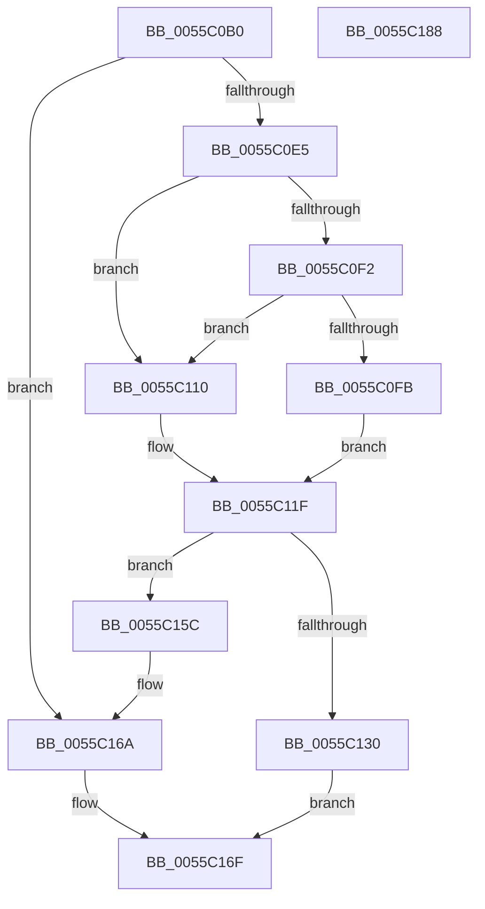

# EmonAllocateCounterEnhanced

- RVA: `0x0055C0B0`–`0x0055C189` (길이 `217` bytes)
- VA: `0x000000014055C0B0`
- 실행 섹션: `.text`
- PDB 이름 있음: `예`; PDB Function 태그: `아니요`
- unwind 정보 RVA: `0x00093E28`
- 디코드: `59`개 명령, `217/217` bytes 표시
- 미해석 바이트: `0` (있으면 어셈블리에 `.byte`로 보존)

> 이 문서는 커널 이미지의 기계어와 PDB 기호를 분석해 생성했습니다. 4번과 5번은 함수 원형과 자료형을 바이너리 사용 방식에서 추정한 C 해석이며 원본 소스 복구 결과는 아닙니다.

## 1. Dependencies

- 직접 호출 지점: **3**; 고유 호출 대상: **3**
- 직접 호출자로 확인된 함수: **1**
- RIP 상대 이미지 참조: **1**

### Outgoing calls
- `0x0055C0D8` → [HalpAllocateHalCounters](../53/HalpAllocateHalCounters_function_0053FF88.md) (function, `0x0053FF88`)
- `0x0055C127` → [EmonFindCounterToAllocateEnhanced](EmonFindCounterToAllocateEnhanced_function_0055CBA0.md) (function, `0x0055CBA0`)
- `0x0055C144` → [EmonAllocateCounterInternal](EmonAllocateCounterInternal_function_0055C190.md) (function, `0x0055C190`)

### Direct callers
- [EmonEnableMonitoringEnhanced](EmonEnableMonitoringEnhanced_function_0055C8E0.md) at `0x0055C9A2`

### Static image references
- `0x0055C0FB` → RVA `0x00FC8C40` (`ALMOSTRO`; read)

## 2. Other-region calls and transfers

- 다른 실행 섹션으로 향하는 call: **0**
- 별도 외부 분기/꼬리 이동을 확인하지 못했습니다.

## 3. Assembly (complete function range)

```asm
0055C0B0  48 8B C4                        mov rax, rsp
0055C0B3  48 89 58 08                     mov qword ptr [rax + 8], rbx
0055C0B7  48 89 68 10                     mov qword ptr [rax + 0x10], rbp
0055C0BB  48 89 70 18                     mov qword ptr [rax + 0x18], rsi
0055C0BF  57                              push rdi
0055C0C0  41 56                           push r14
0055C0C2  41 57                           push r15
0055C0C4  48 83 EC 40                     sub rsp, 0x40
0055C0C8  83 60 D8 00                     and dword ptr [rax - 0x28], 0
0055C0CC  4D 8B F1                        mov r14, r9
0055C0CF  41 8B E8                        mov ebp, r8d
0055C0D2  48 8B FA                        mov rdi, rdx
0055C0D5  44 8B F9                        mov r15d, ecx
0055C0D8  E8 AB 3E FE FF                  call 0x14053ff88
0055C0DD  85 C0                           test eax, eax
0055C0DF  0F 88 85 00 00 00               js 0x14055c16a
0055C0E5  65 8B 04 25 A4 01 00 00         mov eax, dword ptr gs:[0x1a4]
0055C0ED  48 85 D2                        test rdx, rdx
0055C0F0  74 1E                           je 0x14055c110
0055C0F2  80 BA 3C 01 00 00 00            cmp byte ptr [rdx + 0x13c], 0
0055C0F9  74 15                           je 0x14055c110
0055C0FB  48 8D 0D 3E CB A6 00            lea rcx, [rip + 0xa6cb3e]
0055C102  48 8B 04 C1                     mov rax, qword ptr [rcx + rax*8]
0055C106  48 8B 70 58                     mov rsi, qword ptr [rax + 0x58]
0055C10A  48 83 C6 18                     add rsi, 0x18
0055C10E  EB 0F                           jmp 0x14055c11f
0055C110  48 8D 0D 29 CB A6 00            lea rcx, [rip + 0xa6cb29]
0055C117  48 8B 04 C1                     mov rax, qword ptr [rcx + rax*8]
0055C11B  48 8B 70 58                     mov rsi, qword ptr [rax + 0x58]
0055C11F  4C 8D 44 24 30                  lea r8, [rsp + 0x30]
0055C124  48 8B CE                        mov rcx, rsi
0055C127  E8 74 0A 00 00                  call 0x14055cba0
0055C12C  84 C0                           test al, al
0055C12E  74 2C                           je 0x14055c15c
0055C130  8B 5C 24 30                     mov ebx, dword ptr [rsp + 0x30]
0055C134  44 8B CD                        mov r9d, ebp
0055C137  4C 8B C7                        mov r8, rdi
0055C13A  89 5C 24 20                     mov dword ptr [rsp + 0x20], ebx
0055C13E  41 8B D7                        mov edx, r15d
0055C141  48 8B CE                        mov rcx, rsi
0055C144  E8 47 00 00 00                  call 0x14055c190
0055C149  48 8B 84 24 80 00 00 00         mov rax, qword ptr [rsp + 0x80]
0055C151  8B 0E                           mov ecx, dword ptr [rsi]
0055C153  41 89 1E                        mov dword ptr [r14], ebx
0055C156  89 08                           mov dword ptr [rax], ecx
0055C158  33 C0                           xor eax, eax
0055C15A  EB 13                           jmp 0x14055c16f
0055C15C  65 48 8B 04 25 20 00 00 00      mov rax, qword ptr gs:[0x20]
0055C165  F0 83 40 60 FE                  lock add dword ptr [rax + 0x60], -2
0055C16A  B8 11 00 00 80                  mov eax, 0x80000011
0055C16F  48 8B 5C 24 60                  mov rbx, qword ptr [rsp + 0x60]
0055C174  48 8B 6C 24 68                  mov rbp, qword ptr [rsp + 0x68]
0055C179  48 8B 74 24 70                  mov rsi, qword ptr [rsp + 0x70]
0055C17E  48 83 C4 40                     add rsp, 0x40
0055C182  41 5F                           pop r15
0055C184  41 5E                           pop r14
0055C186  5F                              pop rdi
0055C187  C3                              ret
0055C188  CC                              int3
```

## 4. C-style interpretation (structured pseudocode)

```c
__int64 __fastcall EmonAllocateCounterEnhanced(int a1, __int64 a2, int a3, __int64 a4, __int64 a5)
{
    __int64 result;
    __int64 v_rsi;
    __int64 v_rsp;
    unsigned __int64 v_stack_m28;
    unsigned int v_stack_m38;
    unsigned __int64 v_stack_p10;
    unsigned __int64 v_stack_p18;
    unsigned __int64 v_stack_p8;

    *(unsigned __int64 *)(v_rsp + 8) = v_rbx;
    *(unsigned __int64 *)(v_rsp + 16) = v_rbp;
    *(unsigned __int64 *)(v_rsp + 24) = v_rsi;
    v_rsp = (v_rsp) - (64);
    result = HalpAllocateHalCounters(a1, a2, a3, a4);
    if (sign_flag) goto loc_0055C16A;
    if (a2 == 0) goto loc_0055C110;
    if ((*(unsigned __int8 *)(a2 + 316)) == 0) goto loc_0055C110;
    v_rsi = (*(unsigned __int64 *)(*(unsigned __int64 *)(v_rip + 10931006 + (unsigned int)(*(unsigned int *)(gs_base + (0 + 420))) * 8) + 88)) + (24);
    goto loc_0055C11F;
loc_0055C110:
loc_0055C11F:
    result = EmonFindCounterToAllocateEnhanced(*(unsigned __int64 *)(*(unsigned __int64 *)(v_rip + 10930985 + *(unsigned __int64 *)(v_rip + 10931006 + (unsigned int)(*(unsigned int *)(gs_base + (0 + 420))) * 8) * 8) + 88), a2, v_stack_m28, a4);
    if ((unsigned __int8)(result) == 0) goto loc_0055C15C;
    v_stack_m38 = (unsigned int)((unsigned int)(v_stack_m28));
    result = EmonAllocateCounterInternal(*(unsigned __int64 *)(*(unsigned __int64 *)(v_rip + 10930985 + *(unsigned __int64 *)(v_rip + 10931006 + (unsigned int)(*(unsigned int *)(gs_base + (0 + 420))) * 8) * 8) + 88), (unsigned int)((unsigned int)((unsigned int)(a1))), a2, (unsigned int)((unsigned int)((unsigned int)(a3))));
    *(unsigned int *)(a4) = (unsigned int)((unsigned int)(v_stack_m28));
    *(unsigned int *)(a5) = (unsigned int)((unsigned int)(*(unsigned int *)(*(unsigned __int64 *)(*(unsigned __int64 *)(v_rip + 10930985 + *(unsigned __int64 *)(v_rip + 10931006 + (unsigned int)(*(unsigned int *)(gs_base + (0 + 420))) * 8) * 8) + 88))));
    result = 0;
    goto loc_0055C16F;
loc_0055C15C:
loc_0055C16A:
loc_0055C16F:
    v_rsp = (v_rsp) + (64);
    return (unsigned int)(0x80000011ULL);
}
```

## 5. (Beta) C Style

```c
int64_t EmonAllocateCounterEnhanced(int32_t Arg1, int64_t Arg2, int32_t Arg3, void *Arg4, void *Arg5)
{
    uint8_t *arg4 = (uint8_t *)Arg4;
    uint8_t *arg5 = (uint8_t *)Arg5;

    int64_t result;
    int64_t local_rsi;
    int64_t local_rsp;
    uint64_t v_stack_m28;
    uint32_t v_stack_m38;
    uint64_t v_stack_p10;
    uint64_t v_stack_p18;
    uint64_t v_stack_p8;

    *(uint64_t *)(local_rsp + 0x8) = local_rbx;
    *(uint64_t *)(local_rsp + 0x10) = local_rbp;
    *(uint64_t *)(local_rsp + 0x18) = local_rsi;
    local_rsp = (local_rsp) - (64);
    result = HalpAllocateHalCounters(Arg1, Arg2, Arg3, Arg4);
    if (sign_flag) goto loc_0055C16A;
    if (Arg2 == 0) goto loc_0055C110;
    if ((*(uint8_t *)(Arg2 + 0x13C)) == 0) goto loc_0055C110;
    local_rsi = (*(uint64_t *)(*(uint64_t *)(v_rip + 0xA6CB3E + (uint32_t)(*(uint32_t *)(gs_base + (0 + 0x1A4))) * 8) + 0x58)) + (24);
    goto loc_0055C11F;
loc_0055C110:
loc_0055C11F:
    result = EmonFindCounterToAllocateEnhanced(*(uint64_t *)(*(uint64_t *)(v_rip + 0xA6CB29 + *(uint64_t *)(v_rip + 0xA6CB3E + (uint32_t)(*(uint32_t *)(gs_base + (0 + 0x1A4))) * 8) * 8) + 0x58), Arg2, v_stack_m28, Arg4);
    if ((uint8_t)(result) == 0) goto loc_0055C15C;
    v_stack_m38 = (uint32_t)((uint32_t)(v_stack_m28));
    result = EmonAllocateCounterInternal(*(uint64_t *)(*(uint64_t *)(v_rip + 0xA6CB29 + *(uint64_t *)(v_rip + 0xA6CB3E + (uint32_t)(*(uint32_t *)(gs_base + (0 + 0x1A4))) * 8) * 8) + 0x58), (uint32_t)((uint32_t)((uint32_t)(Arg1))), Arg2, (uint32_t)((uint32_t)((uint32_t)(Arg3))));
    *(uint32_t *)(arg4) = (uint32_t)((uint32_t)(v_stack_m28));
    *(uint32_t *)(arg5) = (uint32_t)((uint32_t)(*(uint32_t *)(*(uint64_t *)(*(uint64_t *)(v_rip + 0xA6CB29 + *(uint64_t *)(v_rip + 0xA6CB3E + (uint32_t)(*(uint32_t *)(gs_base + (0 + 0x1A4))) * 8) * 8) + 0x58))));
    result = 0;
    goto loc_0055C16F;
loc_0055C15C:
loc_0055C16A:
loc_0055C16F:
    local_rsp = (local_rsp) + (64);
    return (uint32_t)(0x80000011ULL);
}
```

### 관측된 메모리 오프셋

구조체 형식이 확인되지 않은 접근은 인자 기준의 오프셋으로만 기록했습니다.

| 기준 인자 | 오프셋 표현 | 폭 (bit) | 접근 |
|---|---:|---:|---|
| `Arg4` | `+ 0x0` | `32` | `W` |
| `Arg5` | `+ 0x0` | `32` | `W` |

## 6. Execution-region graph

[열기: 2D/3D 그래프와 함수 탐색 컨트롤 패널](../../../control-panel.html?section=text&rva=0x0055C0B0&view=graph)

- 2D 그래프는 위에서 아래로 흐르고, 3D 그래프는 빈 공간을 드래그해 회전합니다. Shift+드래그는 이동, 휠은 확대·축소, 함수 노드 선택은 대상 보고서 이동입니다.

### Static fallback


