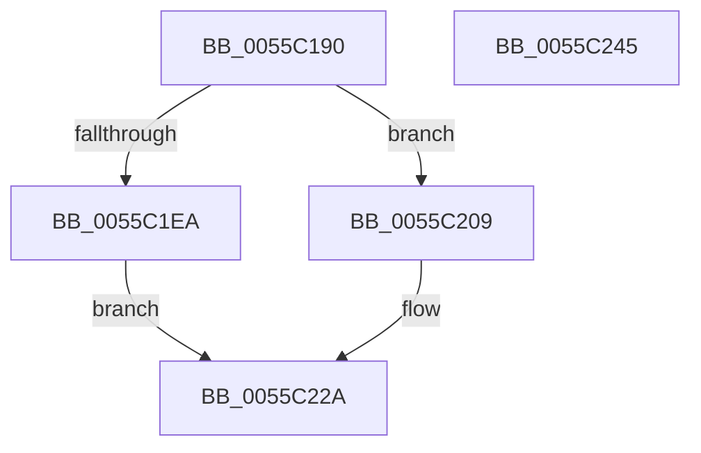

# EmonAllocateCounterInternal

- RVA: `0x0055C190`–`0x0055C246` (길이 `182` bytes)
- VA: `0x000000014055C190`
- 실행 섹션: `.text`
- PDB 이름 있음: `예`; PDB Function 태그: `아니요`
- unwind 정보 RVA: `0x0005E6B4`
- 디코드: `48`개 명령, `182/182` bytes 표시
- 미해석 바이트: `0` (있으면 어셈블리에 `.byte`로 보존)

> 이 문서는 커널 이미지의 기계어와 PDB 기호를 분석해 생성했습니다. 4번과 5번은 함수 원형과 자료형을 바이너리 사용 방식에서 추정한 C 해석이며 원본 소스 복구 결과는 아닙니다.

## 1. Dependencies

- 직접 호출 지점: **1**; 고유 호출 대상: **1**
- 직접 호출자로 확인된 함수: **2**
- RIP 상대 이미지 참조: **0**

### Outgoing calls
- `0x0055C1D3` → [KeQueryPerformanceCounter](../37/KeQueryPerformanceCounter_function_0037E7E0.md) (function, `0x0037E7E0`)

### Direct callers
- [EmonAllocateCounterEnhanced](EmonAllocateCounterEnhanced_function_0055C0B0.md) at `0x0055C144`
- [EmonAllocateCounterOriginal](EmonAllocateCounterOriginal_function_0055C24C.md) at `0x0055C2E0`

### Static image references
- 디코드된 RIP-relative 메모리 참조가 없습니다.

## 2. Other-region calls and transfers

- 다른 실행 섹션으로 향하는 call: **0**
- 별도 외부 분기/꼬리 이동을 확인하지 못했습니다.

## 3. Assembly (complete function range)

```asm
0055C190  48 8B C4                        mov rax, rsp
0055C193  48 89 58 08                     mov qword ptr [rax + 8], rbx
0055C197  48 89 68 10                     mov qword ptr [rax + 0x10], rbp
0055C19B  48 89 70 18                     mov qword ptr [rax + 0x18], rsi
0055C19F  48 89 78 20                     mov qword ptr [rax + 0x20], rdi
0055C1A3  41 56                           push r14
0055C1A5  48 83 EC 20                     sub rsp, 0x20
0055C1A9  48 63 44 24 50                  movsxd rax, dword ptr [rsp + 0x50]
0055C1AE  48 8B F1                        mov rsi, rcx
0055C1B1  45 8B F1                        mov r14d, r9d
0055C1B4  49 8B E8                        mov rbp, r8
0055C1B7  8B DA                           mov ebx, edx
0055C1B9  48 8D 3C 40                     lea rdi, [rax + rax*2]
0055C1BD  48 8B 41 10                     mov rax, qword ptr [rcx + 0x10]
0055C1C1  48 03 FF                        add rdi, rdi
0055C1C4  89 54 F8 18                     mov dword ptr [rax + rdi*8 + 0x18], edx
0055C1C8  48 8B 41 10                     mov rax, qword ptr [rcx + 0x10]
0055C1CC  33 C9                           xor ecx, ecx
0055C1CE  C6 44 F8 28 00                  mov byte ptr [rax + rdi*8 + 0x28], 0
0055C1D3  E8 08 26 E2 FF                  call 0x14037e7e0
0055C1D8  48 8B 4E 10                     mov rcx, qword ptr [rsi + 0x10]
0055C1DC  48 89 44 F9 08                  mov qword ptr [rcx + rdi*8 + 8], rax
0055C1E1  48 8B 46 10                     mov rax, qword ptr [rsi + 0x10]
0055C1E5  83 FB 02                        cmp ebx, 2
0055C1E8  75 1F                           jne 0x14055c209
0055C1EA  C7 44 F8 24 18 00 00 00         mov dword ptr [rax + rdi*8 + 0x24], 0x18
0055C1F2  48 8B 46 10                     mov rax, qword ptr [rsi + 0x10]
0055C1F6  48 83 24 F8 00                  and qword ptr [rax + rdi*8], 0
0055C1FB  48 8B 46 10                     mov rax, qword ptr [rsi + 0x10]
0055C1FF  48 8B 4C F8 10                  mov rcx, qword ptr [rax + rdi*8 + 0x10]
0055C204  83 21 00                        and dword ptr [rcx], 0
0055C207  EB 21                           jmp 0x14055c22a
0055C209  44 89 74 F8 24                  mov dword ptr [rax + rdi*8 + 0x24], r14d
0055C20E  48 8B 46 10                     mov rax, qword ptr [rsi + 0x10]
0055C212  8B 4D 18                        mov ecx, dword ptr [rbp + 0x18]
0055C215  48 89 0C F8                     mov qword ptr [rax + rdi*8], rcx
0055C219  48 8B 46 10                     mov rax, qword ptr [rsi + 0x10]
0055C21D  48 8B 4C F8 10                  mov rcx, qword ptr [rax + rdi*8 + 0x10]
0055C222  8B 85 30 01 00 00               mov eax, dword ptr [rbp + 0x130]
0055C228  89 01                           mov dword ptr [rcx], eax
0055C22A  48 8B 5C 24 30                  mov rbx, qword ptr [rsp + 0x30]
0055C22F  48 8B 6C 24 38                  mov rbp, qword ptr [rsp + 0x38]
0055C234  48 8B 74 24 40                  mov rsi, qword ptr [rsp + 0x40]
0055C239  48 8B 7C 24 48                  mov rdi, qword ptr [rsp + 0x48]
0055C23E  48 83 C4 20                     add rsp, 0x20
0055C242  41 5E                           pop r14
0055C244  C3                              ret
0055C245  CC                              int3
```

## 4. C-style interpretation (structured pseudocode)

```c
__int64 __fastcall EmonAllocateCounterInternal(__int64 a1, int a2, __int64 a3, int a4, unsigned int a5)
{
    __int64 result;
    __int64 v_rdi;
    __int64 v_rsp;
    unsigned __int64 v_stack_p10;
    unsigned __int64 v_stack_p18;
    unsigned __int64 v_stack_p20;
    unsigned __int64 v_stack_p8;

    *(unsigned __int64 *)(v_rsp + 8) = v_rbx;
    *(unsigned __int64 *)(v_rsp + 16) = v_rbp;
    *(unsigned __int64 *)(v_rsp + 24) = v_rsi;
    *(unsigned __int64 *)(v_rsp + 32) = v_rdi;
    v_rsp = (v_rsp) - (32);
    v_rdi = ((int)(a5) + (int)(a5) * 2) + ((int)(a5) + (int)(a5) * 2);
    *(unsigned int *)(*(unsigned __int64 *)(a1 + 16) + v_rdi * 8 + 24) = a2;
    a1 = 0;
    *(unsigned __int8 *)(*(unsigned __int64 *)(a1 + 16) + v_rdi * 8 + 40) = 0;
    result = KeQueryPerformanceCounter(a1, a2, a3, a4);
    *(unsigned __int64 *)(*(unsigned __int64 *)(a1 + 16) + v_rdi * 8 + 8) = result;
    if (((unsigned int)((unsigned int)(a2))) != 2) goto loc_0055C209;
    *(unsigned int *)(*(unsigned __int64 *)(a1 + 16) + v_rdi * 8 + 36) = 24;
    goto loc_0055C22A;
loc_0055C209:
    *(unsigned int *)(*(unsigned __int64 *)(a1 + 16) + v_rdi * 8 + 36) = (unsigned int)((unsigned int)(a4));
    *(unsigned __int64 *)(*(unsigned __int64 *)(a1 + 16) + v_rdi * 8) = (unsigned int)(*(unsigned int *)(a3 + 24));
    *(unsigned int *)(*(unsigned __int64 *)(*(unsigned __int64 *)(a1 + 16) + v_rdi * 8 + 16)) = (unsigned int)((unsigned int)(*(unsigned int *)(a3 + 304)));
loc_0055C22A:
    v_rsp = (v_rsp) + (32);
    return (unsigned int)(*(unsigned int *)(a3 + 304));
}
```

## 5. (Beta) C Style

```c
int64_t EmonAllocateCounterInternal(void *Arg1, int32_t Arg2, void *Arg3, int32_t Arg4, void *Arg5)
{
    uint8_t *arg1 = (uint8_t *)Arg1;
    uint8_t *arg3 = (uint8_t *)Arg3;
    uint8_t *arg5 = (uint8_t *)Arg5;

    int64_t result;
    int64_t local_rdi;
    int64_t local_rsp;
    uint64_t v_stack_p10;
    uint64_t v_stack_p18;
    uint64_t v_stack_p20;
    uint64_t v_stack_p8;

    *(uint64_t *)(local_rsp + 0x8) = local_rbx;
    *(uint64_t *)(local_rsp + 0x10) = local_rbp;
    *(uint64_t *)(local_rsp + 0x18) = local_rsi;
    *(uint64_t *)(local_rsp + 0x20) = local_rdi;
    local_rsp = (local_rsp) - (32);
    local_rdi = ((int32_t)(Arg5) + (int32_t)(Arg5) * 2) + ((int32_t)(Arg5) + (int32_t)(Arg5) * 2);
    *(uint32_t *)(*(uint64_t *)(arg1 + 0x10) + local_rdi * 8 + 0x18) = Arg2;
    Arg1 = 0;
    *(uint8_t *)(*(uint64_t *)(arg1 + 0x10) + local_rdi * 8 + 0x28) = 0;
    result = KeQueryPerformanceCounter(Arg1, Arg2, Arg3, Arg4);
    *(uint64_t *)(*(uint64_t *)(arg1 + 0x10) + local_rdi * 8 + 0x8) = result;
    if (((uint32_t)((uint32_t)(Arg2))) != 2) goto loc_0055C209;
    *(uint32_t *)(*(uint64_t *)(arg1 + 0x10) + local_rdi * 8 + 0x24) = 24;
    goto loc_0055C22A;
loc_0055C209:
    *(uint32_t *)(*(uint64_t *)(arg1 + 0x10) + local_rdi * 8 + 0x24) = (uint32_t)((uint32_t)(Arg4));
    *(uint64_t *)(*(uint64_t *)(arg1 + 0x10) + local_rdi * 8) = (uint32_t)(*(uint32_t *)(arg3 + 0x18));
    *(uint32_t *)(*(uint64_t *)(*(uint64_t *)(arg1 + 0x10) + local_rdi * 8 + 0x10)) = (uint32_t)((uint32_t)(*(uint32_t *)(arg3 + 0x130)));
loc_0055C22A:
    local_rsp = (local_rsp) + (32);
    return (uint32_t)(*(uint32_t *)(arg3 + 0x130));
}
```

### 관측된 메모리 오프셋

구조체 형식이 확인되지 않은 접근은 인자 기준의 오프셋으로만 기록했습니다.

| 기준 인자 | 오프셋 표현 | 폭 (bit) | 접근 |
|---|---:|---:|---|
| `Arg1` | `+ 0x10` | `64` | `R` |
| `Arg3` | `+ 0x18` | `32` | `R` |
| `Arg3` | `+ 0x130` | `32` | `R` |
| `Arg5` | `+ 0x0 + rax*2` | `64` | `R` |

## 6. Execution-region graph

[열기: 2D/3D 그래프와 함수 탐색 컨트롤 패널](../../../control-panel.html?section=text&rva=0x0055C190&view=graph)

- 2D 그래프는 위에서 아래로 흐르고, 3D 그래프는 빈 공간을 드래그해 회전합니다. Shift+드래그는 이동, 휠은 확대·축소, 함수 노드 선택은 대상 보고서 이동입니다.

### Static fallback


