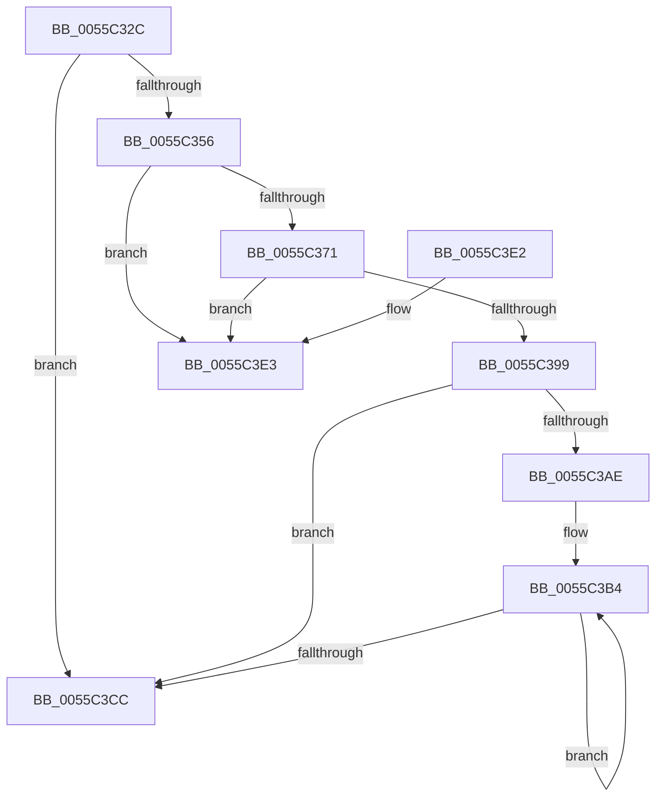

# EmonAllocateCounters

- RVA: `0x0055C32C`–`0x0055C406` (길이 `218` bytes)
- VA: `0x000000014055C32C`
- 실행 섹션: `.text`
- PDB 이름 있음: `예`; PDB Function 태그: `아니요`
- unwind 정보 RVA: `0x000C49CC`
- 디코드: `60`개 명령, `218/218` bytes 표시
- 미해석 바이트: `0` (있으면 어셈블리에 `.byte`로 보존)

> 이 문서는 커널 이미지의 기계어와 PDB 기호를 분석해 생성했습니다. 4번과 5번은 함수 원형과 자료형을 바이너리 사용 방식에서 추정한 C 해석이며 원본 소스 복구 결과는 아닙니다.

## 1. Dependencies

- 직접 호출 지점: **5**; 고유 호출 대상: **3**
- 직접 호출자로 확인된 함수: **1**
- RIP 상대 이미지 참조: **1**

### Outgoing calls
- `0x0055C364` → [HalpMmAllocateMemoryInternal](../54/HalpMmAllocateMemoryInternal_function_00544990.md) (function, `0x00544990`)
- `0x0055C379` → [memset](../6C/memset_function_006C6C40.md) (function, `0x006C6C40`)
- `0x0055C38B` → [HalpMmAllocateMemoryInternal](../54/HalpMmAllocateMemoryInternal_function_00544990.md) (function, `0x00544990`)
- `0x0055C3A1` → [memset](../6C/memset_function_006C6C40.md) (function, `0x006C6C40`)
- `0x0055C400` → [KeBugCheckEx](../4F/KeBugCheckEx_function_004FD660.md) (function, `0x004FD660`)

### Direct callers
- [EmonInitializeProfilingBSP](EmonInitializeProfilingBSP_function_0055D0D8.md) at `0x0055D18C`
- [EmonInitializeProfilingBSP](EmonInitializeProfilingBSP_function_0055D0D8.md) at `0x0055D19D`
- [EmonInitializeProfilingBSP](EmonInitializeProfilingBSP_function_0055D0D8.md) at `0x0055D1AD`
- [EmonInitializeProfilingBSP](EmonInitializeProfilingBSP_function_0055D0D8.md) at `0x0055D1BD`

### Static image references
- `0x0055C3E6` → RVA `0x00025CE8` (`.rdata`; read)

## 2. Other-region calls and transfers

- 다른 실행 섹션으로 향하는 call: **0**
- 별도 외부 분기/꼬리 이동을 확인하지 못했습니다.

## 3. Assembly (complete function range)

```asm
0055C32C  48 89 5C 24 08                  mov qword ptr [rsp + 8], rbx
0055C331  48 89 74 24 10                  mov qword ptr [rsp + 0x10], rsi
0055C336  48 89 7C 24 18                  mov qword ptr [rsp + 0x18], rdi
0055C33B  41 56                           push r14
0055C33D  48 83 EC 30                     sub rsp, 0x30
0055C341  48 83 61 10 00                  and qword ptr [rcx + 0x10], 0
0055C346  4C 8B F1                        mov r14, rcx
0055C349  41 8B D8                        mov ebx, r8d
0055C34C  89 11                           mov dword ptr [rcx], edx
0055C34E  89 59 04                        mov dword ptr [rcx + 4], ebx
0055C351  45 85 C0                        test r8d, r8d
0055C354  74 76                           je 0x14055c3cc
0055C356  8D 34 9D 00 00 00 00            lea esi, [rbx*4]
0055C35D  BA 01 00 00 00                  mov edx, 1
0055C362  8B CE                           mov ecx, esi
0055C364  E8 27 86 FE FF                  call 0x140544990
0055C369  48 8B F8                        mov rdi, rax
0055C36C  48 85 C0                        test rax, rax
0055C36F  74 72                           je 0x14055c3e3
0055C371  44 8B C6                        mov r8d, esi
0055C374  33 D2                           xor edx, edx
0055C376  48 8B C8                        mov rcx, rax
0055C379  E8 C2 A8 16 00                  call 0x1406c6c40
0055C37E  8D 34 5B                        lea esi, [rbx + rbx*2]
0055C381  BA 01 00 00 00                  mov edx, 1
0055C386  C1 E6 04                        shl esi, 4
0055C389  8B CE                           mov ecx, esi
0055C38B  E8 00 86 FE FF                  call 0x140544990
0055C390  49 89 46 10                     mov qword ptr [r14 + 0x10], rax
0055C394  48 85 C0                        test rax, rax
0055C397  74 4A                           je 0x14055c3e3
0055C399  44 8B C6                        mov r8d, esi
0055C39C  33 D2                           xor edx, edx
0055C39E  48 8B C8                        mov rcx, rax
0055C3A1  E8 9A A8 16 00                  call 0x1406c6c40
0055C3A6  49 8B 46 10                     mov rax, qword ptr [r14 + 0x10]
0055C3AA  85 DB                           test ebx, ebx
0055C3AC  74 1E                           je 0x14055c3cc
0055C3AE  48 83 C0 10                     add rax, 0x10
0055C3B2  8B CB                           mov ecx, ebx
0055C3B4  48 89 38                        mov qword ptr [rax], rdi
0055C3B7  48 83 C7 04                     add rdi, 4
0055C3BB  C7 40 0C 03 00 00 00            mov dword ptr [rax + 0xc], 3
0055C3C2  48 8D 40 30                     lea rax, [rax + 0x30]
0055C3C6  48 83 E9 01                     sub rcx, 1
0055C3CA  75 E8                           jne 0x14055c3b4
0055C3CC  48 8B 5C 24 40                  mov rbx, qword ptr [rsp + 0x40]
0055C3D1  48 8B 74 24 48                  mov rsi, qword ptr [rsp + 0x48]
0055C3D6  48 8B 7C 24 50                  mov rdi, qword ptr [rsp + 0x50]
0055C3DB  48 83 C4 30                     add rsp, 0x30
0055C3DF  41 5E                           pop r14
0055C3E1  C3                              ret
0055C3E2  CC                              int3
0055C3E3  44 8B C6                        mov r8d, esi
0055C3E6  4C 8D 0D FB 98 AC FF            lea r9, [rip - 0x536705]
0055C3ED  BA 02 90 00 00                  mov edx, 0x9002
0055C3F2  48 C7 44 24 20 5C 08 00 00      mov qword ptr [rsp + 0x20], 0x85c
0055C3FB  B9 5C 00 00 00                  mov ecx, 0x5c
0055C400  E8 5B 12 FA FF                  call 0x1404fd660
0055C405  CC                              int3
```

## 4. C-style interpretation (structured pseudocode)

```c
__int64 __fastcall EmonAllocateCounters(__int64 a1, int a2, int a3)
{
    __int64 result;
    __int64 v_rdi;
    __int64 v_rsi;
    __int64 v_rsp;
    unsigned __int64 v_stack_p10;
    unsigned __int64 v_stack_p18;
    unsigned __int64 v_stack_p20;
    unsigned __int64 v_stack_p8;

    v_stack_p8 = v_rbx;
    v_stack_p10 = v_rsi;
    v_stack_p18 = v_rdi;
    v_rsp = (v_rsp) - (48);
    *(unsigned int *)(a1) = a2;
    *(unsigned int *)(a1 + 4) = (unsigned int)((unsigned int)(a3));
    if (a3 == 0) goto loc_0055C3CC;
    result = HalpMmAllocateMemoryInternal((unsigned int)((unsigned int)((unsigned int)(a3) * 4)), 1, a3, a4);
    if (result == 0) goto loc_0055C3E3;
    a2 = 0;
    result = memset(result, a2, (unsigned int)((unsigned int)((unsigned int)(a3) * 4)), a4);
    v_rsi = (unsigned int)(((unsigned int)(a3) + (unsigned int)(a3) * 2) << (4));
    result = HalpMmAllocateMemoryInternal((unsigned int)((unsigned int)(v_rsi)), 1, (unsigned int)((unsigned int)((unsigned int)(a3) * 4)), a4);
    *(unsigned __int64 *)(a1 + 16) = result;
    if (result == 0) goto loc_0055C3E3;
    a2 = 0;
    result = memset(result, a2, (unsigned int)((unsigned int)(v_rsi)), a4);
    if ((unsigned int)((unsigned int)(a3)) == 0) goto loc_0055C3CC;
    result = (*(unsigned __int64 *)(a1 + 16)) + (16);
loc_0055C3B4:
    *(unsigned __int64 *)(result) = result;
    v_rdi = (result) + (4);
    *(unsigned int *)(result + 12) = 3;
    a1 = ((unsigned int)((unsigned int)((unsigned int)(a3)))) - (1);
    if (condition_is_not_equal) goto loc_0055C3B4;
loc_0055C3CC:
    v_rsp = (v_rsp) + (48);
    return result + 48;
loc_0055C3E3:
    v_stack_p20 = 0x85CULL;
    result = KeBugCheckEx(92, (unsigned int)(0x9002ULL), (unsigned int)((unsigned int)(v_stack_p10)), v_rip - 5465861);
    return result;
}
```

## 5. (Beta) C Style

```c
int64_t EmonAllocateCounters(void *Arg1, int32_t Arg2, void *Arg3)
{
    uint8_t *arg1 = (uint8_t *)Arg1;
    uint8_t *arg3 = (uint8_t *)Arg3;

    int64_t result;
    int64_t local_rdi;
    int64_t local_rsi;
    int64_t local_rsp;
    uint64_t v_stack_p10;
    uint64_t v_stack_p18;
    uint64_t v_stack_p20;
    uint64_t v_stack_p8;

    v_stack_p8 = local_rbx;
    v_stack_p10 = local_rsi;
    v_stack_p18 = local_rdi;
    local_rsp = (local_rsp) - (48);
    *(uint32_t *)(arg1) = Arg2;
    *(uint32_t *)(arg1 + 0x4) = (uint32_t)((uint32_t)(Arg3));
    if (Arg3 == NULL) goto loc_0055C3CC;
    result = HalpMmAllocateMemoryInternal((uint32_t)((uint32_t)((uint32_t)(Arg3) * 4)), 1, Arg3, a4);
    if (result == 0) goto loc_0055C3E3;
    Arg2 = 0;
    result = memset(result, Arg2, (uint32_t)((uint32_t)((uint32_t)(Arg3) * 4)), a4);
    local_rsi = (uint32_t)(((uint32_t)(Arg3) + (uint32_t)(Arg3) * 2) << (4));
    result = HalpMmAllocateMemoryInternal((uint32_t)((uint32_t)(local_rsi)), 1, (uint32_t)((uint32_t)((uint32_t)(Arg3) * 4)), a4);
    *(uint64_t *)(arg1 + 0x10) = result;
    if (result == 0) goto loc_0055C3E3;
    Arg2 = 0;
    result = memset(result, Arg2, (uint32_t)((uint32_t)(local_rsi)), a4);
    if ((uint32_t)((uint32_t)(Arg3)) == 0) goto loc_0055C3CC;
    result = (*(uint64_t *)(arg1 + 0x10)) + (16);
loc_0055C3B4:
    *(uint64_t *)(result) = result;
    local_rdi = (result) + (4);
    *(uint32_t *)(result + 0xC) = 3;
    Arg1 = ((uint32_t)((uint32_t)((uint32_t)(Arg3)))) - (1);
    if (condition_is_not_equal) goto loc_0055C3B4;
loc_0055C3CC:
    local_rsp = (local_rsp) + (48);
    return result + 48;
loc_0055C3E3:
    v_stack_p20 = 0x85CULL;
    result = KeBugCheckEx(92, (uint32_t)(0x9002ULL), (uint32_t)((uint32_t)(v_stack_p10)), v_rip - 5465861);
    return result;
}
```

### 관측된 메모리 오프셋

구조체 형식이 확인되지 않은 접근은 인자 기준의 오프셋으로만 기록했습니다.

| 기준 인자 | 오프셋 표현 | 폭 (bit) | 접근 |
|---|---:|---:|---|
| `Arg1` | `+ 0x0` | `32` | `W` |
| `Arg1` | `+ 0x4` | `32` | `W` |
| `Arg1` | `+ 0x10` | `64` | `R` |
| `Arg1` | `+ 0x10` | `64` | `R/W` |
| `Arg1` | `+ 0x10` | `64` | `W` |
| `Arg3` | `+ 0x0 + rbx*2` | `32` | `R` |

## 6. Execution-region graph

[열기: 2D/3D 그래프와 함수 탐색 컨트롤 패널](../../../control-panel.html?section=text&rva=0x0055C32C&view=graph)

- 2D 그래프는 위에서 아래로 흐르고, 3D 그래프는 빈 공간을 드래그해 회전합니다. Shift+드래그는 이동, 휠은 확대·축소, 함수 노드 선택은 대상 보고서 이동입니다.

### Static fallback


