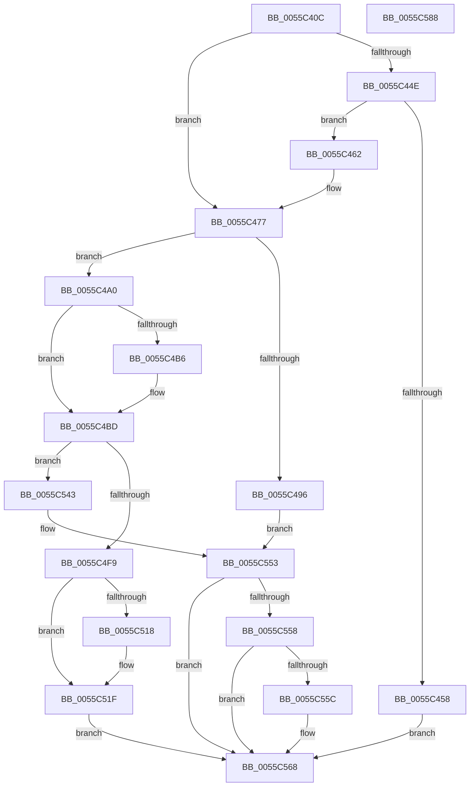

# EmonAllocateResources

- RVA: `0x0055C40C`–`0x0055C589` (길이 `381` bytes)
- VA: `0x000000014055C40C`
- 실행 섹션: `.text`
- PDB 이름 있음: `예`; PDB Function 태그: `아니요`
- unwind 정보 RVA: `0x000AC264`
- 디코드: `105`개 명령, `381/381` bytes 표시
- 미해석 바이트: `0` (있으면 어셈블리에 `.byte`로 보존)

> 이 문서는 커널 이미지의 기계어와 PDB 기호를 분석해 생성했습니다. 4번과 5번은 함수 원형과 자료형을 바이너리 사용 방식에서 추정한 C 해석이며 원본 소스 복구 결과는 아닙니다.

## 1. Dependencies

- 직접 호출 지점: **8**; 고유 호출 대상: **8**
- 직접 호출자로 확인된 함수: **2**
- RIP 상대 이미지 참조: **9**

### Outgoing calls
- `0x0055C477` → [HalpQueryMaximumRegisteredProcessorCount](../54/HalpQueryMaximumRegisteredProcessorCount_function_00543BE8.md) (function, `0x00543BE8`)
- `0x0055C489` → [HalpMmAllocCtxAlloc](../3E/HalpMmAllocCtxAlloc_function_003E10B8.md) (function, `0x003E10B8`)
- `0x0055C4A8` → [memset](../6C/memset_function_006C6C40.md) (function, `0x006C6C40`)
- `0x0055C4EE` → [HalpPmuReservedResourcesProcessorCallback](../54/HalpPmuReservedResourcesProcessorCallback_function_00547608.md) (function, `0x00547608`)
- `0x0055C500` → [KeAcquireSpinLockRaiseToDpc](../20/KeAcquireSpinLockRaiseToDpc_function_00208470.md) (function, `0x00208470`)
- `0x0055C539` → [KeReleaseSpinLock](../39/KeReleaseSpinLock_function_00392BA0.md) (function, `0x00392BA0`)
- `0x0055C546` → [EmonReleaseProfileResourcesInternal](EmonReleaseProfileResourcesInternal_function_0055EF54.md) (function, `0x0055EF54`)
- `0x0055C54E` → [HalpMmAllocCtxFree](../3E/HalpMmAllocCtxFree_function_003E1904.md) (function, `0x003E1904`)

### Direct callers
- [EmonReserveProfileResourcesEnhanced](EmonReserveProfileResourcesEnhanced_function_0055F3C0.md) at `0x0055F543`
- [EmonReserveProfileResourcesOriginal](EmonReserveProfileResourcesOriginal_function_0055F580.md) at `0x0055F721`

### Static image references
- `0x0055C44E` → RVA `0x00F8FE1C` (`.data`; read/write)
- `0x0055C468` → RVA `0x00F8FE20` (`.data`; read)
- `0x0055C471` → RVA `0x00F8FE18` (`.data`; write)
- `0x0055C4CE` → RVA `0x0055D600` (`EmonMarkCountersReserved`; read)
- `0x0055C4F9` → RVA `0x00F8FDE8` (`.data`; read)
- `0x0055C505` → RVA `0x00F8FE08` (`.data`; read)
- `0x0055C50C` → RVA `0x00F8FE00` (`.data`; read)
- `0x0055C532` → RVA `0x00F8FE08` (`.data`; write)
- `0x0055C55C` → RVA `0x00F8FE18` (`.data`; read/write)

## 2. Other-region calls and transfers

- 다른 실행 섹션으로 향하는 call: **0**
- 별도 외부 분기/꼬리 이동을 확인하지 못했습니다.

## 3. Assembly (complete function range)

```asm
0055C40C  48 89 5C 24 08                  mov qword ptr [rsp + 8], rbx
0055C411  48 89 6C 24 10                  mov qword ptr [rsp + 0x10], rbp
0055C416  48 89 74 24 18                  mov qword ptr [rsp + 0x18], rsi
0055C41B  57                              push rdi
0055C41C  41 54                           push r12
0055C41E  41 55                           push r13
0055C420  41 56                           push r14
0055C422  41 57                           push r15
0055C424  48 83 EC 40                     sub rsp, 0x40
0055C428  4C 8B BC 24 98 00 00 00         mov r15, qword ptr [rsp + 0x98]
0055C430  33 C0                           xor eax, eax
0055C432  4D 8B F1                        mov r14, r9
0055C435  89 44 24 24                     mov dword ptr [rsp + 0x24], eax
0055C439  4D 8B E0                        mov r12, r8
0055C43C  48 8B EA                        mov rbp, rdx
0055C43F  4C 8B E9                        mov r13, rcx
0055C442  49 83 0F FF                     or qword ptr [r15], 0xffffffffffffffff
0055C446  8D 70 01                        lea esi, [rax + 1]
0055C449  4D 85 C9                        test r9, r9
0055C44C  74 29                           je 0x14055c477
0055C44E  87 35 C8 39 A3 00               xchg dword ptr [rip + 0xa339c8], esi
0055C454  85 F6                           test esi, esi
0055C456  74 0A                           je 0x14055c462
0055C458  BF 9A 00 00 C0                  mov edi, 0xc000009a
0055C45D  E9 06 01 00 00                  jmp 0x14055c568
0055C462  41 8B 49 08                     mov ecx, dword ptr [r9 + 8]
0055C466  85 C9                           test ecx, ecx
0055C468  8B 05 B2 39 A3 00               mov eax, dword ptr [rip + 0xa339b2]
0055C46E  0F 45 C1                        cmovne eax, ecx
0055C471  89 05 A1 39 A3 00               mov dword ptr [rip + 0xa339a1], eax
0055C477  E8 6C 77 FE FF                  call 0x140543be8
0055C47C  8D 0C 80                        lea ecx, [rax + rax*4]
0055C47F  C1 E1 04                        shl ecx, 4
0055C482  83 C1 70                        add ecx, 0x70
0055C485  8B D1                           mov edx, ecx
0055C487  8B F9                           mov edi, ecx
0055C489  E8 2A 4C E8 FF                  call 0x1403e10b8
0055C48E  48 8B D8                        mov rbx, rax
0055C491  48 85 C0                        test rax, rax
0055C494  75 0A                           jne 0x14055c4a0
0055C496  BF 17 00 00 C0                  mov edi, 0xc0000017
0055C49B  E9 B3 00 00 00                  jmp 0x14055c553
0055C4A0  4C 8B C7                        mov r8, rdi
0055C4A3  33 D2                           xor edx, edx
0055C4A5  48 8B CB                        mov rcx, rbx
0055C4A8  E8 93 A7 16 00                  call 0x1406c6c40
0055C4AD  48 89 6B 10                     mov qword ptr [rbx + 0x10], rbp
0055C4B1  4D 85 F6                        test r14, r14
0055C4B4  74 07                           je 0x14055c4bd
0055C4B6  49 8B 06                        mov rax, qword ptr [r14]
0055C4B9  48 89 43 18                     mov qword ptr [rbx + 0x18], rax
0055C4BD  8B 84 24 90 00 00 00            mov eax, dword ptr [rsp + 0x90]
0055C4C4  4C 8D 44 24 20                  lea r8, [rsp + 0x20]
0055C4C9  83 64 24 24 00                  and dword ptr [rsp + 0x24], 0
0055C4CE  48 8D 15 2B 11 00 00            lea rdx, [rip + 0x112b]
0055C4D5  4C 8B CB                        mov r9, rbx
0055C4D8  89 44 24 20                     mov dword ptr [rsp + 0x20], eax
0055C4DC  49 8B CC                        mov rcx, r12
0055C4DF  48 89 5C 24 28                  mov qword ptr [rsp + 0x28], rbx
0055C4E4  4C 89 6C 24 30                  mov qword ptr [rsp + 0x30], r13
0055C4E9  4C 89 74 24 38                  mov qword ptr [rsp + 0x38], r14
0055C4EE  E8 15 B1 FE FF                  call 0x140547608
0055C4F3  8B F8                           mov edi, eax
0055C4F5  85 C0                           test eax, eax
0055C4F7  78 4A                           js 0x14055c543
0055C4F9  48 8D 0D E8 38 A3 00            lea rcx, [rip + 0xa338e8]
0055C500  E8 6B BF CA FF                  call 0x140208470
0055C505  48 8B 0D FC 38 A3 00            mov rcx, qword ptr [rip + 0xa338fc]
0055C50C  48 8D 15 ED 38 A3 00            lea rdx, [rip + 0xa338ed]
0055C513  48 39 11                        cmp qword ptr [rcx], rdx
0055C516  74 07                           je 0x14055c51f
0055C518  B9 03 00 00 00                  mov ecx, 3
0055C51D  CD 29                           int 0x29
0055C51F  48 89 13                        mov qword ptr [rbx], rdx
0055C522  8A D0                           mov dl, al
0055C524  48 89 4B 08                     mov qword ptr [rbx + 8], rcx
0055C528  48 89 19                        mov qword ptr [rcx], rbx
0055C52B  48 8D 0D B6 38 A3 00            lea rcx, [rip + 0xa338b6]
0055C532  48 89 1D CF 38 A3 00            mov qword ptr [rip + 0xa338cf], rbx
0055C539  E8 62 66 E3 FF                  call 0x140392ba0
0055C53E  49 89 1F                        mov qword ptr [r15], rbx
0055C541  EB 25                           jmp 0x14055c568
0055C543  48 8B CB                        mov rcx, rbx
0055C546  E8 09 2A 00 00                  call 0x14055ef54
0055C54B  48 8B D3                        mov rdx, rbx
0055C54E  E8 B1 53 E8 FF                  call 0x1403e1904
0055C553  4D 85 F6                        test r14, r14
0055C556  74 10                           je 0x14055c568
0055C558  85 F6                           test esi, esi
0055C55A  75 0C                           jne 0x14055c568
0055C55C  21 35 B6 38 A3 00               and dword ptr [rip + 0xa338b6], esi
0055C562  21 35 B4 38 A3 00               and dword ptr [rip + 0xa338b4], esi
0055C568  4C 8D 5C 24 40                  lea r11, [rsp + 0x40]
0055C56D  8B C7                           mov eax, edi
0055C56F  49 8B 5B 30                     mov rbx, qword ptr [r11 + 0x30]
0055C573  49 8B 6B 38                     mov rbp, qword ptr [r11 + 0x38]
0055C577  49 8B 73 40                     mov rsi, qword ptr [r11 + 0x40]
0055C57B  49 8B E3                        mov rsp, r11
0055C57E  41 5F                           pop r15
0055C580  41 5E                           pop r14
0055C582  41 5D                           pop r13
0055C584  41 5C                           pop r12
0055C586  5F                              pop rdi
0055C587  C3                              ret
0055C588  CC                              int3
```

## 4. C-style interpretation (structured pseudocode)

```c
__int64 __fastcall EmonAllocateResources(__int64 a1, __int64 a2, __int64 a3, __int64 a4, unsigned int a5, __int64 a6)
{
    __int64 result;
    __int64 v_rsp;
    unsigned __int64 v_stack_m28;
    unsigned __int64 v_stack_m30;
    unsigned __int64 v_stack_m38;
    unsigned __int64 v_stack_m40;
    unsigned int v_stack_m44;
    unsigned __int64 v_stack_m48;
    unsigned __int64 v_stack_p10;
    unsigned __int64 v_stack_p18;
    unsigned __int64 v_stack_p8;

    v_stack_p8 = v_rbx;
    v_stack_p10 = v_rbp;
    v_stack_p18 = v_rsi;
    v_rsp = (v_rsp) - (64);
    result = 0;
    v_stack_m44 = 0;
    if (a4 == 0) goto loc_0055C477;
    if ((unsigned int)(result + 1) == 0) goto loc_0055C462;
    goto loc_0055C568;
loc_0055C462:
    result = (unsigned int)(*(unsigned int *)(v_rip + 10697138));
    if ((unsigned int)((unsigned int)(*(unsigned int *)(a4 + 8))) != 0) { result = (unsigned int)((unsigned int)(*(unsigned int *)(a4 + 8))); }
    *(unsigned int *)(v_rip + 10697121) = (unsigned int)(result);
loc_0055C477:
    result = HalpQueryMaximumRegisteredProcessorCount((unsigned int)(*(unsigned int *)(a4 + 8)), a2, a3, a4);
    a1 = (unsigned int)((result + result * 4) << (4));
    a1 = (unsigned int)((a1) + (112));
    result = HalpMmAllocCtxAlloc(a1, (unsigned int)((unsigned int)(a1)), a3, a4);
    if (result != 0) goto loc_0055C4A0;
    goto loc_0055C553;
loc_0055C4A0:
    a2 = 0;
    result = memset(result, a2, (unsigned int)(0xC0000017ULL), a4);
    *(unsigned __int64 *)(result + 16) = 0;
    if (a4 != 0) {
        result = *(unsigned __int64 *)(a4);
        *(unsigned __int64 *)(result + 24) = result;
    }
    v_stack_m48 = (unsigned int)((unsigned int)(a5));
    v_stack_m40 = result;
    v_stack_m38 = a1;
    v_stack_m30 = a4;
    result = HalpPmuReservedResourcesProcessorCallback(a3, v_rip + 4395, v_stack_m48, result);
    if (sign_flag) goto loc_0055C543;
    result = KeAcquireSpinLockRaiseToDpc(v_rip + 10696936, v_rip + 4395, v_stack_m48, result);
    if ((*(unsigned __int64 *)(*(unsigned __int64 *)(v_rip + 10696956))) != (v_rip + 10696941)) {
        a1 = 3;
    }
    *(unsigned __int64 *)(result) = v_rip + 10696941;
    *(unsigned __int64 *)(result + 8) = a1;
    *(unsigned __int64 *)(a1) = result;
    *(unsigned __int64 *)(v_rip + 10696911) = result;
    result = KeReleaseSpinLock(v_rip + 10696886, (unsigned __int8)(result), v_stack_m48, result);
    *(unsigned __int64 *)(a6) = result;
    goto loc_0055C568;
loc_0055C543:
    result = EmonReleaseProfileResourcesInternal(result, (unsigned __int8)(result), v_stack_m48, result);
    result = HalpMmAllocCtxFree(result, result, v_stack_m48, result);
loc_0055C553:
    if (a4 == 0) goto loc_0055C568;
    if ((unsigned int)(result + 1) == 0) {
    }
    return (unsigned int)((unsigned int)((unsigned int)((unsigned int)(result))));
}
```

## 5. (Beta) C Style

```c
int64_t EmonAllocateResources(int64_t Arg1, int64_t Arg2, int64_t Arg3, int64_t Arg4, uint32_t Arg5, void *Arg6)
{
    uint8_t *arg6 = (uint8_t *)Arg6;

    int64_t result;
    int64_t local_rsp;
    uint64_t v_stack_m28;
    uint64_t v_stack_m30;
    uint64_t v_stack_m38;
    uint64_t v_stack_m40;
    uint32_t v_stack_m44;
    uint64_t v_stack_m48;
    uint64_t v_stack_p10;
    uint64_t v_stack_p18;
    uint64_t v_stack_p8;

    v_stack_p8 = local_rbx;
    v_stack_p10 = local_rbp;
    v_stack_p18 = local_rsi;
    local_rsp = (local_rsp) - (64);
    result = 0;
    v_stack_m44 = 0;
    if (Arg4 == 0) goto loc_0055C477;
    if ((uint32_t)(result + 1) == 0) goto loc_0055C462;
    goto loc_0055C568;
loc_0055C462:
    result = (uint32_t)(*(uint32_t *)(v_rip + 0xA339B2));
    if ((uint32_t)((uint32_t)(*(uint32_t *)(Arg4 + 0x8))) != 0) { result = (uint32_t)((uint32_t)(*(uint32_t *)(Arg4 + 0x8))); }
    *(uint32_t *)(v_rip + 0xA339A1) = (uint32_t)(result);
loc_0055C477:
    result = HalpQueryMaximumRegisteredProcessorCount((uint32_t)(*(uint32_t *)(Arg4 + 0x8)), Arg2, Arg3, Arg4);
    Arg1 = (uint32_t)((result + result * 4) << (4));
    Arg1 = (uint32_t)((Arg1) + (112));
    result = HalpMmAllocCtxAlloc(Arg1, (uint32_t)((uint32_t)(Arg1)), Arg3, Arg4);
    if (result != 0) goto loc_0055C4A0;
    goto loc_0055C553;
loc_0055C4A0:
    Arg2 = 0;
    result = memset(result, Arg2, (uint32_t)(0xC0000017ULL), Arg4);
    *(uint64_t *)(result + 0x10) = 0;
    if (Arg4 != 0) {
        result = *(uint64_t *)(Arg4);
        *(uint64_t *)(result + 0x18) = result;
    }
    v_stack_m48 = (uint32_t)((uint32_t)(Arg5));
    v_stack_m40 = result;
    v_stack_m38 = Arg1;
    v_stack_m30 = Arg4;
    result = HalpPmuReservedResourcesProcessorCallback(Arg3, v_rip + 4395, v_stack_m48, result);
    if (sign_flag) goto loc_0055C543;
    result = KeAcquireSpinLockRaiseToDpc(v_rip + 10696936, v_rip + 4395, v_stack_m48, result);
    if ((*(uint64_t *)(*(uint64_t *)(v_rip + 0xA338FC))) != (v_rip + 10696941)) {
        Arg1 = 3;
    }
    *(uint64_t *)(result) = v_rip + 10696941;
    *(uint64_t *)(result + 0x8) = Arg1;
    *(uint64_t *)(Arg1) = result;
    *(uint64_t *)(v_rip + 0xA338CF) = result;
    result = KeReleaseSpinLock(v_rip + 10696886, (uint8_t)(result), v_stack_m48, result);
    *(uint64_t *)(arg6) = result;
    goto loc_0055C568;
loc_0055C543:
    result = EmonReleaseProfileResourcesInternal(result, (uint8_t)(result), v_stack_m48, result);
    result = HalpMmAllocCtxFree(result, result, v_stack_m48, result);
loc_0055C553:
    if (Arg4 == 0) goto loc_0055C568;
    if ((uint32_t)(result + 1) == 0) {
    }
    return (uint32_t)((uint32_t)((uint32_t)((uint32_t)(result))));
}
```

### 관측된 메모리 오프셋

구조체 형식이 확인되지 않은 접근은 인자 기준의 오프셋으로만 기록했습니다.

| 기준 인자 | 오프셋 표현 | 폭 (bit) | 접근 |
|---|---:|---:|---|
| `Arg6` | `+ 0x0` | `64` | `R/W` |
| `Arg6` | `+ 0x0` | `64` | `W` |

## 6. Execution-region graph

[열기: 2D/3D 그래프와 함수 탐색 컨트롤 패널](../../../control-panel.html?section=text&rva=0x0055C40C&view=graph)

- 2D 그래프는 위에서 아래로 흐르고, 3D 그래프는 빈 공간을 드래그해 회전합니다. Shift+드래그는 이동, 휠은 확대·축소, 함수 노드 선택은 대상 보고서 이동입니다.

### Static fallback


