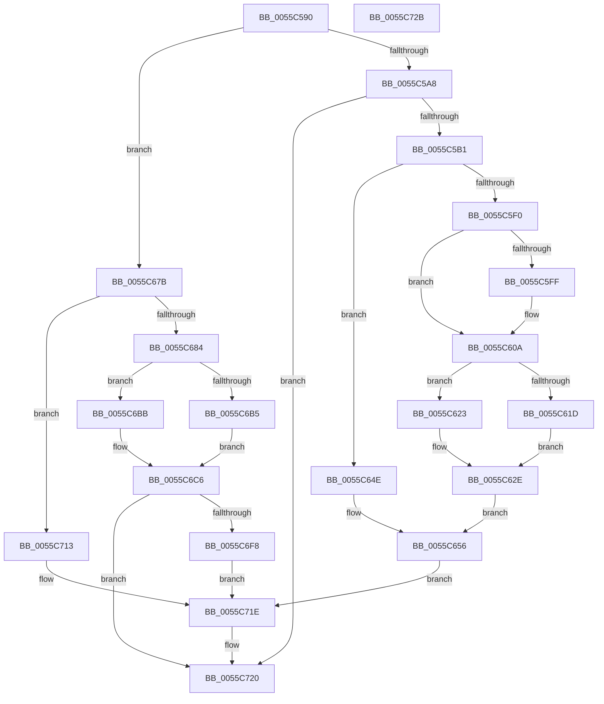

# EmonConfigureCounter

- RVA: `0x0055C590`–`0x0055C72C` (길이 `412` bytes)
- VA: `0x000000014055C590`
- 실행 섹션: `.text`
- PDB 이름 있음: `예`; PDB Function 태그: `아니요`
- unwind 정보 RVA: `0x000C49E4`
- 디코드: `115`개 명령, `412/412` bytes 표시
- 미해석 바이트: `0` (있으면 어셈블리에 `.byte`로 보존)

> 이 문서는 커널 이미지의 기계어와 PDB 기호를 분석해 생성했습니다. 4번과 5번은 함수 원형과 자료형을 바이너리 사용 방식에서 추정한 C 해석이며 원본 소스 복구 결과는 아닙니다.

## 1. Dependencies

- 직접 호출 지점: **0**; 고유 호출 대상: **0**
- 직접 호출자로 확인된 함수: **6**
- RIP 상대 이미지 참조: **3**

### Outgoing calls
- 직접 디코드된 call 명령이 없습니다.

### Direct callers
- [EmonDisableMonitoringEnhanced](EmonDisableMonitoringEnhanced_function_0055C740.md) at `0x0055C7E0`
- [EmonDisableMonitoringOriginal](EmonDisableMonitoringOriginal_function_0055C810.md) at `0x0055C8AE`
- [EmonEnableMonitoringEnhanced](EmonEnableMonitoringEnhanced_function_0055C8E0.md) at `0x0055CA08`
- [EmonEnableMonitoringOriginal](EmonEnableMonitoringOriginal_function_0055CA40.md) at `0x0055CB68`
- [EmonRestartProfilingInternalEnhanced](EmonRestartProfilingInternalEnhanced_function_0055F760.md) at `0x0055F84C`
- [EmonRestartProfilingInternalOriginal](EmonRestartProfilingInternalOriginal_function_0055F87C.md) at `0x0055F92D`

### Static image references
- `0x0055C60A` → RVA `0x00F8FE14` (`.data`; read)
- `0x0055C6A4` → RVA `0x00F8FE10` (`.data`; read)
- `0x0055C6EF` → RVA `0x00F8FDE0` (`.data`; read)

## 2. Other-region calls and transfers

- 다른 실행 섹션으로 향하는 call: **0**
- 별도 외부 분기/꼬리 이동을 확인하지 못했습니다.

## 3. Assembly (complete function range)

```asm
0055C590  48 89 74 24 08                  mov qword ptr [rsp + 8], rsi
0055C595  48 89 7C 24 10                  mov qword ptr [rsp + 0x10], rdi
0055C59A  44 8B D1                        mov r10d, ecx
0055C59D  49 8B F9                        mov rdi, r9
0055C5A0  85 D2                           test edx, edx
0055C5A2  0F 84 D3 00 00 00               je 0x14055c67b
0055C5A8  83 FA 01                        cmp edx, 1
0055C5AB  0F 85 6F 01 00 00               jne 0x14055c720
0055C5B1  B9 8F 03 00 00                  mov ecx, 0x38f
0055C5B6  0F 32                           rdmsr
0055C5B8  48 C1 E2 20                     shl rdx, 0x20
0055C5BC  42 8D 34 95 00 00 00 00         lea esi, [r10*4]
0055C5C4  48 0B C2                        or rax, rdx
0055C5C7  B9 8D 03 00 00                  mov ecx, 0x38d
0055C5CC  4C 8B C8                        mov r9, rax
0055C5CF  0F 32                           rdmsr
0055C5D1  48 C1 E2 20                     shl rdx, 0x20
0055C5D5  8B CE                           mov ecx, esi
0055C5D7  48 0B C2                        or rax, rdx
0055C5DA  4C 8B D8                        mov r11, rax
0055C5DD  B8 0F 00 00 00                  mov eax, 0xf
0055C5E2  48 D3 E0                        shl rax, cl
0055C5E5  48 F7 D0                        not rax
0055C5E8  4C 23 D8                        and r11, rax
0055C5EB  45 84 C0                        test r8b, r8b
0055C5EE  74 5E                           je 0x14055c64e
0055C5F0  8B 44 24 28                     mov eax, dword ptr [rsp + 0x28]
0055C5F4  8A 54 24 30                     mov dl, byte ptr [rsp + 0x30]
0055C5F8  4C 0B D8                        or r11, rax
0055C5FB  84 D2                           test dl, dl
0055C5FD  74 0B                           je 0x14055c60a
0055C5FF  B8 08 00 00 00                  mov eax, 8
0055C604  48 D3 E0                        shl rax, cl
0055C607  4C 0B D8                        or r11, rax
0055C60A  8B 0D 04 38 A3 00               mov ecx, dword ptr [rip + 0xa33804]
0055C610  F6 DA                           neg dl
0055C612  48 1B D2                        sbb rdx, rdx
0055C615  48 23 D7                        and rdx, rdi
0055C618  83 F9 40                        cmp ecx, 0x40
0055C61B  72 06                           jb 0x14055c623
0055C61D  48 83 C8 FF                     or rax, 0xffffffffffffffff
0055C621  EB 0B                           jmp 0x14055c62e
0055C623  B8 01 00 00 00                  mov eax, 1
0055C628  48 D3 E0                        shl rax, cl
0055C62B  48 FF C8                        dec rax
0055C62E  48 F7 DA                        neg rdx
0055C631  41 8D 8A 09 03 00 00            lea ecx, [r10 + 0x309]
0055C638  48 23 D0                        and rdx, rax
0055C63B  48 8B C2                        mov rax, rdx
0055C63E  48 C1 EA 20                     shr rdx, 0x20
0055C642  0F 30                           wrmsr
0055C644  41 8D 4A 20                     lea ecx, [r10 + 0x20]
0055C648  49 0F AB C9                     bts r9, rcx
0055C64C  EB 08                           jmp 0x14055c656
0055C64E  45 8D 42 20                     lea r8d, [r10 + 0x20]
0055C652  4D 0F B3 C1                     btr r9, r8
0055C656  49 8B D1                        mov rdx, r9
0055C659  49 8B C1                        mov rax, r9
0055C65C  48 C1 EA 20                     shr rdx, 0x20
0055C660  B9 8F 03 00 00                  mov ecx, 0x38f
0055C665  0F 30                           wrmsr
0055C667  49 8B D3                        mov rdx, r11
0055C66A  49 8B C3                        mov rax, r11
0055C66D  48 C1 EA 20                     shr rdx, 0x20
0055C671  B9 8D 03 00 00                  mov ecx, 0x38d
0055C676  E9 A3 00 00 00                  jmp 0x14055c71e
0055C67B  45 84 C0                        test r8b, r8b
0055C67E  0F 84 8F 00 00 00               je 0x14055c713
0055C684  8A 4C 24 30                     mov cl, byte ptr [rsp + 0x30]
0055C688  8A C1                           mov al, cl
0055C68A  F6 D8                           neg al
0055C68C  45 1B C0                        sbb r8d, r8d
0055C68F  41 81 E0 00 00 10 00            and r8d, 0x100000
0055C696  41 81 C0 00 00 40 00            add r8d, 0x400000
0055C69D  44 0B 44 24 28                  or r8d, dword ptr [rsp + 0x28]
0055C6A2  F6 D9                           neg cl
0055C6A4  8B 0D 66 37 A3 00               mov ecx, dword ptr [rip + 0xa33766]
0055C6AA  48 1B D2                        sbb rdx, rdx
0055C6AD  48 23 D7                        and rdx, rdi
0055C6B0  83 F9 40                        cmp ecx, 0x40
0055C6B3  72 06                           jb 0x14055c6bb
0055C6B5  48 83 C8 FF                     or rax, 0xffffffffffffffff
0055C6B9  EB 0B                           jmp 0x14055c6c6
0055C6BB  B8 01 00 00 00                  mov eax, 1
0055C6C0  48 D3 E0                        shl rax, cl
0055C6C3  48 FF C8                        dec rax
0055C6C6  48 F7 DA                        neg rdx
0055C6C9  41 8D 8A C1 00 00 00            lea ecx, [r10 + 0xc1]
0055C6D0  48 23 D0                        and rdx, rax
0055C6D3  48 8B C2                        mov rax, rdx
0055C6D6  48 C1 EA 20                     shr rdx, 0x20
0055C6DA  0F 30                           wrmsr
0055C6DC  41 8B D0                        mov edx, r8d
0055C6DF  41 8D 8A 86 01 00 00            lea ecx, [r10 + 0x186]
0055C6E6  48 C1 EA 20                     shr rdx, 0x20
0055C6EA  41 8B C0                        mov eax, r8d
0055C6ED  0F 30                           wrmsr
0055C6EF  83 3D EA 36 A3 00 02            cmp dword ptr [rip + 0xa336ea], 2
0055C6F6  72 28                           jb 0x14055c720
0055C6F8  B9 8F 03 00 00                  mov ecx, 0x38f
0055C6FD  0F 32                           rdmsr
0055C6FF  48 C1 E2 20                     shl rdx, 0x20
0055C703  48 0B C2                        or rax, rdx
0055C706  4C 0F AB D0                     bts rax, r10
0055C70A  48 8B D0                        mov rdx, rax
0055C70D  48 C1 EA 20                     shr rdx, 0x20
0055C711  EB 0B                           jmp 0x14055c71e
0055C713  33 C0                           xor eax, eax
0055C715  41 8D 8A 86 01 00 00            lea ecx, [r10 + 0x186]
0055C71C  33 D2                           xor edx, edx
0055C71E  0F 30                           wrmsr
0055C720  48 8B 74 24 08                  mov rsi, qword ptr [rsp + 8]
0055C725  48 8B 7C 24 10                  mov rdi, qword ptr [rsp + 0x10]
0055C72A  C3                              ret
0055C72B  CC                              int3
```

## 4. C-style interpretation (structured pseudocode)

```c
__int64 __fastcall EmonConfigureCounter(int a1, __int64 a2, unsigned __int8 a3, __int64 a4, unsigned int a5, unsigned __int8 a6)
{
    __int64 result;
    __int64 v_r11;
    unsigned __int64 v_stack_p10;
    unsigned __int64 v_stack_p8;

    v_stack_p8 = v_rsi;
    v_stack_p10 = v_rdi;
    if ((unsigned int)(a2) == 0) goto loc_0055C67B;
    if (((unsigned int)(a2)) != 1) goto loc_0055C720;
    a2 = (a2) << (32);
    result = (result) | (a2);
    a2 = (a2) << (32);
    result = (result) | (a2);
    result = (15) << ((unsigned __int8)((unsigned int)((unsigned int)((unsigned int)(a1) * 4))));
    result = ~(result);
    v_r11 = (result) & (result);
    if (a3 == 0) goto loc_0055C64E;
    v_r11 = (v_r11) | ((unsigned int)(a5));
    result = (unsigned int)(a5);
    if (a6 != 0) {
        result = 8;
        result = (result) << ((unsigned __int8)((unsigned int)((unsigned int)((unsigned int)(a1) * 4))));
        v_r11 = (v_r11) | (result);
    }
    a2 = (unsigned __int8)(-(a6));
    a2 = (a2) & (a4);
    if (((unsigned int)((unsigned int)(*(unsigned int *)(v_rip + 10696708)))) < 64) goto loc_0055C623;
    result = (result) | (-1);
    goto loc_0055C62E;
loc_0055C623:
    result = (1) << ((unsigned __int8)((unsigned int)(*(unsigned int *)(v_rip + 10696708))));
    result = (result) - 1;
loc_0055C62E:
    a2 = -(a2);
    a2 = (a2) & (result);
    a2 = (a2) >> (32);
    goto loc_0055C656;
loc_0055C64E:
loc_0055C656:
    a2 = (result) >> (32);
    a2 = (v_r11) >> (32);
    goto loc_0055C71E;
loc_0055C67B:
    if ((unsigned __int8)((unsigned int)(a1) + 32) == 0) goto loc_0055C713;
    result = (unsigned __int8)(-(a6));
    a3 = (unsigned int)(((unsigned int)(a1) + 32) & (0x100000ULL));
    a3 = (unsigned int)((a3) + (0x400000ULL));
    a3 = (unsigned int)((a3) | (a5));
    a1 = (unsigned __int8)(-(a6));
    a2 = (a2) & (a4);
    if (((unsigned int)((unsigned int)(*(unsigned int *)(v_rip + 10696550)))) < 64) goto loc_0055C6BB;
    result = (result) | (-1);
    goto loc_0055C6C6;
loc_0055C6BB:
    result = (1) << ((unsigned __int8)((unsigned int)(*(unsigned int *)(v_rip + 10696550))));
    result = (result) - 1;
loc_0055C6C6:
    a2 = -(a2);
    a2 = (a2) & (result);
    a2 = (a2) >> (32);
    a2 = ((unsigned int)(a3)) >> (32);
    if ((*(unsigned int *)(v_rip + 10696426)) < 2) goto loc_0055C720;
    a2 = (a2) << (32);
    result = ((unsigned int)(a3)) | (a2);
    a2 = (result) >> (32);
    goto loc_0055C71E;
loc_0055C713:
    result = 0;
    a2 = 0;
loc_0055C71E:
loc_0055C720:
    return result;
}
```

## 5. (Beta) C Style

```c
int64_t EmonConfigureCounter(void *Arg1, int64_t Arg2, uint8_t Arg3, int64_t Arg4, uint32_t Arg5, uint8_t Arg6)
{
    uint8_t *arg1 = (uint8_t *)Arg1;

    int64_t result;
    int64_t local_r11;
    uint64_t v_stack_p10;
    uint64_t v_stack_p8;

    v_stack_p8 = local_rsi;
    v_stack_p10 = local_rdi;
    if ((uint32_t)(Arg2) == 0) goto loc_0055C67B;
    if (((uint32_t)(Arg2)) != 1) goto loc_0055C720;
    Arg2 = (Arg2) << (32);
    result = (result) | (Arg2);
    Arg2 = (Arg2) << (32);
    result = (result) | (Arg2);
    result = (15) << ((uint8_t)((uint32_t)((uint32_t)((uint32_t)(Arg1) * 4))));
    result = ~(result);
    local_r11 = (result) & (result);
    if (Arg3 == 0) goto loc_0055C64E;
    local_r11 = (local_r11) | ((uint32_t)(Arg5));
    result = (uint32_t)(Arg5);
    if (Arg6 != 0) {
        result = 8;
        result = (result) << ((uint8_t)((uint32_t)((uint32_t)((uint32_t)(Arg1) * 4))));
        local_r11 = (local_r11) | (result);
    }
    Arg2 = (uint8_t)(-(Arg6));
    Arg2 = (Arg2) & (Arg4);
    if (((uint32_t)((uint32_t)(*(uint32_t *)(v_rip + 0xA33804)))) < 64) goto loc_0055C623;
    result = (result) | (-1);
    goto loc_0055C62E;
loc_0055C623:
    result = (1) << ((uint8_t)((uint32_t)(*(uint32_t *)(v_rip + 0xA33804))));
    result = (result) - 1;
loc_0055C62E:
    Arg2 = -(Arg2);
    Arg2 = (Arg2) & (result);
    Arg2 = (Arg2) >> (32);
    goto loc_0055C656;
loc_0055C64E:
loc_0055C656:
    Arg2 = (result) >> (32);
    Arg2 = (local_r11) >> (32);
    goto loc_0055C71E;
loc_0055C67B:
    if ((uint8_t)((uint32_t)(Arg1) + 32) == 0) goto loc_0055C713;
    result = (uint8_t)(-(Arg6));
    Arg3 = (uint32_t)(((uint32_t)(Arg1) + 32) & (0x100000ULL));
    Arg3 = (uint32_t)((Arg3) + (0x400000ULL));
    Arg3 = (uint32_t)((Arg3) | (Arg5));
    Arg1 = (uint8_t)(-(Arg6));
    Arg2 = (Arg2) & (Arg4);
    if (((uint32_t)((uint32_t)(*(uint32_t *)(v_rip + 0xA33766)))) < 64) goto loc_0055C6BB;
    result = (result) | (-1);
    goto loc_0055C6C6;
loc_0055C6BB:
    result = (1) << ((uint8_t)((uint32_t)(*(uint32_t *)(v_rip + 0xA33766))));
    result = (result) - 1;
loc_0055C6C6:
    Arg2 = -(Arg2);
    Arg2 = (Arg2) & (result);
    Arg2 = (Arg2) >> (32);
    Arg2 = ((uint32_t)(Arg3)) >> (32);
    if ((*(uint32_t *)(v_rip + 0xA336EA)) < 2) goto loc_0055C720;
    Arg2 = (Arg2) << (32);
    result = ((uint32_t)(Arg3)) | (Arg2);
    Arg2 = (result) >> (32);
    goto loc_0055C71E;
loc_0055C713:
    result = 0;
    Arg2 = 0;
loc_0055C71E:
loc_0055C720:
    return result;
}
```

### 관측된 메모리 오프셋

구조체 형식이 확인되지 않은 접근은 인자 기준의 오프셋으로만 기록했습니다.

| 기준 인자 | 오프셋 표현 | 폭 (bit) | 접근 |
|---|---:|---:|---|
| `Arg1` | `+ 0x20` | `32` | `R` |
| `Arg1` | `+ 0xC1` | `32` | `R` |
| `Arg1` | `+ 0x186` | `32` | `R` |
| `Arg1` | `+ 0x309` | `32` | `R` |

## 6. Execution-region graph

[열기: 2D/3D 그래프와 함수 탐색 컨트롤 패널](../../../control-panel.html?section=text&rva=0x0055C590&view=graph)

- 2D 그래프는 위에서 아래로 흐르고, 3D 그래프는 빈 공간을 드래그해 회전합니다. Shift+드래그는 이동, 휠은 확대·축소, 함수 노드 선택은 대상 보고서 이동입니다.

### Static fallback


