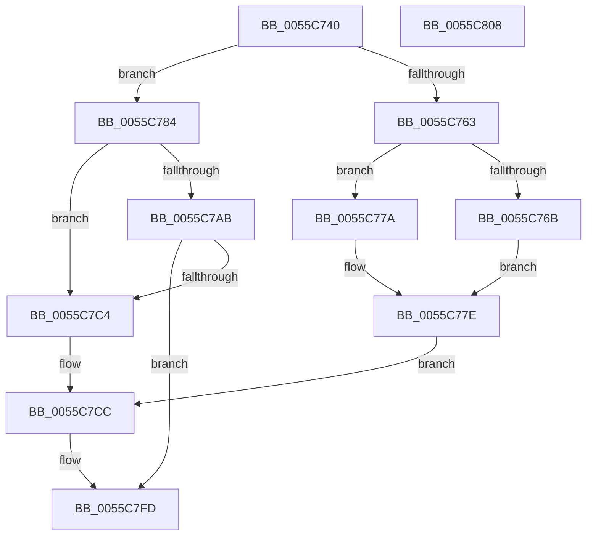

# EmonDisableMonitoringEnhanced

- RVA: `0x0055C740`–`0x0055C809` (길이 `201` bytes)
- VA: `0x000000014055C740`
- 실행 섹션: `.text`
- PDB 이름 있음: `예`; PDB Function 태그: `아니요`
- unwind 정보 RVA: `0x0006E5F8`
- 디코드: `55`개 명령, `201/201` bytes 표시
- 미해석 바이트: `0` (있으면 어셈블리에 `.byte`로 보존)

> 이 문서는 커널 이미지의 기계어와 PDB 기호를 분석해 생성했습니다. 4번과 5번은 함수 원형과 자료형을 바이너리 사용 방식에서 추정한 C 해석이며 원본 소스 복구 결과는 아닙니다.

## 1. Dependencies

- 직접 호출 지점: **4**; 고유 호출 대상: **3**
- 직접 호출자로 확인된 함수: **0**
- RIP 상대 이미지 참조: **1**

### Outgoing calls
- `0x0055C7A2` → [EmonFindCounterToDisableEnhanced](EmonFindCounterToDisableEnhanced_function_0055CD60.md) (function, `0x0055CD60`)
- `0x0055C7BB` → [EmonFindCounterToDisableEnhanced](EmonFindCounterToDisableEnhanced_function_0055CD60.md) (function, `0x0055CD60`)
- `0x0055C7E0` → [EmonConfigureCounter](EmonConfigureCounter_function_0055C590.md) (function, `0x0055C590`)
- `0x0055C7E9` → [EmonFreeCounterEnhanced](EmonFreeCounterEnhanced_function_0055CE6C.md) (function, `0x0055CE6C`)

### Direct callers
- 이 함수 시작 RVA로 연결되는 직접 call은 확인되지 않았습니다. 간접 호출은 완전히 역산할 수 없습니다.

### Static image references
- `0x0055C784` → RVA `0x00FC8C40` (`ALMOSTRO`; read)

## 2. Other-region calls and transfers

- 다른 실행 섹션으로 향하는 call: **0**
- 별도 외부 분기/꼬리 이동을 확인하지 못했습니다.

## 3. Assembly (complete function range)

```asm
0055C740  48 89 5C 24 08                  mov qword ptr [rsp + 8], rbx
0055C745  57                              push rdi
0055C746  48 83 EC 30                     sub rsp, 0x30
0055C74A  83 64 24 48 00                  and dword ptr [rsp + 0x48], 0
0055C74F  8B D9                           mov ebx, ecx
0055C751  83 64 24 50 00                  and dword ptr [rsp + 0x50], 0
0055C756  65 8B 04 25 A4 01 00 00         mov eax, dword ptr gs:[0x1a4]
0055C75E  48 85 D2                        test rdx, rdx
0055C761  74 21                           je 0x14055c784
0055C763  8B 1A                           mov ebx, dword ptr [rdx]
0055C765  0F BA E3 1E                     bt ebx, 0x1e
0055C769  73 0F                           jae 0x14055c77a
0055C76B  BF 01 00 00 00                  mov edi, 1
0055C770  0F BA F3 1E                     btr ebx, 0x1e
0055C774  89 7C 24 48                     mov dword ptr [rsp + 0x48], edi
0055C778  EB 04                           jmp 0x14055c77e
0055C77A  8B 7C 24 48                     mov edi, dword ptr [rsp + 0x48]
0055C77E  89 5C 24 50                     mov dword ptr [rsp + 0x50], ebx
0055C782  EB 48                           jmp 0x14055c7cc
0055C784  48 8D 0D B5 C4 A6 00            lea rcx, [rip + 0xa6c4b5]
0055C78B  8B D3                           mov edx, ebx
0055C78D  48 8B 04 C1                     mov rax, qword ptr [rcx + rax*8]
0055C791  4C 8D 4C 24 48                  lea r9, [rsp + 0x48]
0055C796  4C 8D 44 24 50                  lea r8, [rsp + 0x50]
0055C79B  48 8B 78 58                     mov rdi, qword ptr [rax + 0x58]
0055C79F  48 8B CF                        mov rcx, rdi
0055C7A2  E8 B9 05 00 00                  call 0x14055cd60
0055C7A7  84 C0                           test al, al
0055C7A9  75 19                           jne 0x14055c7c4
0055C7AB  48 8D 4F 18                     lea rcx, [rdi + 0x18]
0055C7AF  8B D3                           mov edx, ebx
0055C7B1  4C 8D 4C 24 48                  lea r9, [rsp + 0x48]
0055C7B6  4C 8D 44 24 50                  lea r8, [rsp + 0x50]
0055C7BB  E8 A0 05 00 00                  call 0x14055cd60
0055C7C0  84 C0                           test al, al
0055C7C2  74 39                           je 0x14055c7fd
0055C7C4  8B 7C 24 48                     mov edi, dword ptr [rsp + 0x48]
0055C7C8  8B 5C 24 50                     mov ebx, dword ptr [rsp + 0x50]
0055C7CC  C6 44 24 28 00                  mov byte ptr [rsp + 0x28], 0
0055C7D1  45 33 C9                        xor r9d, r9d
0055C7D4  83 64 24 20 00                  and dword ptr [rsp + 0x20], 0
0055C7D9  45 33 C0                        xor r8d, r8d
0055C7DC  8B D7                           mov edx, edi
0055C7DE  8B CB                           mov ecx, ebx
0055C7E0  E8 AB FD FF FF                  call 0x14055c590
0055C7E5  8B D7                           mov edx, edi
0055C7E7  8B CB                           mov ecx, ebx
0055C7E9  E8 7E 06 00 00                  call 0x14055ce6c
0055C7EE  65 4C 8B 0C 25 20 00 00 00      mov r9, qword ptr gs:[0x20]
0055C7F7  F0 41 83 41 60 FE               lock add dword ptr [r9 + 0x60], -2
0055C7FD  48 8B 5C 24 40                  mov rbx, qword ptr [rsp + 0x40]
0055C802  48 83 C4 30                     add rsp, 0x30
0055C806  5F                              pop rdi
0055C807  C3                              ret
0055C808  CC                              int3
```

## 4. C-style interpretation (structured pseudocode)

```c
__int64 __fastcall EmonDisableMonitoringEnhanced(int a1, __int64 a2)
{
    __int64 result;
    __int64 v_rsp;
    unsigned __int8 v_stack_m10;
    unsigned int v_stack_m18;
    unsigned int v_stack_p10;
    unsigned int v_stack_p18;
    unsigned __int64 v_stack_p8;

    v_stack_p8 = v_rbx;
    v_rsp = (v_rsp) - (48);
    if (a2 == 0) goto loc_0055C784;
    if (condition_is_above_or_equal) goto loc_0055C77A;
    v_stack_p10 = 1;
    goto loc_0055C77E;
loc_0055C77A:
loc_0055C77E:
    v_stack_p18 = (unsigned int)((unsigned int)(*(unsigned int *)(a2)));
    goto loc_0055C7CC;
loc_0055C784:
    result = EmonFindCounterToDisableEnhanced(*(unsigned __int64 *)(*(unsigned __int64 *)(v_rip + 10929333 + (unsigned int)(*(unsigned int *)(gs_base + (0 + 420))) * 8) + 88), (unsigned int)((unsigned int)((unsigned int)(*(unsigned int *)(a2)))), v_stack_p18, v_stack_p10);
    if ((unsigned __int8)(result) != 0) goto loc_0055C7C4;
    result = EmonFindCounterToDisableEnhanced(*(unsigned __int64 *)(*(unsigned __int64 *)(v_rip + 10929333 + (unsigned int)(*(unsigned int *)(gs_base + (0 + 420))) * 8) + 88) + 24, (unsigned int)((unsigned int)((unsigned int)(*(unsigned int *)(a2)))), v_stack_p18, v_stack_p10);
    if ((unsigned __int8)(result) == 0) goto loc_0055C7FD;
loc_0055C7C4:
loc_0055C7CC:
    v_stack_m10 = 0;
    a4 = 0;
    a3 = 0;
    result = EmonConfigureCounter((unsigned int)((unsigned int)((unsigned int)(v_stack_p18))), (unsigned int)((unsigned int)((unsigned int)(v_stack_p10))), a3, a4);
    result = EmonFreeCounterEnhanced((unsigned int)((unsigned int)((unsigned int)(v_stack_p18))), (unsigned int)((unsigned int)((unsigned int)(v_stack_p10))), a3, a4);
loc_0055C7FD:
    v_rsp = (v_rsp) + (48);
    return result;
}
```

## 5. (Beta) C Style

```c
int64_t EmonDisableMonitoringEnhanced(int32_t Arg1, int64_t Arg2)
{
    int64_t result;
    int64_t local_rsp;
    uint8_t v_stack_m10;
    uint32_t v_stack_m18;
    uint32_t v_stack_p10;
    uint32_t v_stack_p18;
    uint64_t v_stack_p8;

    v_stack_p8 = local_rbx;
    local_rsp = (local_rsp) - (48);
    if (Arg2 == 0) goto loc_0055C784;
    if (condition_is_above_or_equal) goto loc_0055C77A;
    v_stack_p10 = 1;
    goto loc_0055C77E;
loc_0055C77A:
loc_0055C77E:
    v_stack_p18 = (uint32_t)((uint32_t)(*(uint32_t *)(Arg2)));
    goto loc_0055C7CC;
loc_0055C784:
    result = EmonFindCounterToDisableEnhanced(*(uint64_t *)(*(uint64_t *)(v_rip + 0xA6C4B5 + (uint32_t)(*(uint32_t *)(gs_base + (0 + 0x1A4))) * 8) + 0x58), (uint32_t)((uint32_t)((uint32_t)(*(uint32_t *)(Arg2)))), v_stack_p18, v_stack_p10);
    if ((uint8_t)(result) != 0) goto loc_0055C7C4;
    result = EmonFindCounterToDisableEnhanced(*(uint64_t *)(*(uint64_t *)(v_rip + 0xA6C4B5 + (uint32_t)(*(uint32_t *)(gs_base + (0 + 0x1A4))) * 8) + 0x58) + 24, (uint32_t)((uint32_t)((uint32_t)(*(uint32_t *)(Arg2)))), v_stack_p18, v_stack_p10);
    if ((uint8_t)(result) == 0) goto loc_0055C7FD;
loc_0055C7C4:
loc_0055C7CC:
    v_stack_m10 = 0;
    a4 = 0;
    a3 = 0;
    result = EmonConfigureCounter((uint32_t)((uint32_t)((uint32_t)(v_stack_p18))), (uint32_t)((uint32_t)((uint32_t)(v_stack_p10))), a3, a4);
    result = EmonFreeCounterEnhanced((uint32_t)((uint32_t)((uint32_t)(v_stack_p18))), (uint32_t)((uint32_t)((uint32_t)(v_stack_p10))), a3, a4);
loc_0055C7FD:
    local_rsp = (local_rsp) + (48);
    return result;
}
```

## 6. Execution-region graph

[열기: 2D/3D 그래프와 함수 탐색 컨트롤 패널](../../../control-panel.html?section=text&rva=0x0055C740&view=graph)

- 2D 그래프는 위에서 아래로 흐르고, 3D 그래프는 빈 공간을 드래그해 회전합니다. Shift+드래그는 이동, 휠은 확대·축소, 함수 노드 선택은 대상 보고서 이동입니다.

### Static fallback


