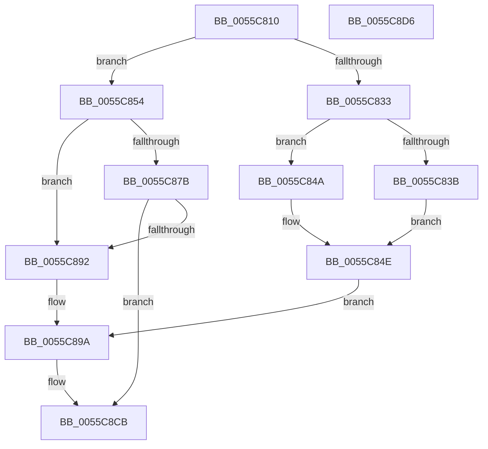

# EmonDisableMonitoringOriginal

- RVA: `0x0055C810`–`0x0055C8D7` (길이 `199` bytes)
- VA: `0x000000014055C810`
- 실행 섹션: `.text`
- PDB 이름 있음: `예`; PDB Function 태그: `아니요`
- unwind 정보 RVA: `0x0006E5F8`
- 디코드: `54`개 명령, `199/199` bytes 표시
- 미해석 바이트: `0` (있으면 어셈블리에 `.byte`로 보존)

> 이 문서는 커널 이미지의 기계어와 PDB 기호를 분석해 생성했습니다. 4번과 5번은 함수 원형과 자료형을 바이너리 사용 방식에서 추정한 C 해석이며 원본 소스 복구 결과는 아닙니다.

## 1. Dependencies

- 직접 호출 지점: **4**; 고유 호출 대상: **3**
- 직접 호출자로 확인된 함수: **0**
- RIP 상대 이미지 참조: **1**

### Outgoing calls
- `0x0055C872` → [EmonFindCounterToDisableOriginal](EmonFindCounterToDisableOriginal_function_0055CE10.md) (function, `0x0055CE10`)
- `0x0055C889` → [EmonFindCounterToDisableOriginal](EmonFindCounterToDisableOriginal_function_0055CE10.md) (function, `0x0055CE10`)
- `0x0055C8AE` → [EmonConfigureCounter](EmonConfigureCounter_function_0055C590.md) (function, `0x0055C590`)
- `0x0055C8B7` → [EmonFreeCounterOriginal](EmonFreeCounterOriginal_function_0055CEDC.md) (function, `0x0055CEDC`)

### Direct callers
- 이 함수 시작 RVA로 연결되는 직접 call은 확인되지 않았습니다. 간접 호출은 완전히 역산할 수 없습니다.

### Static image references
- `0x0055C854` → RVA `0x00FC8C40` (`ALMOSTRO`; read)

## 2. Other-region calls and transfers

- 다른 실행 섹션으로 향하는 call: **0**
- 별도 외부 분기/꼬리 이동을 확인하지 못했습니다.

## 3. Assembly (complete function range)

```asm
0055C810  48 89 5C 24 08                  mov qword ptr [rsp + 8], rbx
0055C815  57                              push rdi
0055C816  48 83 EC 30                     sub rsp, 0x30
0055C81A  83 64 24 48 00                  and dword ptr [rsp + 0x48], 0
0055C81F  8B D9                           mov ebx, ecx
0055C821  83 64 24 50 00                  and dword ptr [rsp + 0x50], 0
0055C826  65 8B 04 25 A4 01 00 00         mov eax, dword ptr gs:[0x1a4]
0055C82E  48 85 D2                        test rdx, rdx
0055C831  74 21                           je 0x14055c854
0055C833  8B 1A                           mov ebx, dword ptr [rdx]
0055C835  0F BA E3 1E                     bt ebx, 0x1e
0055C839  73 0F                           jae 0x14055c84a
0055C83B  BF 01 00 00 00                  mov edi, 1
0055C840  0F BA F3 1E                     btr ebx, 0x1e
0055C844  89 7C 24 48                     mov dword ptr [rsp + 0x48], edi
0055C848  EB 04                           jmp 0x14055c84e
0055C84A  8B 7C 24 48                     mov edi, dword ptr [rsp + 0x48]
0055C84E  89 5C 24 50                     mov dword ptr [rsp + 0x50], ebx
0055C852  EB 46                           jmp 0x14055c89a
0055C854  48 8D 0D E5 C3 A6 00            lea rcx, [rip + 0xa6c3e5]
0055C85B  8B D3                           mov edx, ebx
0055C85D  48 8B 04 C1                     mov rax, qword ptr [rcx + rax*8]
0055C861  4C 8D 4C 24 48                  lea r9, [rsp + 0x48]
0055C866  4C 8D 44 24 50                  lea r8, [rsp + 0x50]
0055C86B  48 8B 78 58                     mov rdi, qword ptr [rax + 0x58]
0055C86F  48 8B CF                        mov rcx, rdi
0055C872  E8 99 05 00 00                  call 0x14055ce10
0055C877  84 C0                           test al, al
0055C879  75 17                           jne 0x14055c892
0055C87B  48 8D 4F 18                     lea rcx, [rdi + 0x18]
0055C87F  4C 8D 4C 24 48                  lea r9, [rsp + 0x48]
0055C884  4C 8D 44 24 50                  lea r8, [rsp + 0x50]
0055C889  E8 82 05 00 00                  call 0x14055ce10
0055C88E  84 C0                           test al, al
0055C890  74 39                           je 0x14055c8cb
0055C892  8B 7C 24 48                     mov edi, dword ptr [rsp + 0x48]
0055C896  8B 5C 24 50                     mov ebx, dword ptr [rsp + 0x50]
0055C89A  C6 44 24 28 00                  mov byte ptr [rsp + 0x28], 0
0055C89F  45 33 C9                        xor r9d, r9d
0055C8A2  83 64 24 20 00                  and dword ptr [rsp + 0x20], 0
0055C8A7  45 33 C0                        xor r8d, r8d
0055C8AA  8B D7                           mov edx, edi
0055C8AC  8B CB                           mov ecx, ebx
0055C8AE  E8 DD FC FF FF                  call 0x14055c590
0055C8B3  8B D7                           mov edx, edi
0055C8B5  8B CB                           mov ecx, ebx
0055C8B7  E8 20 06 00 00                  call 0x14055cedc
0055C8BC  65 4C 8B 0C 25 20 00 00 00      mov r9, qword ptr gs:[0x20]
0055C8C5  F0 41 83 41 60 FE               lock add dword ptr [r9 + 0x60], -2
0055C8CB  48 8B 5C 24 40                  mov rbx, qword ptr [rsp + 0x40]
0055C8D0  48 83 C4 30                     add rsp, 0x30
0055C8D4  5F                              pop rdi
0055C8D5  C3                              ret
0055C8D6  CC                              int3
```

## 4. C-style interpretation (structured pseudocode)

```c
__int64 __fastcall EmonDisableMonitoringOriginal(int a1, __int64 a2)
{
    __int64 result;
    __int64 v_rsp;
    unsigned __int8 v_stack_m10;
    unsigned int v_stack_m18;
    unsigned int v_stack_p10;
    unsigned int v_stack_p18;
    unsigned __int64 v_stack_p8;

    v_stack_p8 = v_rbx;
    v_rsp = (v_rsp) - (48);
    if (a2 == 0) goto loc_0055C854;
    if (condition_is_above_or_equal) goto loc_0055C84A;
    v_stack_p10 = 1;
    goto loc_0055C84E;
loc_0055C84A:
loc_0055C84E:
    v_stack_p18 = (unsigned int)((unsigned int)(*(unsigned int *)(a2)));
    goto loc_0055C89A;
loc_0055C854:
    result = EmonFindCounterToDisableOriginal(*(unsigned __int64 *)(*(unsigned __int64 *)(v_rip + 10929125 + (unsigned int)(*(unsigned int *)(gs_base + (0 + 420))) * 8) + 88), (unsigned int)((unsigned int)((unsigned int)(*(unsigned int *)(a2)))), v_stack_p18, v_stack_p10);
    if ((unsigned __int8)(result) != 0) goto loc_0055C892;
    result = EmonFindCounterToDisableOriginal(*(unsigned __int64 *)(*(unsigned __int64 *)(v_rip + 10929125 + (unsigned int)(*(unsigned int *)(gs_base + (0 + 420))) * 8) + 88) + 24, (unsigned int)((unsigned int)((unsigned int)(*(unsigned int *)(a2)))), v_stack_p18, v_stack_p10);
    if ((unsigned __int8)(result) == 0) goto loc_0055C8CB;
loc_0055C892:
loc_0055C89A:
    v_stack_m10 = 0;
    a4 = 0;
    a3 = 0;
    result = EmonConfigureCounter((unsigned int)((unsigned int)((unsigned int)(v_stack_p18))), (unsigned int)((unsigned int)((unsigned int)(v_stack_p10))), a3, a4);
    result = EmonFreeCounterOriginal((unsigned int)((unsigned int)((unsigned int)(v_stack_p18))), (unsigned int)((unsigned int)((unsigned int)(v_stack_p10))), a3, a4);
loc_0055C8CB:
    v_rsp = (v_rsp) + (48);
    return result;
}
```

## 5. (Beta) C Style

```c
int64_t EmonDisableMonitoringOriginal(int32_t Arg1, int64_t Arg2)
{
    int64_t result;
    int64_t local_rsp;
    uint8_t v_stack_m10;
    uint32_t v_stack_m18;
    uint32_t v_stack_p10;
    uint32_t v_stack_p18;
    uint64_t v_stack_p8;

    v_stack_p8 = local_rbx;
    local_rsp = (local_rsp) - (48);
    if (Arg2 == 0) goto loc_0055C854;
    if (condition_is_above_or_equal) goto loc_0055C84A;
    v_stack_p10 = 1;
    goto loc_0055C84E;
loc_0055C84A:
loc_0055C84E:
    v_stack_p18 = (uint32_t)((uint32_t)(*(uint32_t *)(Arg2)));
    goto loc_0055C89A;
loc_0055C854:
    result = EmonFindCounterToDisableOriginal(*(uint64_t *)(*(uint64_t *)(v_rip + 0xA6C3E5 + (uint32_t)(*(uint32_t *)(gs_base + (0 + 0x1A4))) * 8) + 0x58), (uint32_t)((uint32_t)((uint32_t)(*(uint32_t *)(Arg2)))), v_stack_p18, v_stack_p10);
    if ((uint8_t)(result) != 0) goto loc_0055C892;
    result = EmonFindCounterToDisableOriginal(*(uint64_t *)(*(uint64_t *)(v_rip + 0xA6C3E5 + (uint32_t)(*(uint32_t *)(gs_base + (0 + 0x1A4))) * 8) + 0x58) + 24, (uint32_t)((uint32_t)((uint32_t)(*(uint32_t *)(Arg2)))), v_stack_p18, v_stack_p10);
    if ((uint8_t)(result) == 0) goto loc_0055C8CB;
loc_0055C892:
loc_0055C89A:
    v_stack_m10 = 0;
    a4 = 0;
    a3 = 0;
    result = EmonConfigureCounter((uint32_t)((uint32_t)((uint32_t)(v_stack_p18))), (uint32_t)((uint32_t)((uint32_t)(v_stack_p10))), a3, a4);
    result = EmonFreeCounterOriginal((uint32_t)((uint32_t)((uint32_t)(v_stack_p18))), (uint32_t)((uint32_t)((uint32_t)(v_stack_p10))), a3, a4);
loc_0055C8CB:
    local_rsp = (local_rsp) + (48);
    return result;
}
```

## 6. Execution-region graph

[열기: 2D/3D 그래프와 함수 탐색 컨트롤 패널](../../../control-panel.html?section=text&rva=0x0055C810&view=graph)

- 2D 그래프는 위에서 아래로 흐르고, 3D 그래프는 빈 공간을 드래그해 회전합니다. Shift+드래그는 이동, 휠은 확대·축소, 함수 노드 선택은 대상 보고서 이동입니다.

### Static fallback


