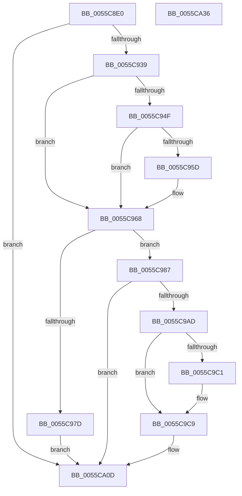

# EmonEnableMonitoringEnhanced

- RVA: `0x0055C8E0`–`0x0055CA37` (길이 `343` bytes)
- VA: `0x000000014055C8E0`
- 실행 섹션: `.text`
- PDB 이름 있음: `예`; PDB Function 태그: `아니요`
- unwind 정보 RVA: `0x00086C3C`
- 디코드: `94`개 명령, `343/343` bytes 표시
- 미해석 바이트: `0` (있으면 어셈블리에 `.byte`로 보존)

> 이 문서는 커널 이미지의 기계어와 PDB 기호를 분석해 생성했습니다. 4번과 5번은 함수 원형과 자료형을 바이너리 사용 방식에서 추정한 C 해석이며 원본 소스 복구 결과는 아닙니다.

## 1. Dependencies

- 직접 호출 지점: **7**; 고유 호출 대상: **6**
- 직접 호출자로 확인된 함수: **0**
- RIP 상대 이미지 참조: **1**

### Outgoing calls
- `0x0055C91A` → [HalpAcquireHighLevelLock](../2D/HalpAcquireHighLevelLock_function_002D2390.md) (function, `0x002D2390`)
- `0x0055C92A` → [HalpGetProfileDescriptor](../4B/HalpGetProfileDescriptor_function_004BB170.md) (function, `0x004BB170`)
- `0x0055C954` → [HalpGetProfileDescriptor](../4B/HalpGetProfileDescriptor_function_004BB170.md) (function, `0x004BB170`)
- `0x0055C974` → [KeCheckProcessorAffinityEx](../30/KeCheckProcessorAffinityEx_function_00305150.md) (function, `0x00305150`)
- `0x0055C9A2` → [EmonAllocateCounterEnhanced](EmonAllocateCounterEnhanced_function_0055C0B0.md) (function, `0x0055C0B0`)
- `0x0055CA08` → [EmonConfigureCounter](EmonConfigureCounter_function_0055C590.md) (function, `0x0055C590`)
- `0x0055CA17` → [HalpReleaseHighLevelLock](../2D/HalpReleaseHighLevelLock_function_002D1C58.md) (function, `0x002D1C58`)

### Direct callers
- 이 함수 시작 RVA로 연결되는 직접 call은 확인되지 않았습니다. 간접 호출은 완전히 역산할 수 없습니다.

### Static image references
- `0x0055C904` → RVA `0x00FC2BD0` (`.data`; read)

## 2. Other-region calls and transfers

- 다른 실행 섹션으로 향하는 call: **0**
- 별도 외부 분기/꼬리 이동을 확인하지 못했습니다.

## 3. Assembly (complete function range)

```asm
0055C8E0  48 8B C4                        mov rax, rsp
0055C8E3  48 89 58 08                     mov qword ptr [rax + 8], rbx
0055C8E7  4C 89 48 20                     mov qword ptr [rax + 0x20], r9
0055C8EB  4C 89 40 18                     mov qword ptr [rax + 0x18], r8
0055C8EF  55                              push rbp
0055C8F0  56                              push rsi
0055C8F1  57                              push rdi
0055C8F2  41 54                           push r12
0055C8F4  41 55                           push r13
0055C8F6  41 56                           push r14
0055C8F8  41 57                           push r15
0055C8FA  48 83 EC 50                     sub rsp, 0x50
0055C8FE  45 33 F6                        xor r14d, r14d
0055C901  44 8B E1                        mov r12d, ecx
0055C904  48 8D 0D C5 62 A6 00            lea rcx, [rip + 0xa662c5]
0055C90B  4C 89 70 B0                     mov qword ptr [rax - 0x50], r14
0055C90F  4C 89 70 B8                     mov qword ptr [rax - 0x48], r14
0055C913  44 8B FA                        mov r15d, edx
0055C916  44 89 70 A8                     mov dword ptr [rax - 0x58], r14d
0055C91A  E8 71 5A D7 FF                  call 0x1402d2390
0055C91F  4C 8D 44 24 38                  lea r8, [rsp + 0x38]
0055C924  41 8B CF                        mov ecx, r15d
0055C927  44 8A E8                        mov r13b, al
0055C92A  E8 41 E8 F5 FF                  call 0x1404bb170
0055C92F  8B F8                           mov edi, eax
0055C931  85 C0                           test eax, eax
0055C933  0F 88 D4 00 00 00               js 0x14055ca0d
0055C939  48 8B 5C 24 38                  mov rbx, qword ptr [rsp + 0x38]
0055C93E  48 8B F3                        mov rsi, rbx
0055C941  48 8B EB                        mov rbp, rbx
0055C944  8B 8B 38 01 00 00               mov ecx, dword ptr [rbx + 0x138]
0055C94A  83 F9 25                        cmp ecx, 0x25
0055C94D  74 19                           je 0x14055c968
0055C94F  4C 8D 44 24 40                  lea r8, [rsp + 0x40]
0055C954  E8 17 E8 F5 FF                  call 0x1404bb170
0055C959  85 C0                           test eax, eax
0055C95B  78 0B                           js 0x14055c968
0055C95D  48 8B 5C 24 40                  mov rbx, qword ptr [rsp + 0x40]
0055C962  48 8B F3                        mov rsi, rbx
0055C965  48 8B EB                        mov rbp, rbx
0055C968  65 8B 14 25 A4 01 00 00         mov edx, dword ptr gs:[0x1a4]
0055C970  48 8D 4B 20                     lea rcx, [rbx + 0x20]
0055C974  E8 D7 87 DA FF                  call 0x140305150
0055C979  85 C0                           test eax, eax
0055C97B  75 0A                           jne 0x14055c987
0055C97D  BF BB 00 00 C0                  mov edi, 0xc00000bb
0055C982  E9 86 00 00 00                  jmp 0x14055ca0d
0055C987  4C 8B B4 24 B8 00 00 00         mov r14, qword ptr [rsp + 0xb8]
0055C98F  4C 8D 4C 24 30                  lea r9, [rsp + 0x30]
0055C994  45 8B C7                        mov r8d, r15d
0055C997  4C 89 74 24 20                  mov qword ptr [rsp + 0x20], r14
0055C99C  48 8B D3                        mov rdx, rbx
0055C99F  41 8B CC                        mov ecx, r12d
0055C9A2  E8 09 F7 FF FF                  call 0x14055c0b0
0055C9A7  8B F8                           mov edi, eax
0055C9A9  85 C0                           test eax, eax
0055C9AB  78 60                           js 0x14055ca0d
0055C9AD  44 8B 54 24 30                  mov r10d, dword ptr [rsp + 0x30]
0055C9B2  45 85 E4                        test r12d, r12d
0055C9B5  45 8B C2                        mov r8d, r10d
0055C9B8  0F 94 C2                        sete dl
0055C9BB  41 83 3E 01                     cmp dword ptr [r14], 1
0055C9BF  75 08                           jne 0x14055c9c9
0055C9C1  41 0F BA E8 1E                  bts r8d, 0x1e
0055C9C6  48 8B F5                        mov rsi, rbp
0055C9C9  48 8B 84 24 B0 00 00 00         mov rax, qword ptr [rsp + 0xb0]
0055C9D1  41 8B CA                        mov ecx, r10d
0055C9D4  88 54 24 28                     mov byte ptr [rsp + 0x28], dl
0055C9D8  44 89 00                        mov dword ptr [rax], r8d
0055C9DB  41 B0 01                        mov r8b, 1
0055C9DE  48 8B 84 24 A8 00 00 00         mov rax, qword ptr [rsp + 0xa8]
0055C9E6  44 89 10                        mov dword ptr [rax], r10d
0055C9E9  48 8B 84 24 A0 00 00 00         mov rax, qword ptr [rsp + 0xa0]
0055C9F1  C7 00 01 00 00 00               mov dword ptr [rax], 1
0055C9F7  8B 83 30 01 00 00               mov eax, dword ptr [rbx + 0x130]
0055C9FD  44 8B 4E 18                     mov r9d, dword ptr [rsi + 0x18]
0055CA01  41 8B 16                        mov edx, dword ptr [r14]
0055CA04  89 44 24 20                     mov dword ptr [rsp + 0x20], eax
0055CA08  E8 83 FB FF FF                  call 0x14055c590
0055CA0D  41 8A D5                        mov dl, r13b
0055CA10  48 8D 0D B9 61 A6 00            lea rcx, [rip + 0xa661b9]
0055CA17  E8 3C 52 D7 FF                  call 0x1402d1c58
0055CA1C  48 8B 9C 24 90 00 00 00         mov rbx, qword ptr [rsp + 0x90]
0055CA24  8B C7                           mov eax, edi
0055CA26  48 83 C4 50                     add rsp, 0x50
0055CA2A  41 5F                           pop r15
0055CA2C  41 5E                           pop r14
0055CA2E  41 5D                           pop r13
0055CA30  41 5C                           pop r12
0055CA32  5F                              pop rdi
0055CA33  5E                              pop rsi
0055CA34  5D                              pop rbp
0055CA35  C3                              ret
0055CA36  CC                              int3
```

## 4. C-style interpretation (structured pseudocode)

```c
__int64 __fastcall EmonEnableMonitoringEnhanced(int a1, int a2, __int64 a3, __int64 a4, __int64 a5, __int64 a6)
{
    __int64 result;
    __int64 v_r14;
    __int64 v_rbp;
    __int64 v_rbx;
    __int64 v_rsi;
    __int64 v_rsp;
    unsigned __int64 v_stack_m48;
    unsigned __int64 v_stack_m50;
    unsigned __int64 v_stack_m58;
    unsigned __int8 v_stack_m60;
    unsigned __int64 v_stack_m68;
    unsigned __int64 v_stack_p18;
    unsigned __int64 v_stack_p20;
    unsigned __int64 v_stack_p8;

    *(unsigned __int64 *)(v_rsp + 8) = v_rbx;
    *(unsigned __int64 *)(v_rsp + 32) = a4;
    *(unsigned __int64 *)(v_rsp + 24) = a3;
    v_rsp = (v_rsp) - (80);
    v_r14 = 0;
    *(unsigned __int64 *)(v_rsp - 80) = 0;
    *(unsigned __int64 *)(v_rsp - 72) = 0;
    *(unsigned int *)(v_rsp - 88) = 0;
    result = HalpAcquireHighLevelLock(v_rip + 10904261, a2, a3, a4);
    result = HalpGetProfileDescriptor((unsigned int)((unsigned int)((unsigned int)(a2))), a2, v_stack_m50, a4);
    if (sign_flag) goto loc_0055CA0D;
    if (((unsigned int)((unsigned int)(*(unsigned int *)(v_stack_m50 + 312)))) == 37) goto loc_0055C968;
    result = HalpGetProfileDescriptor((unsigned int)(*(unsigned int *)(v_stack_m50 + 312)), a2, v_stack_m48, a4);
    v_rbx = v_stack_m50;
    v_rsi = v_stack_m50;
    v_rbp = v_stack_m50;
    if (!(sign_flag)) {
        v_rbx = v_stack_m48;
        v_rsi = v_rbx;
        v_rbp = v_rbx;
    }
    result = KeCheckProcessorAffinityEx(v_rbx + 32, (unsigned int)(*(unsigned int *)(gs_base + (0 + 420))), v_stack_m48, a4);
    if ((unsigned int)(result) != 0) goto loc_0055C987;
    goto loc_0055CA0D;
loc_0055C987:
    v_stack_m68 = a6;
    result = EmonAllocateCounterEnhanced((unsigned int)((unsigned int)((unsigned int)(a1))), v_rbx, (unsigned int)((unsigned int)((unsigned int)(a2))), v_stack_m58);
    if (sign_flag) goto loc_0055CA0D;
    a2 = ((unsigned int)((unsigned int)(a1)) == 0) ? 1 : 0;
    if ((*(unsigned int *)(a6)) == 1) {
        v_rsi = v_rbp;
    }
    v_stack_m60 = (unsigned __int8)(a2);
    *(unsigned int *)(a5) = (unsigned int)((unsigned int)((unsigned int)((unsigned int)(v_stack_m58))));
    *(unsigned int *)(v_stack_p20) = (unsigned int)((unsigned int)(v_stack_m58));
    *(unsigned int *)(v_stack_p18) = 1;
    v_stack_m68 = (unsigned int)((unsigned int)(*(unsigned int *)(v_rbx + 304)));
    result = EmonConfigureCounter((unsigned int)((unsigned int)((unsigned int)(v_stack_m58))), (unsigned int)(*(unsigned int *)(a6)), 1, (unsigned int)(*(unsigned int *)(v_rsi + 24)));
loc_0055CA0D:
    result = HalpReleaseHighLevelLock(v_rip + 10903993, (unsigned __int8)((unsigned __int8)(result)), 1, (unsigned int)(*(unsigned int *)(v_rsi + 24)));
    v_rsp = (v_rsp) + (80);
    return (unsigned int)((unsigned int)((unsigned int)((unsigned int)(result))));
}
```

## 5. (Beta) C Style

```c
int64_t EmonEnableMonitoringEnhanced(int32_t Arg1, int32_t Arg2, int64_t Arg3, int64_t Arg4, void *Arg5, void *Arg6)
{
    uint8_t *arg5 = (uint8_t *)Arg5;
    uint8_t *arg6 = (uint8_t *)Arg6;

    int64_t result;
    int64_t local_r14;
    int64_t local_rbp;
    int64_t local_rbx;
    int64_t local_rsi;
    int64_t local_rsp;
    uint64_t v_stack_m48;
    uint64_t v_stack_m50;
    uint64_t v_stack_m58;
    uint8_t v_stack_m60;
    uint64_t v_stack_m68;
    uint64_t v_stack_p18;
    uint64_t v_stack_p20;
    uint64_t v_stack_p8;

    *(uint64_t *)(local_rsp + 0x8) = local_rbx;
    *(uint64_t *)(local_rsp + 0x20) = Arg4;
    *(uint64_t *)(local_rsp + 0x18) = Arg3;
    local_rsp = (local_rsp) - (80);
    local_r14 = 0;
    *(uint64_t *)(local_rsp - 0x50) = 0;
    *(uint64_t *)(local_rsp - 0x48) = 0;
    *(uint32_t *)(local_rsp - 0x58) = 0;
    result = HalpAcquireHighLevelLock(v_rip + 10904261, Arg2, Arg3, Arg4);
    result = HalpGetProfileDescriptor((uint32_t)((uint32_t)((uint32_t)(Arg2))), Arg2, v_stack_m50, Arg4);
    if (sign_flag) goto loc_0055CA0D;
    if (((uint32_t)((uint32_t)(*(uint32_t *)(v_stack_m50 + 0x138)))) == 37) goto loc_0055C968;
    result = HalpGetProfileDescriptor((uint32_t)(*(uint32_t *)(v_stack_m50 + 0x138)), Arg2, v_stack_m48, Arg4);
    local_rbx = v_stack_m50;
    local_rsi = v_stack_m50;
    local_rbp = v_stack_m50;
    if (!(sign_flag)) {
        local_rbx = v_stack_m48;
        local_rsi = local_rbx;
        local_rbp = local_rbx;
    }
    result = KeCheckProcessorAffinityEx(local_rbx + 32, (uint32_t)(*(uint32_t *)(gs_base + (0 + 0x1A4))), v_stack_m48, Arg4);
    if ((uint32_t)(result) != 0) goto loc_0055C987;
    goto loc_0055CA0D;
loc_0055C987:
    v_stack_m68 = Arg6;
    result = EmonAllocateCounterEnhanced((uint32_t)((uint32_t)((uint32_t)(Arg1))), local_rbx, (uint32_t)((uint32_t)((uint32_t)(Arg2))), v_stack_m58);
    if (sign_flag) goto loc_0055CA0D;
    Arg2 = ((uint32_t)((uint32_t)(Arg1)) == 0) ? 1 : 0;
    if ((*(uint32_t *)(arg6)) == 1) {
        local_rsi = local_rbp;
    }
    v_stack_m60 = (uint8_t)(Arg2);
    *(uint32_t *)(arg5) = (uint32_t)((uint32_t)((uint32_t)((uint32_t)(v_stack_m58))));
    *(uint32_t *)(v_stack_p20) = (uint32_t)((uint32_t)(v_stack_m58));
    *(uint32_t *)(v_stack_p18) = 1;
    v_stack_m68 = (uint32_t)((uint32_t)(*(uint32_t *)(local_rbx + 0x130)));
    result = EmonConfigureCounter((uint32_t)((uint32_t)((uint32_t)(v_stack_m58))), (uint32_t)(*(uint32_t *)(arg6)), 1, (uint32_t)(*(uint32_t *)(local_rsi + 0x18)));
loc_0055CA0D:
    result = HalpReleaseHighLevelLock(v_rip + 10903993, (uint8_t)((uint8_t)(result)), 1, (uint32_t)(*(uint32_t *)(local_rsi + 0x18)));
    local_rsp = (local_rsp) + (80);
    return (uint32_t)((uint32_t)((uint32_t)((uint32_t)(result))));
}
```

### 관측된 메모리 오프셋

구조체 형식이 확인되지 않은 접근은 인자 기준의 오프셋으로만 기록했습니다.

| 기준 인자 | 오프셋 표현 | 폭 (bit) | 접근 |
|---|---:|---:|---|
| `Arg5` | `+ 0x0` | `32` | `W` |
| `Arg6` | `+ 0x0` | `32` | `R` |

## 6. Execution-region graph

[열기: 2D/3D 그래프와 함수 탐색 컨트롤 패널](../../../control-panel.html?section=text&rva=0x0055C8E0&view=graph)

- 2D 그래프는 위에서 아래로 흐르고, 3D 그래프는 빈 공간을 드래그해 회전합니다. Shift+드래그는 이동, 휠은 확대·축소, 함수 노드 선택은 대상 보고서 이동입니다.

### Static fallback


