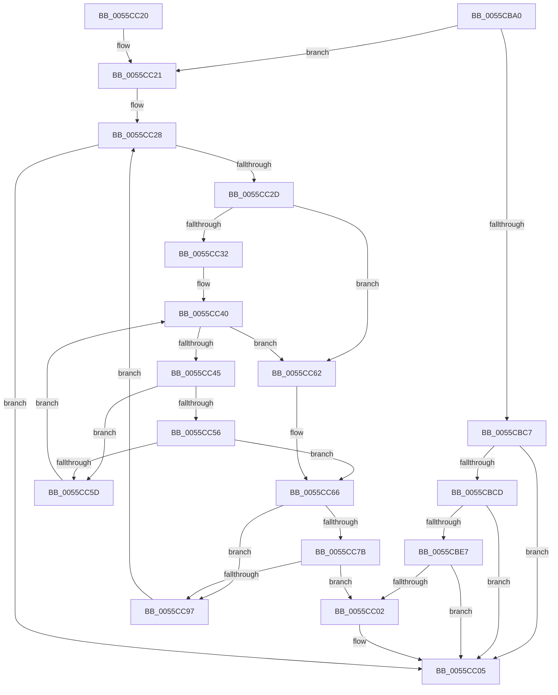

# EmonFindCounterToAllocateEnhanced

- RVA: `0x0055CBA0`–`0x0055CC9C` (길이 `252` bytes)
- VA: `0x000000014055CBA0`
- 실행 섹션: `.text`
- PDB 이름 있음: `예`; PDB Function 태그: `아니요`
- unwind 정보 RVA: `0x000C4A04`
- 디코드: `74`개 명령, `252/252` bytes 표시
- 미해석 바이트: `0` (있으면 어셈블리에 `.byte`로 보존)

> 이 문서는 커널 이미지의 기계어와 PDB 기호를 분석해 생성했습니다. 4번과 5번은 함수 원형과 자료형을 바이너리 사용 방식에서 추정한 C 해석이며 원본 소스 복구 결과는 아닙니다.

## 1. Dependencies

- 직접 호출 지점: **0**; 고유 호출 대상: **0**
- 직접 호출자로 확인된 함수: **1**
- RIP 상대 이미지 참조: **0**

### Outgoing calls
- 직접 디코드된 call 명령이 없습니다.

### Direct callers
- [EmonAllocateCounterEnhanced](EmonAllocateCounterEnhanced_function_0055C0B0.md) at `0x0055C127`

### Static image references
- 디코드된 RIP-relative 메모리 참조가 없습니다.

## 2. Other-region calls and transfers

- 다른 실행 섹션으로 향하는 call: **0**
- 별도 외부 분기/꼬리 이동을 확인하지 못했습니다.

## 3. Assembly (complete function range)

```asm
0055CBA0  48 8B C4                        mov rax, rsp
0055CBA3  48 89 58 08                     mov qword ptr [rax + 8], rbx
0055CBA7  48 89 70 10                     mov qword ptr [rax + 0x10], rsi
0055CBAB  48 89 78 18                     mov qword ptr [rax + 0x18], rdi
0055CBAF  4C 89 70 20                     mov qword ptr [rax + 0x20], r14
0055CBB3  44 8B 19                        mov r11d, dword ptr [rcx]
0055CBB6  45 33 D2                        xor r10d, r10d
0055CBB9  4D 8B F0                        mov r14, r8
0055CBBC  48 8B D9                        mov rbx, rcx
0055CBBF  45 8B CA                        mov r9d, r10d
0055CBC2  45 85 DB                        test r11d, r11d
0055CBC5  74 5A                           je 0x14055cc21
0055CBC7  41 83 FB 01                     cmp r11d, 1
0055CBCB  75 38                           jne 0x14055cc05
0055CBCD  44 0F B6 8A 34 01 00 00         movzx r9d, byte ptr [rdx + 0x134]
0055CBD5  48 8B 43 10                     mov rax, qword ptr [rbx + 0x10]
0055CBD9  4B 8D 0C 49                     lea rcx, [r9 + r9*2]
0055CBDD  48 03 C9                        add rcx, rcx
0055CBE0  83 7C C8 18 03                  cmp dword ptr [rax + rcx*8 + 0x18], 3
0055CBE5  75 1E                           jne 0x14055cc05
0055CBE7  B9 8F 03 00 00                  mov ecx, 0x38f
0055CBEC  0F 32                           rdmsr
0055CBEE  48 C1 E2 20                     shl rdx, 0x20
0055CBF2  41 8D 49 20                     lea ecx, [r9 + 0x20]
0055CBF6  48 0B D0                        or rdx, rax
0055CBF9  0F B6 C1                        movzx eax, cl
0055CBFC  48 0F A3 C2                     bt rdx, rax
0055CC00  72 03                           jb 0x14055cc05
0055CC02  41 B2 01                        mov r10b, 1
0055CC05  48 8B 5C 24 08                  mov rbx, qword ptr [rsp + 8]
0055CC0A  41 8A C2                        mov al, r10b
0055CC0D  48 8B 74 24 10                  mov rsi, qword ptr [rsp + 0x10]
0055CC12  48 8B 7C 24 18                  mov rdi, qword ptr [rsp + 0x18]
0055CC17  45 89 0E                        mov dword ptr [r14], r9d
0055CC1A  4C 8B 74 24 20                  mov r14, qword ptr [rsp + 0x20]
0055CC1F  C3                              ret
0055CC20  CC                              int3
0055CC21  8B 79 04                        mov edi, dword ptr [rcx + 4]
0055CC24  44 8D 47 FF                     lea r8d, [rdi - 1]
0055CC28  45 85 C0                        test r8d, r8d
0055CC2B  78 D8                           js 0x14055cc05
0055CC2D  44 3B C7                        cmp r8d, edi
0055CC30  73 30                           jae 0x14055cc62
0055CC32  48 8B 73 10                     mov rsi, qword ptr [rbx + 0x10]
0055CC36  41 8B D2                        mov edx, r10d
0055CC39  44 8B 5B 08                     mov r11d, dword ptr [rbx + 8]
0055CC3D  45 8B CA                        mov r9d, r10d
0055CC40  45 3B CB                        cmp r9d, r11d
0055CC43  77 1D                           ja 0x14055cc62
0055CC45  41 8B C1                        mov eax, r9d
0055CC48  48 8D 0C 40                     lea rcx, [rax + rax*2]
0055CC4C  48 03 C9                        add rcx, rcx
0055CC4F  83 7C CE 1C 03                  cmp dword ptr [rsi + rcx*8 + 0x1c], 3
0055CC54  74 07                           je 0x14055cc5d
0055CC56  FF C2                           inc edx
0055CC58  41 3B D0                        cmp edx, r8d
0055CC5B  77 09                           ja 0x14055cc66
0055CC5D  41 FF C1                        inc r9d
0055CC60  EB DE                           jmp 0x14055cc40
0055CC62  41 83 C9 FF                     or r9d, 0xffffffff
0055CC66  49 63 C1                        movsxd rax, r9d
0055CC69  48 8D 0C 40                     lea rcx, [rax + rax*2]
0055CC6D  48 8B 43 10                     mov rax, qword ptr [rbx + 0x10]
0055CC71  48 03 C9                        add rcx, rcx
0055CC74  83 7C C8 18 03                  cmp dword ptr [rax + rcx*8 + 0x18], 3
0055CC79  75 1C                           jne 0x14055cc97
0055CC7B  41 8D 89 86 01 00 00            lea ecx, [r9 + 0x186]
0055CC82  0F 32                           rdmsr
0055CC84  48 C1 E2 20                     shl rdx, 0x20
0055CC88  48 0B C2                        or rax, rdx
0055CC8B  48 A9 FF 00 40 00               test rax, 0x4000ff
0055CC91  0F 84 6B FF FF FF               je 0x14055cc02
0055CC97  41 FF C8                        dec r8d
0055CC9A  EB 8C                           jmp 0x14055cc28
```

## 4. C-style interpretation (structured pseudocode)

```c
__int64 __fastcall EmonFindCounterToAllocateEnhanced(__int64 a1, __int64 a2, __int64 a3)
{
    __int64 result;
    __int64 v_r10;
    unsigned __int64 v_stack_p10;
    unsigned __int64 v_stack_p18;
    unsigned __int64 v_stack_p20;
    unsigned __int64 v_stack_p8;

    *(unsigned __int64 *)(v_rsp + 8) = v_rbx;
    *(unsigned __int64 *)(v_rsp + 16) = v_rsi;
    *(unsigned __int64 *)(v_rsp + 24) = v_rdi;
    *(unsigned __int64 *)(v_rsp + 32) = v_r14;
    v_r10 = 0;
    if ((unsigned int)((unsigned int)(*(unsigned int *)(a1))) == 0) goto loc_0055CC21;
    if (((unsigned int)((unsigned int)(*(unsigned int *)(a1)))) != 1) goto loc_0055CC05;
    a1 = (*(unsigned __int8 *)(a2 + 308) + *(unsigned __int8 *)(a2 + 308) * 2) + (*(unsigned __int8 *)(a2 + 308) + *(unsigned __int8 *)(a2 + 308) * 2);
    if ((*(unsigned int *)(*(unsigned __int64 *)(a1 + 16) + a1 * 8 + 24)) != 3) goto loc_0055CC05;
    a2 = (a2) << (32);
    a2 = (a2) | (*(unsigned __int64 *)(a1 + 16));
    if (!(condition_is_below)) {
        v_r10 = 1;
    }
    *(unsigned int *)(a3) = (unsigned int)(*(unsigned __int8 *)(a2 + 308));
    return (unsigned __int8)(v_r10);
loc_0055CC21:
loc_0055CC28:
    if (sign_flag) goto loc_0055CC05;
    if (((unsigned int)((unsigned int)(*(unsigned int *)(*(unsigned __int8 *)(a2 + 308) + 32 + 4)) - 1)) >= ((unsigned int)((unsigned int)(*(unsigned int *)(*(unsigned __int8 *)(a2 + 308) + 32 + 4))))) goto loc_0055CC62;
loc_0055CC40:
    if (((unsigned int)((unsigned int)((unsigned int)(v_r10)))) > ((unsigned int)((unsigned int)(*(unsigned int *)(v_stack_p8 + 8))))) goto loc_0055CC62;
    a1 = ((unsigned int)((unsigned int)((unsigned int)((unsigned int)(v_r10)))) + (unsigned int)((unsigned int)((unsigned int)((unsigned int)(v_r10)))) * 2) + ((unsigned int)((unsigned int)((unsigned int)((unsigned int)(v_r10)))) + (unsigned int)((unsigned int)((unsigned int)((unsigned int)(v_r10)))) * 2);
    if ((*(unsigned int *)(*(unsigned __int64 *)(v_stack_p8 + 16) + a1 * 8 + 28)) == 3) goto loc_0055CC5D;
    a2 = (unsigned int)(((unsigned int)((unsigned int)(v_r10))) + 1);
    if (((unsigned int)(a2)) > ((unsigned int)((unsigned int)(*(unsigned int *)(*(unsigned __int8 *)(a2 + 308) + 32 + 4)) - 1))) goto loc_0055CC66;
loc_0055CC5D:
    a4 = (unsigned int)(((unsigned int)((unsigned int)(v_r10))) + 1);
    goto loc_0055CC40;
loc_0055CC62:
    a4 = (unsigned int)((a4) | (0xFFFFFFFFULL));
loc_0055CC66:
    a1 = ((int)((unsigned int)(a4)) + (int)((unsigned int)(a4)) * 2) + ((int)((unsigned int)(a4)) + (int)((unsigned int)(a4)) * 2);
    if ((*(unsigned int *)(*(unsigned __int64 *)(v_stack_p8 + 16) + a1 * 8 + 24)) != 3) goto loc_0055CC97;
    a2 = (a2) << (32);
    result = (*(unsigned __int64 *)(v_stack_p8 + 16)) | (a2);
    if (((result) & (0x4000FFULL)) == 0) goto loc_0055CC02;
loc_0055CC97:
    a3 = (unsigned int)(((unsigned int)(*(unsigned int *)(*(unsigned __int8 *)(a2 + 308) + 32 + 4)) - 1) - 1);
    goto loc_0055CC28;
}
```

## 5. (Beta) C Style

```c
int64_t EmonFindCounterToAllocateEnhanced(void *Arg1, void *Arg2, void *Arg3)
{
    uint8_t *arg1 = (uint8_t *)Arg1;
    uint8_t *arg2 = (uint8_t *)Arg2;
    uint8_t *arg3 = (uint8_t *)Arg3;

    int64_t result;
    int64_t local_r10;
    uint64_t v_stack_p10;
    uint64_t v_stack_p18;
    uint64_t v_stack_p20;
    uint64_t v_stack_p8;

    *(uint64_t *)(local_rsp + 0x8) = local_rbx;
    *(uint64_t *)(local_rsp + 0x10) = local_rsi;
    *(uint64_t *)(local_rsp + 0x18) = local_rdi;
    *(uint64_t *)(local_rsp + 0x20) = local_r14;
    local_r10 = 0;
    if ((uint32_t)((uint32_t)(*(uint32_t *)(arg1))) == 0) goto loc_0055CC21;
    if (((uint32_t)((uint32_t)(*(uint32_t *)(arg1)))) != 1) goto loc_0055CC05;
    Arg1 = (*(uint8_t *)(arg2 + 0x134) + *(uint8_t *)(arg2 + 0x134) * 2) + (*(uint8_t *)(arg2 + 0x134) + *(uint8_t *)(arg2 + 0x134) * 2);
    if ((*(uint32_t *)(*(uint64_t *)(arg1 + 0x10) + arg1 * 8 + 0x18)) != 3) goto loc_0055CC05;
    Arg2 = (Arg2) << (32);
    Arg2 = (Arg2) | (*(uint64_t *)(arg1 + 0x10));
    if (!(condition_is_below)) {
        local_r10 = 1;
    }
    *(uint32_t *)(arg3) = (uint32_t)(*(uint8_t *)(arg2 + 0x134));
    return (uint8_t)(local_r10);
loc_0055CC21:
loc_0055CC28:
    if (sign_flag) goto loc_0055CC05;
    if (((uint32_t)((uint32_t)(*(uint32_t *)(*(uint8_t *)(arg2 + 0x134) + 0x20 + 0x4)) - 1)) >= ((uint32_t)((uint32_t)(*(uint32_t *)(*(uint8_t *)(arg2 + 0x134) + 0x20 + 0x4))))) goto loc_0055CC62;
loc_0055CC40:
    if (((uint32_t)((uint32_t)((uint32_t)(local_r10)))) > ((uint32_t)((uint32_t)(*(uint32_t *)(v_stack_p8 + 0x8))))) goto loc_0055CC62;
    Arg1 = ((uint32_t)((uint32_t)((uint32_t)((uint32_t)(local_r10)))) + (uint32_t)((uint32_t)((uint32_t)((uint32_t)(local_r10)))) * 2) + ((uint32_t)((uint32_t)((uint32_t)((uint32_t)(local_r10)))) + (uint32_t)((uint32_t)((uint32_t)((uint32_t)(local_r10)))) * 2);
    if ((*(uint32_t *)(*(uint64_t *)(v_stack_p8 + 0x10) + arg1 * 8 + 0x1C)) == 3) goto loc_0055CC5D;
    Arg2 = (uint32_t)(((uint32_t)((uint32_t)(local_r10))) + 1);
    if (((uint32_t)(Arg2)) > ((uint32_t)((uint32_t)(*(uint32_t *)(*(uint8_t *)(arg2 + 0x134) + 0x20 + 0x4)) - 1))) goto loc_0055CC66;
loc_0055CC5D:
    a4 = (uint32_t)(((uint32_t)((uint32_t)(local_r10))) + 1);
    goto loc_0055CC40;
loc_0055CC62:
    a4 = (uint32_t)((a4) | (0xFFFFFFFFULL));
loc_0055CC66:
    Arg1 = ((int32_t)((uint32_t)(a4)) + (int32_t)((uint32_t)(a4)) * 2) + ((int32_t)((uint32_t)(a4)) + (int32_t)((uint32_t)(a4)) * 2);
    if ((*(uint32_t *)(*(uint64_t *)(v_stack_p8 + 0x10) + arg1 * 8 + 0x18)) != 3) goto loc_0055CC97;
    Arg2 = (Arg2) << (32);
    result = (*(uint64_t *)(v_stack_p8 + 0x10)) | (Arg2);
    if (((result) & (0x4000FFULL)) == 0) goto loc_0055CC02;
loc_0055CC97:
    Arg3 = (uint32_t)(((uint32_t)(*(uint32_t *)(*(uint8_t *)(arg2 + 0x134) + 0x20 + 0x4)) - 1) - 1);
    goto loc_0055CC28;
}
```

### 관측된 메모리 오프셋

구조체 형식이 확인되지 않은 접근은 인자 기준의 오프셋으로만 기록했습니다.

| 기준 인자 | 오프셋 표현 | 폭 (bit) | 접근 |
|---|---:|---:|---|
| `Arg1` | `+ 0x0` | `32` | `R` |
| `Arg1` | `+ 0x4` | `32` | `R` |
| `Arg1` | `+ 0x8` | `32` | `R` |
| `Arg1` | `+ 0x10` | `64` | `R` |
| `Arg2` | `+ 0x134` | `8` | `R` |
| `Arg3` | `+ 0x0` | `32` | `W` |

## 6. Execution-region graph

[열기: 2D/3D 그래프와 함수 탐색 컨트롤 패널](../../../control-panel.html?section=text&rva=0x0055CBA0&view=graph)

- 2D 그래프는 위에서 아래로 흐르고, 3D 그래프는 빈 공간을 드래그해 회전합니다. Shift+드래그는 이동, 휠은 확대·축소, 함수 노드 선택은 대상 보고서 이동입니다.

### Static fallback


