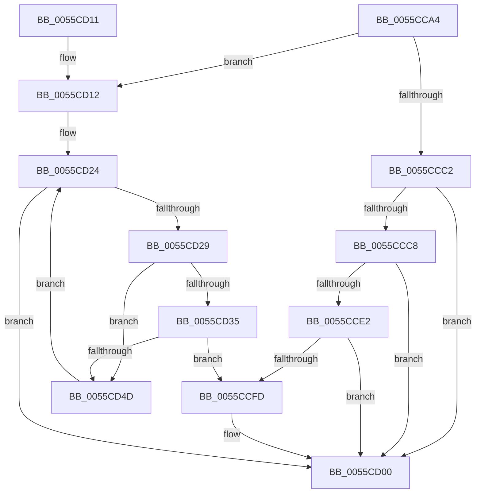

# EmonFindCounterToAllocateOriginal

- RVA: `0x0055CCA4`–`0x0055CD59` (길이 `181` bytes)
- VA: `0x000000014055CCA4`
- 실행 섹션: `.text`
- PDB 이름 있음: `예`; PDB Function 태그: `아니요`
- unwind 정보 RVA: `0x000C49F4`
- 디코드: `52`개 명령, `181/181` bytes 표시
- 미해석 바이트: `0` (있으면 어셈블리에 `.byte`로 보존)

> 이 문서는 커널 이미지의 기계어와 PDB 기호를 분석해 생성했습니다. 4번과 5번은 함수 원형과 자료형을 바이너리 사용 방식에서 추정한 C 해석이며 원본 소스 복구 결과는 아닙니다.

## 1. Dependencies

- 직접 호출 지점: **0**; 고유 호출 대상: **0**
- 직접 호출자로 확인된 함수: **1**
- RIP 상대 이미지 참조: **0**

### Outgoing calls
- 직접 디코드된 call 명령이 없습니다.

### Direct callers
- [EmonAllocateCounterOriginal](EmonAllocateCounterOriginal_function_0055C24C.md) at `0x0055C2C3`

### Static image references
- 디코드된 RIP-relative 메모리 참조가 없습니다.

## 2. Other-region calls and transfers

- 다른 실행 섹션으로 향하는 call: **0**
- 별도 외부 분기/꼬리 이동을 확인하지 못했습니다.

## 3. Assembly (complete function range)

```asm
0055CCA4  48 89 5C 24 08                  mov qword ptr [rsp + 8], rbx
0055CCA9  48 89 7C 24 10                  mov qword ptr [rsp + 0x10], rdi
0055CCAE  44 8B 19                        mov r11d, dword ptr [rcx]
0055CCB1  45 33 D2                        xor r10d, r10d
0055CCB4  49 8B F8                        mov rdi, r8
0055CCB7  48 8B D9                        mov rbx, rcx
0055CCBA  45 8B CA                        mov r9d, r10d
0055CCBD  45 85 DB                        test r11d, r11d
0055CCC0  74 50                           je 0x14055cd12
0055CCC2  41 83 FB 01                     cmp r11d, 1
0055CCC6  75 38                           jne 0x14055cd00
0055CCC8  44 0F B6 8A 34 01 00 00         movzx r9d, byte ptr [rdx + 0x134]
0055CCD0  48 8B 43 10                     mov rax, qword ptr [rbx + 0x10]
0055CCD4  4B 8D 0C 49                     lea rcx, [r9 + r9*2]
0055CCD8  48 03 C9                        add rcx, rcx
0055CCDB  83 7C C8 18 03                  cmp dword ptr [rax + rcx*8 + 0x18], 3
0055CCE0  75 1E                           jne 0x14055cd00
0055CCE2  B9 8F 03 00 00                  mov ecx, 0x38f
0055CCE7  0F 32                           rdmsr
0055CCE9  48 C1 E2 20                     shl rdx, 0x20
0055CCED  41 8D 49 20                     lea ecx, [r9 + 0x20]
0055CCF1  48 0B D0                        or rdx, rax
0055CCF4  0F B6 C1                        movzx eax, cl
0055CCF7  48 0F A3 C2                     bt rdx, rax
0055CCFB  72 03                           jb 0x14055cd00
0055CCFD  41 B2 01                        mov r10b, 1
0055CD00  48 8B 5C 24 08                  mov rbx, qword ptr [rsp + 8]
0055CD05  41 8A C2                        mov al, r10b
0055CD08  44 89 0F                        mov dword ptr [rdi], r9d
0055CD0B  48 8B 7C 24 10                  mov rdi, qword ptr [rsp + 0x10]
0055CD10  C3                              ret
0055CD11  CC                              int3
0055CD12  44 8B 49 04                     mov r9d, dword ptr [rcx + 4]
0055CD16  41 FF C9                        dec r9d
0055CD19  4D 63 C1                        movsxd r8, r9d
0055CD1C  4F 8D 1C 40                     lea r11, [r8 + r8*2]
0055CD20  49 C1 E3 04                     shl r11, 4
0055CD24  4D 85 C0                        test r8, r8
0055CD27  78 D7                           js 0x14055cd00
0055CD29  48 8B 43 10                     mov rax, qword ptr [rbx + 0x10]
0055CD2D  41 83 7C 03 18 03               cmp dword ptr [r11 + rax + 0x18], 3
0055CD33  75 18                           jne 0x14055cd4d
0055CD35  41 8D 89 86 01 00 00            lea ecx, [r9 + 0x186]
0055CD3C  0F 32                           rdmsr
0055CD3E  48 C1 E2 20                     shl rdx, 0x20
0055CD42  48 0B C2                        or rax, rdx
0055CD45  48 A9 FF 00 40 00               test rax, 0x4000ff
0055CD4B  74 B0                           je 0x14055ccfd
0055CD4D  41 FF C9                        dec r9d
0055CD50  49 FF C8                        dec r8
0055CD53  49 83 EB 30                     sub r11, 0x30
0055CD57  EB CB                           jmp 0x14055cd24
```

## 4. C-style interpretation (structured pseudocode)

```c
__int64 __fastcall EmonFindCounterToAllocateOriginal(__int64 a1, __int64 a2, __int64 a3)
{
    __int64 result;
    __int64 v_r10;
    __int64 v_r11;
    unsigned __int64 v_stack_p10;
    unsigned __int64 v_stack_p8;

    v_stack_p8 = v_rbx;
    v_stack_p10 = v_rdi;
    v_r10 = 0;
    if ((unsigned int)((unsigned int)(*(unsigned int *)(a1))) == 0) goto loc_0055CD12;
    if (((unsigned int)((unsigned int)(*(unsigned int *)(a1)))) != 1) goto loc_0055CD00;
    a1 = (*(unsigned __int8 *)(a2 + 308) + *(unsigned __int8 *)(a2 + 308) * 2) + (*(unsigned __int8 *)(a2 + 308) + *(unsigned __int8 *)(a2 + 308) * 2);
    if ((*(unsigned int *)(*(unsigned __int64 *)(a1 + 16) + a1 * 8 + 24)) != 3) goto loc_0055CD00;
    a2 = (a2) << (32);
    a2 = (a2) | (*(unsigned __int64 *)(a1 + 16));
    if (!(condition_is_below)) {
        v_r10 = 1;
    }
    *(unsigned int *)(a3) = (unsigned int)(*(unsigned __int8 *)(a2 + 308));
    return (unsigned __int8)(v_r10);
loc_0055CD12:
    a4 = (unsigned int)(((unsigned int)(*(unsigned int *)(*(unsigned __int8 *)(a2 + 308) + 32 + 4))) - 1);
    v_r11 = ((int)((unsigned int)(a4)) + (int)((unsigned int)(a4)) * 2) << (4);
loc_0055CD24:
    if (sign_flag) goto loc_0055CD00;
    if ((*(unsigned int *)(v_r11 + *(unsigned __int64 *)(v_stack_p8 + 16) * 1 + 24)) != 3) goto loc_0055CD4D;
    a2 = (a2) << (32);
    result = (*(unsigned __int64 *)(v_stack_p8 + 16)) | (a2);
    if (((result) & (0x4000FFULL)) == 0) goto loc_0055CCFD;
loc_0055CD4D:
    a4 = (unsigned int)((a4) - 1);
    a3 = ((int)((unsigned int)(a4))) - 1;
    v_r11 = (v_r11) - (48);
    goto loc_0055CD24;
}
```

## 5. (Beta) C Style

```c
int64_t EmonFindCounterToAllocateOriginal(void *Arg1, void *Arg2, void *Arg3)
{
    uint8_t *arg1 = (uint8_t *)Arg1;
    uint8_t *arg2 = (uint8_t *)Arg2;
    uint8_t *arg3 = (uint8_t *)Arg3;

    int64_t result;
    int64_t local_r10;
    int64_t local_r11;
    uint64_t v_stack_p10;
    uint64_t v_stack_p8;

    v_stack_p8 = local_rbx;
    v_stack_p10 = local_rdi;
    local_r10 = 0;
    if ((uint32_t)((uint32_t)(*(uint32_t *)(arg1))) == 0) goto loc_0055CD12;
    if (((uint32_t)((uint32_t)(*(uint32_t *)(arg1)))) != 1) goto loc_0055CD00;
    Arg1 = (*(uint8_t *)(arg2 + 0x134) + *(uint8_t *)(arg2 + 0x134) * 2) + (*(uint8_t *)(arg2 + 0x134) + *(uint8_t *)(arg2 + 0x134) * 2);
    if ((*(uint32_t *)(*(uint64_t *)(arg1 + 0x10) + arg1 * 8 + 0x18)) != 3) goto loc_0055CD00;
    Arg2 = (Arg2) << (32);
    Arg2 = (Arg2) | (*(uint64_t *)(arg1 + 0x10));
    if (!(condition_is_below)) {
        local_r10 = 1;
    }
    *(uint32_t *)(arg3) = (uint32_t)(*(uint8_t *)(arg2 + 0x134));
    return (uint8_t)(local_r10);
loc_0055CD12:
    a4 = (uint32_t)(((uint32_t)(*(uint32_t *)(*(uint8_t *)(arg2 + 0x134) + 0x20 + 0x4))) - 1);
    local_r11 = ((int32_t)((uint32_t)(a4)) + (int32_t)((uint32_t)(a4)) * 2) << (4);
loc_0055CD24:
    if (sign_flag) goto loc_0055CD00;
    if ((*(uint32_t *)(local_r11 + *(uint64_t *)(v_stack_p8 + 0x10) * 1 + 0x18)) != 3) goto loc_0055CD4D;
    Arg2 = (Arg2) << (32);
    result = (*(uint64_t *)(v_stack_p8 + 0x10)) | (Arg2);
    if (((result) & (0x4000FFULL)) == 0) goto loc_0055CCFD;
loc_0055CD4D:
    a4 = (uint32_t)((a4) - 1);
    Arg3 = ((int32_t)((uint32_t)(a4))) - 1;
    local_r11 = (local_r11) - (48);
    goto loc_0055CD24;
}
```

### 관측된 메모리 오프셋

구조체 형식이 확인되지 않은 접근은 인자 기준의 오프셋으로만 기록했습니다.

| 기준 인자 | 오프셋 표현 | 폭 (bit) | 접근 |
|---|---:|---:|---|
| `Arg1` | `+ 0x0` | `32` | `R` |
| `Arg1` | `+ 0x4` | `32` | `R` |
| `Arg1` | `+ 0x10` | `64` | `R` |
| `Arg2` | `+ 0x134` | `8` | `R` |
| `Arg3` | `+ 0x0` | `32` | `W` |

## 6. Execution-region graph

[열기: 2D/3D 그래프와 함수 탐색 컨트롤 패널](../../../control-panel.html?section=text&rva=0x0055CCA4&view=graph)

- 2D 그래프는 위에서 아래로 흐르고, 3D 그래프는 빈 공간을 드래그해 회전합니다. Shift+드래그는 이동, 휠은 확대·축소, 함수 노드 선택은 대상 보고서 이동입니다.

### Static fallback


