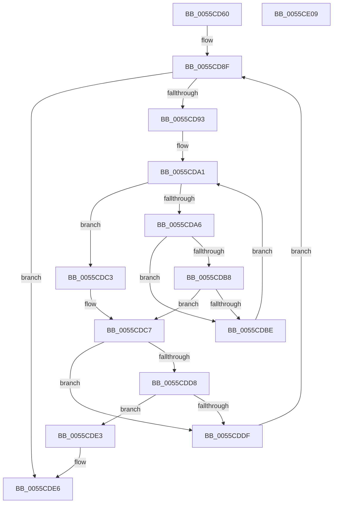

# EmonFindCounterToDisableEnhanced

- RVA: `0x0055CD60`–`0x0055CE0A` (길이 `170` bytes)
- VA: `0x000000014055CD60`
- 실행 섹션: `.text`
- PDB 이름 있음: `예`; PDB Function 태그: `아니요`
- unwind 정보 RVA: `0x000BE9E8`
- 디코드: `56`개 명령, `170/170` bytes 표시
- 미해석 바이트: `0` (있으면 어셈블리에 `.byte`로 보존)

> 이 문서는 커널 이미지의 기계어와 PDB 기호를 분석해 생성했습니다. 4번과 5번은 함수 원형과 자료형을 바이너리 사용 방식에서 추정한 C 해석이며 원본 소스 복구 결과는 아닙니다.

## 1. Dependencies

- 직접 호출 지점: **0**; 고유 호출 대상: **0**
- 직접 호출자로 확인된 함수: **1**
- RIP 상대 이미지 참조: **0**

### Outgoing calls
- 직접 디코드된 call 명령이 없습니다.

### Direct callers
- [EmonDisableMonitoringEnhanced](EmonDisableMonitoringEnhanced_function_0055C740.md) at `0x0055C7A2`
- [EmonDisableMonitoringEnhanced](EmonDisableMonitoringEnhanced_function_0055C740.md) at `0x0055C7BB`

### Static image references
- 디코드된 RIP-relative 메모리 참조가 없습니다.

## 2. Other-region calls and transfers

- 다른 실행 섹션으로 향하는 call: **0**
- 별도 외부 분기/꼬리 이동을 확인하지 못했습니다.

## 3. Assembly (complete function range)

```asm
0055CD60  48 8B C4                        mov rax, rsp
0055CD63  48 89 58 08                     mov qword ptr [rax + 8], rbx
0055CD67  48 89 68 10                     mov qword ptr [rax + 0x10], rbp
0055CD6B  48 89 70 18                     mov qword ptr [rax + 0x18], rsi
0055CD6F  48 89 78 20                     mov qword ptr [rax + 0x20], rdi
0055CD73  41 56                           push r14
0055CD75  41 57                           push r15
0055CD77  8B 69 04                        mov ebp, dword ptr [rcx + 4]
0055CD7A  45 33 DB                        xor r11d, r11d
0055CD7D  45 8B D3                        mov r10d, r11d
0055CD80  41 8B DB                        mov ebx, r11d
0055CD83  49 8B F1                        mov rsi, r9
0055CD86  4D 8B F0                        mov r14, r8
0055CD89  44 8B FA                        mov r15d, edx
0055CD8C  48 8B F9                        mov rdi, rcx
0055CD8F  3B DD                           cmp ebx, ebp
0055CD91  73 53                           jae 0x14055cde6
0055CD93  4C 8B 47 10                     mov r8, qword ptr [rdi + 0x10]
0055CD97  41 8B D3                        mov edx, r11d
0055CD9A  44 8B 4F 08                     mov r9d, dword ptr [rdi + 8]
0055CD9E  45 8B D3                        mov r10d, r11d
0055CDA1  45 3B D1                        cmp r10d, r9d
0055CDA4  77 1D                           ja 0x14055cdc3
0055CDA6  41 8B C2                        mov eax, r10d
0055CDA9  48 8D 0C 40                     lea rcx, [rax + rax*2]
0055CDAD  48 03 C9                        add rcx, rcx
0055CDB0  41 83 7C C8 1C 03               cmp dword ptr [r8 + rcx*8 + 0x1c], 3
0055CDB6  74 06                           je 0x14055cdbe
0055CDB8  FF C2                           inc edx
0055CDBA  3B D3                           cmp edx, ebx
0055CDBC  77 09                           ja 0x14055cdc7
0055CDBE  41 FF C2                        inc r10d
0055CDC1  EB DE                           jmp 0x14055cda1
0055CDC3  41 83 CA FF                     or r10d, 0xffffffff
0055CDC7  41 8B C2                        mov eax, r10d
0055CDCA  48 8D 0C 40                     lea rcx, [rax + rax*2]
0055CDCE  48 03 C9                        add rcx, rcx
0055CDD1  45 39 5C C8 18                  cmp dword ptr [r8 + rcx*8 + 0x18], r11d
0055CDD6  75 07                           jne 0x14055cddf
0055CDD8  45 39 7C C8 24                  cmp dword ptr [r8 + rcx*8 + 0x24], r15d
0055CDDD  74 04                           je 0x14055cde3
0055CDDF  FF C3                           inc ebx
0055CDE1  EB AC                           jmp 0x14055cd8f
0055CDE3  41 B3 01                        mov r11b, 1
0055CDE6  8B 0F                           mov ecx, dword ptr [rdi]
0055CDE8  41 8A C3                        mov al, r11b
0055CDEB  48 8B 5C 24 18                  mov rbx, qword ptr [rsp + 0x18]
0055CDF0  48 8B 6C 24 20                  mov rbp, qword ptr [rsp + 0x20]
0055CDF5  48 8B 7C 24 30                  mov rdi, qword ptr [rsp + 0x30]
0055CDFA  89 0E                           mov dword ptr [rsi], ecx
0055CDFC  48 8B 74 24 28                  mov rsi, qword ptr [rsp + 0x28]
0055CE01  45 89 16                        mov dword ptr [r14], r10d
0055CE04  41 5F                           pop r15
0055CE06  41 5E                           pop r14
0055CE08  C3                              ret
0055CE09  CC                              int3
```

## 4. C-style interpretation (structured pseudocode)

```c
__int64 __fastcall EmonFindCounterToDisableEnhanced(__int64 a1, int a2, __int64 a3, __int64 a4)
{
    __int64 v_r10;
    __int64 v_r11;
    __int64 v_rbx;
    unsigned __int64 v_stack_p10;
    unsigned __int64 v_stack_p18;
    unsigned __int64 v_stack_p20;
    unsigned __int64 v_stack_p8;

    *(unsigned __int64 *)(v_rsp + 8) = v_rbx;
    *(unsigned __int64 *)(v_rsp + 16) = v_rbp;
    *(unsigned __int64 *)(v_rsp + 24) = v_rsi;
    *(unsigned __int64 *)(v_rsp + 32) = v_rdi;
    v_r11 = 0;
loc_0055CD8F:
    if (0 >= ((unsigned int)((unsigned int)(*(unsigned int *)(a1 + 4))))) goto loc_0055CDE6;
loc_0055CDA1:
    if (0 > ((unsigned int)((unsigned int)(*(unsigned int *)(a1 + 8))))) goto loc_0055CDC3;
    a1 = (0 + 0 * 2) + (0 + 0 * 2);
    if ((*(unsigned int *)(*(unsigned __int64 *)(a1 + 16) + a1 * 8 + 28)) == 3) goto loc_0055CDBE;
    a2 = (unsigned int)((0) + 1);
    if (a2 > 0) goto loc_0055CDC7;
loc_0055CDBE:
    v_r10 = (unsigned int)((0) + 1);
    goto loc_0055CDA1;
loc_0055CDC3:
    v_r10 = (unsigned int)((v_r10) | (0xFFFFFFFFULL));
loc_0055CDC7:
    a1 = ((unsigned int)((unsigned int)(v_r10)) + (unsigned int)((unsigned int)(v_r10)) * 2) + ((unsigned int)((unsigned int)(v_r10)) + (unsigned int)((unsigned int)(v_r10)) * 2);
    if ((*(unsigned int *)(*(unsigned __int64 *)(a1 + 16) + a1 * 8 + 24)) != 0) goto loc_0055CDDF;
    if ((*(unsigned int *)(*(unsigned __int64 *)(a1 + 16) + a1 * 8 + 36)) == ((unsigned int)((unsigned int)(a2)))) goto loc_0055CDE3;
loc_0055CDDF:
    v_rbx = (unsigned int)((0) + 1);
    goto loc_0055CD8F;
loc_0055CDE3:
loc_0055CDE6:
    *(unsigned int *)(a4) = (unsigned int)((unsigned int)(*(unsigned int *)(a1)));
    *(unsigned int *)(a3) = (unsigned int)(v_r10);
    return 1;
}
```

## 5. (Beta) C Style

```c
int64_t EmonFindCounterToDisableEnhanced(void *Arg1, int32_t Arg2, void *Arg3, void *Arg4)
{
    uint8_t *arg1 = (uint8_t *)Arg1;
    uint8_t *arg3 = (uint8_t *)Arg3;
    uint8_t *arg4 = (uint8_t *)Arg4;

    int64_t local_r10;
    int64_t local_r11;
    int64_t local_rbx;
    uint64_t v_stack_p10;
    uint64_t v_stack_p18;
    uint64_t v_stack_p20;
    uint64_t v_stack_p8;

    *(uint64_t *)(local_rsp + 0x8) = local_rbx;
    *(uint64_t *)(local_rsp + 0x10) = local_rbp;
    *(uint64_t *)(local_rsp + 0x18) = local_rsi;
    *(uint64_t *)(local_rsp + 0x20) = local_rdi;
    local_r11 = 0;
loc_0055CD8F:
    if (0 >= ((uint32_t)((uint32_t)(*(uint32_t *)(arg1 + 0x4))))) goto loc_0055CDE6;
loc_0055CDA1:
    if (0 > ((uint32_t)((uint32_t)(*(uint32_t *)(arg1 + 0x8))))) goto loc_0055CDC3;
    Arg1 = (0 + 0 * 2) + (0 + 0 * 2);
    if ((*(uint32_t *)(*(uint64_t *)(arg1 + 0x10) + arg1 * 8 + 0x1C)) == 3) goto loc_0055CDBE;
    Arg2 = (uint32_t)((0) + 1);
    if (Arg2 > 0) goto loc_0055CDC7;
loc_0055CDBE:
    local_r10 = (uint32_t)((0) + 1);
    goto loc_0055CDA1;
loc_0055CDC3:
    local_r10 = (uint32_t)((local_r10) | (0xFFFFFFFFULL));
loc_0055CDC7:
    Arg1 = ((uint32_t)((uint32_t)(local_r10)) + (uint32_t)((uint32_t)(local_r10)) * 2) + ((uint32_t)((uint32_t)(local_r10)) + (uint32_t)((uint32_t)(local_r10)) * 2);
    if ((*(uint32_t *)(*(uint64_t *)(arg1 + 0x10) + arg1 * 8 + 0x18)) != 0) goto loc_0055CDDF;
    if ((*(uint32_t *)(*(uint64_t *)(arg1 + 0x10) + arg1 * 8 + 0x24)) == ((uint32_t)((uint32_t)(Arg2)))) goto loc_0055CDE3;
loc_0055CDDF:
    local_rbx = (uint32_t)((0) + 1);
    goto loc_0055CD8F;
loc_0055CDE3:
loc_0055CDE6:
    *(uint32_t *)(arg4) = (uint32_t)((uint32_t)(*(uint32_t *)(arg1)));
    *(uint32_t *)(arg3) = (uint32_t)(local_r10);
    return 1;
}
```

### 관측된 메모리 오프셋

구조체 형식이 확인되지 않은 접근은 인자 기준의 오프셋으로만 기록했습니다.

| 기준 인자 | 오프셋 표현 | 폭 (bit) | 접근 |
|---|---:|---:|---|
| `Arg1` | `+ 0x0` | `32` | `R` |
| `Arg1` | `+ 0x4` | `32` | `R` |
| `Arg1` | `+ 0x8` | `32` | `R` |
| `Arg1` | `+ 0x10` | `64` | `R` |
| `Arg3` | `+ 0x0` | `32` | `W` |
| `Arg4` | `+ 0x0` | `32` | `W` |

## 6. Execution-region graph

[열기: 2D/3D 그래프와 함수 탐색 컨트롤 패널](../../../control-panel.html?section=text&rva=0x0055CD60&view=graph)

- 2D 그래프는 위에서 아래로 흐르고, 3D 그래프는 빈 공간을 드래그해 회전합니다. Shift+드래그는 이동, 휠은 확대·축소, 함수 노드 선택은 대상 보고서 이동입니다.

### Static fallback


