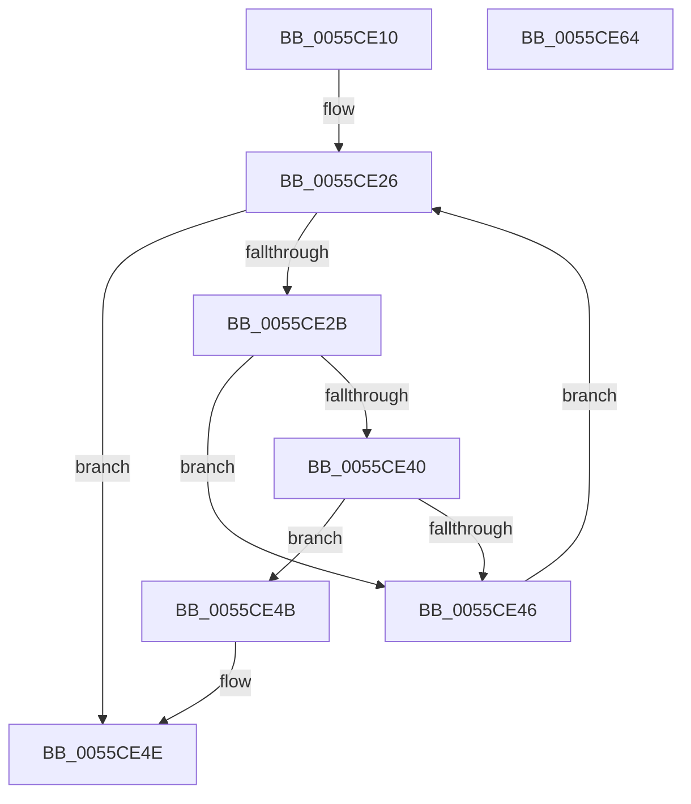

# EmonFindCounterToDisableOriginal

- RVA: `0x0055CE10`–`0x0055CE65` (길이 `85` bytes)
- VA: `0x000000014055CE10`
- 실행 섹션: `.text`
- PDB 이름 있음: `예`; PDB Function 태그: `아니요`
- unwind 정보 RVA: `0x000950EC`
- 디코드: `27`개 명령, `85/85` bytes 표시
- 미해석 바이트: `0` (있으면 어셈블리에 `.byte`로 보존)

> 이 문서는 커널 이미지의 기계어와 PDB 기호를 분석해 생성했습니다. 4번과 5번은 함수 원형과 자료형을 바이너리 사용 방식에서 추정한 C 해석이며 원본 소스 복구 결과는 아닙니다.

## 1. Dependencies

- 직접 호출 지점: **0**; 고유 호출 대상: **0**
- 직접 호출자로 확인된 함수: **1**
- RIP 상대 이미지 참조: **0**

### Outgoing calls
- 직접 디코드된 call 명령이 없습니다.

### Direct callers
- [EmonDisableMonitoringOriginal](EmonDisableMonitoringOriginal_function_0055C810.md) at `0x0055C872`
- [EmonDisableMonitoringOriginal](EmonDisableMonitoringOriginal_function_0055C810.md) at `0x0055C889`

### Static image references
- 디코드된 RIP-relative 메모리 참조가 없습니다.

## 2. Other-region calls and transfers

- 다른 실행 섹션으로 향하는 call: **0**
- 별도 외부 분기/꼬리 이동을 확인하지 못했습니다.

## 3. Assembly (complete function range)

```asm
0055CE10  48 89 5C 24 08                  mov qword ptr [rsp + 8], rbx
0055CE15  48 89 7C 24 10                  mov qword ptr [rsp + 0x10], rdi
0055CE1A  8B 79 04                        mov edi, dword ptr [rcx + 4]
0055CE1D  45 33 DB                        xor r11d, r11d
0055CE20  45 8B D3                        mov r10d, r11d
0055CE23  48 8B D9                        mov rbx, rcx
0055CE26  44 3B D7                        cmp r10d, edi
0055CE29  73 23                           jae 0x14055ce4e
0055CE2B  41 8B C2                        mov eax, r10d
0055CE2E  48 8D 0C 40                     lea rcx, [rax + rax*2]
0055CE32  48 8B 43 10                     mov rax, qword ptr [rbx + 0x10]
0055CE36  48 03 C9                        add rcx, rcx
0055CE39  44 39 5C C8 18                  cmp dword ptr [rax + rcx*8 + 0x18], r11d
0055CE3E  75 06                           jne 0x14055ce46
0055CE40  39 54 C8 24                     cmp dword ptr [rax + rcx*8 + 0x24], edx
0055CE44  74 05                           je 0x14055ce4b
0055CE46  41 FF C2                        inc r10d
0055CE49  EB DB                           jmp 0x14055ce26
0055CE4B  41 B3 01                        mov r11b, 1
0055CE4E  8B 0B                           mov ecx, dword ptr [rbx]
0055CE50  41 8A C3                        mov al, r11b
0055CE53  48 8B 5C 24 08                  mov rbx, qword ptr [rsp + 8]
0055CE58  48 8B 7C 24 10                  mov rdi, qword ptr [rsp + 0x10]
0055CE5D  41 89 09                        mov dword ptr [r9], ecx
0055CE60  45 89 10                        mov dword ptr [r8], r10d
0055CE63  C3                              ret
0055CE64  CC                              int3
```

## 4. C-style interpretation (structured pseudocode)

```c
__int64 __fastcall EmonFindCounterToDisableOriginal(__int64 a1, int a2, __int64 a3, __int64 a4)
{
    __int64 v_r10;
    __int64 v_r11;
    unsigned __int64 v_stack_p10;
    unsigned __int64 v_stack_p8;

    v_stack_p8 = v_rbx;
    v_stack_p10 = v_rdi;
    v_r11 = 0;
loc_0055CE26:
    if (0 >= ((unsigned int)((unsigned int)(*(unsigned int *)(a1 + 4))))) goto loc_0055CE4E;
    a1 = (0 + 0 * 2) + (0 + 0 * 2);
    if ((*(unsigned int *)(*(unsigned __int64 *)(a1 + 16) + a1 * 8 + 24)) != 0) goto loc_0055CE46;
    if ((*(unsigned int *)(*(unsigned __int64 *)(a1 + 16) + a1 * 8 + 36)) == a2) goto loc_0055CE4B;
loc_0055CE46:
    v_r10 = (unsigned int)((0) + 1);
    goto loc_0055CE26;
loc_0055CE4B:
loc_0055CE4E:
    *(unsigned int *)(a4) = (unsigned int)((unsigned int)(*(unsigned int *)(a1)));
    *(unsigned int *)(a3) = (unsigned int)(v_r10);
    return 1;
}
```

## 5. (Beta) C Style

```c
int64_t EmonFindCounterToDisableOriginal(void *Arg1, int32_t Arg2, void *Arg3, void *Arg4)
{
    uint8_t *arg1 = (uint8_t *)Arg1;
    uint8_t *arg3 = (uint8_t *)Arg3;
    uint8_t *arg4 = (uint8_t *)Arg4;

    int64_t local_r10;
    int64_t local_r11;
    uint64_t v_stack_p10;
    uint64_t v_stack_p8;

    v_stack_p8 = local_rbx;
    v_stack_p10 = local_rdi;
    local_r11 = 0;
loc_0055CE26:
    if (0 >= ((uint32_t)((uint32_t)(*(uint32_t *)(arg1 + 0x4))))) goto loc_0055CE4E;
    Arg1 = (0 + 0 * 2) + (0 + 0 * 2);
    if ((*(uint32_t *)(*(uint64_t *)(arg1 + 0x10) + arg1 * 8 + 0x18)) != 0) goto loc_0055CE46;
    if ((*(uint32_t *)(*(uint64_t *)(arg1 + 0x10) + arg1 * 8 + 0x24)) == Arg2) goto loc_0055CE4B;
loc_0055CE46:
    local_r10 = (uint32_t)((0) + 1);
    goto loc_0055CE26;
loc_0055CE4B:
loc_0055CE4E:
    *(uint32_t *)(arg4) = (uint32_t)((uint32_t)(*(uint32_t *)(arg1)));
    *(uint32_t *)(arg3) = (uint32_t)(local_r10);
    return 1;
}
```

### 관측된 메모리 오프셋

구조체 형식이 확인되지 않은 접근은 인자 기준의 오프셋으로만 기록했습니다.

| 기준 인자 | 오프셋 표현 | 폭 (bit) | 접근 |
|---|---:|---:|---|
| `Arg1` | `+ 0x0` | `32` | `R` |
| `Arg1` | `+ 0x4` | `32` | `R` |
| `Arg1` | `+ 0x10` | `64` | `R` |
| `Arg3` | `+ 0x0` | `32` | `W` |
| `Arg4` | `+ 0x0` | `32` | `W` |

## 6. Execution-region graph

[열기: 2D/3D 그래프와 함수 탐색 컨트롤 패널](../../../control-panel.html?section=text&rva=0x0055CE10&view=graph)

- 2D 그래프는 위에서 아래로 흐르고, 3D 그래프는 빈 공간을 드래그해 회전합니다. Shift+드래그는 이동, 휠은 확대·축소, 함수 노드 선택은 대상 보고서 이동입니다.

### Static fallback


