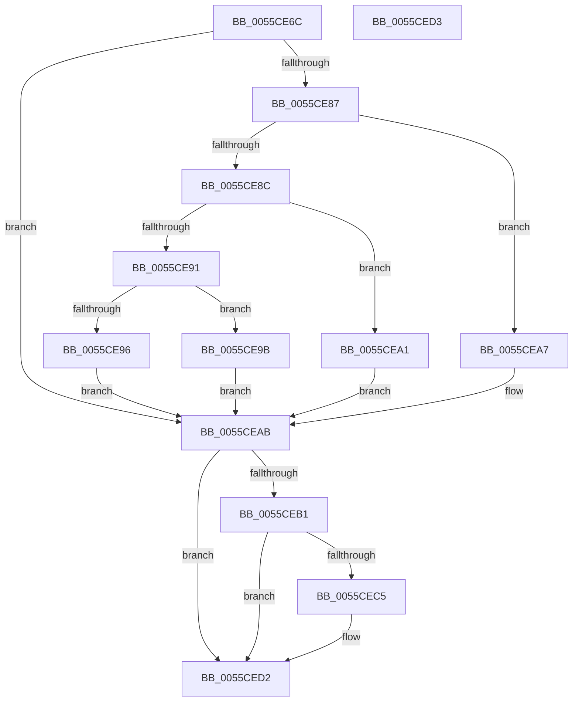

# EmonFreeCounterEnhanced

- RVA: `0x0055CE6C`–`0x0055CED4` (길이 `104` bytes)
- VA: `0x000000014055CE6C`
- 실행 섹션: `.text`
- PDB 이름 있음: `예`; PDB Function 태그: `아니요`
- unwind 정보 RVA: `0x000DB714`
- 디코드: `31`개 명령, `104/104` bytes 표시
- 미해석 바이트: `0` (있으면 어셈블리에 `.byte`로 보존)

> 이 문서는 커널 이미지의 기계어와 PDB 기호를 분석해 생성했습니다. 4번과 5번은 함수 원형과 자료형을 바이너리 사용 방식에서 추정한 C 해석이며 원본 소스 복구 결과는 아닙니다.

## 1. Dependencies

- 직접 호출 지점: **0**; 고유 호출 대상: **0**
- 직접 호출자로 확인된 함수: **2**
- RIP 상대 이미지 참조: **1**

### Outgoing calls
- 직접 디코드된 call 명령이 없습니다.

### Direct callers
- [EmonDisableMonitoringEnhanced](EmonDisableMonitoringEnhanced_function_0055C740.md) at `0x0055C7E9`
- [EmonInitializeProfilingEnhanced](../../pagelk/B5/EmonInitializeProfilingEnhanced_function_00B5F320.md) at `0x00B5F54A`
- [EmonInitializeProfilingEnhanced](../../pagelk/B5/EmonInitializeProfilingEnhanced_function_00B5F320.md) at `0x00B5F5BE`

### Static image references
- `0x0055CE74` → RVA `0x00FC8C40` (`ALMOSTRO`; read)

## 2. Other-region calls and transfers

- 다른 실행 섹션으로 향하는 call: **0**
- 별도 외부 분기/꼬리 이동을 확인하지 못했습니다.

## 3. Assembly (complete function range)

```asm
0055CE6C  65 8B 04 25 A4 01 00 00         mov eax, dword ptr gs:[0x1a4]
0055CE74  4C 8D 05 C5 BD A6 00            lea r8, [rip + 0xa6bdc5]
0055CE7B  49 8B 04 C0                     mov rax, qword ptr [r8 + rax*8]
0055CE7F  4C 8B 40 58                     mov r8, qword ptr [rax + 0x58]
0055CE83  85 D2                           test edx, edx
0055CE85  74 24                           je 0x14055ceab
0055CE87  83 EA 01                        sub edx, 1
0055CE8A  74 1B                           je 0x14055cea7
0055CE8C  83 EA 63                        sub edx, 0x63
0055CE8F  74 10                           je 0x14055cea1
0055CE91  83 FA 01                        cmp edx, 1
0055CE94  74 05                           je 0x14055ce9b
0055CE96  45 33 C0                        xor r8d, r8d
0055CE99  EB 10                           jmp 0x14055ceab
0055CE9B  49 83 C0 48                     add r8, 0x48
0055CE9F  EB 0A                           jmp 0x14055ceab
0055CEA1  49 83 C0 30                     add r8, 0x30
0055CEA5  EB 04                           jmp 0x14055ceab
0055CEA7  49 83 C0 18                     add r8, 0x18
0055CEAB  41 3B 48 08                     cmp ecx, dword ptr [r8 + 8]
0055CEAF  77 21                           ja 0x14055ced2
0055CEB1  49 8B 50 10                     mov rdx, qword ptr [r8 + 0x10]
0055CEB5  8B C1                           mov eax, ecx
0055CEB7  48 8D 0C 40                     lea rcx, [rax + rax*2]
0055CEBB  48 03 C9                        add rcx, rcx
0055CEBE  83 7C CA 1C 03                  cmp dword ptr [rdx + rcx*8 + 0x1c], 3
0055CEC3  74 0D                           je 0x14055ced2
0055CEC5  83 64 CA 24 00                  and dword ptr [rdx + rcx*8 + 0x24], 0
0055CECA  C7 44 CA 18 03 00 00 00         mov dword ptr [rdx + rcx*8 + 0x18], 3
0055CED2  C3                              ret
0055CED3  CC                              int3
```

## 4. C-style interpretation (structured pseudocode)

```c
__int64 __fastcall EmonFreeCounterEnhanced(int a1, int a2)
{
    if (a2 == 0) goto loc_0055CEAB;
    a2 = (unsigned int)((a2) - (1));
    if (condition_is_equal) goto loc_0055CEA7;
    a2 = (unsigned int)((a2) - (99));
    if (condition_is_equal) goto loc_0055CEA1;
    if (a2 == 1) goto loc_0055CE9B;
    a3 = 0;
    goto loc_0055CEAB;
loc_0055CE9B:
    a3 = (a3) + (72);
    goto loc_0055CEAB;
loc_0055CEA1:
    a3 = (a3) + (48);
    goto loc_0055CEAB;
loc_0055CEA7:
    a3 = (a3) + (24);
loc_0055CEAB:
    if (a1 > (*(unsigned int *)(a3 + 8))) goto loc_0055CED2;
    a1 = ((unsigned int)(a1) + (unsigned int)(a1) * 2) + ((unsigned int)(a1) + (unsigned int)(a1) * 2);
    if ((*(unsigned int *)(*(unsigned __int64 *)(a3 + 16) + a1 * 8 + 28)) != 3) {
        *(unsigned int *)(*(unsigned __int64 *)(a3 + 16) + a1 * 8 + 24) = 3;
    }
    return (unsigned int)(a1);
}
```

## 5. (Beta) C Style

```c
int64_t EmonFreeCounterEnhanced(int32_t Arg1, int32_t Arg2)
{
    if (Arg2 == 0) goto loc_0055CEAB;
    Arg2 = (uint32_t)((Arg2) - (1));
    if (condition_is_equal) goto loc_0055CEA7;
    Arg2 = (uint32_t)((Arg2) - (99));
    if (condition_is_equal) goto loc_0055CEA1;
    if (Arg2 == 1) goto loc_0055CE9B;
    a3 = 0;
    goto loc_0055CEAB;
loc_0055CE9B:
    a3 = (a3) + (72);
    goto loc_0055CEAB;
loc_0055CEA1:
    a3 = (a3) + (48);
    goto loc_0055CEAB;
loc_0055CEA7:
    a3 = (a3) + (24);
loc_0055CEAB:
    if (Arg1 > (*(uint32_t *)(a3 + 0x8))) goto loc_0055CED2;
    Arg1 = ((uint32_t)(Arg1) + (uint32_t)(Arg1) * 2) + ((uint32_t)(Arg1) + (uint32_t)(Arg1) * 2);
    if ((*(uint32_t *)(*(uint64_t *)(a3 + 0x10) + Arg1 * 8 + 0x1C)) != 3) {
        *(uint32_t *)(*(uint64_t *)(a3 + 0x10) + Arg1 * 8 + 0x18) = 3;
    }
    return (uint32_t)(Arg1);
}
```

## 6. Execution-region graph

[열기: 2D/3D 그래프와 함수 탐색 컨트롤 패널](../../../control-panel.html?section=text&rva=0x0055CE6C&view=graph)

- 2D 그래프는 위에서 아래로 흐르고, 3D 그래프는 빈 공간을 드래그해 회전합니다. Shift+드래그는 이동, 휠은 확대·축소, 함수 노드 선택은 대상 보고서 이동입니다.

### Static fallback


