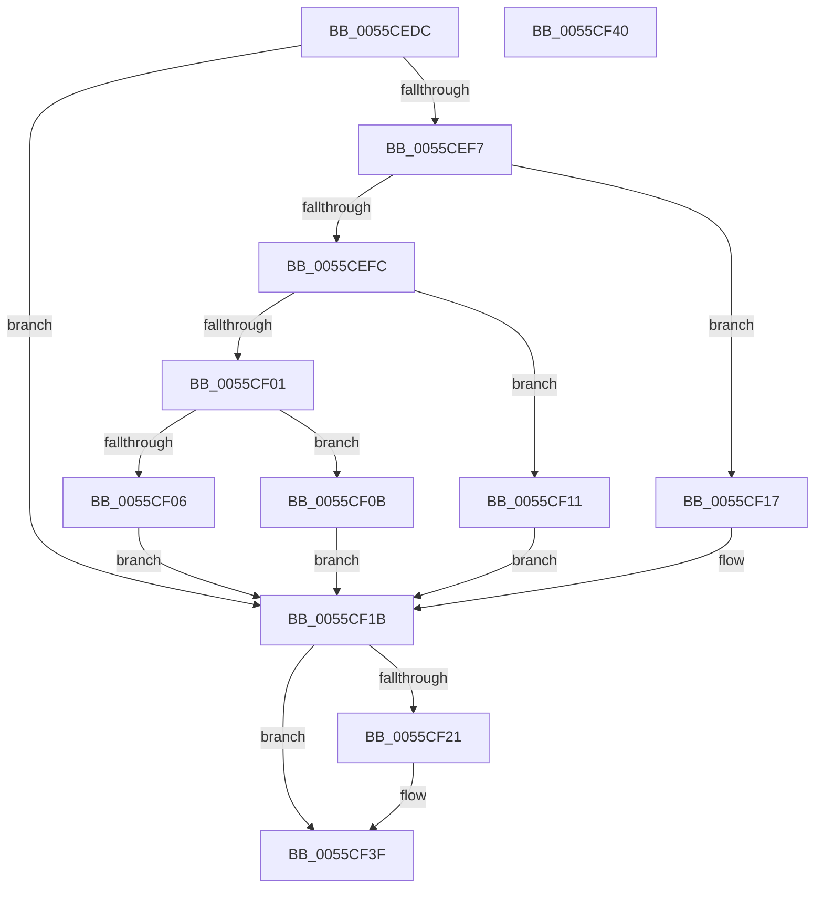

# EmonFreeCounterOriginal

- RVA: `0x0055CEDC`–`0x0055CF41` (길이 `101` bytes)
- VA: `0x000000014055CEDC`
- 실행 섹션: `.text`
- PDB 이름 있음: `예`; PDB Function 태그: `아니요`
- unwind 정보 RVA: `0x000DB714`
- 디코드: `30`개 명령, `101/101` bytes 표시
- 미해석 바이트: `0` (있으면 어셈블리에 `.byte`로 보존)

> 이 문서는 커널 이미지의 기계어와 PDB 기호를 분석해 생성했습니다. 4번과 5번은 함수 원형과 자료형을 바이너리 사용 방식에서 추정한 C 해석이며 원본 소스 복구 결과는 아닙니다.

## 1. Dependencies

- 직접 호출 지점: **0**; 고유 호출 대상: **0**
- 직접 호출자로 확인된 함수: **2**
- RIP 상대 이미지 참조: **1**

### Outgoing calls
- 직접 디코드된 call 명령이 없습니다.

### Direct callers
- [EmonDisableMonitoringOriginal](EmonDisableMonitoringOriginal_function_0055C810.md) at `0x0055C8B7`
- [EmonInitializeProfilingOriginal](../../pagelk/B5/EmonInitializeProfilingOriginal_function_00B5F630.md) at `0x00B5F957`
- [EmonInitializeProfilingOriginal](../../pagelk/B5/EmonInitializeProfilingOriginal_function_00B5F630.md) at `0x00B5F993`

### Static image references
- `0x0055CEE4` → RVA `0x00FC8C40` (`ALMOSTRO`; read)

## 2. Other-region calls and transfers

- 다른 실행 섹션으로 향하는 call: **0**
- 별도 외부 분기/꼬리 이동을 확인하지 못했습니다.

## 3. Assembly (complete function range)

```asm
0055CEDC  65 8B 04 25 A4 01 00 00         mov eax, dword ptr gs:[0x1a4]
0055CEE4  4C 8D 05 55 BD A6 00            lea r8, [rip + 0xa6bd55]
0055CEEB  49 8B 04 C0                     mov rax, qword ptr [r8 + rax*8]
0055CEEF  4C 8B 40 58                     mov r8, qword ptr [rax + 0x58]
0055CEF3  85 D2                           test edx, edx
0055CEF5  74 24                           je 0x14055cf1b
0055CEF7  83 EA 01                        sub edx, 1
0055CEFA  74 1B                           je 0x14055cf17
0055CEFC  83 EA 63                        sub edx, 0x63
0055CEFF  74 10                           je 0x14055cf11
0055CF01  83 FA 01                        cmp edx, 1
0055CF04  74 05                           je 0x14055cf0b
0055CF06  45 33 C0                        xor r8d, r8d
0055CF09  EB 10                           jmp 0x14055cf1b
0055CF0B  49 83 C0 48                     add r8, 0x48
0055CF0F  EB 0A                           jmp 0x14055cf1b
0055CF11  49 83 C0 30                     add r8, 0x30
0055CF15  EB 04                           jmp 0x14055cf1b
0055CF17  49 83 C0 18                     add r8, 0x18
0055CF1B  41 3B 48 04                     cmp ecx, dword ptr [r8 + 4]
0055CF1F  73 1E                           jae 0x14055cf3f
0055CF21  8B C1                           mov eax, ecx
0055CF23  48 8D 0C 40                     lea rcx, [rax + rax*2]
0055CF27  49 8B 40 10                     mov rax, qword ptr [r8 + 0x10]
0055CF2B  48 03 C9                        add rcx, rcx
0055CF2E  C7 44 C8 18 03 00 00 00         mov dword ptr [rax + rcx*8 + 0x18], 3
0055CF36  49 8B 40 10                     mov rax, qword ptr [r8 + 0x10]
0055CF3A  83 64 C8 24 00                  and dword ptr [rax + rcx*8 + 0x24], 0
0055CF3F  C3                              ret
0055CF40  CC                              int3
```

## 4. C-style interpretation (structured pseudocode)

```c
__int64 __fastcall EmonFreeCounterOriginal(int a1, int a2)
{
    __int64 result;

    if (a2 == 0) goto loc_0055CF1B;
    a2 = (unsigned int)((a2) - (1));
    if (condition_is_equal) goto loc_0055CF17;
    a2 = (unsigned int)((a2) - (99));
    if (condition_is_equal) goto loc_0055CF11;
    if (a2 == 1) goto loc_0055CF0B;
    a3 = 0;
    goto loc_0055CF1B;
loc_0055CF0B:
    a3 = (a3) + (72);
    goto loc_0055CF1B;
loc_0055CF11:
    a3 = (a3) + (48);
    goto loc_0055CF1B;
loc_0055CF17:
    a3 = (a3) + (24);
loc_0055CF1B:
    result = *(unsigned __int64 *)(v_rip + 10927445 + (unsigned int)(*(unsigned int *)(gs_base + (0 + 420))) * 8);
    if (a1 < (*(unsigned int *)(a3 + 4))) {
        result = a1;
        a1 = result + result * 2;
        result = *(unsigned __int64 *)(a3 + 16);
        a1 = (a1) + (a1);
        *(unsigned int *)(result + a1 * 8 + 24) = 3;
        result = *(unsigned __int64 *)(a3 + 16);
    }
    return result;
}
```

## 5. (Beta) C Style

```c
int64_t EmonFreeCounterOriginal(int32_t Arg1, int32_t Arg2)
{
    int64_t result;

    if (Arg2 == 0) goto loc_0055CF1B;
    Arg2 = (uint32_t)((Arg2) - (1));
    if (condition_is_equal) goto loc_0055CF17;
    Arg2 = (uint32_t)((Arg2) - (99));
    if (condition_is_equal) goto loc_0055CF11;
    if (Arg2 == 1) goto loc_0055CF0B;
    a3 = 0;
    goto loc_0055CF1B;
loc_0055CF0B:
    a3 = (a3) + (72);
    goto loc_0055CF1B;
loc_0055CF11:
    a3 = (a3) + (48);
    goto loc_0055CF1B;
loc_0055CF17:
    a3 = (a3) + (24);
loc_0055CF1B:
    result = *(uint64_t *)(v_rip + 0xA6BD55 + (uint32_t)(*(uint32_t *)(gs_base + (0 + 0x1A4))) * 8);
    if (Arg1 < (*(uint32_t *)(a3 + 0x4))) {
        result = Arg1;
        Arg1 = result + result * 2;
        result = *(uint64_t *)(a3 + 0x10);
        Arg1 = (Arg1) + (Arg1);
        *(uint32_t *)(result + Arg1 * 8 + 0x18) = 3;
        result = *(uint64_t *)(a3 + 0x10);
    }
    return result;
}
```

## 6. Execution-region graph

[열기: 2D/3D 그래프와 함수 탐색 컨트롤 패널](../../../control-panel.html?section=text&rva=0x0055CEDC&view=graph)

- 2D 그래프는 위에서 아래로 흐르고, 3D 그래프는 빈 공간을 드래그해 회전합니다. Shift+드래그는 이동, 휠은 확대·축소, 함수 노드 선택은 대상 보고서 이동입니다.

### Static fallback


