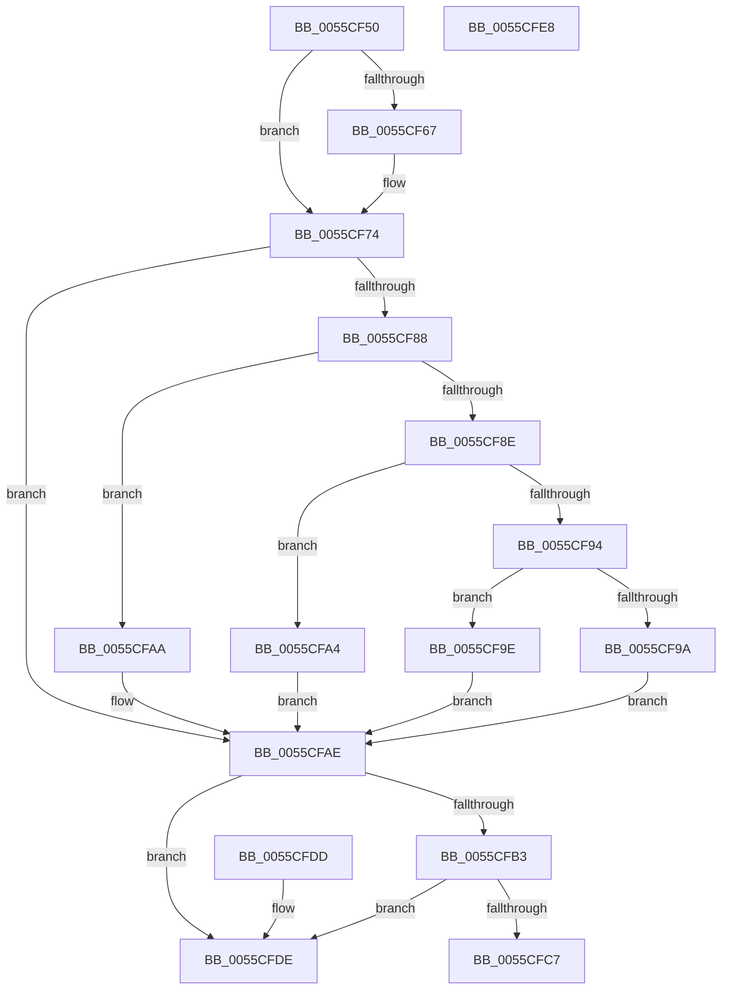

# EmonGetCounterResolutionEnhanced

- RVA: `0x0055CF50`–`0x0055CFE9` (길이 `153` bytes)
- VA: `0x000000014055CF50`
- 실행 섹션: `.text`
- PDB 이름 있음: `예`; PDB Function 태그: `아니요`
- unwind 정보 RVA: `0x000DB714`
- 디코드: `46`개 명령, `153/153` bytes 표시
- 미해석 바이트: `0` (있으면 어셈블리에 `.byte`로 보존)

> 이 문서는 커널 이미지의 기계어와 PDB 기호를 분석해 생성했습니다. 4번과 5번은 함수 원형과 자료형을 바이너리 사용 방식에서 추정한 C 해석이며 원본 소스 복구 결과는 아닙니다.

## 1. Dependencies

- 직접 호출 지점: **0**; 고유 호출 대상: **0**
- 직접 호출자로 확인된 함수: **0**
- RIP 상대 이미지 참조: **3**

### Outgoing calls
- 직접 디코드된 call 명령이 없습니다.

### Direct callers
- 이 함수 시작 RVA로 연결되는 직접 call은 확인되지 않았습니다. 간접 호출은 완전히 역산할 수 없습니다.

### Static image references
- `0x0055CF74` → RVA `0x00FC8C40` (`ALMOSTRO`; read)
- `0x0055CFC7` → RVA `0x00F8FE14` (`.data`; read)
- `0x0055CFD0` → RVA `0x00F8FE10` (`.data`; read)

## 2. Other-region calls and transfers

- 다른 실행 섹션으로 향하는 call: **0**
- 별도 외부 분기/꼬리 이동을 확인하지 못했습니다.

## 3. Assembly (complete function range)

```asm
0055CF50  65 8B 04 25 A4 01 00 00         mov eax, dword ptr gs:[0x1a4]
0055CF58  45 33 C0                        xor r8d, r8d
0055CF5B  45 32 D2                        xor r10b, r10b
0055CF5E  4C 8B CA                        mov r9, rdx
0055CF61  0F BA E1 1E                     bt ecx, 0x1e
0055CF65  73 0D                           jae 0x14055cf74
0055CF67  41 B8 01 00 00 00               mov r8d, 1
0055CF6D  0F BA F1 1E                     btr ecx, 0x1e
0055CF71  45 8A D0                        mov r10b, r8b
0055CF74  48 8D 15 C5 BC A6 00            lea rdx, [rip + 0xa6bcc5]
0055CF7B  48 8B 04 C2                     mov rax, qword ptr [rdx + rax*8]
0055CF7F  48 8B 50 58                     mov rdx, qword ptr [rax + 0x58]
0055CF83  45 85 C0                        test r8d, r8d
0055CF86  74 26                           je 0x14055cfae
0055CF88  41 83 E8 01                     sub r8d, 1
0055CF8C  74 1C                           je 0x14055cfaa
0055CF8E  41 83 E8 63                     sub r8d, 0x63
0055CF92  74 10                           je 0x14055cfa4
0055CF94  41 83 F8 01                     cmp r8d, 1
0055CF98  74 04                           je 0x14055cf9e
0055CF9A  33 D2                           xor edx, edx
0055CF9C  EB 10                           jmp 0x14055cfae
0055CF9E  48 83 C2 48                     add rdx, 0x48
0055CFA2  EB 0A                           jmp 0x14055cfae
0055CFA4  48 83 C2 30                     add rdx, 0x30
0055CFA8  EB 04                           jmp 0x14055cfae
0055CFAA  48 83 C2 18                     add rdx, 0x18
0055CFAE  3B 4A 08                        cmp ecx, dword ptr [rdx + 8]
0055CFB1  77 2B                           ja 0x14055cfde
0055CFB3  8B C1                           mov eax, ecx
0055CFB5  48 8D 0C 40                     lea rcx, [rax + rax*2]
0055CFB9  48 8B 42 10                     mov rax, qword ptr [rdx + 0x10]
0055CFBD  48 03 C9                        add rcx, rcx
0055CFC0  83 7C C8 1C 03                  cmp dword ptr [rax + rcx*8 + 0x1c], 3
0055CFC5  74 17                           je 0x14055cfde
0055CFC7  8B 0D 47 2E A3 00               mov ecx, dword ptr [rip + 0xa32e47]
0055CFCD  45 84 D2                        test r10b, r10b
0055CFD0  0F 44 0D 39 2E A3 00            cmove ecx, dword ptr [rip + 0xa32e39]
0055CFD7  33 C0                           xor eax, eax
0055CFD9  41 89 09                        mov dword ptr [r9], ecx
0055CFDC  C3                              ret
0055CFDD  CC                              int3
0055CFDE  41 83 21 00                     and dword ptr [r9], 0
0055CFE2  B8 EF 00 00 C0                  mov eax, 0xc00000ef
0055CFE7  C3                              ret
0055CFE8  CC                              int3
```

## 4. C-style interpretation (structured pseudocode)

```c
__int64 __fastcall EmonGetCounterResolutionEnhanced(int a1, __int64 a2, int a3)
{
    __int64 result;
    __int64 v_r10;

    a3 = 0;
    v_r10 = 0;
    if (!(condition_is_above_or_equal)) {
        a3 = 1;
        v_r10 = (unsigned __int8)(a3);
    }
    if (a3 == 0) goto loc_0055CFAE;
    a3 = (unsigned int)((a3) - (1));
    if (condition_is_equal) goto loc_0055CFAA;
    a3 = (unsigned int)((a3) - (99));
    if (condition_is_equal) goto loc_0055CFA4;
    if (a3 == 1) goto loc_0055CF9E;
    a2 = 0;
    goto loc_0055CFAE;
loc_0055CF9E:
    a2 = (a2) + (72);
    goto loc_0055CFAE;
loc_0055CFA4:
    a2 = (a2) + (48);
    goto loc_0055CFAE;
loc_0055CFAA:
    a2 = (a2) + (24);
loc_0055CFAE:
    if (a1 > (*(unsigned int *)(a2 + 8))) goto loc_0055CFDE;
    a1 = ((unsigned int)(a1) + (unsigned int)(a1) * 2) + ((unsigned int)(a1) + (unsigned int)(a1) * 2);
    if ((*(unsigned int *)(*(unsigned __int64 *)(a2 + 16) + a1 * 8 + 28)) == 3) goto loc_0055CFDE;
    a1 = (unsigned int)(*(unsigned int *)(v_rip + 10694215));
    if ((unsigned __int8)(v_r10) == 0) { a1 = *(unsigned int *)(v_rip + 10694201); }
    result = 0;
    *(unsigned int *)(a2) = a1;
    return result;
loc_0055CFDE:
    return (unsigned int)(0xC00000EFULL);
}
```

## 5. (Beta) C Style

```c
int64_t EmonGetCounterResolutionEnhanced(int32_t Arg1, void *Arg2, int32_t Arg3)
{
    uint8_t *arg2 = (uint8_t *)Arg2;

    int64_t result;
    int64_t local_r10;

    Arg3 = 0;
    local_r10 = 0;
    if (!(condition_is_above_or_equal)) {
        Arg3 = 1;
        local_r10 = (uint8_t)(Arg3);
    }
    if (Arg3 == 0) goto loc_0055CFAE;
    Arg3 = (uint32_t)((Arg3) - (1));
    if (condition_is_equal) goto loc_0055CFAA;
    Arg3 = (uint32_t)((Arg3) - (99));
    if (condition_is_equal) goto loc_0055CFA4;
    if (Arg3 == 1) goto loc_0055CF9E;
    Arg2 = 0;
    goto loc_0055CFAE;
loc_0055CF9E:
    Arg2 = (Arg2) + (72);
    goto loc_0055CFAE;
loc_0055CFA4:
    Arg2 = (Arg2) + (48);
    goto loc_0055CFAE;
loc_0055CFAA:
    Arg2 = (Arg2) + (24);
loc_0055CFAE:
    if (Arg1 > (*(uint32_t *)(arg2 + 0x8))) goto loc_0055CFDE;
    Arg1 = ((uint32_t)(Arg1) + (uint32_t)(Arg1) * 2) + ((uint32_t)(Arg1) + (uint32_t)(Arg1) * 2);
    if ((*(uint32_t *)(*(uint64_t *)(arg2 + 0x10) + Arg1 * 8 + 0x1C)) == 3) goto loc_0055CFDE;
    Arg1 = (uint32_t)(*(uint32_t *)(v_rip + 0xA32E47));
    if ((uint8_t)(local_r10) == 0) { Arg1 = *(uint32_t *)(v_rip + 0xA32E39); }
    result = 0;
    *(uint32_t *)(arg2) = Arg1;
    return result;
loc_0055CFDE:
    return (uint32_t)(0xC00000EFULL);
}
```

### 관측된 메모리 오프셋

구조체 형식이 확인되지 않은 접근은 인자 기준의 오프셋으로만 기록했습니다.

| 기준 인자 | 오프셋 표현 | 폭 (bit) | 접근 |
|---|---:|---:|---|
| `Arg2` | `+ 0x0` | `32` | `R/W` |
| `Arg2` | `+ 0x0` | `32` | `W` |

## 6. Execution-region graph

[열기: 2D/3D 그래프와 함수 탐색 컨트롤 패널](../../../control-panel.html?section=text&rva=0x0055CF50&view=graph)

- 2D 그래프는 위에서 아래로 흐르고, 3D 그래프는 빈 공간을 드래그해 회전합니다. Shift+드래그는 이동, 휠은 확대·축소, 함수 노드 선택은 대상 보고서 이동입니다.

### Static fallback


