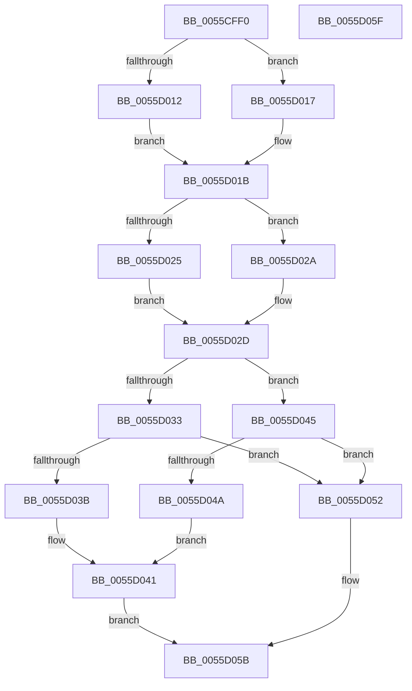

# EmonGetCounterResolutionOriginal

- RVA: `0x0055CFF0`–`0x0055D060` (길이 `112` bytes)
- VA: `0x000000014055CFF0`
- 실행 섹션: `.text`
- PDB 이름 있음: `예`; PDB Function 태그: `아니요`
- unwind 정보 RVA: `0x000DB714`
- 디코드: `34`개 명령, `112/112` bytes 표시
- 미해석 바이트: `0` (있으면 어셈블리에 `.byte`로 보존)

> 이 문서는 커널 이미지의 기계어와 PDB 기호를 분석해 생성했습니다. 4번과 5번은 함수 원형과 자료형을 바이너리 사용 방식에서 추정한 C 해석이며 원본 소스 복구 결과는 아닙니다.

## 1. Dependencies

- 직접 호출 지점: **0**; 고유 호출 대상: **0**
- 직접 호출자로 확인된 함수: **0**
- RIP 상대 이미지 참조: **3**

### Outgoing calls
- 직접 디코드된 call 명령이 없습니다.

### Direct callers
- 이 함수 시작 RVA로 연결되는 직접 call은 확인되지 않았습니다. 간접 호출은 완전히 역산할 수 없습니다.

### Static image references
- `0x0055CFFE` → RVA `0x00FC8C40` (`ALMOSTRO`; read)
- `0x0055D03B` → RVA `0x00F8FE14` (`.data`; read)
- `0x0055D04A` → RVA `0x00F8FE10` (`.data`; read)

## 2. Other-region calls and transfers

- 다른 실행 섹션으로 향하는 call: **0**
- 별도 외부 분기/꼬리 이동을 확인하지 못했습니다.

## 3. Assembly (complete function range)

```asm
0055CFF0  65 8B 04 25 A4 01 00 00         mov eax, dword ptr gs:[0x1a4]
0055CFF8  45 33 C9                        xor r9d, r9d
0055CFFB  44 8B C0                        mov r8d, eax
0055CFFE  48 8D 05 3B BC A6 00            lea rax, [rip + 0xa6bc3b]
0055D005  4A 8B 04 C0                     mov rax, qword ptr [rax + r8*8]
0055D009  4C 8B 40 58                     mov r8, qword ptr [rax + 0x58]
0055D00D  4D 85 C0                        test r8, r8
0055D010  75 05                           jne 0x14055d017
0055D012  45 8B C1                        mov r8d, r9d
0055D015  EB 04                           jmp 0x14055d01b
0055D017  45 8B 40 04                     mov r8d, dword ptr [r8 + 4]
0055D01B  48 8B 40 58                     mov rax, qword ptr [rax + 0x58]
0055D01F  48 83 C0 18                     add rax, 0x18
0055D023  75 05                           jne 0x14055d02a
0055D025  41 8B C1                        mov eax, r9d
0055D028  EB 03                           jmp 0x14055d02d
0055D02A  8B 40 04                        mov eax, dword ptr [rax + 4]
0055D02D  0F BA E1 1E                     bt ecx, 0x1e
0055D031  73 12                           jae 0x14055d045
0055D033  0F BA F1 1E                     btr ecx, 0x1e
0055D037  3B C8                           cmp ecx, eax
0055D039  73 17                           jae 0x14055d052
0055D03B  8B 05 D3 2D A3 00               mov eax, dword ptr [rip + 0xa32dd3]
0055D041  89 02                           mov dword ptr [rdx], eax
0055D043  EB 16                           jmp 0x14055d05b
0055D045  41 3B C8                        cmp ecx, r8d
0055D048  73 08                           jae 0x14055d052
0055D04A  8B 05 C0 2D A3 00               mov eax, dword ptr [rip + 0xa32dc0]
0055D050  EB EF                           jmp 0x14055d041
0055D052  44 89 0A                        mov dword ptr [rdx], r9d
0055D055  41 B9 0D 00 00 C0               mov r9d, 0xc000000d
0055D05B  41 8B C1                        mov eax, r9d
0055D05E  C3                              ret
0055D05F  CC                              int3
```

## 4. C-style interpretation (structured pseudocode)

```c
__int64 __fastcall EmonGetCounterResolutionOriginal(int a1, __int64 a2, __int64 a3, int a4)
{
    __int64 result;

    a4 = 0;
    if (*(unsigned __int64 *)(*(unsigned __int64 *)(v_rip + 10927163 + (unsigned int)((unsigned int)((unsigned int)(*(unsigned int *)(gs_base + (0 + 420))))) * 8) + 88) != 0) goto loc_0055D017;
    goto loc_0055D01B;
loc_0055D017:
loc_0055D01B:
    result = (*(unsigned __int64 *)(*(unsigned __int64 *)(v_rip + 10927163 + (unsigned int)((unsigned int)((unsigned int)(*(unsigned int *)(gs_base + (0 + 420))))) * 8) + 88)) + (24);
    if (condition_is_not_equal) goto loc_0055D02A;
    goto loc_0055D02D;
loc_0055D02A:
loc_0055D02D:
    if (condition_is_above_or_equal) goto loc_0055D045;
    if (a1 >= ((unsigned int)((unsigned int)(*(unsigned int *)(0 + 4))))) goto loc_0055D052;
loc_0055D041:
    *(unsigned int *)(a2) = (unsigned int)((unsigned int)(*(unsigned int *)(v_rip + 10694099)));
    goto loc_0055D05B;
loc_0055D045:
    if (a1 >= ((unsigned int)((unsigned int)(*(unsigned int *)(0 + 4))))) goto loc_0055D052;
    goto loc_0055D041;
loc_0055D052:
    *(unsigned int *)(a2) = 0;
loc_0055D05B:
    return (unsigned int)((unsigned int)((unsigned int)(0xC000000DULL)));
}
```

## 5. (Beta) C Style

```c
int64_t EmonGetCounterResolutionOriginal(int32_t Arg1, void *Arg2, int64_t Arg3, int32_t Arg4)
{
    uint8_t *arg2 = (uint8_t *)Arg2;

    int64_t result;

    Arg4 = 0;
    if (*(uint64_t *)(*(uint64_t *)(v_rip + 0xA6BC3B + (uint32_t)((uint32_t)((uint32_t)(*(uint32_t *)(gs_base + (0 + 0x1A4))))) * 8) + 0x58) != 0) goto loc_0055D017;
    goto loc_0055D01B;
loc_0055D017:
loc_0055D01B:
    result = (*(uint64_t *)(*(uint64_t *)(v_rip + 0xA6BC3B + (uint32_t)((uint32_t)((uint32_t)(*(uint32_t *)(gs_base + (0 + 0x1A4))))) * 8) + 0x58)) + (24);
    if (condition_is_not_equal) goto loc_0055D02A;
    goto loc_0055D02D;
loc_0055D02A:
loc_0055D02D:
    if (condition_is_above_or_equal) goto loc_0055D045;
    if (Arg1 >= ((uint32_t)((uint32_t)(*(uint32_t *)(0 + 0x4))))) goto loc_0055D052;
loc_0055D041:
    *(uint32_t *)(arg2) = (uint32_t)((uint32_t)(*(uint32_t *)(v_rip + 0xA32DD3)));
    goto loc_0055D05B;
loc_0055D045:
    if (Arg1 >= ((uint32_t)((uint32_t)(*(uint32_t *)(0 + 0x4))))) goto loc_0055D052;
    goto loc_0055D041;
loc_0055D052:
    *(uint32_t *)(arg2) = 0;
loc_0055D05B:
    return (uint32_t)((uint32_t)((uint32_t)(0xC000000DULL)));
}
```

### 관측된 메모리 오프셋

구조체 형식이 확인되지 않은 접근은 인자 기준의 오프셋으로만 기록했습니다.

| 기준 인자 | 오프셋 표현 | 폭 (bit) | 접근 |
|---|---:|---:|---|
| `Arg2` | `+ 0x0` | `32` | `W` |

## 6. Execution-region graph

[열기: 2D/3D 그래프와 함수 탐색 컨트롤 패널](../../../control-panel.html?section=text&rva=0x0055CFF0&view=graph)

- 2D 그래프는 위에서 아래로 흐르고, 3D 그래프는 빈 공간을 드래그해 회전합니다. Shift+드래그는 이동, 휠은 확대·축소, 함수 노드 선택은 대상 보고서 이동입니다.

### Static fallback


