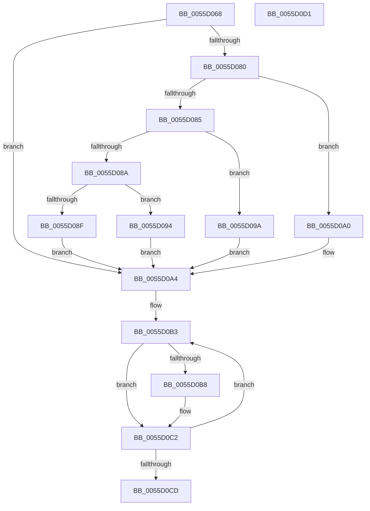

# EmonGetCountersBitmap

- RVA: `0x0055D068`–`0x0055D0D2` (길이 `106` bytes)
- VA: `0x000000014055D068`
- 실행 섹션: `.text`
- PDB 이름 있음: `예`; PDB Function 태그: `아니요`
- unwind 정보 RVA: `0x000DB714`
- 디코드: `36`개 명령, `106/106` bytes 표시
- 미해석 바이트: `0` (있으면 어셈블리에 `.byte`로 보존)

> 이 문서는 커널 이미지의 기계어와 PDB 기호를 분석해 생성했습니다. 4번과 5번은 함수 원형과 자료형을 바이너리 사용 방식에서 추정한 C 해석이며 원본 소스 복구 결과는 아닙니다.

## 1. Dependencies

- 직접 호출 지점: **0**; 고유 호출 대상: **0**
- 직접 호출자로 확인된 함수: **1**
- RIP 상대 이미지 참조: **1**

### Outgoing calls
- 직접 디코드된 call 명령이 없습니다.

### Direct callers
- [EmonReserveProfileResourcesEnhanced](EmonReserveProfileResourcesEnhanced_function_0055F3C0.md) at `0x0055F40B`
- [EmonReserveProfileResourcesEnhanced](EmonReserveProfileResourcesEnhanced_function_0055F3C0.md) at `0x0055F41B`

### Static image references
- `0x0055D06D` → RVA `0x00FC8C40` (`ALMOSTRO`; read)

## 2. Other-region calls and transfers

- 다른 실행 섹션으로 향하는 call: **0**
- 별도 외부 분기/꼬리 이동을 확인하지 못했습니다.

## 3. Assembly (complete function range)

```asm
0055D068  8B C1                           mov eax, ecx
0055D06A  45 33 C0                        xor r8d, r8d
0055D06D  48 8D 0D CC BB A6 00            lea rcx, [rip + 0xa6bbcc]
0055D074  48 8B 04 C1                     mov rax, qword ptr [rcx + rax*8]
0055D078  48 8B 48 58                     mov rcx, qword ptr [rax + 0x58]
0055D07C  85 D2                           test edx, edx
0055D07E  74 24                           je 0x14055d0a4
0055D080  83 EA 01                        sub edx, 1
0055D083  74 1B                           je 0x14055d0a0
0055D085  83 EA 63                        sub edx, 0x63
0055D088  74 10                           je 0x14055d09a
0055D08A  83 FA 01                        cmp edx, 1
0055D08D  74 05                           je 0x14055d094
0055D08F  41 8B C8                        mov ecx, r8d
0055D092  EB 10                           jmp 0x14055d0a4
0055D094  48 83 C1 48                     add rcx, 0x48
0055D098  EB 0A                           jmp 0x14055d0a4
0055D09A  48 83 C1 30                     add rcx, 0x30
0055D09E  EB 04                           jmp 0x14055d0a4
0055D0A0  48 83 C1 18                     add rcx, 0x18
0055D0A4  48 8B 41 10                     mov rax, qword ptr [rcx + 0x10]
0055D0A8  44 8B 49 08                     mov r9d, dword ptr [rcx + 8]
0055D0AC  48 83 C0 1C                     add rax, 0x1c
0055D0B0  41 8B C8                        mov ecx, r8d
0055D0B3  83 38 03                        cmp dword ptr [rax], 3
0055D0B6  74 0A                           je 0x14055d0c2
0055D0B8  BA 01 00 00 00                  mov edx, 1
0055D0BD  D3 E2                           shl edx, cl
0055D0BF  44 0B C2                        or r8d, edx
0055D0C2  FF C1                           inc ecx
0055D0C4  48 83 C0 30                     add rax, 0x30
0055D0C8  41 3B C9                        cmp ecx, r9d
0055D0CB  76 E6                           jbe 0x14055d0b3
0055D0CD  41 8B C0                        mov eax, r8d
0055D0D0  C3                              ret
0055D0D1  CC                              int3
```

## 4. C-style interpretation (structured pseudocode)

```c
__int64 __fastcall EmonGetCountersBitmap(int a1, int a2, int a3)
{
    __int64 result;

    a3 = 0;
    if (a2 == 0) goto loc_0055D0A4;
    a2 = (unsigned int)((a2) - (1));
    if (condition_is_equal) goto loc_0055D0A0;
    a2 = (unsigned int)((a2) - (99));
    if (condition_is_equal) goto loc_0055D09A;
    if (a2 == 1) goto loc_0055D094;
    goto loc_0055D0A4;
loc_0055D094:
    a1 = (0) + (72);
    goto loc_0055D0A4;
loc_0055D09A:
    a1 = (a1) + (48);
    goto loc_0055D0A4;
loc_0055D0A0:
    a1 = (a1) + (24);
loc_0055D0A4:
    result = (*(unsigned __int64 *)(a1 + 16)) + (28);
loc_0055D0B3:
    if ((*(unsigned int *)(result)) != 3) {
        a2 = 1;
        a2 = (unsigned int)((a2) << (0));
        a3 = (unsigned int)((a3) | (a2));
    }
    a1 = (unsigned int)((0) + 1);
    result = (result) + (48);
    if (a1 <= ((unsigned int)((unsigned int)(*(unsigned int *)(a1 + 8))))) goto loc_0055D0B3;
    return (unsigned int)(a3);
}
```

## 5. (Beta) C Style

```c
int64_t EmonGetCountersBitmap(int32_t Arg1, int32_t Arg2, int32_t Arg3)
{
    int64_t result;

    Arg3 = 0;
    if (Arg2 == 0) goto loc_0055D0A4;
    Arg2 = (uint32_t)((Arg2) - (1));
    if (condition_is_equal) goto loc_0055D0A0;
    Arg2 = (uint32_t)((Arg2) - (99));
    if (condition_is_equal) goto loc_0055D09A;
    if (Arg2 == 1) goto loc_0055D094;
    goto loc_0055D0A4;
loc_0055D094:
    Arg1 = (0) + (72);
    goto loc_0055D0A4;
loc_0055D09A:
    Arg1 = (Arg1) + (48);
    goto loc_0055D0A4;
loc_0055D0A0:
    Arg1 = (Arg1) + (24);
loc_0055D0A4:
    result = (*(uint64_t *)(Arg1 + 0x10)) + (28);
loc_0055D0B3:
    if ((*(uint32_t *)(result)) != 3) {
        Arg2 = 1;
        Arg2 = (uint32_t)((Arg2) << (0));
        Arg3 = (uint32_t)((Arg3) | (Arg2));
    }
    Arg1 = (uint32_t)((0) + 1);
    result = (result) + (48);
    if (Arg1 <= ((uint32_t)((uint32_t)(*(uint32_t *)(Arg1 + 0x8))))) goto loc_0055D0B3;
    return (uint32_t)(Arg3);
}
```

## 6. Execution-region graph

[열기: 2D/3D 그래프와 함수 탐색 컨트롤 패널](../../../control-panel.html?section=text&rva=0x0055D068&view=graph)

- 2D 그래프는 위에서 아래로 흐르고, 3D 그래프는 빈 공간을 드래그해 회전합니다. Shift+드래그는 이동, 휠은 확대·축소, 함수 노드 선택은 대상 보고서 이동입니다.

### Static fallback


