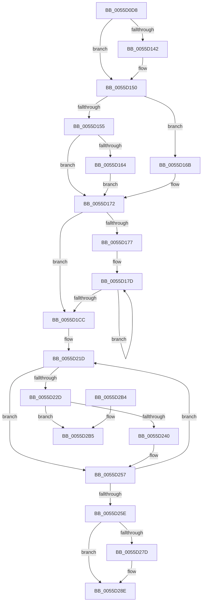

# EmonInitializeProfilingBSP

- RVA: `0x0055D0D8`–`0x0055D2BC` (길이 `484` bytes)
- VA: `0x000000014055D0D8`
- 실행 섹션: `.text`
- PDB 이름 있음: `예`; PDB Function 태그: `아니요`
- unwind 정보 RVA: `0x000C49A8`
- 디코드: `118`개 명령, `484/484` bytes 표시
- 미해석 바이트: `0` (있으면 어셈블리에 `.byte`로 보존)

> 이 문서는 커널 이미지의 기계어와 PDB 기호를 분석해 생성했습니다. 4번과 5번은 함수 원형과 자료형을 바이너리 사용 방식에서 추정한 C 해석이며 원본 소스 복구 결과는 아닙니다.

## 1. Dependencies

- 직접 호출 지점: **7**; 고유 호출 대상: **4**
- 직접 호출자로 확인된 함수: **1**
- RIP 상대 이미지 참조: **20**

### Outgoing calls
- `0x0055D112` → [HalpQueryMaximumRegisteredProcessorCount](../54/HalpQueryMaximumRegisteredProcessorCount_function_00543BE8.md) (function, `0x00543BE8`)
- `0x0055D18C` → [EmonAllocateCounters](EmonAllocateCounters_function_0055C32C.md) (function, `0x0055C32C`)
- `0x0055D19D` → [EmonAllocateCounters](EmonAllocateCounters_function_0055C32C.md) (function, `0x0055C32C`)
- `0x0055D1AD` → [EmonAllocateCounters](EmonAllocateCounters_function_0055C32C.md) (function, `0x0055C32C`)
- `0x0055D1BD` → [EmonAllocateCounters](EmonAllocateCounters_function_0055C32C.md) (function, `0x0055C32C`)
- `0x0055D25E` → [EmonInitializePebs](../../pagelk/B5/EmonInitializePebs_function_00B5F230.md) (function, `0x00B5F230`)
- `0x0055D296` → [_security_check_cookie](../6A/_security_check_cookie_function_006AC640.md) (function, `0x006AC640`)

### Direct callers
- [EmonInitializeProfilingEnhanced](../../pagelk/B5/EmonInitializeProfilingEnhanced_function_00B5F320.md) at `0x00B5F3D4`

### Static image references
- `0x0055D0F0` → RVA `0x00E0A740` (`.data`; read)
- `0x0055D10B` → RVA `0x00F8FDF8` (`.data`; write)
- `0x0055D131` → RVA `0x00F8FE10` (`.data`; write)
- `0x0055D137` → RVA `0x00F8FDE0` (`.data`; write)
- `0x0055D14A` → RVA `0x00F8FE14` (`.data`; write)
- `0x0055D1CC` → RVA `0x00FC2BD0` (`.data`; read/write)
- `0x0055D1D4` → RVA `0x00025D68` (`.rdata`; read)
- `0x0055D1DB` → RVA `0x00F8FDE8` (`.data`; read/write)
- `0x0055D1E3` → RVA `0x00FC2C40` (`.data`; read)
- `0x0055D1EA` → RVA `0x00FC2BC8` (`.data`; write)
- `0x0055D1F1` → RVA `0x00E03C90` (`.data`; read)
- `0x0055D1F8` → RVA `0x00F8FE00` (`.data`; read)
- `0x0055D1FF` → RVA `0x00FC2C48` (`.data`; write)
- `0x0055D206` → RVA `0x00F8FE08` (`.data`; write)
- `0x0055D20F` → RVA `0x00F8FE00` (`.data`; write)
- `0x0055D216` → RVA `0x00FC2C40` (`.data`; write)
- `0x0055D234` → RVA `0x00FC2C48` (`.data`; read)
- `0x0055D240` → RVA `0x00FC2C20` (`.data`; read/write)
- `0x0055D263` → RVA `0x00F8FDF8` (`.data`; read)
- `0x0055D274` → RVA `0x00F8FE28` (`.data`; write)

## 2. Other-region calls and transfers

- 다른 실행 섹션으로 향하는 call: **1**
  - `0x0055D25E` → [EmonInitializePebs](../../pagelk/B5/EmonInitializePebs_function_00B5F230.md) (`.text` → `PAGELK`)
- 별도 외부 분기/꼬리 이동을 확인하지 못했습니다.

## 3. Assembly (complete function range)

```asm
0055D0D8  48 89 5C 24 08                  mov qword ptr [rsp + 8], rbx
0055D0DD  48 89 6C 24 10                  mov qword ptr [rsp + 0x10], rbp
0055D0E2  48 89 74 24 18                  mov qword ptr [rsp + 0x18], rsi
0055D0E7  57                              push rdi
0055D0E8  41 56                           push r14
0055D0EA  41 57                           push r15
0055D0EC  48 83 EC 40                     sub rsp, 0x40
0055D0F0  48 8B 05 49 D6 8A 00            mov rax, qword ptr [rip + 0x8ad649]
0055D0F7  48 33 C4                        xor rax, rsp
0055D0FA  48 89 44 24 30                  mov qword ptr [rsp + 0x30], rax
0055D0FF  65 4C 8B 3C 25 20 00 00 00      mov r15, qword ptr gs:[0x20]
0055D108  40 8A F9                        mov dil, cl
0055D10B  C6 05 E6 2C A3 00 00            mov byte ptr [rip + 0xa32ce6], 0
0055D112  E8 D1 6A FE FF                  call 0x140543be8
0055D117  33 C9                           xor ecx, ecx
0055D119  44 8B C8                        mov r9d, eax
0055D11C  B8 0A 00 00 00                  mov eax, 0xa
0055D121  0F A2                           cpuid
0055D123  0F B6 D8                        movzx ebx, al
0055D126  8B C8                           mov ecx, eax
0055D128  C1 E9 10                        shr ecx, 0x10
0055D12B  44 8B C0                        mov r8d, eax
0055D12E  0F B6 C9                        movzx ecx, cl
0055D131  89 0D D9 2C A3 00               mov dword ptr [rip + 0xa32cd9], ecx
0055D137  89 1D A3 2C A3 00               mov dword ptr [rip + 0xa32ca3], ebx
0055D13D  83 FB 02                        cmp ebx, 2
0055D140  72 0E                           jb 0x14055d150
0055D142  8B C2                           mov eax, edx
0055D144  C1 E8 05                        shr eax, 5
0055D147  0F B6 C0                        movzx eax, al
0055D14A  89 05 C4 2C A3 00               mov dword ptr [rip + 0xa32cc4], eax
0055D150  40 84 FF                        test dil, dil
0055D153  75 16                           jne 0x14055d16b
0055D155  41 C1 E8 08                     shr r8d, 8
0055D159  33 FF                           xor edi, edi
0055D15B  41 0F B6 F0                     movzx esi, r8b
0055D15F  83 FB 02                        cmp ebx, 2
0055D162  72 0E                           jb 0x14055d172
0055D164  8B FA                           mov edi, edx
0055D166  83 E7 0F                        and edi, 0xf
0055D169  EB 07                           jmp 0x14055d172
0055D16B  BE 20 00 00 00                  mov esi, 0x20
0055D170  8B FE                           mov edi, esi
0055D172  45 85 C9                        test r9d, r9d
0055D175  74 55                           je 0x14055d1cc
0055D177  45 33 F6                        xor r14d, r14d
0055D17A  49 8B E9                        mov rbp, r9
0055D17D  49 8B 5F 58                     mov rbx, qword ptr [r15 + 0x58]
0055D181  44 8B C6                        mov r8d, esi
0055D184  49 03 DE                        add rbx, r14
0055D187  33 D2                           xor edx, edx
0055D189  48 8B CB                        mov rcx, rbx
0055D18C  E8 9B F1 FF FF                  call 0x14055c32c
0055D191  48 8D 4B 18                     lea rcx, [rbx + 0x18]
0055D195  44 8B C7                        mov r8d, edi
0055D198  BA 01 00 00 00                  mov edx, 1
0055D19D  E8 8A F1 FF FF                  call 0x14055c32c
0055D1A2  45 33 C0                        xor r8d, r8d
0055D1A5  48 8D 4B 30                     lea rcx, [rbx + 0x30]
0055D1A9  41 8D 50 64                     lea edx, [r8 + 0x64]
0055D1AD  E8 7A F1 FF FF                  call 0x14055c32c
0055D1B2  45 33 C0                        xor r8d, r8d
0055D1B5  48 8D 4B 48                     lea rcx, [rbx + 0x48]
0055D1B9  41 8D 50 65                     lea edx, [r8 + 0x65]
0055D1BD  E8 6A F1 FF FF                  call 0x14055c32c
0055D1C2  49 83 C6 60                     add r14, 0x60
0055D1C6  48 83 ED 01                     sub rbp, 1
0055D1CA  75 B1                           jne 0x14055d17d
0055D1CC  48 83 25 FC 59 A6 00 00         and qword ptr [rip + 0xa659fc], 0
0055D1D4  48 8D 05 8D 8B AC FF            lea rax, [rip - 0x537473]
0055D1DB  48 83 25 05 2C A3 00 00         and qword ptr [rip + 0xa32c05], 0
0055D1E3  48 8D 1D 56 5A A6 00            lea rbx, [rip + 0xa65a56]
0055D1EA  48 89 05 D7 59 A6 00            mov qword ptr [rip + 0xa659d7], rax
0055D1F1  4C 8D 05 98 6A 8A 00            lea r8, [rip + 0x8a6a98]
0055D1F8  48 8D 05 01 2C A3 00            lea rax, [rip + 0xa32c01]
0055D1FF  48 89 1D 42 5A A6 00            mov qword ptr [rip + 0xa65a42], rbx
0055D206  48 89 05 FB 2B A3 00            mov qword ptr [rip + 0xa32bfb], rax
0055D20D  33 C9                           xor ecx, ecx
0055D20F  48 89 05 EA 2B A3 00            mov qword ptr [rip + 0xa32bea], rax
0055D216  48 89 1D 23 5A A6 00            mov qword ptr [rip + 0xa65a23], rbx
0055D21D  48 8D 14 89                     lea rdx, [rcx + rcx*4]
0055D221  48 C1 E2 06                     shl rdx, 6
0055D225  42 80 7C 02 1D 00               cmp byte ptr [rdx + r8 + 0x1d], 0
0055D22B  75 2A                           jne 0x14055d257
0055D22D  49 8D 40 08                     lea rax, [r8 + 8]
0055D231  48 03 C2                        add rax, rdx
0055D234  48 8B 15 0D 5A A6 00            mov rdx, qword ptr [rip + 0xa65a0d]
0055D23B  48 39 1A                        cmp qword ptr [rdx], rbx
0055D23E  75 75                           jne 0x14055d2b5
0055D240  FF 05 DA 59 A6 00               inc dword ptr [rip + 0xa659da]
0055D246  48 89 18                        mov qword ptr [rax], rbx
0055D249  48 89 50 08                     mov qword ptr [rax + 8], rdx
0055D24D  48 89 02                        mov qword ptr [rdx], rax
0055D250  48 89 05 F1 59 A6 00            mov qword ptr [rip + 0xa659f1], rax
0055D257  FF C1                           inc ecx
0055D259  83 F9 12                        cmp ecx, 0x12
0055D25C  72 BF                           jb 0x14055d21d
0055D25E  E8 CD 1F 60 00                  call 0x140b5f230
0055D263  80 3D 8E 2B A3 00 00            cmp byte ptr [rip + 0xa32b8e], 0
0055D26A  48 B8 FF FF FF FF FF FF 7F 03   movabs rax, 0x37fffffffffffff
0055D274  48 89 05 AD 2B A3 00            mov qword ptr [rip + 0xa32bad], rax
0055D27B  74 11                           je 0x14055d28e
0055D27D  48 B8 FF FF FF FF FF FF 7F 43   movabs rax, 0x437fffffffffffff
0055D287  48 89 05 9A 2B A3 00            mov qword ptr [rip + 0xa32b9a], rax
0055D28E  48 8B 4C 24 30                  mov rcx, qword ptr [rsp + 0x30]
0055D293  48 33 CC                        xor rcx, rsp
0055D296  E8 A5 F3 14 00                  call 0x1406ac640
0055D29B  48 8B 5C 24 60                  mov rbx, qword ptr [rsp + 0x60]
0055D2A0  48 8B 6C 24 68                  mov rbp, qword ptr [rsp + 0x68]
0055D2A5  48 8B 74 24 70                  mov rsi, qword ptr [rsp + 0x70]
0055D2AA  48 83 C4 40                     add rsp, 0x40
0055D2AE  41 5F                           pop r15
0055D2B0  41 5E                           pop r14
0055D2B2  5F                              pop rdi
0055D2B3  C3                              ret
0055D2B4  CC                              int3
0055D2B5  B9 03 00 00 00                  mov ecx, 3
0055D2BA  CD 29                           int 0x29
```

## 4. C-style interpretation (structured pseudocode)

```c
__int64 __fastcall EmonInitializeProfilingBSP(int a1, int a2)
{
    __int64 result;
    __int64 v_r14;
    __int64 v_rbp;
    __int64 v_rbx;
    __int64 v_rdi;
    __int64 v_rsp;
    unsigned __int64 v_stack_m28;
    unsigned __int64 v_stack_p10;
    unsigned __int64 v_stack_p18;
    unsigned __int64 v_stack_p8;

    v_stack_p8 = v_rbx;
    v_stack_p10 = v_rbp;
    v_stack_p18 = v_rsi;
    v_rsp = (v_rsp) - (64);
    result = (*(unsigned __int64 *)(v_rip + 9098825)) ^ (v_rsp);
    v_stack_m28 = result;
    *(unsigned __int8 *)(v_rip + 10693862) = 0;
    result = HalpQueryMaximumRegisteredProcessorCount(a1, a2, a3, a4);
    a1 = 0;
    a1 = (unsigned int)((10) >> (16));
    *(unsigned int *)(v_rip + 10693849) = (unsigned int)((unsigned __int8)(a1));
    *(unsigned int *)(v_rip + 10693795) = 10;
    result = 10;
    if (10 >= 2) {
        result = a2;
        result = (unsigned int)((result) >> (5));
        result = (unsigned __int8)(result);
        *(unsigned int *)(v_rip + 10693828) = (unsigned int)(result);
    }
    if ((unsigned __int8)((unsigned __int8)(a1)) != 0) goto loc_0055D16B;
    a3 = (unsigned int)((10) >> (8));
    v_rdi = 0;
    if (10 < 2) goto loc_0055D172;
    v_rdi = (unsigned int)(((unsigned int)(a2)) & (15));
    goto loc_0055D172;
loc_0055D16B:
loc_0055D172:
    if ((unsigned int)((unsigned int)((unsigned int)(result))) == 0) goto loc_0055D1CC;
    v_r14 = 0;
loc_0055D17D:
    v_rbx = (*(unsigned __int64 *)(*(unsigned __int64 *)(gs_base + (0 + 32)) + 88)) + (0);
    a2 = 0;
    result = EmonAllocateCounters(v_rbx, a2, 32, (unsigned int)((unsigned int)(result)));
    result = EmonAllocateCounters(v_rbx + 24, 1, 32, (unsigned int)((unsigned int)(result)));
    a3 = 0;
    result = EmonAllocateCounters(v_rbx + 48, a3 + 100, a3, (unsigned int)((unsigned int)(result)));
    a3 = 0;
    result = EmonAllocateCounters(v_rbx + 72, a3 + 101, a3, (unsigned int)((unsigned int)(result)));
    v_r14 = (v_r14) + (96);
    v_rbp = ((unsigned int)((unsigned int)(result))) - (1);
    if (condition_is_not_equal) goto loc_0055D17D;
loc_0055D1CC:
    *(unsigned __int64 *)(v_rip + 10901975) = v_rip - 5469299;
    *(unsigned __int64 *)(v_rip + 10902082) = v_rip + 10902102;
    *(unsigned __int64 *)(v_rip + 10693627) = v_rip + 10693633;
    a1 = 0;
    *(unsigned __int64 *)(v_rip + 10693610) = v_rip + 10693633;
    *(unsigned __int64 *)(v_rip + 10902051) = v_rip + 10902102;
loc_0055D21D:
    a2 = (a1 + a1 * 4) << (6);
    if ((*(unsigned __int8 *)(a2 + v_rip + 9071256 * 1 + 29)) != 0) goto loc_0055D257;
    result = (v_rip + 9071256 + 8) + (a2);
    if ((*(unsigned __int64 *)(*(unsigned __int64 *)(v_rip + 10902029))) != (v_rip + 10902102)) goto loc_0055D2B5;
    *(unsigned __int64 *)(result) = v_rip + 10902102;
    *(unsigned __int64 *)(result + 8) = *(unsigned __int64 *)(v_rip + 10902029);
    *(unsigned __int64 *)(*(unsigned __int64 *)(v_rip + 10902029)) = result;
    *(unsigned __int64 *)(v_rip + 10902001) = result;
loc_0055D257:
    a1 = (unsigned int)((a1) + 1);
    if (a1 < 18) goto loc_0055D21D;
    result = EmonInitializePebs(a1, *(unsigned __int64 *)(v_rip + 10902029), v_rip + 9071256, (unsigned int)((unsigned int)(result)));
    *(unsigned __int64 *)(v_rip + 10693549) = result;
    if ((*(unsigned __int8 *)(v_rip + 10693518)) != 0) {
        *(unsigned __int64 *)(v_rip + 10693530) = result;
    }
    a1 = (v_stack_m28) ^ (v_rsp);
    result = _security_check_cookie(a1, *(unsigned __int64 *)(v_rip + 10902029), v_rip + 9071256, (unsigned int)((unsigned int)(result)));
    v_rsp = (v_rsp) + (64);
    return result;
loc_0055D2B5:
    return result;
}
```

## 5. (Beta) C Style

```c
int64_t EmonInitializeProfilingBSP(int32_t Arg1, int32_t Arg2)
{
    int64_t result;
    int64_t local_r14;
    int64_t local_rbp;
    int64_t local_rbx;
    int64_t local_rdi;
    int64_t local_rsp;
    uint64_t v_stack_m28;
    uint64_t v_stack_p10;
    uint64_t v_stack_p18;
    uint64_t v_stack_p8;

    v_stack_p8 = local_rbx;
    v_stack_p10 = local_rbp;
    v_stack_p18 = local_rsi;
    local_rsp = (local_rsp) - (64);
    result = (*(uint64_t *)(v_rip + 0x8AD649)) ^ (local_rsp);
    v_stack_m28 = result;
    *(uint8_t *)(v_rip + 0xA32CE6) = 0;
    result = HalpQueryMaximumRegisteredProcessorCount(Arg1, Arg2, a3, a4);
    Arg1 = 0;
    Arg1 = (uint32_t)((10) >> (16));
    *(uint32_t *)(v_rip + 0xA32CD9) = (uint32_t)((uint8_t)(Arg1));
    *(uint32_t *)(v_rip + 0xA32CA3) = 10;
    result = 10;
    if (10 >= 2) {
        result = Arg2;
        result = (uint32_t)((result) >> (5));
        result = (uint8_t)(result);
        *(uint32_t *)(v_rip + 0xA32CC4) = (uint32_t)(result);
    }
    if ((uint8_t)((uint8_t)(Arg1)) != 0) goto loc_0055D16B;
    a3 = (uint32_t)((10) >> (8));
    local_rdi = 0;
    if (10 < 2) goto loc_0055D172;
    local_rdi = (uint32_t)(((uint32_t)(Arg2)) & (15));
    goto loc_0055D172;
loc_0055D16B:
loc_0055D172:
    if ((uint32_t)((uint32_t)((uint32_t)(result))) == 0) goto loc_0055D1CC;
    local_r14 = 0;
loc_0055D17D:
    local_rbx = (*(uint64_t *)(*(uint64_t *)(gs_base + (0 + 0x20)) + 0x58)) + (0);
    Arg2 = 0;
    result = EmonAllocateCounters(local_rbx, Arg2, 32, (uint32_t)((uint32_t)(result)));
    result = EmonAllocateCounters(local_rbx + 24, 1, 32, (uint32_t)((uint32_t)(result)));
    a3 = 0;
    result = EmonAllocateCounters(local_rbx + 48, a3 + 100, a3, (uint32_t)((uint32_t)(result)));
    a3 = 0;
    result = EmonAllocateCounters(local_rbx + 72, a3 + 101, a3, (uint32_t)((uint32_t)(result)));
    local_r14 = (local_r14) + (96);
    local_rbp = ((uint32_t)((uint32_t)(result))) - (1);
    if (condition_is_not_equal) goto loc_0055D17D;
loc_0055D1CC:
    *(uint64_t *)(v_rip + 0xA659D7) = v_rip - 5469299;
    *(uint64_t *)(v_rip + 0xA65A42) = v_rip + 10902102;
    *(uint64_t *)(v_rip + 0xA32BFB) = v_rip + 10693633;
    Arg1 = 0;
    *(uint64_t *)(v_rip + 0xA32BEA) = v_rip + 10693633;
    *(uint64_t *)(v_rip + 0xA65A23) = v_rip + 10902102;
loc_0055D21D:
    Arg2 = (Arg1 + Arg1 * 4) << (6);
    if ((*(uint8_t *)(Arg2 + v_rip + 0x8A6A98 * 1 + 0x1D)) != 0) goto loc_0055D257;
    result = (v_rip + 9071256 + 8) + (Arg2);
    if ((*(uint64_t *)(*(uint64_t *)(v_rip + 0xA65A0D))) != (v_rip + 10902102)) goto loc_0055D2B5;
    *(uint64_t *)(result) = v_rip + 10902102;
    *(uint64_t *)(result + 0x8) = *(uint64_t *)(v_rip + 0xA65A0D);
    *(uint64_t *)(*(uint64_t *)(v_rip + 0xA65A0D)) = result;
    *(uint64_t *)(v_rip + 0xA659F1) = result;
loc_0055D257:
    Arg1 = (uint32_t)((Arg1) + 1);
    if (Arg1 < 18) goto loc_0055D21D;
    result = EmonInitializePebs(Arg1, *(uint64_t *)(v_rip + 0xA65A0D), v_rip + 9071256, (uint32_t)((uint32_t)(result)));
    *(uint64_t *)(v_rip + 0xA32BAD) = result;
    if ((*(uint8_t *)(v_rip + 0xA32B8E)) != 0) {
        *(uint64_t *)(v_rip + 0xA32B9A) = result;
    }
    Arg1 = (v_stack_m28) ^ (local_rsp);
    result = _security_check_cookie(Arg1, *(uint64_t *)(v_rip + 0xA65A0D), v_rip + 9071256, (uint32_t)((uint32_t)(result)));
    local_rsp = (local_rsp) + (64);
    return result;
loc_0055D2B5:
    return result;
}
```

## 6. Execution-region graph

[열기: 2D/3D 그래프와 함수 탐색 컨트롤 패널](../../../control-panel.html?section=text&rva=0x0055D0D8&view=graph)

- 2D 그래프는 위에서 아래로 흐르고, 3D 그래프는 빈 공간을 드래그해 회전합니다. Shift+드래그는 이동, 휠은 확대·축소, 함수 노드 선택은 대상 보고서 이동입니다.

### Static fallback


