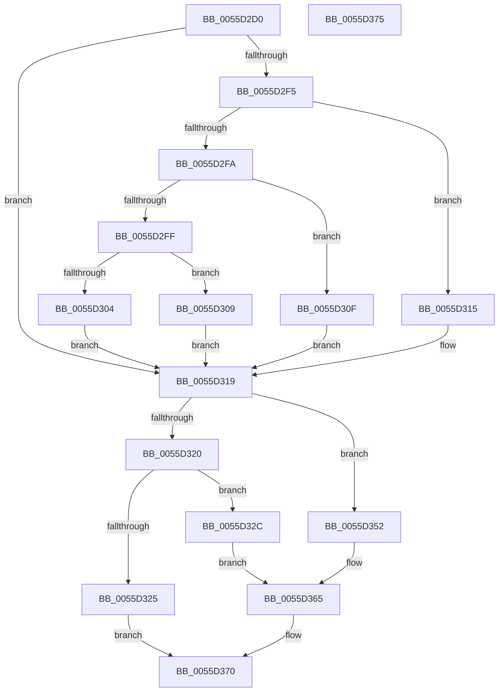

# EmonIsModifiedByBadActorEnhanced

- RVA: `0x0055D2D0`–`0x0055D376` (길이 `166` bytes)
- VA: `0x000000014055D2D0`
- 실행 섹션: `.text`
- PDB 이름 있음: `예`; PDB Function 태그: `아니요`
- unwind 정보 RVA: `0x0005C788`
- 디코드: `50`개 명령, `166/166` bytes 표시
- 미해석 바이트: `0` (있으면 어셈블리에 `.byte`로 보존)

> 이 문서는 커널 이미지의 기계어와 PDB 기호를 분석해 생성했습니다. 4번과 5번은 함수 원형과 자료형을 바이너리 사용 방식에서 추정한 C 해석이며 원본 소스 복구 결과는 아닙니다.

## 1. Dependencies

- 직접 호출 지점: **1**; 고유 호출 대상: **1**
- 직접 호출자로 확인된 함수: **0**
- RIP 상대 이미지 참조: **1**

### Outgoing calls
- `0x0055D36B` → [EmonIsModifiedByBadActorInternalEnhanced](EmonIsModifiedByBadActorInternalEnhanced_function_0055D37C.md) (function, `0x0055D37C`)

### Direct callers
- 이 함수 시작 RVA로 연결되는 직접 call은 확인되지 않았습니다. 간접 호출은 완전히 역산할 수 없습니다.

### Static image references
- `0x0055D2DF` → RVA `0x00FC8C40` (`ALMOSTRO`; read)

## 2. Other-region calls and transfers

- 다른 실행 섹션으로 향하는 call: **0**
- 별도 외부 분기/꼬리 이동을 확인하지 못했습니다.

## 3. Assembly (complete function range)

```asm
0055D2D0  48 83 EC 28                     sub rsp, 0x28
0055D2D4  65 8B 04 25 A4 01 00 00         mov eax, dword ptr gs:[0x1a4]
0055D2DC  44 8B D9                        mov r11d, ecx
0055D2DF  48 8D 0D 5A B9 A6 00            lea rcx, [rip + 0xa6b95a]
0055D2E6  4D 8B C8                        mov r9, r8
0055D2E9  48 8B 04 C1                     mov rax, qword ptr [rcx + rax*8]
0055D2ED  4C 8B 50 58                     mov r10, qword ptr [rax + 0x58]
0055D2F1  85 D2                           test edx, edx
0055D2F3  74 24                           je 0x14055d319
0055D2F5  83 EA 01                        sub edx, 1
0055D2F8  74 1B                           je 0x14055d315
0055D2FA  83 EA 63                        sub edx, 0x63
0055D2FD  74 10                           je 0x14055d30f
0055D2FF  83 FA 01                        cmp edx, 1
0055D302  74 05                           je 0x14055d309
0055D304  45 33 D2                        xor r10d, r10d
0055D307  EB 10                           jmp 0x14055d319
0055D309  49 83 C2 48                     add r10, 0x48
0055D30D  EB 0A                           jmp 0x14055d319
0055D30F  49 83 C2 30                     add r10, 0x30
0055D313  EB 04                           jmp 0x14055d319
0055D315  49 83 C2 18                     add r10, 0x18
0055D319  41 8B 0A                        mov ecx, dword ptr [r10]
0055D31C  85 C9                           test ecx, ecx
0055D31E  74 32                           je 0x14055d352
0055D320  83 F9 01                        cmp ecx, 1
0055D323  74 07                           je 0x14055d32c
0055D325  B8 F0 00 00 C0                  mov eax, 0xc00000f0
0055D32A  EB 44                           jmp 0x14055d370
0055D32C  B9 8D 03 00 00                  mov ecx, 0x38d
0055D331  0F 32                           rdmsr
0055D333  48 C1 E2 20                     shl rdx, 0x20
0055D337  42 8D 0C 9D 00 00 00 00         lea ecx, [r11*4]
0055D33F  48 0B C2                        or rax, rdx
0055D342  4C 8B C0                        mov r8, rax
0055D345  B8 0F 00 00 00                  mov eax, 0xf
0055D34A  48 D3 E0                        shl rax, cl
0055D34D  4C 23 C0                        and r8, rax
0055D350  EB 13                           jmp 0x14055d365
0055D352  41 8D 8B 86 01 00 00            lea ecx, [r11 + 0x186]
0055D359  0F 32                           rdmsr
0055D35B  48 C1 E2 20                     shl rdx, 0x20
0055D35F  48 0B C2                        or rax, rdx
0055D362  4C 8B C0                        mov r8, rax
0055D365  49 8B D2                        mov rdx, r10
0055D368  41 8B CB                        mov ecx, r11d
0055D36B  E8 0C 00 00 00                  call 0x14055d37c
0055D370  48 83 C4 28                     add rsp, 0x28
0055D374  C3                              ret
0055D375  CC                              int3
```

## 4. C-style interpretation (structured pseudocode)

```c
__int64 __fastcall EmonIsModifiedByBadActorEnhanced(int a1, int a2, __int64 a3)
{
    __int64 result;
    __int64 v_r10;
    __int64 v_rsp;

    v_rsp = (v_rsp) - (40);
    if (a2 == 0) goto loc_0055D319;
    a2 = (unsigned int)((a2) - (1));
    if (condition_is_equal) goto loc_0055D315;
    a2 = (unsigned int)((a2) - (99));
    if (condition_is_equal) goto loc_0055D30F;
    if (a2 == 1) goto loc_0055D309;
    v_r10 = 0;
    goto loc_0055D319;
loc_0055D309:
    v_r10 = (v_r10) + (72);
    goto loc_0055D319;
loc_0055D30F:
    v_r10 = (v_r10) + (48);
    goto loc_0055D319;
loc_0055D315:
    v_r10 = (v_r10) + (24);
loc_0055D319:
    if ((unsigned int)((unsigned int)(*(unsigned int *)(v_r10))) == 0) goto loc_0055D352;
    if (((unsigned int)((unsigned int)(*(unsigned int *)(v_r10)))) == 1) goto loc_0055D32C;
    goto loc_0055D370;
loc_0055D32C:
    a2 = (a2) << (32);
    result = ((unsigned int)(0xC00000F0ULL)) | (a2);
    result = (15) << ((unsigned __int8)((unsigned int)(a1) * 4));
    a3 = (result) & (result);
    goto loc_0055D365;
loc_0055D352:
    a2 = (a2) << (32);
    result = (result) | (a2);
loc_0055D365:
    result = EmonIsModifiedByBadActorInternalEnhanced((unsigned int)((unsigned int)((unsigned int)(a1))), v_r10, result, a3);
loc_0055D370:
    v_rsp = (v_rsp) + (40);
    return result;
}
```

## 5. (Beta) C Style

```c
int64_t EmonIsModifiedByBadActorEnhanced(void *Arg1, int32_t Arg2, int64_t Arg3)
{
    uint8_t *arg1 = (uint8_t *)Arg1;

    int64_t result;
    int64_t local_r10;
    int64_t local_rsp;

    local_rsp = (local_rsp) - (40);
    if (Arg2 == 0) goto loc_0055D319;
    Arg2 = (uint32_t)((Arg2) - (1));
    if (condition_is_equal) goto loc_0055D315;
    Arg2 = (uint32_t)((Arg2) - (99));
    if (condition_is_equal) goto loc_0055D30F;
    if (Arg2 == 1) goto loc_0055D309;
    local_r10 = 0;
    goto loc_0055D319;
loc_0055D309:
    local_r10 = (local_r10) + (72);
    goto loc_0055D319;
loc_0055D30F:
    local_r10 = (local_r10) + (48);
    goto loc_0055D319;
loc_0055D315:
    local_r10 = (local_r10) + (24);
loc_0055D319:
    if ((uint32_t)((uint32_t)(*(uint32_t *)(local_r10))) == 0) goto loc_0055D352;
    if (((uint32_t)((uint32_t)(*(uint32_t *)(local_r10)))) == 1) goto loc_0055D32C;
    goto loc_0055D370;
loc_0055D32C:
    Arg2 = (Arg2) << (32);
    result = ((uint32_t)(0xC00000F0ULL)) | (Arg2);
    result = (15) << ((uint8_t)((uint32_t)(Arg1) * 4));
    Arg3 = (result) & (result);
    goto loc_0055D365;
loc_0055D352:
    Arg2 = (Arg2) << (32);
    result = (result) | (Arg2);
loc_0055D365:
    result = EmonIsModifiedByBadActorInternalEnhanced((uint32_t)((uint32_t)((uint32_t)(Arg1))), local_r10, result, Arg3);
loc_0055D370:
    local_rsp = (local_rsp) + (40);
    return result;
}
```

### 관측된 메모리 오프셋

구조체 형식이 확인되지 않은 접근은 인자 기준의 오프셋으로만 기록했습니다.

| 기준 인자 | 오프셋 표현 | 폭 (bit) | 접근 |
|---|---:|---:|---|
| `Arg1` | `+ 0x186` | `32` | `R` |

## 6. Execution-region graph

[열기: 2D/3D 그래프와 함수 탐색 컨트롤 패널](../../../control-panel.html?section=text&rva=0x0055D2D0&view=graph)

- 2D 그래프는 위에서 아래로 흐르고, 3D 그래프는 빈 공간을 드래그해 회전합니다. Shift+드래그는 이동, 휠은 확대·축소, 함수 노드 선택은 대상 보고서 이동입니다.

### Static fallback


