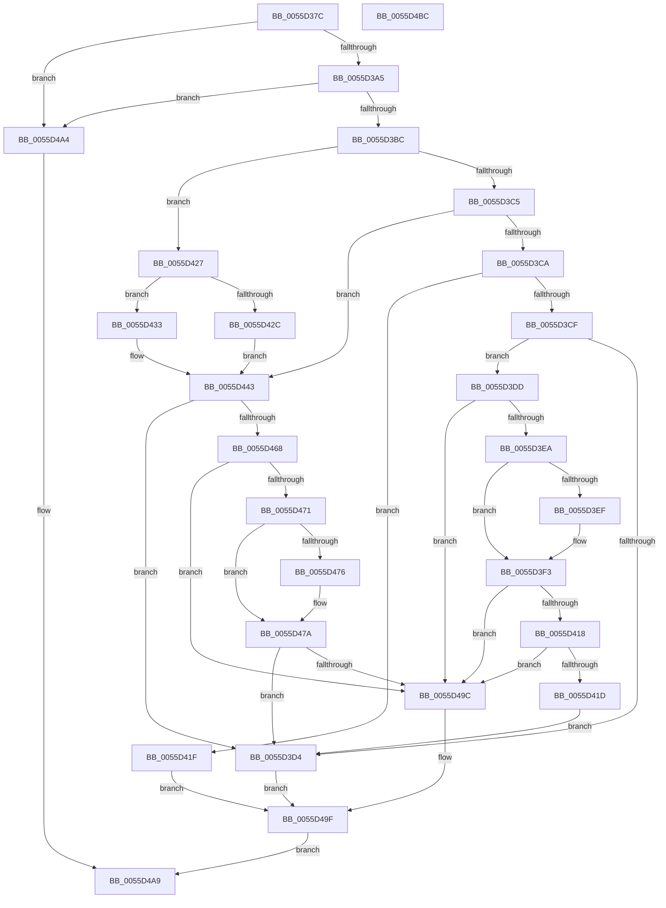

# EmonIsModifiedByBadActorInternalEnhanced

- RVA: `0x0055D37C`–`0x0055D4BD` (길이 `321` bytes)
- VA: `0x000000014055D37C`
- 실행 섹션: `.text`
- PDB 이름 있음: `예`; PDB Function 태그: `아니요`
- unwind 정보 RVA: `0x000C48E8`
- 디코드: `90`개 명령, `321/321` bytes 표시
- 미해석 바이트: `0` (있으면 어셈블리에 `.byte`로 보존)

> 이 문서는 커널 이미지의 기계어와 PDB 기호를 분석해 생성했습니다. 4번과 5번은 함수 원형과 자료형을 바이너리 사용 방식에서 추정한 C 해석이며 원본 소스 복구 결과는 아닙니다.

## 1. Dependencies

- 직접 호출 지점: **0**; 고유 호출 대상: **0**
- 직접 호출자로 확인된 함수: **3**
- RIP 상대 이미지 참조: **1**

### Outgoing calls
- 직접 디코드된 call 명령이 없습니다.

### Direct callers
- [EmonIsModifiedByBadActorEnhanced](EmonIsModifiedByBadActorEnhanced_function_0055D2D0.md) at `0x0055D36B`
- [EmonOverflowHandlerInternalV1Enhanced](EmonOverflowHandlerInternalV1Enhanced_function_0055D88C.md) at `0x0055DC32`
- [EmonOverflowHandlerInternalV2Enhanced](EmonOverflowHandlerInternalV2Enhanced_function_0055E110.md) at `0x0055E50C`

### Static image references
- `0x0055D3DD` → RVA `0x00F8FDE0` (`.data`; read)

## 2. Other-region calls and transfers

- 다른 실행 섹션으로 향하는 call: **0**
- 별도 외부 분기/꼬리 이동을 확인하지 못했습니다.

## 3. Assembly (complete function range)

```asm
0055D37C  48 89 5C 24 08                  mov qword ptr [rsp + 8], rbx
0055D381  48 89 6C 24 18                  mov qword ptr [rsp + 0x18], rbp
0055D386  48 89 74 24 20                  mov qword ptr [rsp + 0x20], rsi
0055D38B  57                              push rdi
0055D38C  41 56                           push r14
0055D38E  8B 3A                           mov edi, dword ptr [rdx]
0055D390  45 33 D2                        xor r10d, r10d
0055D393  48 8B DA                        mov rbx, rdx
0055D396  44 8B D9                        mov r11d, ecx
0055D399  41 8B EA                        mov ebp, r10d
0055D39C  3B 4A 08                        cmp ecx, dword ptr [rdx + 8]
0055D39F  0F 87 FF 00 00 00               ja 0x14055d4a4
0055D3A5  4C 8B 72 10                     mov r14, qword ptr [rdx + 0x10]
0055D3A9  4B 8D 34 5B                     lea rsi, [r11 + r11*2]
0055D3AD  48 03 F6                        add rsi, rsi
0055D3B0  41 83 7C F6 1C 03               cmp dword ptr [r14 + rsi*8 + 0x1c], 3
0055D3B6  0F 84 E8 00 00 00               je 0x14055d4a4
0055D3BC  41 8B 4C F6 18                  mov ecx, dword ptr [r14 + rsi*8 + 0x18]
0055D3C1  85 C9                           test ecx, ecx
0055D3C3  74 62                           je 0x14055d427
0055D3C5  83 E9 01                        sub ecx, 1
0055D3C8  74 79                           je 0x14055d443
0055D3CA  83 F9 01                        cmp ecx, 1
0055D3CD  74 50                           je 0x14055d41f
0055D3CF  4D 85 C0                        test r8, r8
0055D3D2  74 09                           je 0x14055d3dd
0055D3D4  41 C6 01 01                     mov byte ptr [r9], 1
0055D3D8  E9 C2 00 00 00                  jmp 0x14055d49f
0055D3DD  83 3D FC 29 A3 00 02            cmp dword ptr [rip + 0xa329fc], 2
0055D3E4  0F 82 B2 00 00 00               jb 0x14055d49c
0055D3EA  83 FF 01                        cmp edi, 1
0055D3ED  75 04                           jne 0x14055d3f3
0055D3EF  41 83 C3 20                     add r11d, 0x20
0055D3F3  B9 8F 03 00 00                  mov ecx, 0x38f
0055D3F8  0F 32                           rdmsr
0055D3FA  48 C1 E2 20                     shl rdx, 0x20
0055D3FE  41 8B CB                        mov ecx, r11d
0055D401  48 0B D0                        or rdx, rax
0055D404  B8 01 00 00 00                  mov eax, 1
0055D409  48 D3 E0                        shl rax, cl
0055D40C  48 23 D0                        and rdx, rax
0055D40F  83 FF 01                        cmp edi, 1
0055D412  0F 85 84 00 00 00               jne 0x14055d49c
0055D418  48 85 D2                        test rdx, rdx
0055D41B  74 7F                           je 0x14055d49c
0055D41D  EB B5                           jmp 0x14055d3d4
0055D41F  41 BA 08 07 00 C0               mov r10d, 0xc0000708
0055D425  EB 78                           jmp 0x14055d49f
0055D427  83 FF 01                        cmp edi, 1
0055D42A  74 07                           je 0x14055d433
0055D42C  BD 00 00 10 00                  mov ebp, 0x100000
0055D431  EB 10                           jmp 0x14055d443
0055D433  42 8D 0C 9D 00 00 00 00         lea ecx, [r11*4]
0055D43B  BD 08 00 00 00                  mov ebp, 8
0055D440  48 D3 E5                        shl rbp, cl
0055D443  0F AE E8                        lfence
0055D446  49 8B 44 F6 10                  mov rax, qword ptr [r14 + rsi*8 + 0x10]
0055D44B  48 8B D5                        mov rdx, rbp
0055D44E  48 0F BA EA 16                  bts rdx, 0x16
0055D453  83 FF 01                        cmp edi, 1
0055D456  8B 08                           mov ecx, dword ptr [rax]
0055D458  48 0F 44 D5                     cmove rdx, rbp
0055D45C  48 0B D1                        or rdx, rcx
0055D45F  4C 3B C2                        cmp r8, rdx
0055D462  0F 85 6C FF FF FF               jne 0x14055d3d4
0055D468  83 3D 71 29 A3 00 02            cmp dword ptr [rip + 0xa32971], 2
0055D46F  72 2B                           jb 0x14055d49c
0055D471  83 3B 01                        cmp dword ptr [rbx], 1
0055D474  75 04                           jne 0x14055d47a
0055D476  41 83 C3 20                     add r11d, 0x20
0055D47A  B9 8F 03 00 00                  mov ecx, 0x38f
0055D47F  0F 32                           rdmsr
0055D481  48 C1 E2 20                     shl rdx, 0x20
0055D485  41 8B CB                        mov ecx, r11d
0055D488  48 0B D0                        or rdx, rax
0055D48B  B8 01 00 00 00                  mov eax, 1
0055D490  48 D3 E0                        shl rax, cl
0055D493  48 85 D0                        test rax, rdx
0055D496  0F 84 38 FF FF FF               je 0x14055d3d4
0055D49C  45 88 11                        mov byte ptr [r9], r10b
0055D49F  41 8B C2                        mov eax, r10d
0055D4A2  EB 05                           jmp 0x14055d4a9
0055D4A4  B8 EF 00 00 C0                  mov eax, 0xc00000ef
0055D4A9  48 8B 5C 24 18                  mov rbx, qword ptr [rsp + 0x18]
0055D4AE  48 8B 6C 24 28                  mov rbp, qword ptr [rsp + 0x28]
0055D4B3  48 8B 74 24 30                  mov rsi, qword ptr [rsp + 0x30]
0055D4B8  41 5E                           pop r14
0055D4BA  5F                              pop rdi
0055D4BB  C3                              ret
0055D4BC  CC                              int3
```

## 4. C-style interpretation (structured pseudocode)

```c
__int64 __fastcall EmonIsModifiedByBadActorInternalEnhanced(int a1, __int64 a2, __int64 a3, __int64 a4)
{
    __int64 result;
    __int64 v_r10;
    __int64 v_r11;
    __int64 v_rbp;
    __int64 v_rsi;
    unsigned __int64 v_stack_p18;
    unsigned __int64 v_stack_p20;
    unsigned __int64 v_stack_p8;

    v_stack_p8 = v_rbx;
    v_stack_p18 = v_rbp;
    v_stack_p20 = v_rsi;
    v_r10 = 0;
    if (a1 > (*(unsigned int *)(a2 + 8))) goto loc_0055D4A4;
    v_rsi = ((unsigned int)(a1) + (unsigned int)(a1) * 2) + ((unsigned int)(a1) + (unsigned int)(a1) * 2);
    if ((*(unsigned int *)(*(unsigned __int64 *)(a2 + 16) + v_rsi * 8 + 28)) == 3) goto loc_0055D4A4;
    if ((unsigned int)((unsigned int)(*(unsigned int *)(*(unsigned __int64 *)(a2 + 16) + v_rsi * 8 + 24))) == 0) goto loc_0055D427;
    a1 = (unsigned int)(((unsigned int)(*(unsigned int *)(*(unsigned __int64 *)(a2 + 16) + v_rsi * 8 + 24))) - (1));
    if (condition_is_equal) goto loc_0055D443;
    if (a1 == 1) goto loc_0055D41F;
    if (a3 == 0) goto loc_0055D3DD;
loc_0055D3D4:
    *(unsigned __int8 *)(a4) = 1;
    goto loc_0055D49F;
loc_0055D3DD:
    if ((*(unsigned int *)(v_rip + 10693116)) < 2) goto loc_0055D49C;
    v_r11 = (unsigned int)(a1);
    if (((unsigned int)((unsigned int)(*(unsigned int *)(a2)))) == 1) {
        v_r11 = (unsigned int)(((unsigned int)(a1)) + (32));
    }
    a2 = (a2) << (32);
    a2 = (a2) | (result);
    result = (1) << ((unsigned __int8)((unsigned int)((unsigned int)(v_r11))));
    a2 = (a2) & (result);
    if (((unsigned int)((unsigned int)(*(unsigned int *)(a2)))) != 1) goto loc_0055D49C;
    if (a2 == 0) goto loc_0055D49C;
    goto loc_0055D3D4;
loc_0055D41F:
    goto loc_0055D49F;
loc_0055D427:
    if (((unsigned int)((unsigned int)(*(unsigned int *)(a2)))) == 1) goto loc_0055D433;
    goto loc_0055D443;
loc_0055D433:
    v_rbp = (8) << ((unsigned __int8)(v_r11 * 4));
loc_0055D443:
    a2 = v_rbp;
    if (((unsigned int)((unsigned int)(*(unsigned int *)(a2)))) == 1) { a2 = v_rbp; }
    a2 = (a2) | ((unsigned int)(*(unsigned int *)(*(unsigned __int64 *)(*(unsigned __int64 *)(a2 + 16) + v_rsi * 8 + 16))));
    if (a3 != a2) goto loc_0055D3D4;
    if ((*(unsigned int *)(v_rip + 10692977)) < 2) goto loc_0055D49C;
    if ((*(unsigned int *)(a2)) == 1) {
        v_r11 = (unsigned int)((v_r11) + (32));
    }
    a2 = (a2) << (32);
    a2 = (a2) | (*(unsigned __int64 *)(*(unsigned __int64 *)(a2 + 16) + v_rsi * 8 + 16));
    result = (1) << ((unsigned __int8)((unsigned int)((unsigned int)(v_r11))));
    if (((result) & (a2)) == 0) goto loc_0055D3D4;
loc_0055D49C:
    *(unsigned __int8 *)(a4) = (unsigned __int8)((unsigned int)(0xC0000708ULL));
loc_0055D49F:
    goto loc_0055D4A9;
loc_0055D4A4:
loc_0055D4A9:
    return (unsigned int)(0xC00000EFULL);
}
```

## 5. (Beta) C Style

```c
int64_t EmonIsModifiedByBadActorInternalEnhanced(void *Arg1, void *Arg2, int64_t Arg3, void *Arg4)
{
    uint8_t *arg1 = (uint8_t *)Arg1;
    uint8_t *arg2 = (uint8_t *)Arg2;
    uint8_t *arg4 = (uint8_t *)Arg4;

    int64_t result;
    int64_t local_r10;
    int64_t local_r11;
    int64_t local_rbp;
    int64_t local_rsi;
    uint64_t v_stack_p18;
    uint64_t v_stack_p20;
    uint64_t v_stack_p8;

    v_stack_p8 = local_rbx;
    v_stack_p18 = local_rbp;
    v_stack_p20 = local_rsi;
    local_r10 = 0;
    if (Arg1 > (*(uint32_t *)(arg2 + 0x8))) goto loc_0055D4A4;
    local_rsi = ((uint32_t)(Arg1) + (uint32_t)(Arg1) * 2) + ((uint32_t)(Arg1) + (uint32_t)(Arg1) * 2);
    if ((*(uint32_t *)(*(uint64_t *)(arg2 + 0x10) + local_rsi * 8 + 0x1C)) == 3) goto loc_0055D4A4;
    if ((uint32_t)((uint32_t)(*(uint32_t *)(*(uint64_t *)(arg2 + 0x10) + local_rsi * 8 + 0x18))) == 0) goto loc_0055D427;
    Arg1 = (uint32_t)(((uint32_t)(*(uint32_t *)(*(uint64_t *)(arg2 + 0x10) + local_rsi * 8 + 0x18))) - (1));
    if (condition_is_equal) goto loc_0055D443;
    if (Arg1 == 1) goto loc_0055D41F;
    if (Arg3 == 0) goto loc_0055D3DD;
loc_0055D3D4:
    *(uint8_t *)(arg4) = 1;
    goto loc_0055D49F;
loc_0055D3DD:
    if ((*(uint32_t *)(v_rip + 0xA329FC)) < 2) goto loc_0055D49C;
    local_r11 = (uint32_t)(Arg1);
    if (((uint32_t)((uint32_t)(*(uint32_t *)(arg2)))) == 1) {
        local_r11 = (uint32_t)(((uint32_t)(Arg1)) + (32));
    }
    Arg2 = (Arg2) << (32);
    Arg2 = (Arg2) | (result);
    result = (1) << ((uint8_t)((uint32_t)((uint32_t)(local_r11))));
    Arg2 = (Arg2) & (result);
    if (((uint32_t)((uint32_t)(*(uint32_t *)(arg2)))) != 1) goto loc_0055D49C;
    if (Arg2 == NULL) goto loc_0055D49C;
    goto loc_0055D3D4;
loc_0055D41F:
    goto loc_0055D49F;
loc_0055D427:
    if (((uint32_t)((uint32_t)(*(uint32_t *)(arg2)))) == 1) goto loc_0055D433;
    goto loc_0055D443;
loc_0055D433:
    local_rbp = (8) << ((uint8_t)(local_r11 * 4));
loc_0055D443:
    Arg2 = local_rbp;
    if (((uint32_t)((uint32_t)(*(uint32_t *)(arg2)))) == 1) { Arg2 = local_rbp; }
    Arg2 = (Arg2) | ((uint32_t)(*(uint32_t *)(*(uint64_t *)(*(uint64_t *)(arg2 + 0x10) + local_rsi * 8 + 0x10))));
    if (Arg3 != Arg2) goto loc_0055D3D4;
    if ((*(uint32_t *)(v_rip + 0xA32971)) < 2) goto loc_0055D49C;
    if ((*(uint32_t *)(arg2)) == 1) {
        local_r11 = (uint32_t)((local_r11) + (32));
    }
    Arg2 = (Arg2) << (32);
    Arg2 = (Arg2) | (*(uint64_t *)(*(uint64_t *)(arg2 + 0x10) + local_rsi * 8 + 0x10));
    result = (1) << ((uint8_t)((uint32_t)((uint32_t)(local_r11))));
    if (((result) & (Arg2)) == 0) goto loc_0055D3D4;
loc_0055D49C:
    *(uint8_t *)(arg4) = (uint8_t)((uint32_t)(0xC0000708ULL));
loc_0055D49F:
    goto loc_0055D4A9;
loc_0055D4A4:
loc_0055D4A9:
    return (uint32_t)(0xC00000EFULL);
}
```

### 관측된 메모리 오프셋

구조체 형식이 확인되지 않은 접근은 인자 기준의 오프셋으로만 기록했습니다.

| 기준 인자 | 오프셋 표현 | 폭 (bit) | 접근 |
|---|---:|---:|---|
| `Arg1` | `+ 0x0 + r11*2` | `64` | `R` |
| `Arg2` | `+ 0x0` | `32` | `R` |
| `Arg2` | `+ 0x8` | `32` | `R` |
| `Arg2` | `+ 0x10` | `64` | `R` |
| `Arg4` | `+ 0x0` | `8` | `W` |

## 6. Execution-region graph

[열기: 2D/3D 그래프와 함수 탐색 컨트롤 패널](../../../control-panel.html?section=text&rva=0x0055D37C&view=graph)

- 2D 그래프는 위에서 아래로 흐르고, 3D 그래프는 빈 공간을 드래그해 회전합니다. Shift+드래그는 이동, 휠은 확대·축소, 함수 노드 선택은 대상 보고서 이동입니다.

### Static fallback


