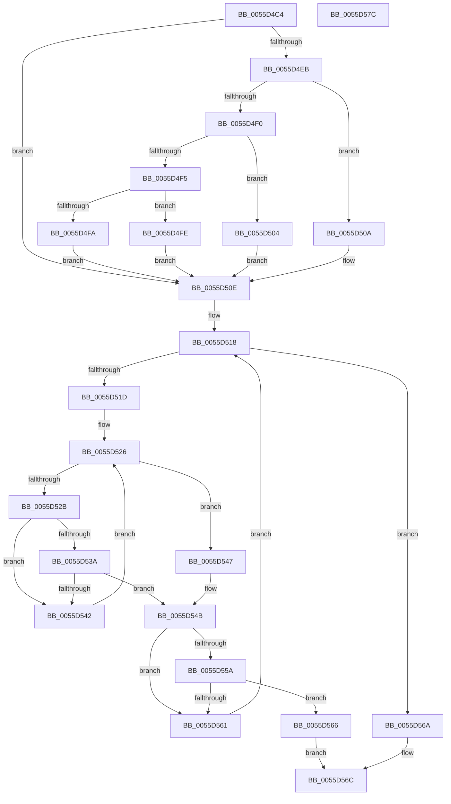

# EmonIsProfileSourceInUseEnhanced

- RVA: `0x0055D4C4`–`0x0055D57D` (길이 `185` bytes)
- VA: `0x000000014055D4C4`
- 실행 섹션: `.text`
- PDB 이름 있음: `예`; PDB Function 태그: `아니요`
- unwind 정보 RVA: `0x00069588`
- 디코드: `59`개 명령, `185/185` bytes 표시
- 미해석 바이트: `0` (있으면 어셈블리에 `.byte`로 보존)

> 이 문서는 커널 이미지의 기계어와 PDB 기호를 분석해 생성했습니다. 4번과 5번은 함수 원형과 자료형을 바이너리 사용 방식에서 추정한 C 해석이며 원본 소스 복구 결과는 아닙니다.

## 1. Dependencies

- 직접 호출 지점: **0**; 고유 호출 대상: **0**
- 직접 호출자로 확인된 함수: **1**
- RIP 상대 이미지 참조: **1**

### Outgoing calls
- 직접 디코드된 call 명령이 없습니다.

### Direct callers
- [EmonRemoveProfileSourceEnhanced](EmonRemoveProfileSourceEnhanced_function_0055F1C0.md) at `0x0055F215`
- [EmonRemoveProfileSourceEnhanced](EmonRemoveProfileSourceEnhanced_function_0055F1C0.md) at `0x0055F228`

### Static image references
- `0x0055D4D5` → RVA `0x00FC8C40` (`ALMOSTRO`; read)

## 2. Other-region calls and transfers

- 다른 실행 섹션으로 향하는 call: **0**
- 별도 외부 분기/꼬리 이동을 확인하지 못했습니다.

## 3. Assembly (complete function range)

```asm
0055D4C4  48 89 5C 24 08                  mov qword ptr [rsp + 8], rbx
0055D4C9  48 89 74 24 10                  mov qword ptr [rsp + 0x10], rsi
0055D4CE  48 89 7C 24 18                  mov qword ptr [rsp + 0x18], rdi
0055D4D3  8B C2                           mov eax, edx
0055D4D5  48 8D 15 64 B7 A6 00            lea rdx, [rip + 0xa6b764]
0055D4DC  41 8B F0                        mov esi, r8d
0055D4DF  48 8B 04 C2                     mov rax, qword ptr [rdx + rax*8]
0055D4E3  48 8B 50 58                     mov rdx, qword ptr [rax + 0x58]
0055D4E7  85 C9                           test ecx, ecx
0055D4E9  74 23                           je 0x14055d50e
0055D4EB  83 E9 01                        sub ecx, 1
0055D4EE  74 1A                           je 0x14055d50a
0055D4F0  83 E9 63                        sub ecx, 0x63
0055D4F3  74 0F                           je 0x14055d504
0055D4F5  83 F9 01                        cmp ecx, 1
0055D4F8  74 04                           je 0x14055d4fe
0055D4FA  33 D2                           xor edx, edx
0055D4FC  EB 10                           jmp 0x14055d50e
0055D4FE  48 83 C2 48                     add rdx, 0x48
0055D502  EB 0A                           jmp 0x14055d50e
0055D504  48 83 C2 30                     add rdx, 0x30
0055D508  EB 04                           jmp 0x14055d50e
0055D50A  48 83 C2 18                     add rdx, 0x18
0055D50E  4C 8B 5A 10                     mov r11, qword ptr [rdx + 0x10]
0055D512  45 33 C9                        xor r9d, r9d
0055D515  8B 7A 04                        mov edi, dword ptr [rdx + 4]
0055D518  44 3B CF                        cmp r9d, edi
0055D51B  73 4D                           jae 0x14055d56a
0055D51D  8B 5A 08                        mov ebx, dword ptr [rdx + 8]
0055D520  45 33 D2                        xor r10d, r10d
0055D523  45 33 C0                        xor r8d, r8d
0055D526  44 3B C3                        cmp r8d, ebx
0055D529  77 1C                           ja 0x14055d547
0055D52B  4B 8D 0C 40                     lea rcx, [r8 + r8*2]
0055D52F  48 03 C9                        add rcx, rcx
0055D532  41 83 7C CB 1C 03               cmp dword ptr [r11 + rcx*8 + 0x1c], 3
0055D538  74 08                           je 0x14055d542
0055D53A  41 FF C2                        inc r10d
0055D53D  45 3B D1                        cmp r10d, r9d
0055D540  77 09                           ja 0x14055d54b
0055D542  41 FF C0                        inc r8d
0055D545  EB DF                           jmp 0x14055d526
0055D547  41 83 C8 FF                     or r8d, 0xffffffff
0055D54B  4B 8D 0C 40                     lea rcx, [r8 + r8*2]
0055D54F  48 03 C9                        add rcx, rcx
0055D552  41 83 7C CB 18 03               cmp dword ptr [r11 + rcx*8 + 0x18], 3
0055D558  74 07                           je 0x14055d561
0055D55A  41 39 74 CB 24                  cmp dword ptr [r11 + rcx*8 + 0x24], esi
0055D55F  74 05                           je 0x14055d566
0055D561  41 FF C1                        inc r9d
0055D564  EB B2                           jmp 0x14055d518
0055D566  B0 01                           mov al, 1
0055D568  EB 02                           jmp 0x14055d56c
0055D56A  32 C0                           xor al, al
0055D56C  48 8B 5C 24 08                  mov rbx, qword ptr [rsp + 8]
0055D571  48 8B 74 24 10                  mov rsi, qword ptr [rsp + 0x10]
0055D576  48 8B 7C 24 18                  mov rdi, qword ptr [rsp + 0x18]
0055D57B  C3                              ret
0055D57C  CC                              int3
```

## 4. C-style interpretation (structured pseudocode)

```c
__int64 __fastcall EmonIsProfileSourceInUseEnhanced(int a1, int a2, int a3, int a4)
{
    __int64 result;
    __int64 v_r10;
    unsigned __int64 v_stack_p10;
    unsigned __int64 v_stack_p18;
    unsigned __int64 v_stack_p8;

    v_stack_p8 = v_rbx;
    v_stack_p10 = v_rsi;
    v_stack_p18 = v_rdi;
    if (a1 == 0) goto loc_0055D50E;
    a1 = (unsigned int)((a1) - (1));
    if (condition_is_equal) goto loc_0055D50A;
    a1 = (unsigned int)((a1) - (99));
    if (condition_is_equal) goto loc_0055D504;
    if (a1 == 1) goto loc_0055D4FE;
    a2 = 0;
    goto loc_0055D50E;
loc_0055D4FE:
    a2 = (a2) + (72);
    goto loc_0055D50E;
loc_0055D504:
    a2 = (a2) + (48);
    goto loc_0055D50E;
loc_0055D50A:
    a2 = (a2) + (24);
loc_0055D50E:
    a4 = 0;
loc_0055D518:
    if (0 >= ((unsigned int)((unsigned int)(*(unsigned int *)(a2 + 4))))) goto loc_0055D56A;
    v_r10 = 0;
    a3 = 0;
loc_0055D526:
    if (0 > ((unsigned int)((unsigned int)(*(unsigned int *)(a2 + 8))))) goto loc_0055D547;
    a1 = (a3 + a3 * 2) + (a3 + a3 * 2);
    if ((*(unsigned int *)(*(unsigned __int64 *)(a2 + 16) + a1 * 8 + 28)) == 3) goto loc_0055D542;
    v_r10 = (unsigned int)((v_r10) + 1);
    if (((unsigned int)(v_r10)) > 0) goto loc_0055D54B;
loc_0055D542:
    a3 = (unsigned int)((a3) + 1);
    goto loc_0055D526;
loc_0055D547:
    a3 = (unsigned int)((a3) | (0xFFFFFFFFULL));
loc_0055D54B:
    a1 = (a3 + a3 * 2) + (a3 + a3 * 2);
    if ((*(unsigned int *)(*(unsigned __int64 *)(a2 + 16) + a1 * 8 + 24)) == 3) goto loc_0055D561;
    if ((*(unsigned int *)(*(unsigned __int64 *)(a2 + 16) + a1 * 8 + 36)) == ((unsigned int)((unsigned int)(a3)))) goto loc_0055D566;
loc_0055D561:
    a4 = (unsigned int)((a4) + 1);
    goto loc_0055D518;
loc_0055D566:
    goto loc_0055D56C;
loc_0055D56A:
    result = 0;
loc_0055D56C:
    return result;
}
```

## 5. (Beta) C Style

```c
int64_t EmonIsProfileSourceInUseEnhanced(int32_t Arg1, int32_t Arg2, int32_t Arg3, int32_t Arg4)
{
    int64_t result;
    int64_t local_r10;
    uint64_t v_stack_p10;
    uint64_t v_stack_p18;
    uint64_t v_stack_p8;

    v_stack_p8 = local_rbx;
    v_stack_p10 = local_rsi;
    v_stack_p18 = local_rdi;
    if (Arg1 == 0) goto loc_0055D50E;
    Arg1 = (uint32_t)((Arg1) - (1));
    if (condition_is_equal) goto loc_0055D50A;
    Arg1 = (uint32_t)((Arg1) - (99));
    if (condition_is_equal) goto loc_0055D504;
    if (Arg1 == 1) goto loc_0055D4FE;
    Arg2 = 0;
    goto loc_0055D50E;
loc_0055D4FE:
    Arg2 = (Arg2) + (72);
    goto loc_0055D50E;
loc_0055D504:
    Arg2 = (Arg2) + (48);
    goto loc_0055D50E;
loc_0055D50A:
    Arg2 = (Arg2) + (24);
loc_0055D50E:
    Arg4 = 0;
loc_0055D518:
    if (0 >= ((uint32_t)((uint32_t)(*(uint32_t *)(Arg2 + 0x4))))) goto loc_0055D56A;
    local_r10 = 0;
    Arg3 = 0;
loc_0055D526:
    if (0 > ((uint32_t)((uint32_t)(*(uint32_t *)(Arg2 + 0x8))))) goto loc_0055D547;
    Arg1 = (Arg3 + Arg3 * 2) + (Arg3 + Arg3 * 2);
    if ((*(uint32_t *)(*(uint64_t *)(Arg2 + 0x10) + Arg1 * 8 + 0x1C)) == 3) goto loc_0055D542;
    local_r10 = (uint32_t)((local_r10) + 1);
    if (((uint32_t)(local_r10)) > 0) goto loc_0055D54B;
loc_0055D542:
    Arg3 = (uint32_t)((Arg3) + 1);
    goto loc_0055D526;
loc_0055D547:
    Arg3 = (uint32_t)((Arg3) | (0xFFFFFFFFULL));
loc_0055D54B:
    Arg1 = (Arg3 + Arg3 * 2) + (Arg3 + Arg3 * 2);
    if ((*(uint32_t *)(*(uint64_t *)(Arg2 + 0x10) + Arg1 * 8 + 0x18)) == 3) goto loc_0055D561;
    if ((*(uint32_t *)(*(uint64_t *)(Arg2 + 0x10) + Arg1 * 8 + 0x24)) == ((uint32_t)((uint32_t)(Arg3)))) goto loc_0055D566;
loc_0055D561:
    Arg4 = (uint32_t)((Arg4) + 1);
    goto loc_0055D518;
loc_0055D566:
    goto loc_0055D56C;
loc_0055D56A:
    result = 0;
loc_0055D56C:
    return result;
}
```

## 6. Execution-region graph

[열기: 2D/3D 그래프와 함수 탐색 컨트롤 패널](../../../control-panel.html?section=text&rva=0x0055D4C4&view=graph)

- 2D 그래프는 위에서 아래로 흐르고, 3D 그래프는 빈 공간을 드래그해 회전합니다. Shift+드래그는 이동, 휠은 확대·축소, 함수 노드 선택은 대상 보고서 이동입니다.

### Static fallback


