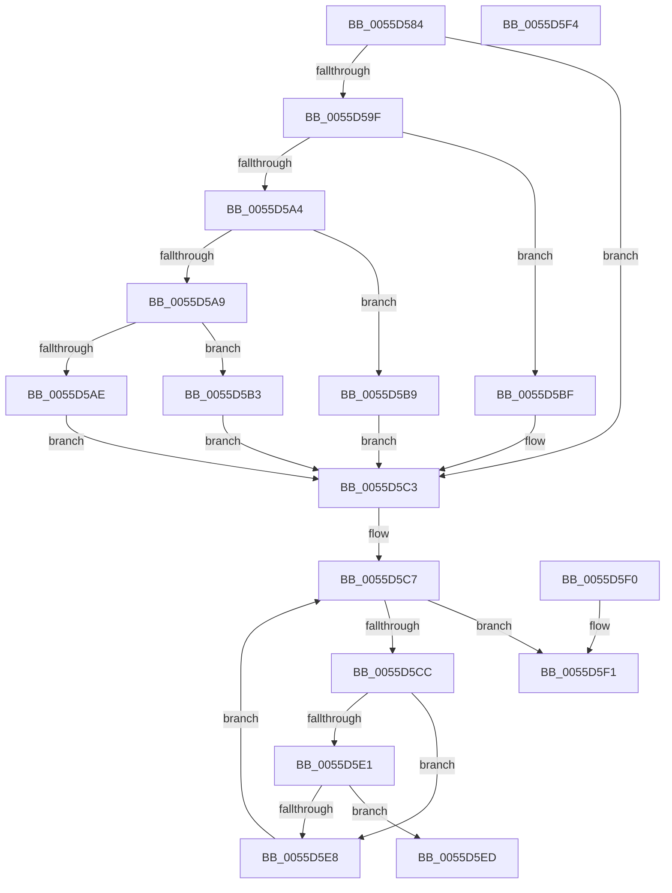

# EmonIsProfileSourceInUseOriginal

- RVA: `0x0055D584`–`0x0055D5F5` (길이 `113` bytes)
- VA: `0x000000014055D584`
- 실행 섹션: `.text`
- PDB 이름 있음: `예`; PDB Function 태그: `아니요`
- unwind 정보 RVA: `0x000DB714`
- 디코드: `40`개 명령, `113/113` bytes 표시
- 미해석 바이트: `0` (있으면 어셈블리에 `.byte`로 보존)

> 이 문서는 커널 이미지의 기계어와 PDB 기호를 분석해 생성했습니다. 4번과 5번은 함수 원형과 자료형을 바이너리 사용 방식에서 추정한 C 해석이며 원본 소스 복구 결과는 아닙니다.

## 1. Dependencies

- 직접 호출 지점: **0**; 고유 호출 대상: **0**
- 직접 호출자로 확인된 함수: **1**
- RIP 상대 이미지 참조: **1**

### Outgoing calls
- 직접 디코드된 call 명령이 없습니다.

### Direct callers
- [EmonRemoveProfileSourceOriginal](EmonRemoveProfileSourceOriginal_function_0055F2C0.md) at `0x0055F315`
- [EmonRemoveProfileSourceOriginal](EmonRemoveProfileSourceOriginal_function_0055F2C0.md) at `0x0055F328`

### Static image references
- `0x0055D589` → RVA `0x00FC8C40` (`ALMOSTRO`; read)

## 2. Other-region calls and transfers

- 다른 실행 섹션으로 향하는 call: **0**
- 별도 외부 분기/꼬리 이동을 확인하지 못했습니다.

## 3. Assembly (complete function range)

```asm
0055D584  8B C2                           mov eax, edx
0055D586  45 33 C9                        xor r9d, r9d
0055D589  48 8D 15 B0 B6 A6 00            lea rdx, [rip + 0xa6b6b0]
0055D590  45 8B D0                        mov r10d, r8d
0055D593  48 8B 04 C2                     mov rax, qword ptr [rdx + rax*8]
0055D597  48 8B 50 58                     mov rdx, qword ptr [rax + 0x58]
0055D59B  85 C9                           test ecx, ecx
0055D59D  74 24                           je 0x14055d5c3
0055D59F  83 E9 01                        sub ecx, 1
0055D5A2  74 1B                           je 0x14055d5bf
0055D5A4  83 E9 63                        sub ecx, 0x63
0055D5A7  74 10                           je 0x14055d5b9
0055D5A9  83 F9 01                        cmp ecx, 1
0055D5AC  74 05                           je 0x14055d5b3
0055D5AE  41 8B D1                        mov edx, r9d
0055D5B1  EB 10                           jmp 0x14055d5c3
0055D5B3  48 83 C2 48                     add rdx, 0x48
0055D5B7  EB 0A                           jmp 0x14055d5c3
0055D5B9  48 83 C2 30                     add rdx, 0x30
0055D5BD  EB 04                           jmp 0x14055d5c3
0055D5BF  48 83 C2 18                     add rdx, 0x18
0055D5C3  44 8B 42 04                     mov r8d, dword ptr [rdx + 4]
0055D5C7  45 3B C8                        cmp r9d, r8d
0055D5CA  73 25                           jae 0x14055d5f1
0055D5CC  41 8B C1                        mov eax, r9d
0055D5CF  48 8D 0C 40                     lea rcx, [rax + rax*2]
0055D5D3  48 8B 42 10                     mov rax, qword ptr [rdx + 0x10]
0055D5D7  48 03 C9                        add rcx, rcx
0055D5DA  83 7C C8 18 03                  cmp dword ptr [rax + rcx*8 + 0x18], 3
0055D5DF  74 07                           je 0x14055d5e8
0055D5E1  44 39 54 C8 24                  cmp dword ptr [rax + rcx*8 + 0x24], r10d
0055D5E6  74 05                           je 0x14055d5ed
0055D5E8  41 FF C1                        inc r9d
0055D5EB  EB DA                           jmp 0x14055d5c7
0055D5ED  B0 01                           mov al, 1
0055D5EF  C3                              ret
0055D5F0  CC                              int3
0055D5F1  32 C0                           xor al, al
0055D5F3  C3                              ret
0055D5F4  CC                              int3
```

## 4. C-style interpretation (structured pseudocode)

```c
__int64 __fastcall EmonIsProfileSourceInUseOriginal(int a1, int a2, int a3, int a4)
{
    __int64 result;

    a4 = 0;
    if (a1 == 0) goto loc_0055D5C3;
    a1 = (unsigned int)((a1) - (1));
    if (condition_is_equal) goto loc_0055D5BF;
    a1 = (unsigned int)((a1) - (99));
    if (condition_is_equal) goto loc_0055D5B9;
    if (a1 == 1) goto loc_0055D5B3;
    goto loc_0055D5C3;
loc_0055D5B3:
    a2 = (0) + (72);
    goto loc_0055D5C3;
loc_0055D5B9:
    a2 = (a2) + (48);
    goto loc_0055D5C3;
loc_0055D5BF:
    a2 = (a2) + (24);
loc_0055D5C3:
loc_0055D5C7:
    if (0 >= ((unsigned int)((unsigned int)(*(unsigned int *)(a2 + 4))))) goto loc_0055D5F1;
    a1 = (0 + 0 * 2) + (0 + 0 * 2);
    if ((*(unsigned int *)(*(unsigned __int64 *)(a2 + 16) + a1 * 8 + 24)) == 3) goto loc_0055D5E8;
    if ((*(unsigned int *)(*(unsigned __int64 *)(a2 + 16) + a1 * 8 + 36)) == ((unsigned int)((unsigned int)(a3)))) goto loc_0055D5ED;
loc_0055D5E8:
    a4 = (unsigned int)((a4) + 1);
    goto loc_0055D5C7;
loc_0055D5ED:
    return 1;
loc_0055D5F1:
    result = 0;
    return result;
}
```

## 5. (Beta) C Style

```c
int64_t EmonIsProfileSourceInUseOriginal(int32_t Arg1, int32_t Arg2, int32_t Arg3, int32_t Arg4)
{
    int64_t result;

    Arg4 = 0;
    if (Arg1 == 0) goto loc_0055D5C3;
    Arg1 = (uint32_t)((Arg1) - (1));
    if (condition_is_equal) goto loc_0055D5BF;
    Arg1 = (uint32_t)((Arg1) - (99));
    if (condition_is_equal) goto loc_0055D5B9;
    if (Arg1 == 1) goto loc_0055D5B3;
    goto loc_0055D5C3;
loc_0055D5B3:
    Arg2 = (0) + (72);
    goto loc_0055D5C3;
loc_0055D5B9:
    Arg2 = (Arg2) + (48);
    goto loc_0055D5C3;
loc_0055D5BF:
    Arg2 = (Arg2) + (24);
loc_0055D5C3:
loc_0055D5C7:
    if (0 >= ((uint32_t)((uint32_t)(*(uint32_t *)(Arg2 + 0x4))))) goto loc_0055D5F1;
    Arg1 = (0 + 0 * 2) + (0 + 0 * 2);
    if ((*(uint32_t *)(*(uint64_t *)(Arg2 + 0x10) + Arg1 * 8 + 0x18)) == 3) goto loc_0055D5E8;
    if ((*(uint32_t *)(*(uint64_t *)(Arg2 + 0x10) + Arg1 * 8 + 0x24)) == ((uint32_t)((uint32_t)(Arg3)))) goto loc_0055D5ED;
loc_0055D5E8:
    Arg4 = (uint32_t)((Arg4) + 1);
    goto loc_0055D5C7;
loc_0055D5ED:
    return 1;
loc_0055D5F1:
    result = 0;
    return result;
}
```

## 6. Execution-region graph

[열기: 2D/3D 그래프와 함수 탐색 컨트롤 패널](../../../control-panel.html?section=text&rva=0x0055D584&view=graph)

- 2D 그래프는 위에서 아래로 흐르고, 3D 그래프는 빈 공간을 드래그해 회전합니다. Shift+드래그는 이동, 휠은 확대·축소, 함수 노드 선택은 대상 보고서 이동입니다.

### Static fallback


