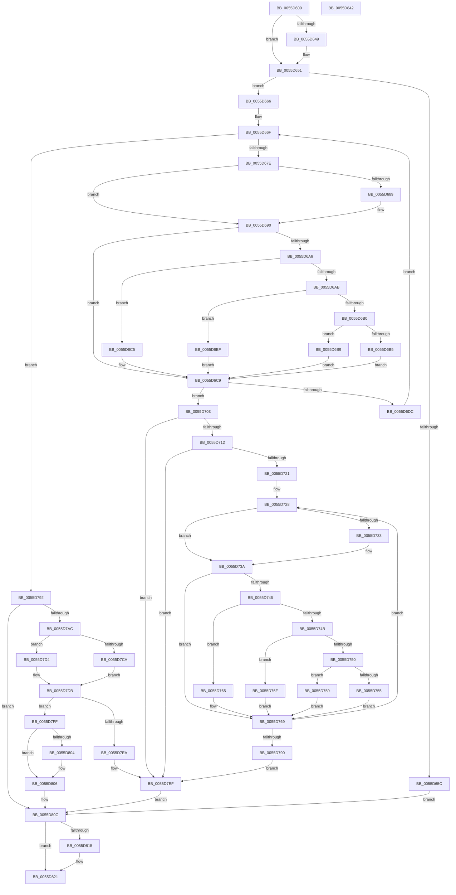

# EmonMarkCountersReserved

- RVA: `0x0055D600`–`0x0055D843` (길이 `579` bytes)
- VA: `0x000000014055D600`
- 실행 섹션: `.text`
- PDB 이름 있음: `예`; PDB Function 태그: `아니요`
- unwind 정보 RVA: `0x00083688`
- 디코드: `161`개 명령, `579/579` bytes 표시
- 미해석 바이트: `0` (있으면 어셈블리에 `.byte`로 보존)

> 이 문서는 커널 이미지의 기계어와 PDB 기호를 분석해 생성했습니다. 4번과 5번은 함수 원형과 자료형을 바이너리 사용 방식에서 추정한 C 해석이며 원본 소스 복구 결과는 아닙니다.

## 1. Dependencies

- 직접 호출 지점: **3**; 고유 호출 대상: **3**
- 직접 호출자로 확인된 함수: **0**
- RIP 상대 이미지 참조: **5**

### Outgoing calls
- `0x0055D64C` → [KiRaiseIrqlProcessIrqlFlags](../4F/KiRaiseIrqlProcessIrqlFlags_function_004F56FC.md) (function, `0x004F56FC`)
- `0x0055D651` → [HalpAllocateHalCounters](../53/HalpAllocateHalCounters_function_0053FF88.md) (function, `0x0053FF88`)
- `0x0055D81C` → [KiLowerIrqlProcessIrqlFlags](../4F/KiLowerIrqlProcessIrqlFlags_function_004F5698.md) (function, `0x004F5698`)

### Direct callers
- 이 함수 시작 RVA로 연결되는 직접 call은 확인되지 않았습니다. 간접 호출은 완전히 역산할 수 없습니다.

### Static image references
- `0x0055D640` → RVA `0x00FC6D20` (`ALMOSTRO`; read)
- `0x0055D693` → RVA `0x00FC8C40` (`ALMOSTRO`; read)
- `0x0055D7B3` → RVA `0x00F8FDF9` (`.data`; read)
- `0x0055D7BE` → RVA `0x00F8FDF0` (`.data`; read)
- `0x0055D7DB` → RVA `0x00F8FE18` (`.data`; read)

## 2. Other-region calls and transfers

- 다른 실행 섹션으로 향하는 call: **0**
- 별도 외부 분기/꼬리 이동을 확인하지 못했습니다.

## 3. Assembly (complete function range)

```asm
0055D600  48 89 5C 24 10                  mov qword ptr [rsp + 0x10], rbx
0055D605  48 89 6C 24 18                  mov qword ptr [rsp + 0x18], rbp
0055D60A  56                              push rsi
0055D60B  57                              push rdi
0055D60C  41 54                           push r12
0055D60E  41 56                           push r14
0055D610  41 57                           push r15
0055D612  48 83 EC 20                     sub rsp, 0x20
0055D616  83 64 24 50 00                  and dword ptr [rsp + 0x50], 0
0055D61B  48 8B F1                        mov rsi, rcx
0055D61E  48 8B 69 18                     mov rbp, qword ptr [rcx + 0x18]
0055D622  48 8B 79 10                     mov rdi, qword ptr [rcx + 0x10]
0055D626  4C 8B 71 08                     mov r14, qword ptr [rcx + 8]
0055D62A  65 44 8B 24 25 A4 01 00 00      mov r12d, dword ptr gs:[0x1a4]
0055D633  45 0F 20 C7                     mov r15, cr8
0055D637  BA 0F 00 00 00                  mov edx, 0xf
0055D63C  44 0F 22 C2                     mov cr8, rdx
0055D640  83 3D D9 96 A6 00 00            cmp dword ptr [rip + 0xa696d9], 0
0055D647  74 08                           je 0x14055d651
0055D649  41 8A CF                        mov cl, r15b
0055D64C  E8 AB 80 F9 FF                  call 0x1404f56fc
0055D651  E8 32 29 FE FF                  call 0x14053ff88
0055D656  8B D8                           mov ebx, eax
0055D658  85 C0                           test eax, eax
0055D65A  79 0A                           jns 0x14055d666
0055D65C  BB 9A 00 00 C0                  mov ebx, 0xc000009a
0055D661  E9 A6 01 00 00                  jmp 0x14055d80c
0055D666  45 8B CC                        mov r9d, r12d
0055D669  41 BB 01 00 00 00               mov r11d, 1
0055D66F  4C 0F BC C7                     bsf r8, rdi
0055D673  44 89 44 24 50                  mov dword ptr [rsp + 0x50], r8d
0055D678  0F 84 14 01 00 00               je 0x14055d792
0055D67E  33 C9                           xor ecx, ecx
0055D680  45 8B D0                        mov r10d, r8d
0055D683  41 83 F8 20                     cmp r8d, 0x20
0055D687  72 07                           jb 0x14055d690
0055D689  41 83 C0 E0                     add r8d, -0x20
0055D68D  41 8B CB                        mov ecx, r11d
0055D690  45 8B CC                        mov r9d, r12d
0055D693  48 8D 05 A6 B5 A6 00            lea rax, [rip + 0xa6b5a6]
0055D69A  4A 8B 04 E0                     mov rax, qword ptr [rax + r12*8]
0055D69E  48 8B 50 58                     mov rdx, qword ptr [rax + 0x58]
0055D6A2  85 C9                           test ecx, ecx
0055D6A4  74 23                           je 0x14055d6c9
0055D6A6  41 2B CB                        sub ecx, r11d
0055D6A9  74 1A                           je 0x14055d6c5
0055D6AB  83 E9 63                        sub ecx, 0x63
0055D6AE  74 0F                           je 0x14055d6bf
0055D6B0  41 3B CB                        cmp ecx, r11d
0055D6B3  74 04                           je 0x14055d6b9
0055D6B5  33 D2                           xor edx, edx
0055D6B7  EB 10                           jmp 0x14055d6c9
0055D6B9  48 83 C2 48                     add rdx, 0x48
0055D6BD  EB 0A                           jmp 0x14055d6c9
0055D6BF  48 83 C2 30                     add rdx, 0x30
0055D6C3  EB 04                           jmp 0x14055d6c9
0055D6C5  48 83 C2 18                     add rdx, 0x18
0055D6C9  48 8B 42 10                     mov rax, qword ptr [rdx + 0x10]
0055D6CD  4F 8D 04 40                     lea r8, [r8 + r8*2]
0055D6D1  4D 03 C0                        add r8, r8
0055D6D4  42 83 7C C0 18 03               cmp dword ptr [rax + r8*8 + 0x18], 3
0055D6DA  75 27                           jne 0x14055d703
0055D6DC  42 C7 44 C0 18 02 00 00 00      mov dword ptr [rax + r8*8 + 0x18], 2
0055D6E5  4C 0F BB D7                     btc rdi, r10
0055D6E9  48 8B 42 10                     mov rax, qword ptr [rdx + 0x10]
0055D6ED  42 C6 44 C0 28 00               mov byte ptr [rax + r8*8 + 0x28], 0
0055D6F3  48 8B 4A 10                     mov rcx, qword ptr [rdx + 0x10]
0055D6F7  8B 06                           mov eax, dword ptr [rsi]
0055D6F9  42 89 44 C1 20                  mov dword ptr [rcx + r8*8 + 0x20], eax
0055D6FE  E9 6C FF FF FF                  jmp 0x14055d66f
0055D703  48 33 7E 10                     xor rdi, qword ptr [rsi + 0x10]
0055D707  BB 9A 00 00 C0                  mov ebx, 0xc000009a
0055D70C  0F 84 DD 00 00 00               je 0x14055d7ef
0055D712  4C 0F BC C7                     bsf r8, rdi
0055D716  44 89 44 24 50                  mov dword ptr [rsp + 0x50], r8d
0055D71B  0F 84 CE 00 00 00               je 0x14055d7ef
0055D721  48 8D 35 18 B5 A6 00            lea rsi, [rip + 0xa6b518]
0055D728  33 C9                           xor ecx, ecx
0055D72A  45 8B D0                        mov r10d, r8d
0055D72D  41 83 F8 20                     cmp r8d, 0x20
0055D731  72 07                           jb 0x14055d73a
0055D733  45 8D 42 E0                     lea r8d, [r10 - 0x20]
0055D737  41 8B CB                        mov ecx, r11d
0055D73A  4A 8B 04 E6                     mov rax, qword ptr [rsi + r12*8]
0055D73E  48 8B 50 58                     mov rdx, qword ptr [rax + 0x58]
0055D742  85 C9                           test ecx, ecx
0055D744  74 23                           je 0x14055d769
0055D746  41 2B CB                        sub ecx, r11d
0055D749  74 1A                           je 0x14055d765
0055D74B  83 E9 63                        sub ecx, 0x63
0055D74E  74 0F                           je 0x14055d75f
0055D750  41 3B CB                        cmp ecx, r11d
0055D753  74 04                           je 0x14055d759
0055D755  33 D2                           xor edx, edx
0055D757  EB 10                           jmp 0x14055d769
0055D759  48 83 C2 48                     add rdx, 0x48
0055D75D  EB 0A                           jmp 0x14055d769
0055D75F  48 83 C2 30                     add rdx, 0x30
0055D763  EB 04                           jmp 0x14055d769
0055D765  48 83 C2 18                     add rdx, 0x18
0055D769  41 8B C0                        mov eax, r8d
0055D76C  4C 0F BB D7                     btc rdi, r10
0055D770  48 8D 0C 40                     lea rcx, [rax + rax*2]
0055D774  48 8B 42 10                     mov rax, qword ptr [rdx + 0x10]
0055D778  48 03 C9                        add rcx, rcx
0055D77B  C7 44 C8 18 03 00 00 00         mov dword ptr [rax + rcx*8 + 0x18], 3
0055D783  48 0F BC C7                     bsf rax, rdi
0055D787  44 8B C0                        mov r8d, eax
0055D78A  89 44 24 50                     mov dword ptr [rsp + 0x50], eax
0055D78E  75 98                           jne 0x14055d728
0055D790  EB 5D                           jmp 0x14055d7ef
0055D792  48 8B 46 10                     mov rax, qword ptr [rsi + 0x10]
0055D796  4B 8D 0C 89                     lea rcx, [r9 + r9*4]
0055D79A  48 03 C9                        add rcx, rcx
0055D79D  49 89 44 CE 20                  mov qword ptr [r14 + rcx*8 + 0x20], rax
0055D7A2  45 88 5C CE 28                  mov byte ptr [r14 + rcx*8 + 0x28], r11b
0055D7A7  48 85 ED                        test rbp, rbp
0055D7AA  74 60                           je 0x14055d80c
0055D7AC  8B 4D 0C                        mov ecx, dword ptr [rbp + 0xc]
0055D7AF  4B 8D 04 89                     lea rax, [r9 + r9*4]
0055D7B3  44 8A 0D 3F 26 A3 00            mov r9b, byte ptr [rip + 0xa3263f]
0055D7BA  48 C1 E0 05                     shl rax, 5
0055D7BE  48 03 05 2B 26 A3 00            add rax, qword ptr [rip + 0xa3262b]
0055D7C5  45 84 C9                        test r9b, r9b
0055D7C8  74 0A                           je 0x14055d7d4
0055D7CA  48 8B 50 20                     mov rdx, qword ptr [rax + 0x20]
0055D7CE  4C 8B 40 30                     mov r8, qword ptr [rax + 0x30]
0055D7D2  EB 07                           jmp 0x14055d7db
0055D7D4  8B 50 10                        mov edx, dword ptr [rax + 0x10]
0055D7D7  44 8B 40 18                     mov r8d, dword ptr [rax + 0x18]
0055D7DB  0F AF 0D 36 26 A3 00            imul ecx, dword ptr [rip + 0xa32636]
0055D7E2  48 03 CA                        add rcx, rdx
0055D7E5  49 3B C8                        cmp rcx, r8
0055D7E8  72 15                           jb 0x14055d7ff
0055D7EA  BB 0D 00 00 C0                  mov ebx, 0xc000000d
0055D7EF  65 48 8B 04 25 20 00 00 00      mov rax, qword ptr gs:[0x20]
0055D7F8  F0 83 40 60 FE                  lock add dword ptr [rax + 0x60], -2
0055D7FD  EB 0D                           jmp 0x14055d80c
0055D7FF  45 84 C9                        test r9b, r9b
0055D802  75 02                           jne 0x14055d806
0055D804  8B C9                           mov ecx, ecx
0055D806  48 89 48 38                     mov qword ptr [rax + 0x38], rcx
0055D80A  33 DB                           xor ebx, ebx
0055D80C  83 3D 0D 95 A6 00 00            cmp dword ptr [rip + 0xa6950d], 0
0055D813  74 0C                           je 0x14055d821
0055D815  44 0F 20 C1                     mov rcx, cr8
0055D819  41 8A D7                        mov dl, r15b
0055D81C  E8 77 7E F9 FF                  call 0x1404f5698
0055D821  41 0F B6 C7                     movzx eax, r15b
0055D825  44 0F 22 C0                     mov cr8, rax
0055D829  48 8B 6C 24 60                  mov rbp, qword ptr [rsp + 0x60]
0055D82E  8B C3                           mov eax, ebx
0055D830  48 8B 5C 24 58                  mov rbx, qword ptr [rsp + 0x58]
0055D835  48 83 C4 20                     add rsp, 0x20
0055D839  41 5F                           pop r15
0055D83B  41 5E                           pop r14
0055D83D  41 5C                           pop r12
0055D83F  5F                              pop rdi
0055D840  5E                              pop rsi
0055D841  C3                              ret
0055D842  CC                              int3
```

## 4. C-style interpretation (structured pseudocode)

```c
__int64 __fastcall EmonMarkCountersReserved(__int64 a1)
{
    __int64 result;
    __int64 v_rbx;
    __int64 v_rdi;
    __int64 v_rsp;
    unsigned __int64 v_stack_p10;
    unsigned __int64 v_stack_p18;
    unsigned int v_stack_p8;

    v_stack_p10 = v_rbx;
    v_stack_p18 = v_rbp;
    v_rsp = (v_rsp) - (32);
    if ((*(unsigned int *)(v_rip + 10917593)) != 0) {
        a1 = (unsigned __int8)(v_cr8);
        result = KiRaiseIrqlProcessIrqlFlags(a1, 15, a3, a4);
    }
    result = HalpAllocateHalCounters(a1, 15, a3, a4);
    if (!sign_flag) goto loc_0055D666;
    goto loc_0055D80C;
loc_0055D666:
loc_0055D66F:
    v_stack_p8 = (unsigned int)(a3);
    if ((unsigned int)(result) == 0) goto loc_0055D792;
    a1 = 0;
    if (((unsigned int)(a3)) >= 32) {
        a3 = (unsigned int)((a3) + (-32));
        a1 = 1;
    }
    if ((unsigned int)(a1) == 0) goto loc_0055D6C9;
    a1 = (unsigned int)((a1) - (1));
    if (condition_is_equal) goto loc_0055D6C5;
    a1 = (unsigned int)((a1) - (99));
    if (condition_is_equal) goto loc_0055D6BF;
    if (((unsigned int)(a1)) == 1) goto loc_0055D6B9;
    a2 = 0;
    goto loc_0055D6C9;
loc_0055D6B9:
    a2 = (a2) + (72);
    goto loc_0055D6C9;
loc_0055D6BF:
    a2 = (a2) + (48);
    goto loc_0055D6C9;
loc_0055D6C5:
    a2 = (a2) + (24);
loc_0055D6C9:
    a3 = (a3 + a3 * 2) + (a3 + a3 * 2);
    if ((*(unsigned int *)(*(unsigned __int64 *)(a2 + 16) + a3 * 8 + 24)) != 3) goto loc_0055D703;
    *(unsigned int *)(*(unsigned __int64 *)(a2 + 16) + a3 * 8 + 24) = 2;
    *(unsigned __int8 *)(*(unsigned __int64 *)(a2 + 16) + a3 * 8 + 40) = 0;
    *(unsigned int *)(*(unsigned __int64 *)(a2 + 16) + a3 * 8 + 32) = (unsigned int)((unsigned int)(*(unsigned int *)(a1)));
    goto loc_0055D66F;
loc_0055D703:
    v_rdi = (*(unsigned __int64 *)(a1 + 16)) ^ (*(unsigned __int64 *)(a1 + 16));
    if (condition_is_equal) goto loc_0055D7EF;
    v_stack_p8 = (unsigned int)(a3);
    if (condition_is_equal) goto loc_0055D7EF;
loc_0055D728:
    a1 = 0;
    if (((unsigned int)(a3)) >= 32) {
        a3 = (unsigned int)((unsigned int)(a3)) - 32;
        a1 = 1;
    }
    if ((unsigned int)(a1) == 0) goto loc_0055D769;
    a1 = (unsigned int)((a1) - (1));
    if (condition_is_equal) goto loc_0055D765;
    a1 = (unsigned int)((a1) - (99));
    if (condition_is_equal) goto loc_0055D75F;
    if (((unsigned int)(a1)) == 1) goto loc_0055D759;
    a2 = 0;
    goto loc_0055D769;
loc_0055D759:
    a2 = (a2) + (72);
    goto loc_0055D769;
loc_0055D75F:
    a2 = (a2) + (48);
    goto loc_0055D769;
loc_0055D765:
    a2 = (a2) + (24);
loc_0055D769:
    a1 = ((unsigned int)((unsigned int)(a3)) + (unsigned int)((unsigned int)(a3)) * 2) + ((unsigned int)((unsigned int)(a3)) + (unsigned int)((unsigned int)(a3)) * 2);
    *(unsigned int *)(*(unsigned __int64 *)(a2 + 16) + a1 * 8 + 24) = 3;
    v_stack_p8 = (unsigned int)(*(unsigned __int64 *)(a2 + 16));
    if (condition_is_not_equal) goto loc_0055D728;
    goto loc_0055D7EF;
loc_0055D792:
    a1 = ((unsigned int)((unsigned int)((unsigned int)(*(unsigned int *)(gs_base + (0 + 420))))) + (unsigned int)((unsigned int)((unsigned int)(*(unsigned int *)(gs_base + (0 + 420))))) * 4) + ((unsigned int)((unsigned int)((unsigned int)(*(unsigned int *)(gs_base + (0 + 420))))) + (unsigned int)((unsigned int)((unsigned int)(*(unsigned int *)(gs_base + (0 + 420))))) * 4);
    *(unsigned __int64 *)(*(unsigned __int64 *)(a1 + 8) + a1 * 8 + 32) = *(unsigned __int64 *)(v_rip + 10925336 + 16);
    *(unsigned __int8 *)(*(unsigned __int64 *)(a1 + 8) + a1 * 8 + 40) = 1;
    if (*(unsigned __int64 *)(a1 + 24) == 0) goto loc_0055D80C;
    result = ((unsigned int)((unsigned int)((unsigned int)(*(unsigned int *)(gs_base + (0 + 420))))) + (unsigned int)((unsigned int)((unsigned int)(*(unsigned int *)(gs_base + (0 + 420))))) * 4) << (5);
    result = (result) + (*(unsigned __int64 *)(v_rip + 10692139));
    if ((unsigned __int8)(*(unsigned __int8 *)(v_rip + 10692159)) == 0) goto loc_0055D7D4;
    goto loc_0055D7DB;
loc_0055D7D4:
loc_0055D7DB:
    a1 = (unsigned int)(((unsigned int)(*(unsigned int *)(*(unsigned __int64 *)(a1 + 24) + 12))) * (*(unsigned int *)(v_rip + 10692150)));
    a1 = (a1) + ((unsigned int)(*(unsigned int *)(result + 16)));
    if (a1 < ((unsigned int)(*(unsigned int *)(result + 24)))) goto loc_0055D7FF;
loc_0055D7EF:
    goto loc_0055D80C;
loc_0055D7FF:
    if ((unsigned __int8)(*(unsigned __int8 *)(v_rip + 10692159)) == 0) {
        a1 = (unsigned int)(a1);
    }
    *(unsigned __int64 *)(*(unsigned __int64 *)(gs_base + (0 + 32)) + 56) = a1;
    v_rbx = 0;
loc_0055D80C:
    result = *(unsigned __int64 *)(gs_base + (0 + 32));
    if ((*(unsigned int *)(v_rip + 10917133)) != 0) {
        a1 = 15;
        a2 = (unsigned __int8)(v_cr8);
        result = KiLowerIrqlProcessIrqlFlags(a1, a2, (unsigned int)(*(unsigned int *)(result + 24)), *(unsigned __int8 *)(v_rip + 10692159));
    }
    v_rsp = (v_rsp) + (32);
    return 0;
}
```

## 5. (Beta) C Style

```c
int64_t EmonMarkCountersReserved(void *Arg1)
{
    uint8_t *arg1 = (uint8_t *)Arg1;

    int64_t result;
    int64_t local_rbx;
    int64_t local_rdi;
    int64_t local_rsp;
    uint64_t v_stack_p10;
    uint64_t v_stack_p18;
    uint32_t v_stack_p8;

    v_stack_p10 = local_rbx;
    v_stack_p18 = local_rbp;
    local_rsp = (local_rsp) - (32);
    if ((*(uint32_t *)(v_rip + 0xA696D9)) != 0) {
        Arg1 = (uint8_t)(v_cr8);
        result = KiRaiseIrqlProcessIrqlFlags(Arg1, 15, a3, a4);
    }
    result = HalpAllocateHalCounters(Arg1, 15, a3, a4);
    if (!sign_flag) goto loc_0055D666;
    goto loc_0055D80C;
loc_0055D666:
loc_0055D66F:
    v_stack_p8 = (uint32_t)(a3);
    if ((uint32_t)(result) == 0) goto loc_0055D792;
    Arg1 = 0;
    if (((uint32_t)(a3)) >= 32) {
        a3 = (uint32_t)((a3) + (-32));
        Arg1 = 1;
    }
    if ((uint32_t)(Arg1) == 0) goto loc_0055D6C9;
    Arg1 = (uint32_t)((Arg1) - (1));
    if (condition_is_equal) goto loc_0055D6C5;
    Arg1 = (uint32_t)((Arg1) - (99));
    if (condition_is_equal) goto loc_0055D6BF;
    if (((uint32_t)(Arg1)) == 1) goto loc_0055D6B9;
    a2 = 0;
    goto loc_0055D6C9;
loc_0055D6B9:
    a2 = (a2) + (72);
    goto loc_0055D6C9;
loc_0055D6BF:
    a2 = (a2) + (48);
    goto loc_0055D6C9;
loc_0055D6C5:
    a2 = (a2) + (24);
loc_0055D6C9:
    a3 = (a3 + a3 * 2) + (a3 + a3 * 2);
    if ((*(uint32_t *)(*(uint64_t *)(a2 + 0x10) + a3 * 8 + 0x18)) != 3) goto loc_0055D703;
    *(uint32_t *)(*(uint64_t *)(a2 + 0x10) + a3 * 8 + 0x18) = 2;
    *(uint8_t *)(*(uint64_t *)(a2 + 0x10) + a3 * 8 + 0x28) = 0;
    *(uint32_t *)(*(uint64_t *)(a2 + 0x10) + a3 * 8 + 0x20) = (uint32_t)((uint32_t)(*(uint32_t *)(arg1)));
    goto loc_0055D66F;
loc_0055D703:
    local_rdi = (*(uint64_t *)(arg1 + 0x10)) ^ (*(uint64_t *)(arg1 + 0x10));
    if (condition_is_equal) goto loc_0055D7EF;
    v_stack_p8 = (uint32_t)(a3);
    if (condition_is_equal) goto loc_0055D7EF;
loc_0055D728:
    Arg1 = 0;
    if (((uint32_t)(a3)) >= 32) {
        a3 = (uint32_t)((uint32_t)(a3)) - 32;
        Arg1 = 1;
    }
    if ((uint32_t)(Arg1) == 0) goto loc_0055D769;
    Arg1 = (uint32_t)((Arg1) - (1));
    if (condition_is_equal) goto loc_0055D765;
    Arg1 = (uint32_t)((Arg1) - (99));
    if (condition_is_equal) goto loc_0055D75F;
    if (((uint32_t)(Arg1)) == 1) goto loc_0055D759;
    a2 = 0;
    goto loc_0055D769;
loc_0055D759:
    a2 = (a2) + (72);
    goto loc_0055D769;
loc_0055D75F:
    a2 = (a2) + (48);
    goto loc_0055D769;
loc_0055D765:
    a2 = (a2) + (24);
loc_0055D769:
    Arg1 = ((uint32_t)((uint32_t)(a3)) + (uint32_t)((uint32_t)(a3)) * 2) + ((uint32_t)((uint32_t)(a3)) + (uint32_t)((uint32_t)(a3)) * 2);
    *(uint32_t *)(*(uint64_t *)(a2 + 0x10) + arg1 * 8 + 0x18) = 3;
    v_stack_p8 = (uint32_t)(*(uint64_t *)(a2 + 0x10));
    if (condition_is_not_equal) goto loc_0055D728;
    goto loc_0055D7EF;
loc_0055D792:
    Arg1 = ((uint32_t)((uint32_t)((uint32_t)(*(uint32_t *)(gs_base + (0 + 0x1A4))))) + (uint32_t)((uint32_t)((uint32_t)(*(uint32_t *)(gs_base + (0 + 0x1A4))))) * 4) + ((uint32_t)((uint32_t)((uint32_t)(*(uint32_t *)(gs_base + (0 + 0x1A4))))) + (uint32_t)((uint32_t)((uint32_t)(*(uint32_t *)(gs_base + (0 + 0x1A4))))) * 4);
    *(uint64_t *)(*(uint64_t *)(arg1 + 0x8) + arg1 * 8 + 0x20) = *(uint64_t *)(v_rip + 0xA6B518 + 0x10);
    *(uint8_t *)(*(uint64_t *)(arg1 + 0x8) + arg1 * 8 + 0x28) = 1;
    if (*(uint64_t *)(arg1 + 0x18) == 0) goto loc_0055D80C;
    result = ((uint32_t)((uint32_t)((uint32_t)(*(uint32_t *)(gs_base + (0 + 0x1A4))))) + (uint32_t)((uint32_t)((uint32_t)(*(uint32_t *)(gs_base + (0 + 0x1A4))))) * 4) << (5);
    result = (result) + (*(uint64_t *)(v_rip + 0xA3262B));
    if ((uint8_t)(*(uint8_t *)(v_rip + 0xA3263F)) == 0) goto loc_0055D7D4;
    goto loc_0055D7DB;
loc_0055D7D4:
loc_0055D7DB:
    Arg1 = (uint32_t)(((uint32_t)(*(uint32_t *)(*(uint64_t *)(arg1 + 0x18) + 0xC))) * (*(uint32_t *)(v_rip + 0xA32636)));
    Arg1 = (Arg1) + ((uint32_t)(*(uint32_t *)(result + 0x10)));
    if (Arg1 < ((uint32_t)(*(uint32_t *)(result + 0x18)))) goto loc_0055D7FF;
loc_0055D7EF:
    goto loc_0055D80C;
loc_0055D7FF:
    if ((uint8_t)(*(uint8_t *)(v_rip + 0xA3263F)) == 0) {
        Arg1 = (uint32_t)(Arg1);
    }
    *(void **)(*(uint64_t *)(gs_base + (0 + 0x20)) + 0x38) = Arg1;
    local_rbx = 0;
loc_0055D80C:
    result = *(uint64_t *)(gs_base + (0 + 0x20));
    if ((*(uint32_t *)(v_rip + 0xA6950D)) != 0) {
        Arg1 = 15;
        a2 = (uint8_t)(v_cr8);
        result = KiLowerIrqlProcessIrqlFlags(Arg1, a2, (uint32_t)(*(uint32_t *)(result + 0x18)), *(uint8_t *)(v_rip + 0xA3263F));
    }
    local_rsp = (local_rsp) + (32);
    return 0;
}
```

### 관측된 메모리 오프셋

구조체 형식이 확인되지 않은 접근은 인자 기준의 오프셋으로만 기록했습니다.

| 기준 인자 | 오프셋 표현 | 폭 (bit) | 접근 |
|---|---:|---:|---|
| `Arg1` | `+ 0x0` | `32` | `R` |
| `Arg1` | `+ 0x8` | `64` | `R` |
| `Arg1` | `+ 0x10` | `64` | `R` |
| `Arg1` | `+ 0x18` | `64` | `R` |

## 6. Execution-region graph

[열기: 2D/3D 그래프와 함수 탐색 컨트롤 패널](../../../control-panel.html?section=text&rva=0x0055D600&view=graph)

- 2D 그래프는 위에서 아래로 흐르고, 3D 그래프는 빈 공간을 드래그해 회전합니다. Shift+드래그는 이동, 휠은 확대·축소, 함수 노드 선택은 대상 보고서 이동입니다.

### Static fallback


