# EmonOverflowHandlerInternalV1Enhanced

- RVA: `0x0055D88C`–`0x0055DCD2` (길이 `1,094` bytes)
- VA: `0x000000014055D88C`
- 실행 섹션: `.text`
- PDB 이름 있음: `예`; PDB Function 태그: `아니요`
- unwind 정보 RVA: `0x000C4964`
- 디코드: `277`개 명령, `1,094/1,094` bytes 표시
- 미해석 바이트: `0` (있으면 어셈블리에 `.byte`로 보존)

> 이 문서는 커널 이미지의 기계어와 PDB 기호를 분석해 생성했습니다. 4번과 5번은 함수 원형과 자료형을 바이너리 사용 방식에서 추정한 C 해석이며 원본 소스 복구 결과는 아닙니다.

## 1. Dependencies

- 직접 호출 지점: **8**; 고유 호출 대상: **5**
- 직접 호출자로 확인된 함수: **1**
- RIP 상대 이미지 참조: **4**

### Outgoing calls
- `0x0055DA34` → [guard_dispatch_icall](../6B/guard_dispatch_icall_function_006BAAD0.md) (function, `0x006BAAD0`)
- `0x0055DA3D` → [KeProfileInterruptWithSource](../4A/KeProfileInterruptWithSource_function_004A34D0.md) (function, `0x004A34D0`)
- `0x0055DAA6` → [PoGetProcessorIdleAccounting](../4F/PoGetProcessorIdleAccounting_function_004FBEA0.md) (function, `0x004FBEA0`)
- `0x0055DAB7` → [KeQueryPerformanceCounter](../37/KeQueryPerformanceCounter_function_0037E7E0.md) (function, `0x0037E7E0`)
- `0x0055DB42` → [PoGetProcessorIdleAccounting](../4F/PoGetProcessorIdleAccounting_function_004FBEA0.md) (function, `0x004FBEA0`)
- `0x0055DB60` → [KeQueryPerformanceCounter](../37/KeQueryPerformanceCounter_function_0037E7E0.md) (function, `0x0037E7E0`)
- `0x0055DBD0` → [KeProfileInterruptWithSource](../4A/KeProfileInterruptWithSource_function_004A34D0.md) (function, `0x004A34D0`)
- `0x0055DC32` → [EmonIsModifiedByBadActorInternalEnhanced](EmonIsModifiedByBadActorInternalEnhanced_function_0055D37C.md) (function, `0x0055D37C`)

### Direct callers
- [EmonOverflowHandlerEnhanced](EmonOverflowHandlerEnhanced_function_0055D850.md) at `0x0055D874`

### Static image references
- `0x0055D8A7` → RVA `0x00F8FE10` (`.data`; read)
- `0x0055DA28` → RVA `0x00E10360` (`.data`; read)
- `0x0055DA4A` → RVA `0x00FC21E8` (`.data`; read)
- `0x0055DAFC` → RVA `0x00F8FE14` (`.data`; read)

## 2. Other-region calls and transfers

- 다른 실행 섹션으로 향하는 call: **0**
- 별도 외부 분기/꼬리 이동을 확인하지 못했습니다.

## 3. Assembly (complete function range)

```asm
0055D88C  48 89 4C 24 08                  mov qword ptr [rsp + 8], rcx
0055D891  53                              push rbx
0055D892  55                              push rbp
0055D893  56                              push rsi
0055D894  57                              push rdi
0055D895  41 54                           push r12
0055D897  41 55                           push r13
0055D899  41 56                           push r14
0055D89B  41 57                           push r15
0055D89D  48 83 EC 58                     sub rsp, 0x58
0055D8A1  4C 8B C9                        mov r9, rcx
0055D8A4  4C 8B E2                        mov r12, rdx
0055D8A7  8B 0D 63 25 A3 00               mov ecx, dword ptr [rip + 0xa32563]
0055D8AD  83 F9 40                        cmp ecx, 0x40
0055D8B0  72 06                           jb 0x14055d8b8
0055D8B2  49 83 CF FF                     or r15, 0xffffffffffffffff
0055D8B6  EB 0C                           jmp 0x14055d8c4
0055D8B8  41 BF 01 00 00 00               mov r15d, 1
0055D8BE  49 D3 E7                        shl r15, cl
0055D8C1  49 FF CF                        dec r15
0055D8C4  83 7A 04 00                     cmp dword ptr [rdx + 4], 0
0055D8C8  0F 86 9E 03 00 00               jbe 0x14055dc6c
0055D8CE  33 F6                           xor esi, esi
0055D8D0  41 BE C1 00 00 00               mov r14d, 0xc1
0055D8D6  89 B4 24 B0 00 00 00            mov dword ptr [rsp + 0xb0], esi
0055D8DD  41 8D 9E 3F FF FF FF            lea ebx, [r14 - 0xc1]
0055D8E4  4C 8D 04 5B                     lea r8, [rbx + rbx*2]
0055D8E8  49 C1 E0 04                     shl r8, 4
0055D8EC  4D 03 44 24 10                  add r8, qword ptr [r12 + 0x10]
0055D8F1  41 83 78 18 00                  cmp dword ptr [r8 + 0x18], 0
0055D8F6  0F 85 51 03 00 00               jne 0x14055dc4d
0055D8FC  41 8B CE                        mov ecx, r14d
0055D8FF  0F 32                           rdmsr
0055D901  48 C1 E2 20                     shl rdx, 0x20
0055D905  49 8B CF                        mov rcx, r15
0055D908  48 0B C2                        or rax, rdx
0055D90B  48 23 C8                        and rcx, rax
0055D90E  49 8B C7                        mov rax, r15
0055D911  48 25 01 00 00 80               and rax, 0xffffffff80000001
0055D917  48 3B C8                        cmp rcx, rax
0055D91A  0F 83 2D 03 00 00               jae 0x14055dc4d
0055D920  33 ED                           xor ebp, ebp
0055D922  41 3B 5C 24 08                  cmp ebx, dword ptr [r12 + 8]
0055D927  0F 87 20 03 00 00               ja 0x14055dc4d
0055D92D  41 83 78 1C 03                  cmp dword ptr [r8 + 0x1c], 3
0055D932  0F 84 15 03 00 00               je 0x14055dc4d
0055D938  48 21 6C 24 28                  and qword ptr [rsp + 0x28], rbp
0055D93D  33 FF                           xor edi, edi
0055D93F  48 21 7C 24 40                  and qword ptr [rsp + 0x40], rdi
0055D944  41 8B 14 24                     mov edx, dword ptr [r12]
0055D948  40 88 AC 24 A8 00 00 00         mov byte ptr [rsp + 0xa8], bpl
0055D950  48 89 7C 24 20                  mov qword ptr [rsp + 0x20], rdi
0055D955  83 FA 01                        cmp edx, 1
0055D958  74 43                           je 0x14055d99d
0055D95A  89 9C 24 B8 00 00 00            mov dword ptr [rsp + 0xb8], ebx
0055D961  44 8B D3                        mov r10d, ebx
0055D964  85 D2                           test edx, edx
0055D966  74 0A                           je 0x14055d972
0055D968  83 FA 01                        cmp edx, 1
0055D96B  74 3F                           je 0x14055d9ac
0055D96D  E9 9E 00 00 00                  jmp 0x14055da10
0055D972  41 8D 8E C5 00 00 00            lea ecx, [r14 + 0xc5]
0055D979  0F 32                           rdmsr
0055D97B  48 C1 E2 20                     shl rdx, 0x20
0055D97F  48 0B C2                        or rax, rdx
0055D982  89 9C 24 B8 00 00 00            mov dword ptr [rsp + 0xb8], ebx
0055D989  48 8B D0                        mov rdx, rax
0055D98C  48 89 44 24 28                  mov qword ptr [rsp + 0x28], rax
0055D991  48 81 E2 FF FF AF FF            and rdx, 0xffffffffffafffff
0055D998  48 8B C2                        mov rax, rdx
0055D99B  EB 5D                           jmp 0x14055d9fa
0055D99D  45 8D 96 5F FF FF FF            lea r10d, [r14 - 0xa1]
0055D9A4  44 89 94 24 B8 00 00 00         mov dword ptr [rsp + 0xb8], r10d
0055D9AC  B9 8D 03 00 00                  mov ecx, 0x38d
0055D9B1  0F 32                           rdmsr
0055D9B3  48 C1 E2 20                     shl rdx, 0x20
0055D9B7  8B CE                           mov ecx, esi
0055D9B9  48 0B C2                        or rax, rdx
0055D9BC  4C 8B C8                        mov r9, rax
0055D9BF  B8 0F 00 00 00                  mov eax, 0xf
0055D9C4  48 D3 E0                        shl rax, cl
0055D9C7  B9 8F 03 00 00                  mov ecx, 0x38f
0055D9CC  48 F7 D0                        not rax
0055D9CF  4C 23 C8                        and r9, rax
0055D9D2  4C 89 4C 24 28                  mov qword ptr [rsp + 0x28], r9
0055D9D7  0F 32                           rdmsr
0055D9D9  48 C1 E2 20                     shl rdx, 0x20
0055D9DD  48 0B C2                        or rax, rdx
0055D9E0  41 8B CA                        mov ecx, r10d
0055D9E3  4C 8B C8                        mov r9, rax
0055D9E6  49 0F B3 C9                     btr r9, rcx
0055D9EA  B9 8F 03 00 00                  mov ecx, 0x38f
0055D9EF  4C 89 4C 24 40                  mov qword ptr [rsp + 0x40], r9
0055D9F4  49 8B D1                        mov rdx, r9
0055D9F7  49 8B C1                        mov rax, r9
0055D9FA  4C 8B 8C 24 A0 00 00 00         mov r9, qword ptr [rsp + 0xa0]
0055DA02  48 C1 EA 20                     shr rdx, 0x20
0055DA06  0F 30                           wrmsr
0055DA08  4C 89 44 24 20                  mov qword ptr [rsp + 0x20], r8
0055DA0D  49 8B F8                        mov rdi, r8
0055DA10  8B 57 24                        mov edx, dword ptr [rdi + 0x24]
0055DA13  49 8B C9                        mov rcx, r9
0055DA16  85 D2                           test edx, edx
0055DA18  0F 85 B2 01 00 00               jne 0x14055dbd0
0055DA1E  48 21 6C 24 30                  and qword ptr [rsp + 0x30], rbp
0055DA23  48 21 6C 24 38                  and qword ptr [rsp + 0x38], rbp
0055DA28  48 8B 05 31 29 8B 00            mov rax, qword ptr [rip + 0x8b2931]
0055DA2F  48 85 C0                        test rax, rax
0055DA32  74 07                           je 0x14055da3b
0055DA34  E8 97 D0 15 00                  call 0x1406baad0
0055DA39  EB 07                           jmp 0x14055da42
0055DA3B  33 D2                           xor edx, edx
0055DA3D  E8 8E 5A F4 FF                  call 0x1404a34d0
0055DA42  65 8B 04 25 A4 01 00 00         mov eax, dword ptr gs:[0x1a4]
0055DA4A  48 8B 3D 97 47 A6 00            mov rdi, qword ptr [rip + 0xa64797]
0055DA51  8B C8                           mov ecx, eax
0055DA53  48 69 D9 28 01 00 00            imul rbx, rcx, 0x128
0055DA5A  8B 4C 3B 18                     mov ecx, dword ptr [rbx + rdi + 0x18]
0055DA5E  85 C9                           test ecx, ecx
0055DA60  74 79                           je 0x14055dadb
0055DA62  8B 44 3B 20                     mov eax, dword ptr [rbx + rdi + 0x20]
0055DA66  8B 6C 3B 10                     mov ebp, dword ptr [rbx + rdi + 0x10]
0055DA6A  8B F0                           mov esi, eax
0055DA6C  48 C1 E6 04                     shl rsi, 4
0055DA70  48 03 F3                        add rsi, rbx
0055DA73  FF C0                           inc eax
0055DA75  83 E0 0F                        and eax, 0xf
0055DA78  89 44 3B 20                     mov dword ptr [rbx + rdi + 0x20], eax
0055DA7C  8B 44 3B 14                     mov eax, dword ptr [rbx + rdi + 0x14]
0055DA80  85 C0                           test eax, eax
0055DA82  0F 85 8C 00 00 00               jne 0x14055db14
0055DA88  33 D2                           xor edx, edx
0055DA8A  B8 10 27 00 00                  mov eax, 0x2710
0055DA8F  F7 F1                           div ecx
0055DA91  89 44 3B 14                     mov dword ptr [rbx + rdi + 0x14], eax
0055DA95  85 C0                           test eax, eax
0055DA97  75 08                           jne 0x14055daa1
0055DA99  C7 44 3B 14 01 00 00 00         mov dword ptr [rbx + rdi + 0x14], 1
0055DAA1  48 8D 4C 24 30                  lea rcx, [rsp + 0x30]
0055DAA6  E8 F5 E3 F9 FF                  call 0x1404fbea0
0055DAAB  48 8B 44 24 30                  mov rax, qword ptr [rsp + 0x30]
0055DAB0  33 C9                           xor ecx, ecx
0055DAB2  48 89 44 3B 08                  mov qword ptr [rbx + rdi + 8], rax
0055DAB7  E8 24 0D E2 FF                  call 0x14037e7e0
0055DABC  48 8B 0D 25 47 A6 00            mov rcx, qword ptr [rip + 0xa64725]
0055DAC3  48 89 04 0B                     mov qword ptr [rbx + rcx], rax
0055DAC7  89 6C 3E 28                     mov dword ptr [rsi + rdi + 0x28], ebp
0055DACB  48 8B 04 0B                     mov rax, qword ptr [rbx + rcx]
0055DACF  48 89 44 3E 30                  mov qword ptr [rsi + rdi + 0x30], rax
0055DAD4  8B B4 24 B0 00 00 00            mov esi, dword ptr [rsp + 0xb0]
0055DADB  48 8B 7C 24 20                  mov rdi, qword ptr [rsp + 0x20]
0055DAE0  41 8D 9E 3F FF FF FF            lea ebx, [r14 - 0xc1]
0055DAE7  41 8B 0C 24                     mov ecx, dword ptr [r12]
0055DAEB  85 C9                           test ecx, ecx
0055DAED  0F 84 8B 01 00 00               je 0x14055dc7e
0055DAF3  83 F9 01                        cmp ecx, 1
0055DAF6  0F 85 24 01 00 00               jne 0x14055dc20
0055DAFC  8B 0D 12 23 A3 00               mov ecx, dword ptr [rip + 0xa32312]
0055DB02  83 F9 40                        cmp ecx, 0x40
0055DB05  0F 82 D1 00 00 00               jb 0x14055dbdc
0055DB0B  48 83 C8 FF                     or rax, 0xffffffffffffffff
0055DB0F  E9 D3 00 00 00                  jmp 0x14055dbe7
0055DB14  83 E8 01                        sub eax, 1
0055DB17  89 44 3B 14                     mov dword ptr [rbx + rdi + 0x14], eax
0055DB1B  75 B7                           jne 0x14055dad4
0055DB1D  33 D2                           xor edx, edx
0055DB1F  B8 10 27 00 00                  mov eax, 0x2710
0055DB24  F7 F1                           div ecx
0055DB26  89 44 3B 14                     mov dword ptr [rbx + rdi + 0x14], eax
0055DB2A  44 8B E8                        mov r13d, eax
0055DB2D  85 C0                           test eax, eax
0055DB2F  75 0C                           jne 0x14055db3d
0055DB31  C7 44 3B 14 01 00 00 00         mov dword ptr [rbx + rdi + 0x14], 1
0055DB39  44 8D 68 01                     lea r13d, [rax + 1]
0055DB3D  48 8D 4C 24 30                  lea rcx, [rsp + 0x30]
0055DB42  E8 59 E3 F9 FF                  call 0x1404fbea0
0055DB47  48 8B 44 24 30                  mov rax, qword ptr [rsp + 0x30]
0055DB4C  48 3B 44 3B 08                  cmp rax, qword ptr [rbx + rdi + 8]
0055DB51  0F 85 59 FF FF FF               jne 0x14055dab0
0055DB57  48 8D 4C 24 38                  lea rcx, [rsp + 0x38]
0055DB5C  44 0F AF ED                     imul r13d, ebp
0055DB60  E8 7B 0C E2 FF                  call 0x14037e7e0
0055DB65  4C 8B 05 7C 46 A6 00            mov r8, qword ptr [rip + 0xa6467c]
0055DB6C  48 8B C8                        mov rcx, rax
0055DB6F  4C 8B C8                        mov r9, rax
0055DB72  4A 2B 0C 03                     sub rcx, qword ptr [rbx + r8]
0055DB76  75 0E                           jne 0x14055db86
0055DB78  89 6C 3E 28                     mov dword ptr [rsi + rdi + 0x28], ebp
0055DB7C  4C 89 4C 3E 30                  mov qword ptr [rsi + rdi + 0x30], r9
0055DB81  E9 4E FF FF FF                  jmp 0x14055dad4
0055DB86  42 8B 44 03 18                  mov eax, dword ptr [rbx + r8 + 0x18]
0055DB8B  33 D2                           xor edx, edx
0055DB8D  49 0F AF C5                     imul rax, r13
0055DB91  48 F7 F1                        div rcx
0055DB94  48 8B C8                        mov rcx, rax
0055DB97  48 B8 BD 42 7A E5 D5 94 BF D6   movabs rax, 0xd6bf94d5e57a42bd
0055DBA1  48 0F AF 4C 24 38               imul rcx, qword ptr [rsp + 0x38]
0055DBA7  48 F7 E1                        mul rcx
0055DBAA  48 8B EA                        mov rbp, rdx
0055DBAD  48 C1 ED 17                     shr rbp, 0x17
0055DBB1  48 8D 85 00 F0 FF FF            lea rax, [rbp - 0x1000]
0055DBB8  48 3D FF EF FF 7F               cmp rax, 0x7fffefff
0055DBBE  76 05                           jbe 0x14055dbc5
0055DBC0  42 8B 6C 03 1C                  mov ebp, dword ptr [rbx + r8 + 0x1c]
0055DBC5  42 89 6C 03 10                  mov dword ptr [rbx + r8 + 0x10], ebp
0055DBCA  4E 89 0C 03                     mov qword ptr [rbx + r8], r9
0055DBCE  EB A8                           jmp 0x14055db78
0055DBD0  E8 FB 58 F4 FF                  call 0x1404a34d0
0055DBD5  8B 2F                           mov ebp, dword ptr [rdi]
0055DBD7  E9 0B FF FF FF                  jmp 0x14055dae7
0055DBDC  B8 01 00 00 00                  mov eax, 1
0055DBE1  48 D3 E0                        shl rax, cl
0055DBE4  48 FF C8                        dec rax
0055DBE7  8B D5                           mov edx, ebp
0055DBE9  41 8D 8E 48 02 00 00            lea ecx, [r14 + 0x248]
0055DBF0  48 F7 DA                        neg rdx
0055DBF3  48 23 D0                        and rdx, rax
0055DBF6  48 8B C2                        mov rax, rdx
0055DBF9  48 C1 EA 20                     shr rdx, 0x20
0055DBFD  0F 30                           wrmsr
0055DBFF  8B 84 24 B8 00 00 00            mov eax, dword ptr [rsp + 0xb8]
0055DC06  48 8B 4C 24 40                  mov rcx, qword ptr [rsp + 0x40]
0055DC0B  48 0F AB C1                     bts rcx, rax
0055DC0F  48 8B D1                        mov rdx, rcx
0055DC12  48 8B C1                        mov rax, rcx
0055DC15  48 C1 EA 20                     shr rdx, 0x20
0055DC19  B9 8F 03 00 00                  mov ecx, 0x38f
0055DC1E  0F 30                           wrmsr
0055DC20  4C 8B 44 24 28                  mov r8, qword ptr [rsp + 0x28]
0055DC25  4C 8D 8C 24 A8 00 00 00         lea r9, [rsp + 0xa8]
0055DC2D  49 8B D4                        mov rdx, r12
0055DC30  8B CB                           mov ecx, ebx
0055DC32  E8 45 F7 FF FF                  call 0x14055d37c
0055DC37  80 BC 24 A8 00 00 00 00         cmp byte ptr [rsp + 0xa8], 0
0055DC3F  4C 8B 8C 24 A0 00 00 00         mov r9, qword ptr [rsp + 0xa0]
0055DC47  74 04                           je 0x14055dc4d
0055DC49  C6 47 28 01                     mov byte ptr [rdi + 0x28], 1
0055DC4D  41 FF C6                        inc r14d
0055DC50  83 C6 04                        add esi, 4
0055DC53  89 B4 24 B0 00 00 00            mov dword ptr [rsp + 0xb0], esi
0055DC5A  41 8D 86 3F FF FF FF            lea eax, [r14 - 0xc1]
0055DC61  41 3B 44 24 04                  cmp eax, dword ptr [r12 + 4]
0055DC66  0F 82 71 FC FF FF               jb 0x14055d8dd
0055DC6C  48 83 C4 58                     add rsp, 0x58
0055DC70  41 5F                           pop r15
0055DC72  41 5E                           pop r14
0055DC74  41 5D                           pop r13
0055DC76  41 5C                           pop r12
0055DC78  5F                              pop rdi
0055DC79  5E                              pop rsi
0055DC7A  5D                              pop rbp
0055DC7B  5B                              pop rbx
0055DC7C  C3                              ret
0055DC7D  CC                              int3
0055DC7E  8B 0D 8C 21 A3 00               mov ecx, dword ptr [rip + 0xa3218c]
0055DC84  83 F9 40                        cmp ecx, 0x40
0055DC87  72 06                           jb 0x14055dc8f
0055DC89  48 83 C8 FF                     or rax, 0xffffffffffffffff
0055DC8D  EB 0B                           jmp 0x14055dc9a
0055DC8F  B8 01 00 00 00                  mov eax, 1
0055DC94  48 D3 E0                        shl rax, cl
0055DC97  48 FF C8                        dec rax
0055DC9A  8B D5                           mov edx, ebp
0055DC9C  41 8B CE                        mov ecx, r14d
0055DC9F  48 F7 DA                        neg rdx
0055DCA2  48 23 D0                        and rdx, rax
0055DCA5  48 8B C2                        mov rax, rdx
0055DCA8  48 C1 EA 20                     shr rdx, 0x20
0055DCAC  0F 30                           wrmsr
0055DCAE  4C 8B 44 24 28                  mov r8, qword ptr [rsp + 0x28]
0055DCB3  41 8D 8E C5 00 00 00            lea ecx, [r14 + 0xc5]
0055DCBA  49 8B D0                        mov rdx, r8
0055DCBD  48 81 CA 00 00 50 00            or rdx, 0x500000
0055DCC4  48 8B C2                        mov rax, rdx
0055DCC7  48 C1 EA 20                     shr rdx, 0x20
0055DCCB  0F 30                           wrmsr
0055DCCD  E9 53 FF FF FF                  jmp 0x14055dc25
```

## 4. C-style interpretation (structured pseudocode)

```c
__int64 __fastcall EmonOverflowHandlerInternalV1Enhanced(__int64 a1, __int64 a2)
{
    __int64 result;
    __int64 v_r13;
    __int64 v_r14;
    __int64 v_r15;
    __int64 v_rbp;
    __int64 v_rbx;
    __int64 v_rdi;
    __int64 v_rsi;
    __int64 v_rsp;
    unsigned __int64 v_stack_m58;
    unsigned __int64 v_stack_m60;
    unsigned __int64 v_stack_m68;
    unsigned __int64 v_stack_m70;
    unsigned __int64 v_stack_m78;
    unsigned __int8 v_stack_p10;
    unsigned int v_stack_p18;
    unsigned int v_stack_p20;
    unsigned __int64 v_stack_p28;
    unsigned __int64 v_stack_p8;

    v_stack_p8 = a1;
    v_rsp = (v_rsp) - (88);
    if (((unsigned int)((unsigned int)(*(unsigned int *)(v_rip + 10691939)))) < 64) goto loc_0055D8B8;
    v_r15 = (v_r15) | (-1);
    goto loc_0055D8C4;
loc_0055D8B8:
    v_r15 = (1) << ((unsigned __int8)((unsigned int)(*(unsigned int *)(v_rip + 10691939))));
    v_r15 = (v_r15) - 1;
loc_0055D8C4:
    if ((*(unsigned int *)(a2 + 4)) <= 0) goto loc_0055DC6C;
    v_rsi = 0;
    v_stack_p18 = 0;
loc_0055D8DD:
    a3 = (193 - 193 + 193 - 193 * 2) << (4);
    a3 = (a3) + (*(unsigned __int64 *)(a2 + 16));
    if ((*(unsigned int *)(a3 + 24)) != 0) goto loc_0055DC4D;
    a2 = (a2) << (32);
    result = (result) | (a2);
    a1 = (v_r15) & (result);
    result = (v_r15) & (0xFFFFFFFF80000001ULL);
    if (a1 >= result) goto loc_0055DC4D;
    v_rbp = 0;
    if (((unsigned int)(193 - 193)) > (*(unsigned int *)(a2 + 8))) goto loc_0055DC4D;
    if ((*(unsigned int *)(a3 + 28)) == 3) goto loc_0055DC4D;
    v_rdi = 0;
    v_stack_p10 = 0;
    v_stack_m78 = 0;
    if (((unsigned int)((unsigned int)(*(unsigned int *)(a2)))) == 1) goto loc_0055D99D;
    v_stack_p20 = (unsigned int)(193 - 193);
    if ((unsigned int)((unsigned int)(*(unsigned int *)(a2))) == 0) goto loc_0055D972;
    if (((unsigned int)((unsigned int)(*(unsigned int *)(a2)))) == 1) goto loc_0055D9AC;
    goto loc_0055DA10;
loc_0055D972:
    a2 = ((unsigned int)(*(unsigned int *)(a2))) << (32);
    result = (result) | (a2);
    v_stack_p20 = (unsigned int)(193 - 193);
    v_stack_m70 = result;
    a2 = (result) & (0xFFFFFFFFFFAFFFFFULL);
    goto loc_0055D9FA;
loc_0055D99D:
    v_stack_p20 = (unsigned int)(193 - 161);
loc_0055D9AC:
    a2 = (a2) << (32);
    result = (a2) | (a2);
    result = (15) << (0);
    result = ~(result);
    a4 = (result) & (result);
    v_stack_m70 = a4;
    a2 = (a2) << (32);
    result = (result) | (a2);
    v_stack_m58 = result;
loc_0055D9FA:
    a2 = (result) >> (32);
    v_stack_m78 = a3;
loc_0055DA10:
    if ((unsigned int)((unsigned int)(*(unsigned int *)(a3 + 36))) != 0) goto loc_0055DBD0;
    if (*(unsigned __int64 *)(v_rip + 9120049) == 0) goto loc_0055DA3B;
    result = guard_dispatch_icall(v_stack_p8, (unsigned int)(*(unsigned int *)(a3 + 36)), a3, v_stack_p8);
    goto loc_0055DA42;
loc_0055DA3B:
    a2 = 0;
    result = KeProfileInterruptWithSource(v_stack_p8, a2, a3, v_stack_p8);
loc_0055DA42:
    v_rbx = (193 - 193) * ((unsigned int)((unsigned int)((unsigned int)(*(unsigned int *)(gs_base + (0 + 420))))));
    if ((unsigned int)((unsigned int)(*(unsigned int *)(v_rbx + *(unsigned __int64 *)(v_rip + 10897303) * 1 + 24))) == 0) goto loc_0055DADB;
    v_rsi = ((unsigned int)((unsigned int)((unsigned int)(*(unsigned int *)(v_rbx + *(unsigned __int64 *)(v_rip + 10897303) * 1 + 32))))) << (4);
    v_rsi = (v_rsi) + (v_rbx);
    result = (unsigned int)(((unsigned int)(*(unsigned int *)(v_rbx + *(unsigned __int64 *)(v_rip + 10897303) * 1 + 32))) + 1);
    result = (unsigned int)((result) & (15));
    *(unsigned int *)(v_rbx + *(unsigned __int64 *)(v_rip + 10897303) * 1 + 32) = (unsigned int)(result);
    if ((unsigned int)((unsigned int)(*(unsigned int *)(v_rbx + *(unsigned __int64 *)(v_rip + 10897303) * 1 + 20))) != 0) goto loc_0055DB14;
    a2 = 0;
    *(unsigned int *)(v_rbx + *(unsigned __int64 *)(v_rip + 10897303) * 1 + 20) = (unsigned int)((unsigned int)(0x2710ULL));
    if ((unsigned int)((unsigned int)(0x2710ULL)) == 0) {
        *(unsigned int *)(v_rbx + *(unsigned __int64 *)(v_rip + 10897303) * 1 + 20) = 1;
    }
    result = PoGetProcessorIdleAccounting(v_stack_m68, a2, a3, v_stack_p8);
loc_0055DAB0:
    a1 = 0;
    *(unsigned __int64 *)(v_rbx + *(unsigned __int64 *)(v_rip + 10897303) * 1 + 8) = v_stack_m68;
    result = KeQueryPerformanceCounter(a1, a2, a3, v_stack_p8);
    *(unsigned __int64 *)(v_rbx + *(unsigned __int64 *)(v_rip + 10897189) * 1) = result;
    *(unsigned int *)(v_rsi + *(unsigned __int64 *)(v_rip + 10897303) * 1 + 40) = (unsigned int)((unsigned int)(*(unsigned int *)(v_rbx + *(unsigned __int64 *)(v_rip + 10897303) * 1 + 16)));
    *(unsigned __int64 *)(v_rsi + *(unsigned __int64 *)(v_rip + 10897303) * 1 + 48) = *(unsigned __int64 *)(v_rbx + *(unsigned __int64 *)(v_rip + 10897189) * 1);
loc_0055DAD4:
loc_0055DADB:
loc_0055DAE7:
    if ((unsigned int)((unsigned int)(*(unsigned int *)(a2))) == 0) goto loc_0055DC7E;
    if (((unsigned int)((unsigned int)(*(unsigned int *)(a2)))) != 1) goto loc_0055DC20;
    if (((unsigned int)((unsigned int)(*(unsigned int *)(v_rip + 10691346)))) < 64) goto loc_0055DBDC;
    result = (*(unsigned __int64 *)(v_rbx + *(unsigned __int64 *)(v_rip + 10897189) * 1)) | (-1);
    goto loc_0055DBE7;
loc_0055DB14:
    result = (unsigned int)((result) - (1));
    *(unsigned int *)(193 - 193 + v_stack_m78 * 1 + 20) = (unsigned int)(result);
    if (condition_is_not_equal) goto loc_0055DAD4;
    a2 = 0;
    *(unsigned int *)(193 - 193 + v_stack_m78 * 1 + 20) = (unsigned int)((unsigned int)(0x2710ULL));
    v_r13 = (unsigned int)((unsigned int)((unsigned int)(0x2710ULL)));
    if ((unsigned int)((unsigned int)(0x2710ULL)) == 0) {
        *(unsigned int *)(193 - 193 + v_stack_m78 * 1 + 20) = 1;
        v_r13 = (unsigned int)(0x2710ULL) + 1;
    }
    result = PoGetProcessorIdleAccounting(v_stack_m68, a2, a3, v_stack_p8);
    if (v_stack_m68 != (*(unsigned __int64 *)(193 - 193 + v_stack_m78 * 1 + 8))) goto loc_0055DAB0;
    v_r13 = (unsigned int)((v_r13) * ((unsigned int)((unsigned int)(*(unsigned int *)(v_rbx + *(unsigned __int64 *)(v_rip + 10897303) * 1 + 16)))));
    result = KeQueryPerformanceCounter(v_stack_m60, a2, a3, v_stack_p8);
    a1 = (result) - (*(unsigned __int64 *)(193 - 193 + *(unsigned __int64 *)(v_rip + 10897020) * 1));
    if (condition_is_not_equal) goto loc_0055DB86;
loc_0055DB78:
    *(unsigned int *)((unsigned int)(v_stack_p18) + v_stack_m78 * 1 + 40) = (unsigned int)((unsigned int)(*(unsigned int *)(v_rbx + *(unsigned __int64 *)(v_rip + 10897303) * 1 + 16)));
    *(unsigned __int64 *)((unsigned int)(v_stack_p18) + v_stack_m78 * 1 + 48) = result;
    goto loc_0055DAD4;
loc_0055DB86:
    a2 = 0;
    result = ((unsigned int)(*(unsigned int *)(193 - 193 + *(unsigned __int64 *)(v_rip + 10897020) * 1 + 24))) * (v_r13);
    a1 = (result) * (v_stack_m60);
    v_rbp = (0) >> (23);
    if ((v_rbp - 4096) >= = 0x7FFFEFFFULL) {
        v_rbp = *(unsigned int *)(193 - 193 + *(unsigned __int64 *)(v_rip + 10897020) * 1 + 28);
    }
    *(unsigned int *)(193 - 193 + *(unsigned __int64 *)(v_rip + 10897020) * 1 + 16) = (unsigned int)(v_rbp);
    *(unsigned __int64 *)(193 - 193 + *(unsigned __int64 *)(v_rip + 10897020) * 1) = result;
    goto loc_0055DB78;
loc_0055DBD0:
    result = KeProfileInterruptWithSource(a1, a2, *(unsigned __int64 *)(v_rip + 10897020), result);
    goto loc_0055DAE7;
loc_0055DBDC:
    result = (1) << ((unsigned __int8)(a1));
    result = (result) - 1;
loc_0055DBE7:
    a2 = -((unsigned int)((unsigned int)((unsigned int)(*(unsigned int *)(v_stack_m78)))));
    a2 = (a2) & (result);
    a2 = (a2) >> (32);
    a2 = (v_stack_m58) >> (32);
loc_0055DC20:
loc_0055DC25:
    result = EmonIsModifiedByBadActorInternalEnhanced((unsigned int)((unsigned int)(193 - 193)), a2, v_stack_m70, v_stack_p10);
    if (v_stack_p10 != 0) {
        *(unsigned __int8 *)(v_stack_m78 + 40) = 1;
    }
    v_r14 = (unsigned int)((193) + 1);
    v_rsi = (unsigned int)(((unsigned int)(v_stack_p18)) + (4));
    v_stack_p18 = (unsigned int)(v_rsi);
    if (((unsigned int)(v_r14 - 193)) < (*(unsigned int *)(a2 + 4))) goto loc_0055D8DD;
loc_0055DC6C:
    v_rsp = (v_rsp) + (88);
    return v_r14 - 193;
loc_0055DC7E:
    if (((unsigned int)((unsigned int)(*(unsigned int *)(v_rip + 10690956)))) < 64) goto loc_0055DC8F;
    result = (v_r14 - 193) | (-1);
    goto loc_0055DC9A;
loc_0055DC8F:
    result = (1) << ((unsigned __int8)((unsigned int)(*(unsigned int *)(v_rip + 10690956))));
    result = (result) - 1;
loc_0055DC9A:
    a2 = -((unsigned int)((unsigned int)((unsigned int)(*(unsigned int *)(v_stack_m78)))));
    a2 = (a2) & (result);
    a2 = (a2) >> (32);
    a2 = (v_stack_p28) | (0x500000ULL);
    a2 = (a2) >> (32);
    goto loc_0055DC25;
}
```

## 5. (Beta) C Style

```c
int64_t EmonOverflowHandlerInternalV1Enhanced(int64_t Arg1, void *Arg2)
{
    uint8_t *arg2 = (uint8_t *)Arg2;

    int64_t result;
    int64_t local_r13;
    int64_t local_r14;
    int64_t local_r15;
    int64_t local_rbp;
    int64_t local_rbx;
    int64_t local_rdi;
    int64_t local_rsi;
    int64_t local_rsp;
    uint64_t v_stack_m58;
    uint64_t v_stack_m60;
    uint64_t v_stack_m68;
    uint64_t v_stack_m70;
    uint64_t v_stack_m78;
    uint8_t v_stack_p10;
    uint32_t v_stack_p18;
    uint32_t v_stack_p20;
    uint64_t v_stack_p28;
    uint64_t v_stack_p8;

    v_stack_p8 = Arg1;
    local_rsp = (local_rsp) - (88);
    if (((uint32_t)((uint32_t)(*(uint32_t *)(v_rip + 0xA32563)))) < 64) goto loc_0055D8B8;
    local_r15 = (local_r15) | (-1);
    goto loc_0055D8C4;
loc_0055D8B8:
    local_r15 = (1) << ((uint8_t)((uint32_t)(*(uint32_t *)(v_rip + 0xA32563))));
    local_r15 = (local_r15) - 1;
loc_0055D8C4:
    if ((*(uint32_t *)(arg2 + 0x4)) <= 0) goto loc_0055DC6C;
    local_rsi = 0;
    v_stack_p18 = 0;
loc_0055D8DD:
    a3 = (193 - 193 + 193 - 193 * 2) << (4);
    a3 = (a3) + (*(uint64_t *)(arg2 + 0x10));
    if ((*(uint32_t *)(a3 + 0x18)) != 0) goto loc_0055DC4D;
    Arg2 = (Arg2) << (32);
    result = (result) | (Arg2);
    Arg1 = (local_r15) & (result);
    result = (local_r15) & (0xFFFFFFFF80000001ULL);
    if (Arg1 >= result) goto loc_0055DC4D;
    local_rbp = 0;
    if (((uint32_t)(193 - 193)) > (*(uint32_t *)(arg2 + 0x8))) goto loc_0055DC4D;
    if ((*(uint32_t *)(a3 + 0x1C)) == 3) goto loc_0055DC4D;
    local_rdi = 0;
    v_stack_p10 = 0;
    v_stack_m78 = 0;
    if (((uint32_t)((uint32_t)(*(uint32_t *)(arg2)))) == 1) goto loc_0055D99D;
    v_stack_p20 = (uint32_t)(193 - 193);
    if ((uint32_t)((uint32_t)(*(uint32_t *)(arg2))) == 0) goto loc_0055D972;
    if (((uint32_t)((uint32_t)(*(uint32_t *)(arg2)))) == 1) goto loc_0055D9AC;
    goto loc_0055DA10;
loc_0055D972:
    Arg2 = ((uint32_t)(*(uint32_t *)(arg2))) << (32);
    result = (result) | (Arg2);
    v_stack_p20 = (uint32_t)(193 - 193);
    v_stack_m70 = result;
    Arg2 = (result) & (0xFFFFFFFFFFAFFFFFULL);
    goto loc_0055D9FA;
loc_0055D99D:
    v_stack_p20 = (uint32_t)(193 - 161);
loc_0055D9AC:
    Arg2 = (Arg2) << (32);
    result = (Arg2) | (Arg2);
    result = (15) << (0);
    result = ~(result);
    a4 = (result) & (result);
    v_stack_m70 = a4;
    Arg2 = (Arg2) << (32);
    result = (result) | (Arg2);
    v_stack_m58 = result;
loc_0055D9FA:
    Arg2 = (result) >> (32);
    v_stack_m78 = a3;
loc_0055DA10:
    if ((uint32_t)((uint32_t)(*(uint32_t *)(a3 + 0x24))) != 0) goto loc_0055DBD0;
    if (*(uint64_t *)(v_rip + 0x8B2931) == 0) goto loc_0055DA3B;
    result = guard_dispatch_icall(v_stack_p8, (uint32_t)(*(uint32_t *)(a3 + 0x24)), a3, v_stack_p8);
    goto loc_0055DA42;
loc_0055DA3B:
    Arg2 = 0;
    result = KeProfileInterruptWithSource(v_stack_p8, Arg2, a3, v_stack_p8);
loc_0055DA42:
    local_rbx = (193 - 193) * ((uint32_t)((uint32_t)((uint32_t)(*(uint32_t *)(gs_base + (0 + 0x1A4))))));
    if ((uint32_t)((uint32_t)(*(uint32_t *)(local_rbx + *(uint64_t *)(v_rip + 0xA64797) * 1 + 0x18))) == 0) goto loc_0055DADB;
    local_rsi = ((uint32_t)((uint32_t)((uint32_t)(*(uint32_t *)(local_rbx + *(uint64_t *)(v_rip + 0xA64797) * 1 + 0x20))))) << (4);
    local_rsi = (local_rsi) + (local_rbx);
    result = (uint32_t)(((uint32_t)(*(uint32_t *)(local_rbx + *(uint64_t *)(v_rip + 0xA64797) * 1 + 0x20))) + 1);
    result = (uint32_t)((result) & (15));
    *(uint32_t *)(local_rbx + *(uint64_t *)(v_rip + 0xA64797) * 1 + 0x20) = (uint32_t)(result);
    if ((uint32_t)((uint32_t)(*(uint32_t *)(local_rbx + *(uint64_t *)(v_rip + 0xA64797) * 1 + 0x14))) != 0) goto loc_0055DB14;
    Arg2 = 0;
    *(uint32_t *)(local_rbx + *(uint64_t *)(v_rip + 0xA64797) * 1 + 0x14) = (uint32_t)((uint32_t)(0x2710ULL));
    if ((uint32_t)((uint32_t)(0x2710ULL)) == 0) {
        *(uint32_t *)(local_rbx + *(uint64_t *)(v_rip + 0xA64797) * 1 + 0x14) = 1;
    }
    result = PoGetProcessorIdleAccounting(v_stack_m68, Arg2, a3, v_stack_p8);
loc_0055DAB0:
    Arg1 = 0;
    *(uint64_t *)(local_rbx + *(uint64_t *)(v_rip + 0xA64797) * 1 + 0x8) = v_stack_m68;
    result = KeQueryPerformanceCounter(Arg1, Arg2, a3, v_stack_p8);
    *(uint64_t *)(local_rbx + *(uint64_t *)(v_rip + 0xA64725) * 1) = result;
    *(uint32_t *)(local_rsi + *(uint64_t *)(v_rip + 0xA64797) * 1 + 0x28) = (uint32_t)((uint32_t)(*(uint32_t *)(local_rbx + *(uint64_t *)(v_rip + 0xA64797) * 1 + 0x10)));
    *(uint64_t *)(local_rsi + *(uint64_t *)(v_rip + 0xA64797) * 1 + 0x30) = *(uint64_t *)(local_rbx + *(uint64_t *)(v_rip + 0xA64725) * 1);
loc_0055DAD4:
loc_0055DADB:
loc_0055DAE7:
    if ((uint32_t)((uint32_t)(*(uint32_t *)(arg2))) == 0) goto loc_0055DC7E;
    if (((uint32_t)((uint32_t)(*(uint32_t *)(arg2)))) != 1) goto loc_0055DC20;
    if (((uint32_t)((uint32_t)(*(uint32_t *)(v_rip + 0xA32312)))) < 64) goto loc_0055DBDC;
    result = (*(uint64_t *)(local_rbx + *(uint64_t *)(v_rip + 0xA64725) * 1)) | (-1);
    goto loc_0055DBE7;
loc_0055DB14:
    result = (uint32_t)((result) - (1));
    *(uint32_t *)(193 - 0xC1 + v_stack_m78 * 1 + 0x14) = (uint32_t)(result);
    if (condition_is_not_equal) goto loc_0055DAD4;
    Arg2 = 0;
    *(uint32_t *)(193 - 0xC1 + v_stack_m78 * 1 + 0x14) = (uint32_t)((uint32_t)(0x2710ULL));
    local_r13 = (uint32_t)((uint32_t)((uint32_t)(0x2710ULL)));
    if ((uint32_t)((uint32_t)(0x2710ULL)) == 0) {
        *(uint32_t *)(193 - 0xC1 + v_stack_m78 * 1 + 0x14) = 1;
        local_r13 = (uint32_t)(0x2710ULL) + 1;
    }
    result = PoGetProcessorIdleAccounting(v_stack_m68, Arg2, a3, v_stack_p8);
    if (v_stack_m68 != (*(uint64_t *)(193 - 0xC1 + v_stack_m78 * 1 + 0x8))) goto loc_0055DAB0;
    local_r13 = (uint32_t)((local_r13) * ((uint32_t)((uint32_t)(*(uint32_t *)(local_rbx + *(uint64_t *)(v_rip + 0xA64797) * 1 + 0x10)))));
    result = KeQueryPerformanceCounter(v_stack_m60, Arg2, a3, v_stack_p8);
    Arg1 = (result) - (*(uint64_t *)(193 - 0xC1 + *(uint64_t *)(v_rip + 0xA6467C) * 1));
    if (condition_is_not_equal) goto loc_0055DB86;
loc_0055DB78:
    *(uint32_t *)((uint32_t)(v_stack_p18) + v_stack_m78 * 1 + 0x28) = (uint32_t)((uint32_t)(*(uint32_t *)(local_rbx + *(uint64_t *)(v_rip + 0xA64797) * 1 + 0x10)));
    *(uint64_t *)((uint32_t)(v_stack_p18) + v_stack_m78 * 1 + 0x30) = result;
    goto loc_0055DAD4;
loc_0055DB86:
    Arg2 = 0;
    result = ((uint32_t)(*(uint32_t *)(193 - 0xC1 + *(uint64_t *)(v_rip + 0xA6467C) * 1 + 0x18))) * (local_r13);
    Arg1 = (result) * (v_stack_m60);
    local_rbp = (0) >> (23);
    if ((local_rbp - 4096) >= = 0x7FFFEFFFULL) {
        local_rbp = *(uint32_t *)(193 - 0xC1 + *(uint64_t *)(v_rip + 0xA6467C) * 1 + 0x1C);
    }
    *(uint32_t *)(193 - 0xC1 + *(uint64_t *)(v_rip + 0xA6467C) * 1 + 0x10) = (uint32_t)(local_rbp);
    *(uint64_t *)(193 - 0xC1 + *(uint64_t *)(v_rip + 0xA6467C) * 1) = result;
    goto loc_0055DB78;
loc_0055DBD0:
    result = KeProfileInterruptWithSource(Arg1, Arg2, *(uint64_t *)(v_rip + 0xA6467C), result);
    goto loc_0055DAE7;
loc_0055DBDC:
    result = (1) << ((uint8_t)(Arg1));
    result = (result) - 1;
loc_0055DBE7:
    Arg2 = -((uint32_t)((uint32_t)((uint32_t)(*(uint32_t *)(v_stack_m78)))));
    Arg2 = (Arg2) & (result);
    Arg2 = (Arg2) >> (32);
    Arg2 = (v_stack_m58) >> (32);
loc_0055DC20:
loc_0055DC25:
    result = EmonIsModifiedByBadActorInternalEnhanced((uint32_t)((uint32_t)(193 - 193)), Arg2, v_stack_m70, v_stack_p10);
    if (v_stack_p10 != 0) {
        *(uint8_t *)(v_stack_m78 + 0x28) = 1;
    }
    local_r14 = (uint32_t)((193) + 1);
    local_rsi = (uint32_t)(((uint32_t)(v_stack_p18)) + (4));
    v_stack_p18 = (uint32_t)(local_rsi);
    if (((uint32_t)(local_r14 - 193)) < (*(uint32_t *)(arg2 + 0x4))) goto loc_0055D8DD;
loc_0055DC6C:
    local_rsp = (local_rsp) + (88);
    return local_r14 - 193;
loc_0055DC7E:
    if (((uint32_t)((uint32_t)(*(uint32_t *)(v_rip + 0xA3218C)))) < 64) goto loc_0055DC8F;
    result = (local_r14 - 193) | (-1);
    goto loc_0055DC9A;
loc_0055DC8F:
    result = (1) << ((uint8_t)((uint32_t)(*(uint32_t *)(v_rip + 0xA3218C))));
    result = (result) - 1;
loc_0055DC9A:
    Arg2 = -((uint32_t)((uint32_t)((uint32_t)(*(uint32_t *)(v_stack_m78)))));
    Arg2 = (Arg2) & (result);
    Arg2 = (Arg2) >> (32);
    Arg2 = (v_stack_p28) | (0x500000ULL);
    Arg2 = (Arg2) >> (32);
    goto loc_0055DC25;
}
```

### 관측된 메모리 오프셋

구조체 형식이 확인되지 않은 접근은 인자 기준의 오프셋으로만 기록했습니다.

| 기준 인자 | 오프셋 표현 | 폭 (bit) | 접근 |
|---|---:|---:|---|
| `Arg2` | `+ 0x0` | `32` | `R` |
| `Arg2` | `+ 0x4` | `32` | `R` |
| `Arg2` | `+ 0x8` | `32` | `R` |
| `Arg2` | `+ 0x10` | `64` | `R` |

## 6. Execution-region graph

[열기: 2D/3D 그래프와 함수 탐색 컨트롤 패널](../../../control-panel.html?section=text&rva=0x0055D88C&view=graph)

- 2D 그래프는 위에서 아래로 흐르고, 3D 그래프는 빈 공간을 드래그해 회전합니다. Shift+드래그는 이동, 휠은 확대·축소, 함수 노드 선택은 대상 보고서 이동입니다.

### Static fallback

```mermaid
flowchart TD
  bb_0055D88C[BB_0055D88C]
  bb_0055D8B2[BB_0055D8B2]
  bb_0055D8B8[BB_0055D8B8]
  bb_0055D8C4[BB_0055D8C4]
  bb_0055D8CE[BB_0055D8CE]
  bb_0055D8DD[BB_0055D8DD]
  bb_0055D8FC[BB_0055D8FC]
  bb_0055D920[BB_0055D920]
  bb_0055D92D[BB_0055D92D]
  bb_0055D938[BB_0055D938]
  bb_0055D95A[BB_0055D95A]
  bb_0055D968[BB_0055D968]
  bb_0055D96D[BB_0055D96D]
  bb_0055D972[BB_0055D972]
  bb_0055D99D[BB_0055D99D]
  bb_0055D9AC[BB_0055D9AC]
  bb_0055D9FA[BB_0055D9FA]
  bb_0055DA10[BB_0055DA10]
  bb_0055DA1E[BB_0055DA1E]
  bb_0055DA34[BB_0055DA34]
  bb_0055DA3B[BB_0055DA3B]
  bb_0055DA42[BB_0055DA42]
  bb_0055DA62[BB_0055DA62]
  bb_0055DA88[BB_0055DA88]
  bb_0055DA99[BB_0055DA99]
  bb_0055DAA1[BB_0055DAA1]
  bb_0055DAB0[BB_0055DAB0]
  bb_0055DAD4[BB_0055DAD4]
  bb_0055DADB[BB_0055DADB]
  bb_0055DAE7[BB_0055DAE7]
  bb_0055DAF3[BB_0055DAF3]
  bb_0055DAFC[BB_0055DAFC]
  bb_0055DB0B[BB_0055DB0B]
  bb_0055DB14[BB_0055DB14]
  bb_0055DB1D[BB_0055DB1D]
  bb_0055DB31[BB_0055DB31]
  bb_0055DB3D[BB_0055DB3D]
  bb_0055DB57[BB_0055DB57]
  bb_0055DB78[BB_0055DB78]
  bb_0055DB86[BB_0055DB86]
  bb_0055DBC0[BB_0055DBC0]
  bb_0055DBC5[BB_0055DBC5]
  bb_0055DBD0[BB_0055DBD0]
  bb_0055DBDC[BB_0055DBDC]
  bb_0055DBE7[BB_0055DBE7]
  bb_0055DC20[BB_0055DC20]
  bb_0055DC25[BB_0055DC25]
  bb_0055DC49[BB_0055DC49]
  bb_0055DC4D[BB_0055DC4D]
  bb_0055DC6C[BB_0055DC6C]
  bb_0055DC7D[BB_0055DC7D]
  bb_0055DC7E[BB_0055DC7E]
  bb_0055DC89[BB_0055DC89]
  bb_0055DC8F[BB_0055DC8F]
  bb_0055DC9A[BB_0055DC9A]
  bb_0055D88C -->|branch| bb_0055D8B8
  bb_0055D88C -->|fallthrough| bb_0055D8B2
  bb_0055D8B2 -->|branch| bb_0055D8C4
  bb_0055D8B8 -->|flow| bb_0055D8C4
  bb_0055D8C4 -->|branch| bb_0055DC6C
  bb_0055D8C4 -->|fallthrough| bb_0055D8CE
  bb_0055D8CE -->|flow| bb_0055D8DD
  bb_0055D8DD -->|branch| bb_0055DC4D
  bb_0055D8DD -->|fallthrough| bb_0055D8FC
  bb_0055D8FC -->|branch| bb_0055DC4D
  bb_0055D8FC -->|fallthrough| bb_0055D920
  bb_0055D920 -->|branch| bb_0055DC4D
  bb_0055D920 -->|fallthrough| bb_0055D92D
  bb_0055D92D -->|branch| bb_0055DC4D
  bb_0055D92D -->|fallthrough| bb_0055D938
  bb_0055D938 -->|branch| bb_0055D99D
  bb_0055D938 -->|fallthrough| bb_0055D95A
  bb_0055D95A -->|branch| bb_0055D972
  bb_0055D95A -->|fallthrough| bb_0055D968
  bb_0055D968 -->|branch| bb_0055D9AC
  bb_0055D968 -->|fallthrough| bb_0055D96D
  bb_0055D96D -->|branch| bb_0055DA10
  bb_0055D972 -->|branch| bb_0055D9FA
  bb_0055D99D -->|flow| bb_0055D9AC
  bb_0055D9AC -->|flow| bb_0055D9FA
  bb_0055D9FA -->|flow| bb_0055DA10
  bb_0055DA10 -->|branch| bb_0055DBD0
  bb_0055DA10 -->|fallthrough| bb_0055DA1E
  bb_0055DA1E -->|branch| bb_0055DA3B
  bb_0055DA1E -->|fallthrough| bb_0055DA34
  bb_0055DA34 -->|branch| bb_0055DA42
  bb_0055DA3B -->|flow| bb_0055DA42
  bb_0055DA42 -->|branch| bb_0055DADB
  bb_0055DA42 -->|fallthrough| bb_0055DA62
  bb_0055DA62 -->|branch| bb_0055DB14
  bb_0055DA62 -->|fallthrough| bb_0055DA88
  bb_0055DA88 -->|branch| bb_0055DAA1
  bb_0055DA88 -->|fallthrough| bb_0055DA99
  bb_0055DA99 -->|flow| bb_0055DAA1
  bb_0055DAA1 -->|flow| bb_0055DAB0
  bb_0055DAB0 -->|flow| bb_0055DAD4
  bb_0055DAD4 -->|flow| bb_0055DADB
  bb_0055DADB -->|flow| bb_0055DAE7
  bb_0055DAE7 -->|branch| bb_0055DC7E
  bb_0055DAE7 -->|fallthrough| bb_0055DAF3
  bb_0055DAF3 -->|branch| bb_0055DC20
  bb_0055DAF3 -->|fallthrough| bb_0055DAFC
  bb_0055DAFC -->|branch| bb_0055DBDC
  bb_0055DAFC -->|fallthrough| bb_0055DB0B
  bb_0055DB0B -->|branch| bb_0055DBE7
  bb_0055DB14 -->|branch| bb_0055DAD4
  bb_0055DB14 -->|fallthrough| bb_0055DB1D
  bb_0055DB1D -->|branch| bb_0055DB3D
  bb_0055DB1D -->|fallthrough| bb_0055DB31
  bb_0055DB31 -->|flow| bb_0055DB3D
  bb_0055DB3D -->|branch| bb_0055DAB0
  bb_0055DB3D -->|fallthrough| bb_0055DB57
  bb_0055DB57 -->|branch| bb_0055DB86
  bb_0055DB57 -->|fallthrough| bb_0055DB78
  bb_0055DB78 -->|branch| bb_0055DAD4
  bb_0055DB86 -->|branch| bb_0055DBC5
  bb_0055DB86 -->|fallthrough| bb_0055DBC0
  bb_0055DBC0 -->|flow| bb_0055DBC5
  bb_0055DBC5 -->|branch| bb_0055DB78
  bb_0055DBD0 -->|branch| bb_0055DAE7
  bb_0055DBDC -->|flow| bb_0055DBE7
  bb_0055DBE7 -->|flow| bb_0055DC20
  bb_0055DC20 -->|flow| bb_0055DC25
  bb_0055DC25 -->|branch| bb_0055DC4D
  bb_0055DC25 -->|fallthrough| bb_0055DC49
  bb_0055DC49 -->|flow| bb_0055DC4D
  bb_0055DC4D -->|branch| bb_0055D8DD
  bb_0055DC4D -->|fallthrough| bb_0055DC6C
  bb_0055DC7D -->|flow| bb_0055DC7E
  bb_0055DC7E -->|branch| bb_0055DC8F
  bb_0055DC7E -->|fallthrough| bb_0055DC89
  bb_0055DC89 -->|branch| bb_0055DC9A
  bb_0055DC8F -->|flow| bb_0055DC9A
  bb_0055DC9A -->|branch| bb_0055DC25
```


