# EmonOverflowHandlerInternalV1Original

- RVA: `0x0055DCD8`–`0x0055E108` (길이 `1,072` bytes)
- VA: `0x000000014055DCD8`
- 실행 섹션: `.text`
- PDB 이름 있음: `예`; PDB Function 태그: `아니요`
- unwind 정보 RVA: `0x000C4964`
- 디코드: `273`개 명령, `1,072/1,072` bytes 표시
- 미해석 바이트: `0` (있으면 어셈블리에 `.byte`로 보존)

> 이 문서는 커널 이미지의 기계어와 PDB 기호를 분석해 생성했습니다. 4번과 5번은 함수 원형과 자료형을 바이너리 사용 방식에서 추정한 C 해석이며 원본 소스 복구 결과는 아닙니다.

## 1. Dependencies

- 직접 호출 지점: **8**; 고유 호출 대상: **5**
- 직접 호출자로 확인된 함수: **1**
- RIP 상대 이미지 참조: **4**

### Outgoing calls
- `0x0055DE6A` → [guard_dispatch_icall](../6B/guard_dispatch_icall_function_006BAAD0.md) (function, `0x006BAAD0`)
- `0x0055DE73` → [KeProfileInterruptWithSource](../4A/KeProfileInterruptWithSource_function_004A34D0.md) (function, `0x004A34D0`)
- `0x0055DEDC` → [PoGetProcessorIdleAccounting](../4F/PoGetProcessorIdleAccounting_function_004FBEA0.md) (function, `0x004FBEA0`)
- `0x0055DEED` → [KeQueryPerformanceCounter](../37/KeQueryPerformanceCounter_function_0037E7E0.md) (function, `0x0037E7E0`)
- `0x0055DF78` → [PoGetProcessorIdleAccounting](../4F/PoGetProcessorIdleAccounting_function_004FBEA0.md) (function, `0x004FBEA0`)
- `0x0055DF96` → [KeQueryPerformanceCounter](../37/KeQueryPerformanceCounter_function_0037E7E0.md) (function, `0x0037E7E0`)
- `0x0055E006` → [KeProfileInterruptWithSource](../4A/KeProfileInterruptWithSource_function_004A34D0.md) (function, `0x004A34D0`)
- `0x0055E068` → [EmonIsModifiedByBadActorInternalOriginal](../49/EmonIsModifiedByBadActorInternalOriginal_function_004928FC.md) (function, `0x004928FC`)

### Direct callers
- [EmonOverflowHandlerOriginal](EmonOverflowHandlerOriginal_function_0055EA60.md) at `0x0055EA84`

### Static image references
- `0x0055DCF3` → RVA `0x00F8FE10` (`.data`; read)
- `0x0055DE5E` → RVA `0x00E10360` (`.data`; read)
- `0x0055DE80` → RVA `0x00FC21E8` (`.data`; read)
- `0x0055DF32` → RVA `0x00F8FE14` (`.data`; read)

## 2. Other-region calls and transfers

- 다른 실행 섹션으로 향하는 call: **0**
- 별도 외부 분기/꼬리 이동을 확인하지 못했습니다.

## 3. Assembly (complete function range)

```asm
0055DCD8  48 89 4C 24 08                  mov qword ptr [rsp + 8], rcx
0055DCDD  53                              push rbx
0055DCDE  55                              push rbp
0055DCDF  56                              push rsi
0055DCE0  57                              push rdi
0055DCE1  41 54                           push r12
0055DCE3  41 55                           push r13
0055DCE5  41 56                           push r14
0055DCE7  41 57                           push r15
0055DCE9  48 83 EC 58                     sub rsp, 0x58
0055DCED  4C 8B C9                        mov r9, rcx
0055DCF0  4C 8B E2                        mov r12, rdx
0055DCF3  8B 0D 17 21 A3 00               mov ecx, dword ptr [rip + 0xa32117]
0055DCF9  83 F9 40                        cmp ecx, 0x40
0055DCFC  72 06                           jb 0x14055dd04
0055DCFE  49 83 CF FF                     or r15, 0xffffffffffffffff
0055DD02  EB 0C                           jmp 0x14055dd10
0055DD04  41 BF 01 00 00 00               mov r15d, 1
0055DD0A  49 D3 E7                        shl r15, cl
0055DD0D  49 FF CF                        dec r15
0055DD10  83 7A 04 00                     cmp dword ptr [rdx + 4], 0
0055DD14  0F 86 88 03 00 00               jbe 0x14055e0a2
0055DD1A  33 F6                           xor esi, esi
0055DD1C  41 BE C1 00 00 00               mov r14d, 0xc1
0055DD22  89 B4 24 B0 00 00 00            mov dword ptr [rsp + 0xb0], esi
0055DD29  41 8D BE 3F FF FF FF            lea edi, [r14 - 0xc1]
0055DD30  4C 8D 04 7F                     lea r8, [rdi + rdi*2]
0055DD34  49 C1 E0 04                     shl r8, 4
0055DD38  4D 03 44 24 10                  add r8, qword ptr [r12 + 0x10]
0055DD3D  41 83 78 18 00                  cmp dword ptr [r8 + 0x18], 0
0055DD42  0F 85 3B 03 00 00               jne 0x14055e083
0055DD48  41 8B CE                        mov ecx, r14d
0055DD4B  0F 32                           rdmsr
0055DD4D  48 C1 E2 20                     shl rdx, 0x20
0055DD51  49 8B CF                        mov rcx, r15
0055DD54  48 0B C2                        or rax, rdx
0055DD57  48 23 C8                        and rcx, rax
0055DD5A  49 8B C7                        mov rax, r15
0055DD5D  48 25 01 00 00 80               and rax, 0xffffffff80000001
0055DD63  48 3B C8                        cmp rcx, rax
0055DD66  0F 83 17 03 00 00               jae 0x14055e083
0055DD6C  41 8B 14 24                     mov edx, dword ptr [r12]
0055DD70  33 ED                           xor ebp, ebp
0055DD72  48 21 6C 24 28                  and qword ptr [rsp + 0x28], rbp
0055DD77  33 DB                           xor ebx, ebx
0055DD79  48 21 5C 24 40                  and qword ptr [rsp + 0x40], rbx
0055DD7E  40 88 AC 24 A8 00 00 00         mov byte ptr [rsp + 0xa8], bpl
0055DD86  48 89 5C 24 20                  mov qword ptr [rsp + 0x20], rbx
0055DD8B  83 FA 01                        cmp edx, 1
0055DD8E  74 43                           je 0x14055ddd3
0055DD90  89 BC 24 B8 00 00 00            mov dword ptr [rsp + 0xb8], edi
0055DD97  44 8B D7                        mov r10d, edi
0055DD9A  85 D2                           test edx, edx
0055DD9C  74 0A                           je 0x14055dda8
0055DD9E  83 FA 01                        cmp edx, 1
0055DDA1  74 3F                           je 0x14055dde2
0055DDA3  E9 9E 00 00 00                  jmp 0x14055de46
0055DDA8  41 8D 8E C5 00 00 00            lea ecx, [r14 + 0xc5]
0055DDAF  0F 32                           rdmsr
0055DDB1  48 C1 E2 20                     shl rdx, 0x20
0055DDB5  48 0B C2                        or rax, rdx
0055DDB8  89 BC 24 B8 00 00 00            mov dword ptr [rsp + 0xb8], edi
0055DDBF  48 8B D0                        mov rdx, rax
0055DDC2  48 89 44 24 28                  mov qword ptr [rsp + 0x28], rax
0055DDC7  48 81 E2 FF FF AF FF            and rdx, 0xffffffffffafffff
0055DDCE  48 8B C2                        mov rax, rdx
0055DDD1  EB 5D                           jmp 0x14055de30
0055DDD3  45 8D 96 5F FF FF FF            lea r10d, [r14 - 0xa1]
0055DDDA  44 89 94 24 B8 00 00 00         mov dword ptr [rsp + 0xb8], r10d
0055DDE2  B9 8D 03 00 00                  mov ecx, 0x38d
0055DDE7  0F 32                           rdmsr
0055DDE9  48 C1 E2 20                     shl rdx, 0x20
0055DDED  8B CE                           mov ecx, esi
0055DDEF  48 0B C2                        or rax, rdx
0055DDF2  4C 8B C8                        mov r9, rax
0055DDF5  B8 0F 00 00 00                  mov eax, 0xf
0055DDFA  48 D3 E0                        shl rax, cl
0055DDFD  B9 8F 03 00 00                  mov ecx, 0x38f
0055DE02  48 F7 D0                        not rax
0055DE05  4C 23 C8                        and r9, rax
0055DE08  4C 89 4C 24 28                  mov qword ptr [rsp + 0x28], r9
0055DE0D  0F 32                           rdmsr
0055DE0F  48 C1 E2 20                     shl rdx, 0x20
0055DE13  48 0B C2                        or rax, rdx
0055DE16  41 8B CA                        mov ecx, r10d
0055DE19  4C 8B C8                        mov r9, rax
0055DE1C  49 0F B3 C9                     btr r9, rcx
0055DE20  B9 8F 03 00 00                  mov ecx, 0x38f
0055DE25  4C 89 4C 24 40                  mov qword ptr [rsp + 0x40], r9
0055DE2A  49 8B D1                        mov rdx, r9
0055DE2D  49 8B C1                        mov rax, r9
0055DE30  4C 8B 8C 24 A0 00 00 00         mov r9, qword ptr [rsp + 0xa0]
0055DE38  49 8B D8                        mov rbx, r8
0055DE3B  48 C1 EA 20                     shr rdx, 0x20
0055DE3F  0F 30                           wrmsr
0055DE41  48 89 5C 24 20                  mov qword ptr [rsp + 0x20], rbx
0055DE46  8B 53 24                        mov edx, dword ptr [rbx + 0x24]
0055DE49  49 8B C9                        mov rcx, r9
0055DE4C  85 D2                           test edx, edx
0055DE4E  0F 85 B2 01 00 00               jne 0x14055e006
0055DE54  48 21 6C 24 30                  and qword ptr [rsp + 0x30], rbp
0055DE59  48 21 6C 24 38                  and qword ptr [rsp + 0x38], rbp
0055DE5E  48 8B 05 FB 24 8B 00            mov rax, qword ptr [rip + 0x8b24fb]
0055DE65  48 85 C0                        test rax, rax
0055DE68  74 07                           je 0x14055de71
0055DE6A  E8 61 CC 15 00                  call 0x1406baad0
0055DE6F  EB 07                           jmp 0x14055de78
0055DE71  33 D2                           xor edx, edx
0055DE73  E8 58 56 F4 FF                  call 0x1404a34d0
0055DE78  65 8B 04 25 A4 01 00 00         mov eax, dword ptr gs:[0x1a4]
0055DE80  48 8B 3D 61 43 A6 00            mov rdi, qword ptr [rip + 0xa64361]
0055DE87  8B C8                           mov ecx, eax
0055DE89  48 69 D9 28 01 00 00            imul rbx, rcx, 0x128
0055DE90  8B 4C 3B 18                     mov ecx, dword ptr [rbx + rdi + 0x18]
0055DE94  85 C9                           test ecx, ecx
0055DE96  74 79                           je 0x14055df11
0055DE98  8B 44 3B 20                     mov eax, dword ptr [rbx + rdi + 0x20]
0055DE9C  8B 6C 3B 10                     mov ebp, dword ptr [rbx + rdi + 0x10]
0055DEA0  8B F0                           mov esi, eax
0055DEA2  48 C1 E6 04                     shl rsi, 4
0055DEA6  48 03 F3                        add rsi, rbx
0055DEA9  FF C0                           inc eax
0055DEAB  83 E0 0F                        and eax, 0xf
0055DEAE  89 44 3B 20                     mov dword ptr [rbx + rdi + 0x20], eax
0055DEB2  8B 44 3B 14                     mov eax, dword ptr [rbx + rdi + 0x14]
0055DEB6  85 C0                           test eax, eax
0055DEB8  0F 85 8C 00 00 00               jne 0x14055df4a
0055DEBE  33 D2                           xor edx, edx
0055DEC0  B8 10 27 00 00                  mov eax, 0x2710
0055DEC5  F7 F1                           div ecx
0055DEC7  89 44 3B 14                     mov dword ptr [rbx + rdi + 0x14], eax
0055DECB  85 C0                           test eax, eax
0055DECD  75 08                           jne 0x14055ded7
0055DECF  C7 44 3B 14 01 00 00 00         mov dword ptr [rbx + rdi + 0x14], 1
0055DED7  48 8D 4C 24 30                  lea rcx, [rsp + 0x30]
0055DEDC  E8 BF DF F9 FF                  call 0x1404fbea0
0055DEE1  48 8B 44 24 30                  mov rax, qword ptr [rsp + 0x30]
0055DEE6  33 C9                           xor ecx, ecx
0055DEE8  48 89 44 3B 08                  mov qword ptr [rbx + rdi + 8], rax
0055DEED  E8 EE 08 E2 FF                  call 0x14037e7e0
0055DEF2  48 8B 0D EF 42 A6 00            mov rcx, qword ptr [rip + 0xa642ef]
0055DEF9  48 89 04 0B                     mov qword ptr [rbx + rcx], rax
0055DEFD  89 6C 3E 28                     mov dword ptr [rsi + rdi + 0x28], ebp
0055DF01  48 8B 04 0B                     mov rax, qword ptr [rbx + rcx]
0055DF05  48 89 44 3E 30                  mov qword ptr [rsi + rdi + 0x30], rax
0055DF0A  8B B4 24 B0 00 00 00            mov esi, dword ptr [rsp + 0xb0]
0055DF11  48 8B 5C 24 20                  mov rbx, qword ptr [rsp + 0x20]
0055DF16  41 8D BE 3F FF FF FF            lea edi, [r14 - 0xc1]
0055DF1D  41 8B 0C 24                     mov ecx, dword ptr [r12]
0055DF21  85 C9                           test ecx, ecx
0055DF23  0F 84 8B 01 00 00               je 0x14055e0b4
0055DF29  83 F9 01                        cmp ecx, 1
0055DF2C  0F 85 24 01 00 00               jne 0x14055e056
0055DF32  8B 0D DC 1E A3 00               mov ecx, dword ptr [rip + 0xa31edc]
0055DF38  83 F9 40                        cmp ecx, 0x40
0055DF3B  0F 82 D1 00 00 00               jb 0x14055e012
0055DF41  48 83 C8 FF                     or rax, 0xffffffffffffffff
0055DF45  E9 D3 00 00 00                  jmp 0x14055e01d
0055DF4A  83 E8 01                        sub eax, 1
0055DF4D  89 44 3B 14                     mov dword ptr [rbx + rdi + 0x14], eax
0055DF51  75 B7                           jne 0x14055df0a
0055DF53  33 D2                           xor edx, edx
0055DF55  B8 10 27 00 00                  mov eax, 0x2710
0055DF5A  F7 F1                           div ecx
0055DF5C  89 44 3B 14                     mov dword ptr [rbx + rdi + 0x14], eax
0055DF60  44 8B E8                        mov r13d, eax
0055DF63  85 C0                           test eax, eax
0055DF65  75 0C                           jne 0x14055df73
0055DF67  C7 44 3B 14 01 00 00 00         mov dword ptr [rbx + rdi + 0x14], 1
0055DF6F  44 8D 68 01                     lea r13d, [rax + 1]
0055DF73  48 8D 4C 24 30                  lea rcx, [rsp + 0x30]
0055DF78  E8 23 DF F9 FF                  call 0x1404fbea0
0055DF7D  48 8B 44 24 30                  mov rax, qword ptr [rsp + 0x30]
0055DF82  48 3B 44 3B 08                  cmp rax, qword ptr [rbx + rdi + 8]
0055DF87  0F 85 59 FF FF FF               jne 0x14055dee6
0055DF8D  48 8D 4C 24 38                  lea rcx, [rsp + 0x38]
0055DF92  44 0F AF ED                     imul r13d, ebp
0055DF96  E8 45 08 E2 FF                  call 0x14037e7e0
0055DF9B  4C 8B 05 46 42 A6 00            mov r8, qword ptr [rip + 0xa64246]
0055DFA2  48 8B C8                        mov rcx, rax
0055DFA5  4C 8B C8                        mov r9, rax
0055DFA8  4A 2B 0C 03                     sub rcx, qword ptr [rbx + r8]
0055DFAC  75 0E                           jne 0x14055dfbc
0055DFAE  89 6C 3E 28                     mov dword ptr [rsi + rdi + 0x28], ebp
0055DFB2  4C 89 4C 3E 30                  mov qword ptr [rsi + rdi + 0x30], r9
0055DFB7  E9 4E FF FF FF                  jmp 0x14055df0a
0055DFBC  42 8B 44 03 18                  mov eax, dword ptr [rbx + r8 + 0x18]
0055DFC1  33 D2                           xor edx, edx
0055DFC3  49 0F AF C5                     imul rax, r13
0055DFC7  48 F7 F1                        div rcx
0055DFCA  48 8B C8                        mov rcx, rax
0055DFCD  48 B8 BD 42 7A E5 D5 94 BF D6   movabs rax, 0xd6bf94d5e57a42bd
0055DFD7  48 0F AF 4C 24 38               imul rcx, qword ptr [rsp + 0x38]
0055DFDD  48 F7 E1                        mul rcx
0055DFE0  48 8B EA                        mov rbp, rdx
0055DFE3  48 C1 ED 17                     shr rbp, 0x17
0055DFE7  48 8D 85 00 F0 FF FF            lea rax, [rbp - 0x1000]
0055DFEE  48 3D FF EF FF 7F               cmp rax, 0x7fffefff
0055DFF4  76 05                           jbe 0x14055dffb
0055DFF6  42 8B 6C 03 1C                  mov ebp, dword ptr [rbx + r8 + 0x1c]
0055DFFB  42 89 6C 03 10                  mov dword ptr [rbx + r8 + 0x10], ebp
0055E000  4E 89 0C 03                     mov qword ptr [rbx + r8], r9
0055E004  EB A8                           jmp 0x14055dfae
0055E006  E8 C5 54 F4 FF                  call 0x1404a34d0
0055E00B  8B 2B                           mov ebp, dword ptr [rbx]
0055E00D  E9 0B FF FF FF                  jmp 0x14055df1d
0055E012  B8 01 00 00 00                  mov eax, 1
0055E017  48 D3 E0                        shl rax, cl
0055E01A  48 FF C8                        dec rax
0055E01D  8B D5                           mov edx, ebp
0055E01F  41 8D 8E 48 02 00 00            lea ecx, [r14 + 0x248]
0055E026  48 F7 DA                        neg rdx
0055E029  48 23 D0                        and rdx, rax
0055E02C  48 8B C2                        mov rax, rdx
0055E02F  48 C1 EA 20                     shr rdx, 0x20
0055E033  0F 30                           wrmsr
0055E035  8B 84 24 B8 00 00 00            mov eax, dword ptr [rsp + 0xb8]
0055E03C  48 8B 4C 24 40                  mov rcx, qword ptr [rsp + 0x40]
0055E041  48 0F AB C1                     bts rcx, rax
0055E045  48 8B D1                        mov rdx, rcx
0055E048  48 8B C1                        mov rax, rcx
0055E04B  48 C1 EA 20                     shr rdx, 0x20
0055E04F  B9 8F 03 00 00                  mov ecx, 0x38f
0055E054  0F 30                           wrmsr
0055E056  4C 8B 44 24 28                  mov r8, qword ptr [rsp + 0x28]
0055E05B  4C 8D 8C 24 A8 00 00 00         lea r9, [rsp + 0xa8]
0055E063  49 8B D4                        mov rdx, r12
0055E066  8B CF                           mov ecx, edi
0055E068  E8 8F 48 F3 FF                  call 0x1404928fc
0055E06D  80 BC 24 A8 00 00 00 00         cmp byte ptr [rsp + 0xa8], 0
0055E075  4C 8B 8C 24 A0 00 00 00         mov r9, qword ptr [rsp + 0xa0]
0055E07D  74 04                           je 0x14055e083
0055E07F  C6 43 28 01                     mov byte ptr [rbx + 0x28], 1
0055E083  41 FF C6                        inc r14d
0055E086  83 C6 04                        add esi, 4
0055E089  89 B4 24 B0 00 00 00            mov dword ptr [rsp + 0xb0], esi
0055E090  41 8D 86 3F FF FF FF            lea eax, [r14 - 0xc1]
0055E097  41 3B 44 24 04                  cmp eax, dword ptr [r12 + 4]
0055E09C  0F 82 87 FC FF FF               jb 0x14055dd29
0055E0A2  48 83 C4 58                     add rsp, 0x58
0055E0A6  41 5F                           pop r15
0055E0A8  41 5E                           pop r14
0055E0AA  41 5D                           pop r13
0055E0AC  41 5C                           pop r12
0055E0AE  5F                              pop rdi
0055E0AF  5E                              pop rsi
0055E0B0  5D                              pop rbp
0055E0B1  5B                              pop rbx
0055E0B2  C3                              ret
0055E0B3  CC                              int3
0055E0B4  8B 0D 56 1D A3 00               mov ecx, dword ptr [rip + 0xa31d56]
0055E0BA  83 F9 40                        cmp ecx, 0x40
0055E0BD  72 06                           jb 0x14055e0c5
0055E0BF  48 83 C8 FF                     or rax, 0xffffffffffffffff
0055E0C3  EB 0B                           jmp 0x14055e0d0
0055E0C5  B8 01 00 00 00                  mov eax, 1
0055E0CA  48 D3 E0                        shl rax, cl
0055E0CD  48 FF C8                        dec rax
0055E0D0  8B D5                           mov edx, ebp
0055E0D2  41 8B CE                        mov ecx, r14d
0055E0D5  48 F7 DA                        neg rdx
0055E0D8  48 23 D0                        and rdx, rax
0055E0DB  48 8B C2                        mov rax, rdx
0055E0DE  48 C1 EA 20                     shr rdx, 0x20
0055E0E2  0F 30                           wrmsr
0055E0E4  4C 8B 44 24 28                  mov r8, qword ptr [rsp + 0x28]
0055E0E9  41 8D 8E C5 00 00 00            lea ecx, [r14 + 0xc5]
0055E0F0  49 8B D0                        mov rdx, r8
0055E0F3  48 81 CA 00 00 50 00            or rdx, 0x500000
0055E0FA  48 8B C2                        mov rax, rdx
0055E0FD  48 C1 EA 20                     shr rdx, 0x20
0055E101  0F 30                           wrmsr
0055E103  E9 53 FF FF FF                  jmp 0x14055e05b
```

## 4. C-style interpretation (structured pseudocode)

```c
__int64 __fastcall EmonOverflowHandlerInternalV1Original(__int64 a1, __int64 a2)
{
    __int64 result;
    __int64 v_r13;
    __int64 v_r14;
    __int64 v_r15;
    __int64 v_rbp;
    __int64 v_rbx;
    __int64 v_rsi;
    __int64 v_rsp;
    unsigned __int64 v_stack_m58;
    unsigned __int64 v_stack_m60;
    unsigned __int64 v_stack_m68;
    unsigned __int64 v_stack_m70;
    unsigned __int64 v_stack_m78;
    unsigned __int8 v_stack_p10;
    unsigned int v_stack_p18;
    unsigned int v_stack_p20;
    unsigned __int64 v_stack_p28;
    unsigned __int64 v_stack_p8;

    v_stack_p8 = a1;
    v_rsp = (v_rsp) - (88);
    if (((unsigned int)((unsigned int)(*(unsigned int *)(v_rip + 10690839)))) < 64) goto loc_0055DD04;
    v_r15 = (v_r15) | (-1);
    goto loc_0055DD10;
loc_0055DD04:
    v_r15 = (1) << ((unsigned __int8)((unsigned int)(*(unsigned int *)(v_rip + 10690839))));
    v_r15 = (v_r15) - 1;
loc_0055DD10:
    if ((*(unsigned int *)(a2 + 4)) <= 0) goto loc_0055E0A2;
    v_rsi = 0;
    v_stack_p18 = 0;
loc_0055DD29:
    a3 = (193 - 193 + 193 - 193 * 2) << (4);
    a3 = (a3) + (*(unsigned __int64 *)(a2 + 16));
    if ((*(unsigned int *)(a3 + 24)) != 0) goto loc_0055E083;
    a2 = (a2) << (32);
    result = (result) | (a2);
    a1 = (v_r15) & (result);
    result = (v_r15) & (0xFFFFFFFF80000001ULL);
    if (a1 >= result) goto loc_0055E083;
    v_rbp = 0;
    v_rbx = 0;
    v_stack_p10 = 0;
    v_stack_m78 = 0;
    if (((unsigned int)((unsigned int)(*(unsigned int *)(a2)))) == 1) goto loc_0055DDD3;
    v_stack_p20 = (unsigned int)(193 - 193);
    if ((unsigned int)((unsigned int)(*(unsigned int *)(a2))) == 0) goto loc_0055DDA8;
    if (((unsigned int)((unsigned int)(*(unsigned int *)(a2)))) == 1) goto loc_0055DDE2;
    goto loc_0055DE46;
loc_0055DDA8:
    a2 = ((unsigned int)(*(unsigned int *)(a2))) << (32);
    result = (result) | (a2);
    v_stack_p20 = (unsigned int)(193 - 193);
    v_stack_m70 = result;
    a2 = (result) & (0xFFFFFFFFFFAFFFFFULL);
    goto loc_0055DE30;
loc_0055DDD3:
    v_stack_p20 = (unsigned int)(193 - 161);
loc_0055DDE2:
    a2 = (a2) << (32);
    result = (a2) | (a2);
    result = (15) << (0);
    result = ~(result);
    a4 = (result) & (result);
    v_stack_m70 = a4;
    a2 = (a2) << (32);
    result = (result) | (a2);
    v_stack_m58 = result;
loc_0055DE30:
    a2 = (result) >> (32);
    v_stack_m78 = a3;
loc_0055DE46:
    if ((unsigned int)((unsigned int)(*(unsigned int *)(a3 + 36))) != 0) goto loc_0055E006;
    if (*(unsigned __int64 *)(v_rip + 9118971) == 0) goto loc_0055DE71;
    result = guard_dispatch_icall(v_stack_p8, (unsigned int)(*(unsigned int *)(a3 + 36)), a3, v_stack_p8);
    goto loc_0055DE78;
loc_0055DE71:
    a2 = 0;
    result = KeProfileInterruptWithSource(v_stack_p8, a2, a3, v_stack_p8);
loc_0055DE78:
    v_rbx = (a3) * ((unsigned int)((unsigned int)((unsigned int)(*(unsigned int *)(gs_base + (0 + 420))))));
    if ((unsigned int)((unsigned int)(*(unsigned int *)(v_rbx + *(unsigned __int64 *)(v_rip + 10896225) * 1 + 24))) == 0) goto loc_0055DF11;
    v_rsi = ((unsigned int)((unsigned int)((unsigned int)(*(unsigned int *)(v_rbx + *(unsigned __int64 *)(v_rip + 10896225) * 1 + 32))))) << (4);
    v_rsi = (v_rsi) + (v_rbx);
    result = (unsigned int)(((unsigned int)(*(unsigned int *)(v_rbx + *(unsigned __int64 *)(v_rip + 10896225) * 1 + 32))) + 1);
    result = (unsigned int)((result) & (15));
    *(unsigned int *)(v_rbx + *(unsigned __int64 *)(v_rip + 10896225) * 1 + 32) = (unsigned int)(result);
    if ((unsigned int)((unsigned int)(*(unsigned int *)(v_rbx + *(unsigned __int64 *)(v_rip + 10896225) * 1 + 20))) != 0) goto loc_0055DF4A;
    a2 = 0;
    *(unsigned int *)(v_rbx + *(unsigned __int64 *)(v_rip + 10896225) * 1 + 20) = (unsigned int)((unsigned int)(0x2710ULL));
    if ((unsigned int)((unsigned int)(0x2710ULL)) == 0) {
        *(unsigned int *)(v_rbx + *(unsigned __int64 *)(v_rip + 10896225) * 1 + 20) = 1;
    }
    result = PoGetProcessorIdleAccounting(v_stack_m68, a2, a3, v_stack_p8);
loc_0055DEE6:
    a1 = 0;
    *(unsigned __int64 *)(v_rbx + *(unsigned __int64 *)(v_rip + 10896225) * 1 + 8) = v_stack_m68;
    result = KeQueryPerformanceCounter(a1, a2, a3, v_stack_p8);
    *(unsigned __int64 *)(v_rbx + *(unsigned __int64 *)(v_rip + 10896111) * 1) = result;
    *(unsigned int *)(v_rsi + *(unsigned __int64 *)(v_rip + 10896225) * 1 + 40) = (unsigned int)((unsigned int)(*(unsigned int *)(v_rbx + *(unsigned __int64 *)(v_rip + 10896225) * 1 + 16)));
    *(unsigned __int64 *)(v_rsi + *(unsigned __int64 *)(v_rip + 10896225) * 1 + 48) = *(unsigned __int64 *)(v_rbx + *(unsigned __int64 *)(v_rip + 10896111) * 1);
loc_0055DF0A:
loc_0055DF11:
loc_0055DF1D:
    if ((unsigned int)((unsigned int)(*(unsigned int *)(a2))) == 0) goto loc_0055E0B4;
    if (((unsigned int)((unsigned int)(*(unsigned int *)(a2)))) != 1) goto loc_0055E056;
    if (((unsigned int)((unsigned int)(*(unsigned int *)(v_rip + 10690268)))) < 64) goto loc_0055E012;
    result = (*(unsigned __int64 *)(v_rbx + *(unsigned __int64 *)(v_rip + 10896111) * 1)) | (-1);
    goto loc_0055E01D;
loc_0055DF4A:
    result = (unsigned int)((result) - (1));
    *(unsigned int *)(v_stack_m78 + 193 - 193 * 1 + 20) = (unsigned int)(result);
    if (condition_is_not_equal) goto loc_0055DF0A;
    a2 = 0;
    *(unsigned int *)(v_stack_m78 + 193 - 193 * 1 + 20) = (unsigned int)((unsigned int)(0x2710ULL));
    v_r13 = (unsigned int)((unsigned int)((unsigned int)(0x2710ULL)));
    if ((unsigned int)((unsigned int)(0x2710ULL)) == 0) {
        *(unsigned int *)(v_stack_m78 + 193 - 193 * 1 + 20) = 1;
        v_r13 = (unsigned int)(0x2710ULL) + 1;
    }
    result = PoGetProcessorIdleAccounting(v_stack_m68, a2, a3, v_stack_p8);
    if (v_stack_m68 != (*(unsigned __int64 *)(v_stack_m78 + 193 - 193 * 1 + 8))) goto loc_0055DEE6;
    v_r13 = (unsigned int)((v_r13) * ((unsigned int)((unsigned int)(*(unsigned int *)(v_rbx + *(unsigned __int64 *)(v_rip + 10896225) * 1 + 16)))));
    result = KeQueryPerformanceCounter(v_stack_m60, a2, a3, v_stack_p8);
    a1 = (result) - (*(unsigned __int64 *)(v_stack_m78 + *(unsigned __int64 *)(v_rip + 10895942) * 1));
    if (condition_is_not_equal) goto loc_0055DFBC;
loc_0055DFAE:
    *(unsigned int *)((unsigned int)(v_stack_p18) + 193 - 193 * 1 + 40) = (unsigned int)((unsigned int)(*(unsigned int *)(v_rbx + *(unsigned __int64 *)(v_rip + 10896225) * 1 + 16)));
    *(unsigned __int64 *)((unsigned int)(v_stack_p18) + 193 - 193 * 1 + 48) = result;
    goto loc_0055DF0A;
loc_0055DFBC:
    a2 = 0;
    result = ((unsigned int)(*(unsigned int *)(v_stack_m78 + *(unsigned __int64 *)(v_rip + 10895942) * 1 + 24))) * (v_r13);
    a1 = (result) * (v_stack_m60);
    v_rbp = (0) >> (23);
    if ((v_rbp - 4096) >= = 0x7FFFEFFFULL) {
        v_rbp = *(unsigned int *)(v_stack_m78 + *(unsigned __int64 *)(v_rip + 10895942) * 1 + 28);
    }
    *(unsigned int *)(v_stack_m78 + *(unsigned __int64 *)(v_rip + 10895942) * 1 + 16) = (unsigned int)(v_rbp);
    *(unsigned __int64 *)(v_stack_m78 + *(unsigned __int64 *)(v_rip + 10895942) * 1) = result;
    goto loc_0055DFAE;
loc_0055E006:
    result = KeProfileInterruptWithSource(a1, a2, *(unsigned __int64 *)(v_rip + 10895942), result);
    goto loc_0055DF1D;
loc_0055E012:
    result = (1) << ((unsigned __int8)(a1));
    result = (result) - 1;
loc_0055E01D:
    a2 = -((unsigned int)((unsigned int)((unsigned int)(*(unsigned int *)(v_stack_m78)))));
    a2 = (a2) & (result);
    a2 = (a2) >> (32);
    a2 = (v_stack_m58) >> (32);
loc_0055E056:
loc_0055E05B:
    result = EmonIsModifiedByBadActorInternalOriginal((unsigned int)((unsigned int)(193 - 193)), a2, v_stack_m70, v_stack_p10);
    if (v_stack_p10 != 0) {
        *(unsigned __int8 *)(v_stack_m78 + 40) = 1;
    }
    v_r14 = (unsigned int)((193) + 1);
    v_rsi = (unsigned int)(((unsigned int)(v_stack_p18)) + (4));
    v_stack_p18 = (unsigned int)(v_rsi);
    if (((unsigned int)(v_r14 - 193)) < (*(unsigned int *)(a2 + 4))) goto loc_0055DD29;
loc_0055E0A2:
    v_rsp = (v_rsp) + (88);
    return v_r14 - 193;
loc_0055E0B4:
    if (((unsigned int)((unsigned int)(*(unsigned int *)(v_rip + 10689878)))) < 64) goto loc_0055E0C5;
    result = (v_r14 - 193) | (-1);
    goto loc_0055E0D0;
loc_0055E0C5:
    result = (1) << ((unsigned __int8)((unsigned int)(*(unsigned int *)(v_rip + 10689878))));
    result = (result) - 1;
loc_0055E0D0:
    a2 = -((unsigned int)((unsigned int)((unsigned int)(*(unsigned int *)(v_stack_m78)))));
    a2 = (a2) & (result);
    a2 = (a2) >> (32);
    a2 = (v_stack_p28) | (0x500000ULL);
    a2 = (a2) >> (32);
    goto loc_0055E05B;
}
```

## 5. (Beta) C Style

```c
int64_t EmonOverflowHandlerInternalV1Original(int64_t Arg1, void *Arg2)
{
    uint8_t *arg2 = (uint8_t *)Arg2;

    int64_t result;
    int64_t local_r13;
    int64_t local_r14;
    int64_t local_r15;
    int64_t local_rbp;
    int64_t local_rbx;
    int64_t local_rsi;
    int64_t local_rsp;
    uint64_t v_stack_m58;
    uint64_t v_stack_m60;
    uint64_t v_stack_m68;
    uint64_t v_stack_m70;
    uint64_t v_stack_m78;
    uint8_t v_stack_p10;
    uint32_t v_stack_p18;
    uint32_t v_stack_p20;
    uint64_t v_stack_p28;
    uint64_t v_stack_p8;

    v_stack_p8 = Arg1;
    local_rsp = (local_rsp) - (88);
    if (((uint32_t)((uint32_t)(*(uint32_t *)(v_rip + 0xA32117)))) < 64) goto loc_0055DD04;
    local_r15 = (local_r15) | (-1);
    goto loc_0055DD10;
loc_0055DD04:
    local_r15 = (1) << ((uint8_t)((uint32_t)(*(uint32_t *)(v_rip + 0xA32117))));
    local_r15 = (local_r15) - 1;
loc_0055DD10:
    if ((*(uint32_t *)(arg2 + 0x4)) <= 0) goto loc_0055E0A2;
    local_rsi = 0;
    v_stack_p18 = 0;
loc_0055DD29:
    a3 = (193 - 193 + 193 - 193 * 2) << (4);
    a3 = (a3) + (*(uint64_t *)(arg2 + 0x10));
    if ((*(uint32_t *)(a3 + 0x18)) != 0) goto loc_0055E083;
    Arg2 = (Arg2) << (32);
    result = (result) | (Arg2);
    Arg1 = (local_r15) & (result);
    result = (local_r15) & (0xFFFFFFFF80000001ULL);
    if (Arg1 >= result) goto loc_0055E083;
    local_rbp = 0;
    local_rbx = 0;
    v_stack_p10 = 0;
    v_stack_m78 = 0;
    if (((uint32_t)((uint32_t)(*(uint32_t *)(arg2)))) == 1) goto loc_0055DDD3;
    v_stack_p20 = (uint32_t)(193 - 193);
    if ((uint32_t)((uint32_t)(*(uint32_t *)(arg2))) == 0) goto loc_0055DDA8;
    if (((uint32_t)((uint32_t)(*(uint32_t *)(arg2)))) == 1) goto loc_0055DDE2;
    goto loc_0055DE46;
loc_0055DDA8:
    Arg2 = ((uint32_t)(*(uint32_t *)(arg2))) << (32);
    result = (result) | (Arg2);
    v_stack_p20 = (uint32_t)(193 - 193);
    v_stack_m70 = result;
    Arg2 = (result) & (0xFFFFFFFFFFAFFFFFULL);
    goto loc_0055DE30;
loc_0055DDD3:
    v_stack_p20 = (uint32_t)(193 - 161);
loc_0055DDE2:
    Arg2 = (Arg2) << (32);
    result = (Arg2) | (Arg2);
    result = (15) << (0);
    result = ~(result);
    a4 = (result) & (result);
    v_stack_m70 = a4;
    Arg2 = (Arg2) << (32);
    result = (result) | (Arg2);
    v_stack_m58 = result;
loc_0055DE30:
    Arg2 = (result) >> (32);
    v_stack_m78 = a3;
loc_0055DE46:
    if ((uint32_t)((uint32_t)(*(uint32_t *)(a3 + 0x24))) != 0) goto loc_0055E006;
    if (*(uint64_t *)(v_rip + 0x8B24FB) == 0) goto loc_0055DE71;
    result = guard_dispatch_icall(v_stack_p8, (uint32_t)(*(uint32_t *)(a3 + 0x24)), a3, v_stack_p8);
    goto loc_0055DE78;
loc_0055DE71:
    Arg2 = 0;
    result = KeProfileInterruptWithSource(v_stack_p8, Arg2, a3, v_stack_p8);
loc_0055DE78:
    local_rbx = (a3) * ((uint32_t)((uint32_t)((uint32_t)(*(uint32_t *)(gs_base + (0 + 0x1A4))))));
    if ((uint32_t)((uint32_t)(*(uint32_t *)(local_rbx + *(uint64_t *)(v_rip + 0xA64361) * 1 + 0x18))) == 0) goto loc_0055DF11;
    local_rsi = ((uint32_t)((uint32_t)((uint32_t)(*(uint32_t *)(local_rbx + *(uint64_t *)(v_rip + 0xA64361) * 1 + 0x20))))) << (4);
    local_rsi = (local_rsi) + (local_rbx);
    result = (uint32_t)(((uint32_t)(*(uint32_t *)(local_rbx + *(uint64_t *)(v_rip + 0xA64361) * 1 + 0x20))) + 1);
    result = (uint32_t)((result) & (15));
    *(uint32_t *)(local_rbx + *(uint64_t *)(v_rip + 0xA64361) * 1 + 0x20) = (uint32_t)(result);
    if ((uint32_t)((uint32_t)(*(uint32_t *)(local_rbx + *(uint64_t *)(v_rip + 0xA64361) * 1 + 0x14))) != 0) goto loc_0055DF4A;
    Arg2 = 0;
    *(uint32_t *)(local_rbx + *(uint64_t *)(v_rip + 0xA64361) * 1 + 0x14) = (uint32_t)((uint32_t)(0x2710ULL));
    if ((uint32_t)((uint32_t)(0x2710ULL)) == 0) {
        *(uint32_t *)(local_rbx + *(uint64_t *)(v_rip + 0xA64361) * 1 + 0x14) = 1;
    }
    result = PoGetProcessorIdleAccounting(v_stack_m68, Arg2, a3, v_stack_p8);
loc_0055DEE6:
    Arg1 = 0;
    *(uint64_t *)(local_rbx + *(uint64_t *)(v_rip + 0xA64361) * 1 + 0x8) = v_stack_m68;
    result = KeQueryPerformanceCounter(Arg1, Arg2, a3, v_stack_p8);
    *(uint64_t *)(local_rbx + *(uint64_t *)(v_rip + 0xA642EF) * 1) = result;
    *(uint32_t *)(local_rsi + *(uint64_t *)(v_rip + 0xA64361) * 1 + 0x28) = (uint32_t)((uint32_t)(*(uint32_t *)(local_rbx + *(uint64_t *)(v_rip + 0xA64361) * 1 + 0x10)));
    *(uint64_t *)(local_rsi + *(uint64_t *)(v_rip + 0xA64361) * 1 + 0x30) = *(uint64_t *)(local_rbx + *(uint64_t *)(v_rip + 0xA642EF) * 1);
loc_0055DF0A:
loc_0055DF11:
loc_0055DF1D:
    if ((uint32_t)((uint32_t)(*(uint32_t *)(arg2))) == 0) goto loc_0055E0B4;
    if (((uint32_t)((uint32_t)(*(uint32_t *)(arg2)))) != 1) goto loc_0055E056;
    if (((uint32_t)((uint32_t)(*(uint32_t *)(v_rip + 0xA31EDC)))) < 64) goto loc_0055E012;
    result = (*(uint64_t *)(local_rbx + *(uint64_t *)(v_rip + 0xA642EF) * 1)) | (-1);
    goto loc_0055E01D;
loc_0055DF4A:
    result = (uint32_t)((result) - (1));
    *(uint32_t *)(v_stack_m78 + 0xC1 - 0xC1 * 1 + 0x14) = (uint32_t)(result);
    if (condition_is_not_equal) goto loc_0055DF0A;
    Arg2 = 0;
    *(uint32_t *)(v_stack_m78 + 0xC1 - 0xC1 * 1 + 0x14) = (uint32_t)((uint32_t)(0x2710ULL));
    local_r13 = (uint32_t)((uint32_t)((uint32_t)(0x2710ULL)));
    if ((uint32_t)((uint32_t)(0x2710ULL)) == 0) {
        *(uint32_t *)(v_stack_m78 + 0xC1 - 0xC1 * 1 + 0x14) = 1;
        local_r13 = (uint32_t)(0x2710ULL) + 1;
    }
    result = PoGetProcessorIdleAccounting(v_stack_m68, Arg2, a3, v_stack_p8);
    if (v_stack_m68 != (*(uint64_t *)(v_stack_m78 + 0xC1 - 0xC1 * 1 + 0x8))) goto loc_0055DEE6;
    local_r13 = (uint32_t)((local_r13) * ((uint32_t)((uint32_t)(*(uint32_t *)(local_rbx + *(uint64_t *)(v_rip + 0xA64361) * 1 + 0x10)))));
    result = KeQueryPerformanceCounter(v_stack_m60, Arg2, a3, v_stack_p8);
    Arg1 = (result) - (*(uint64_t *)(v_stack_m78 + *(uint64_t *)(v_rip + 0xA64246) * 1));
    if (condition_is_not_equal) goto loc_0055DFBC;
loc_0055DFAE:
    *(uint32_t *)((uint32_t)(v_stack_p18) + 0xC1 - 0xC1 * 1 + 0x28) = (uint32_t)((uint32_t)(*(uint32_t *)(local_rbx + *(uint64_t *)(v_rip + 0xA64361) * 1 + 0x10)));
    *(uint64_t *)((uint32_t)(v_stack_p18) + 0xC1 - 0xC1 * 1 + 0x30) = result;
    goto loc_0055DF0A;
loc_0055DFBC:
    Arg2 = 0;
    result = ((uint32_t)(*(uint32_t *)(v_stack_m78 + *(uint64_t *)(v_rip + 0xA64246) * 1 + 0x18))) * (local_r13);
    Arg1 = (result) * (v_stack_m60);
    local_rbp = (0) >> (23);
    if ((local_rbp - 4096) >= = 0x7FFFEFFFULL) {
        local_rbp = *(uint32_t *)(v_stack_m78 + *(uint64_t *)(v_rip + 0xA64246) * 1 + 0x1C);
    }
    *(uint32_t *)(v_stack_m78 + *(uint64_t *)(v_rip + 0xA64246) * 1 + 0x10) = (uint32_t)(local_rbp);
    *(uint64_t *)(v_stack_m78 + *(uint64_t *)(v_rip + 0xA64246) * 1) = result;
    goto loc_0055DFAE;
loc_0055E006:
    result = KeProfileInterruptWithSource(Arg1, Arg2, *(uint64_t *)(v_rip + 0xA64246), result);
    goto loc_0055DF1D;
loc_0055E012:
    result = (1) << ((uint8_t)(Arg1));
    result = (result) - 1;
loc_0055E01D:
    Arg2 = -((uint32_t)((uint32_t)((uint32_t)(*(uint32_t *)(v_stack_m78)))));
    Arg2 = (Arg2) & (result);
    Arg2 = (Arg2) >> (32);
    Arg2 = (v_stack_m58) >> (32);
loc_0055E056:
loc_0055E05B:
    result = EmonIsModifiedByBadActorInternalOriginal((uint32_t)((uint32_t)(193 - 193)), Arg2, v_stack_m70, v_stack_p10);
    if (v_stack_p10 != 0) {
        *(uint8_t *)(v_stack_m78 + 0x28) = 1;
    }
    local_r14 = (uint32_t)((193) + 1);
    local_rsi = (uint32_t)(((uint32_t)(v_stack_p18)) + (4));
    v_stack_p18 = (uint32_t)(local_rsi);
    if (((uint32_t)(local_r14 - 193)) < (*(uint32_t *)(arg2 + 0x4))) goto loc_0055DD29;
loc_0055E0A2:
    local_rsp = (local_rsp) + (88);
    return local_r14 - 193;
loc_0055E0B4:
    if (((uint32_t)((uint32_t)(*(uint32_t *)(v_rip + 0xA31D56)))) < 64) goto loc_0055E0C5;
    result = (local_r14 - 193) | (-1);
    goto loc_0055E0D0;
loc_0055E0C5:
    result = (1) << ((uint8_t)((uint32_t)(*(uint32_t *)(v_rip + 0xA31D56))));
    result = (result) - 1;
loc_0055E0D0:
    Arg2 = -((uint32_t)((uint32_t)((uint32_t)(*(uint32_t *)(v_stack_m78)))));
    Arg2 = (Arg2) & (result);
    Arg2 = (Arg2) >> (32);
    Arg2 = (v_stack_p28) | (0x500000ULL);
    Arg2 = (Arg2) >> (32);
    goto loc_0055E05B;
}
```

### 관측된 메모리 오프셋

구조체 형식이 확인되지 않은 접근은 인자 기준의 오프셋으로만 기록했습니다.

| 기준 인자 | 오프셋 표현 | 폭 (bit) | 접근 |
|---|---:|---:|---|
| `Arg2` | `+ 0x0` | `32` | `R` |
| `Arg2` | `+ 0x4` | `32` | `R` |
| `Arg2` | `+ 0x10` | `64` | `R` |

## 6. Execution-region graph

[열기: 2D/3D 그래프와 함수 탐색 컨트롤 패널](../../../control-panel.html?section=text&rva=0x0055DCD8&view=graph)

- 2D 그래프는 위에서 아래로 흐르고, 3D 그래프는 빈 공간을 드래그해 회전합니다. Shift+드래그는 이동, 휠은 확대·축소, 함수 노드 선택은 대상 보고서 이동입니다.

### Static fallback

```mermaid
flowchart TD
  bb_0055DCD8[BB_0055DCD8]
  bb_0055DCFE[BB_0055DCFE]
  bb_0055DD04[BB_0055DD04]
  bb_0055DD10[BB_0055DD10]
  bb_0055DD1A[BB_0055DD1A]
  bb_0055DD29[BB_0055DD29]
  bb_0055DD48[BB_0055DD48]
  bb_0055DD6C[BB_0055DD6C]
  bb_0055DD90[BB_0055DD90]
  bb_0055DD9E[BB_0055DD9E]
  bb_0055DDA3[BB_0055DDA3]
  bb_0055DDA8[BB_0055DDA8]
  bb_0055DDD3[BB_0055DDD3]
  bb_0055DDE2[BB_0055DDE2]
  bb_0055DE30[BB_0055DE30]
  bb_0055DE46[BB_0055DE46]
  bb_0055DE54[BB_0055DE54]
  bb_0055DE6A[BB_0055DE6A]
  bb_0055DE71[BB_0055DE71]
  bb_0055DE78[BB_0055DE78]
  bb_0055DE98[BB_0055DE98]
  bb_0055DEBE[BB_0055DEBE]
  bb_0055DECF[BB_0055DECF]
  bb_0055DED7[BB_0055DED7]
  bb_0055DEE6[BB_0055DEE6]
  bb_0055DF0A[BB_0055DF0A]
  bb_0055DF11[BB_0055DF11]
  bb_0055DF1D[BB_0055DF1D]
  bb_0055DF29[BB_0055DF29]
  bb_0055DF32[BB_0055DF32]
  bb_0055DF41[BB_0055DF41]
  bb_0055DF4A[BB_0055DF4A]
  bb_0055DF53[BB_0055DF53]
  bb_0055DF67[BB_0055DF67]
  bb_0055DF73[BB_0055DF73]
  bb_0055DF8D[BB_0055DF8D]
  bb_0055DFAE[BB_0055DFAE]
  bb_0055DFBC[BB_0055DFBC]
  bb_0055DFF6[BB_0055DFF6]
  bb_0055DFFB[BB_0055DFFB]
  bb_0055E006[BB_0055E006]
  bb_0055E012[BB_0055E012]
  bb_0055E01D[BB_0055E01D]
  bb_0055E056[BB_0055E056]
  bb_0055E05B[BB_0055E05B]
  bb_0055E07F[BB_0055E07F]
  bb_0055E083[BB_0055E083]
  bb_0055E0A2[BB_0055E0A2]
  bb_0055E0B3[BB_0055E0B3]
  bb_0055E0B4[BB_0055E0B4]
  bb_0055E0BF[BB_0055E0BF]
  bb_0055E0C5[BB_0055E0C5]
  bb_0055E0D0[BB_0055E0D0]
  bb_0055DCD8 -->|branch| bb_0055DD04
  bb_0055DCD8 -->|fallthrough| bb_0055DCFE
  bb_0055DCFE -->|branch| bb_0055DD10
  bb_0055DD04 -->|flow| bb_0055DD10
  bb_0055DD10 -->|branch| bb_0055E0A2
  bb_0055DD10 -->|fallthrough| bb_0055DD1A
  bb_0055DD1A -->|flow| bb_0055DD29
  bb_0055DD29 -->|branch| bb_0055E083
  bb_0055DD29 -->|fallthrough| bb_0055DD48
  bb_0055DD48 -->|branch| bb_0055E083
  bb_0055DD48 -->|fallthrough| bb_0055DD6C
  bb_0055DD6C -->|branch| bb_0055DDD3
  bb_0055DD6C -->|fallthrough| bb_0055DD90
  bb_0055DD90 -->|branch| bb_0055DDA8
  bb_0055DD90 -->|fallthrough| bb_0055DD9E
  bb_0055DD9E -->|branch| bb_0055DDE2
  bb_0055DD9E -->|fallthrough| bb_0055DDA3
  bb_0055DDA3 -->|branch| bb_0055DE46
  bb_0055DDA8 -->|branch| bb_0055DE30
  bb_0055DDD3 -->|flow| bb_0055DDE2
  bb_0055DDE2 -->|flow| bb_0055DE30
  bb_0055DE30 -->|flow| bb_0055DE46
  bb_0055DE46 -->|branch| bb_0055E006
  bb_0055DE46 -->|fallthrough| bb_0055DE54
  bb_0055DE54 -->|branch| bb_0055DE71
  bb_0055DE54 -->|fallthrough| bb_0055DE6A
  bb_0055DE6A -->|branch| bb_0055DE78
  bb_0055DE71 -->|flow| bb_0055DE78
  bb_0055DE78 -->|branch| bb_0055DF11
  bb_0055DE78 -->|fallthrough| bb_0055DE98
  bb_0055DE98 -->|branch| bb_0055DF4A
  bb_0055DE98 -->|fallthrough| bb_0055DEBE
  bb_0055DEBE -->|branch| bb_0055DED7
  bb_0055DEBE -->|fallthrough| bb_0055DECF
  bb_0055DECF -->|flow| bb_0055DED7
  bb_0055DED7 -->|flow| bb_0055DEE6
  bb_0055DEE6 -->|flow| bb_0055DF0A
  bb_0055DF0A -->|flow| bb_0055DF11
  bb_0055DF11 -->|flow| bb_0055DF1D
  bb_0055DF1D -->|branch| bb_0055E0B4
  bb_0055DF1D -->|fallthrough| bb_0055DF29
  bb_0055DF29 -->|branch| bb_0055E056
  bb_0055DF29 -->|fallthrough| bb_0055DF32
  bb_0055DF32 -->|branch| bb_0055E012
  bb_0055DF32 -->|fallthrough| bb_0055DF41
  bb_0055DF41 -->|branch| bb_0055E01D
  bb_0055DF4A -->|branch| bb_0055DF0A
  bb_0055DF4A -->|fallthrough| bb_0055DF53
  bb_0055DF53 -->|branch| bb_0055DF73
  bb_0055DF53 -->|fallthrough| bb_0055DF67
  bb_0055DF67 -->|flow| bb_0055DF73
  bb_0055DF73 -->|branch| bb_0055DEE6
  bb_0055DF73 -->|fallthrough| bb_0055DF8D
  bb_0055DF8D -->|branch| bb_0055DFBC
  bb_0055DF8D -->|fallthrough| bb_0055DFAE
  bb_0055DFAE -->|branch| bb_0055DF0A
  bb_0055DFBC -->|branch| bb_0055DFFB
  bb_0055DFBC -->|fallthrough| bb_0055DFF6
  bb_0055DFF6 -->|flow| bb_0055DFFB
  bb_0055DFFB -->|branch| bb_0055DFAE
  bb_0055E006 -->|branch| bb_0055DF1D
  bb_0055E012 -->|flow| bb_0055E01D
  bb_0055E01D -->|flow| bb_0055E056
  bb_0055E056 -->|flow| bb_0055E05B
  bb_0055E05B -->|branch| bb_0055E083
  bb_0055E05B -->|fallthrough| bb_0055E07F
  bb_0055E07F -->|flow| bb_0055E083
  bb_0055E083 -->|branch| bb_0055DD29
  bb_0055E083 -->|fallthrough| bb_0055E0A2
  bb_0055E0B3 -->|flow| bb_0055E0B4
  bb_0055E0B4 -->|branch| bb_0055E0C5
  bb_0055E0B4 -->|fallthrough| bb_0055E0BF
  bb_0055E0BF -->|branch| bb_0055E0D0
  bb_0055E0C5 -->|flow| bb_0055E0D0
  bb_0055E0D0 -->|branch| bb_0055E05B
```


