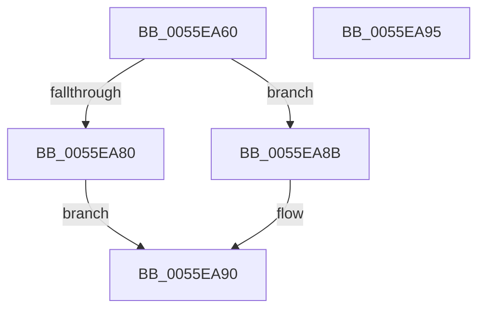

# EmonOverflowHandlerOriginal

- RVA: `0x0055EA60`–`0x0055EA96` (길이 `54` bytes)
- VA: `0x000000014055EA60`
- 실행 섹션: `.text`
- PDB 이름 있음: `예`; PDB Function 태그: `아니요`
- unwind 정보 RVA: `0x0005C788`
- 디코드: `13`개 명령, `54/54` bytes 표시
- 미해석 바이트: `0` (있으면 어셈블리에 `.byte`로 보존)

> 이 문서는 커널 이미지의 기계어와 PDB 기호를 분석해 생성했습니다. 4번과 5번은 함수 원형과 자료형을 바이너리 사용 방식에서 추정한 C 해석이며 원본 소스 복구 결과는 아닙니다.

## 1. Dependencies

- 직접 호출 지점: **2**; 고유 호출 대상: **2**
- 직접 호출자로 확인된 함수: **0**
- RIP 상대 이미지 참조: **2**

### Outgoing calls
- `0x0055EA84` → [EmonOverflowHandlerInternalV1Original](EmonOverflowHandlerInternalV1Original_function_0055DCD8.md) (function, `0x0055DCD8`)
- `0x0055EA8B` → [EmonOverflowHandlerInternalV2Original](EmonOverflowHandlerInternalV2Original_function_0055E5BC.md) (function, `0x0055E5BC`)

### Direct callers
- 이 함수 시작 RVA로 연결되는 직접 call은 확인되지 않았습니다. 간접 호출은 완전히 역산할 수 없습니다.

### Static image references
- `0x0055EA6C` → RVA `0x00FC8C40` (`ALMOSTRO`; read)
- `0x0055EA73` → RVA `0x00F8FDE0` (`.data`; read)

## 2. Other-region calls and transfers

- 다른 실행 섹션으로 향하는 call: **0**
- 별도 외부 분기/꼬리 이동을 확인하지 못했습니다.

## 3. Assembly (complete function range)

```asm
0055EA60  48 83 EC 28                     sub rsp, 0x28
0055EA64  65 8B 14 25 A4 01 00 00         mov edx, dword ptr gs:[0x1a4]
0055EA6C  4C 8D 05 CD A1 A6 00            lea r8, [rip + 0xa6a1cd]
0055EA73  83 3D 66 13 A3 00 02            cmp dword ptr [rip + 0xa31366], 2
0055EA7A  4D 8B 04 D0                     mov r8, qword ptr [r8 + rdx*8]
0055EA7E  73 0B                           jae 0x14055ea8b
0055EA80  49 8B 50 58                     mov rdx, qword ptr [r8 + 0x58]
0055EA84  E8 4F F2 FF FF                  call 0x14055dcd8
0055EA89  EB 05                           jmp 0x14055ea90
0055EA8B  E8 2C FB FF FF                  call 0x14055e5bc
0055EA90  48 83 C4 28                     add rsp, 0x28
0055EA94  C3                              ret
0055EA95  CC                              int3
```

## 4. C-style interpretation (structured pseudocode)

```c
__int64 __fastcall EmonOverflowHandlerOriginal(void)
{
    __int64 result;
    __int64 v_rsp;

    v_rsp = (v_rsp) - (40);
    if ((*(unsigned int *)(v_rip + 10687334)) >= 2) goto loc_0055EA8B;
    result = EmonOverflowHandlerInternalV1Original(a1, *(unsigned __int64 *)(*(unsigned __int64 *)(v_rip + 10920397 + (unsigned int)(*(unsigned int *)(gs_base + (0 + 420))) * 8) + 88), *(unsigned __int64 *)(v_rip + 10920397 + (unsigned int)(*(unsigned int *)(gs_base + (0 + 420))) * 8), a4);
    goto loc_0055EA90;
loc_0055EA8B:
    result = EmonOverflowHandlerInternalV2Original(a1, *(unsigned __int64 *)(*(unsigned __int64 *)(v_rip + 10920397 + (unsigned int)(*(unsigned int *)(gs_base + (0 + 420))) * 8) + 88), *(unsigned __int64 *)(v_rip + 10920397 + (unsigned int)(*(unsigned int *)(gs_base + (0 + 420))) * 8), a4);
loc_0055EA90:
    v_rsp = (v_rsp) + (40);
    return result;
}
```

## 5. (Beta) C Style

```c
void EmonOverflowHandlerOriginal(void)
{
    int64_t result;
    int64_t local_rsp;

    local_rsp = (local_rsp) - (40);
    if ((*(uint32_t *)(v_rip + 0xA31366)) >= 2) goto loc_0055EA8B;
    result = EmonOverflowHandlerInternalV1Original(a1, *(uint64_t *)(*(uint64_t *)(v_rip + 0xA6A1CD + (uint32_t)(*(uint32_t *)(gs_base + (0 + 0x1A4))) * 8) + 0x58), *(uint64_t *)(v_rip + 0xA6A1CD + (uint32_t)(*(uint32_t *)(gs_base + (0 + 0x1A4))) * 8), a4);
    goto loc_0055EA90;
loc_0055EA8B:
    result = EmonOverflowHandlerInternalV2Original(a1, *(uint64_t *)(*(uint64_t *)(v_rip + 0xA6A1CD + (uint32_t)(*(uint32_t *)(gs_base + (0 + 0x1A4))) * 8) + 0x58), *(uint64_t *)(v_rip + 0xA6A1CD + (uint32_t)(*(uint32_t *)(gs_base + (0 + 0x1A4))) * 8), a4);
loc_0055EA90:
    local_rsp = (local_rsp) + (40);
    return result;
}
```

## 6. Execution-region graph

[열기: 2D/3D 그래프와 함수 탐색 컨트롤 패널](../../../control-panel.html?section=text&rva=0x0055EA60&view=graph)

- 2D 그래프는 위에서 아래로 흐르고, 3D 그래프는 빈 공간을 드래그해 회전합니다. Shift+드래그는 이동, 휠은 확대·축소, 함수 노드 선택은 대상 보고서 이동입니다.

### Static fallback


