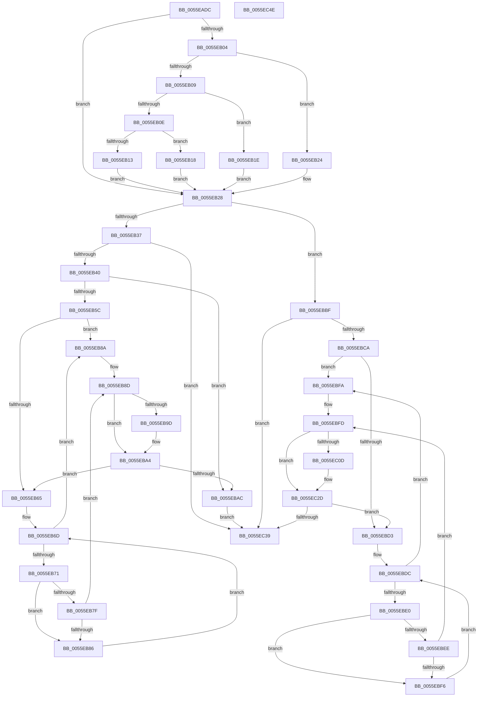

# EmonPauseProfilingInternalEnhanced

- RVA: `0x0055EADC`–`0x0055EC4F` (길이 `371` bytes)
- VA: `0x000000014055EADC`
- 실행 섹션: `.text`
- PDB 이름 있음: `예`; PDB Function 태그: `아니요`
- unwind 정보 RVA: `0x000A5A38`
- 디코드: `119`개 명령, `371/371` bytes 표시
- 미해석 바이트: `0` (있으면 어셈블리에 `.byte`로 보존)

> 이 문서는 커널 이미지의 기계어와 PDB 기호를 분석해 생성했습니다. 4번과 5번은 함수 원형과 자료형을 바이너리 사용 방식에서 추정한 C 해석이며 원본 소스 복구 결과는 아닙니다.

## 1. Dependencies

- 직접 호출 지점: **0**; 고유 호출 대상: **0**
- 직접 호출자로 확인된 함수: **1**
- RIP 상대 이미지 참조: **1**

### Outgoing calls
- 직접 디코드된 call 명령이 없습니다.

### Direct callers
- [EmonPauseProfilingEnhanced](EmonPauseProfilingEnhanced_function_0055EAA0.md) at `0x0055EAB2`
- [EmonPauseProfilingEnhanced](EmonPauseProfilingEnhanced_function_0055EAA0.md) at `0x0055EAC7`

### Static image references
- `0x0055EAF1` → RVA `0x00FC8C40` (`ALMOSTRO`; read)

## 2. Other-region calls and transfers

- 다른 실행 섹션으로 향하는 call: **0**
- 별도 외부 분기/꼬리 이동을 확인하지 못했습니다.

## 3. Assembly (complete function range)

```asm
0055EADC  48 8B C4                        mov rax, rsp
0055EADF  48 89 58 08                     mov qword ptr [rax + 8], rbx
0055EAE3  48 89 68 10                     mov qword ptr [rax + 0x10], rbp
0055EAE7  48 89 70 18                     mov qword ptr [rax + 0x18], rsi
0055EAEB  48 89 78 20                     mov qword ptr [rax + 0x20], rdi
0055EAEF  8B C2                           mov eax, edx
0055EAF1  48 8D 15 48 A1 A6 00            lea rdx, [rip + 0xa6a148]
0055EAF8  48 8B 04 C2                     mov rax, qword ptr [rdx + rax*8]
0055EAFC  4C 8B 40 58                     mov r8, qword ptr [rax + 0x58]
0055EB00  85 C9                           test ecx, ecx
0055EB02  74 24                           je 0x14055eb28
0055EB04  83 E9 01                        sub ecx, 1
0055EB07  74 1B                           je 0x14055eb24
0055EB09  83 E9 63                        sub ecx, 0x63
0055EB0C  74 10                           je 0x14055eb1e
0055EB0E  83 F9 01                        cmp ecx, 1
0055EB11  74 05                           je 0x14055eb18
0055EB13  45 33 C0                        xor r8d, r8d
0055EB16  EB 10                           jmp 0x14055eb28
0055EB18  49 83 C0 48                     add r8, 0x48
0055EB1C  EB 0A                           jmp 0x14055eb28
0055EB1E  49 83 C0 30                     add r8, 0x30
0055EB22  EB 04                           jmp 0x14055eb28
0055EB24  49 83 C0 18                     add r8, 0x18
0055EB28  41 8B 08                        mov ecx, dword ptr [r8]
0055EB2B  49 8B 68 10                     mov rbp, qword ptr [r8 + 0x10]
0055EB2F  85 C9                           test ecx, ecx
0055EB31  0F 84 88 00 00 00               je 0x14055ebbf
0055EB37  83 F9 01                        cmp ecx, 1
0055EB3A  0F 85 F9 00 00 00               jne 0x14055ec39
0055EB40  B9 8F 03 00 00                  mov ecx, 0x38f
0055EB45  0F 32                           rdmsr
0055EB47  41 8B 78 04                     mov edi, dword ptr [r8 + 4]
0055EB4B  45 33 C9                        xor r9d, r9d
0055EB4E  48 C1 E2 20                     shl rdx, 0x20
0055EB52  48 0B C2                        or rax, rdx
0055EB55  4C 8B D0                        mov r10, rax
0055EB58  85 FF                           test edi, edi
0055EB5A  74 50                           je 0x14055ebac
0055EB5C  41 83 CB FF                     or r11d, 0xffffffff
0055EB60  44 3B CF                        cmp r9d, edi
0055EB63  73 25                           jae 0x14055eb8a
0055EB65  41 8B 70 08                     mov esi, dword ptr [r8 + 8]
0055EB69  33 DB                           xor ebx, ebx
0055EB6B  33 D2                           xor edx, edx
0055EB6D  3B D6                           cmp edx, esi
0055EB6F  77 19                           ja 0x14055eb8a
0055EB71  48 8D 0C 52                     lea rcx, [rdx + rdx*2]
0055EB75  48 03 C9                        add rcx, rcx
0055EB78  83 7C CD 1C 03                  cmp dword ptr [rbp + rcx*8 + 0x1c], 3
0055EB7D  74 07                           je 0x14055eb86
0055EB7F  FF C3                           inc ebx
0055EB81  41 3B D9                        cmp ebx, r9d
0055EB84  77 07                           ja 0x14055eb8d
0055EB86  FF C2                           inc edx
0055EB88  EB E3                           jmp 0x14055eb6d
0055EB8A  41 8B D3                        mov edx, r11d
0055EB8D  8B C2                           mov eax, edx
0055EB8F  48 8D 0C 40                     lea rcx, [rax + rax*2]
0055EB93  48 03 C9                        add rcx, rcx
0055EB96  83 7C CD 18 02                  cmp dword ptr [rbp + rcx*8 + 0x18], 2
0055EB9B  7D 07                           jge 0x14055eba4
0055EB9D  83 C2 20                        add edx, 0x20
0055EBA0  49 0F B3 D2                     btr r10, rdx
0055EBA4  41 FF C1                        inc r9d
0055EBA7  44 3B CF                        cmp r9d, edi
0055EBAA  72 B9                           jb 0x14055eb65
0055EBAC  49 8B D2                        mov rdx, r10
0055EBAF  49 8B C2                        mov rax, r10
0055EBB2  48 C1 EA 20                     shr rdx, 0x20
0055EBB6  B9 8F 03 00 00                  mov ecx, 0x38f
0055EBBB  0F 30                           wrmsr
0055EBBD  EB 7A                           jmp 0x14055ec39
0055EBBF  41 8B 40 04                     mov eax, dword ptr [r8 + 4]
0055EBC3  45 33 C9                        xor r9d, r9d
0055EBC6  85 C0                           test eax, eax
0055EBC8  74 6F                           je 0x14055ec39
0055EBCA  41 83 CB FF                     or r11d, 0xffffffff
0055EBCE  44 3B C8                        cmp r9d, eax
0055EBD1  73 27                           jae 0x14055ebfa
0055EBD3  41 8B 58 08                     mov ebx, dword ptr [r8 + 8]
0055EBD7  45 33 D2                        xor r10d, r10d
0055EBDA  33 D2                           xor edx, edx
0055EBDC  3B D3                           cmp edx, ebx
0055EBDE  77 1A                           ja 0x14055ebfa
0055EBE0  48 8D 0C 52                     lea rcx, [rdx + rdx*2]
0055EBE4  48 03 C9                        add rcx, rcx
0055EBE7  83 7C CD 1C 03                  cmp dword ptr [rbp + rcx*8 + 0x1c], 3
0055EBEC  74 08                           je 0x14055ebf6
0055EBEE  41 FF C2                        inc r10d
0055EBF1  45 3B D1                        cmp r10d, r9d
0055EBF4  77 07                           ja 0x14055ebfd
0055EBF6  FF C2                           inc edx
0055EBF8  EB E2                           jmp 0x14055ebdc
0055EBFA  41 8B D3                        mov edx, r11d
0055EBFD  8B C2                           mov eax, edx
0055EBFF  48 8D 0C 40                     lea rcx, [rax + rax*2]
0055EC03  48 03 C9                        add rcx, rcx
0055EC06  83 7C CD 18 02                  cmp dword ptr [rbp + rcx*8 + 0x18], 2
0055EC0B  7D 20                           jge 0x14055ec2d
0055EC0D  8D 8A 86 01 00 00               lea ecx, [rdx + 0x186]
0055EC13  0F 32                           rdmsr
0055EC15  48 C1 E2 20                     shl rdx, 0x20
0055EC19  48 0B C2                        or rax, rdx
0055EC1C  BA FF FF BF FF                  mov edx, 0xffbfffff
0055EC21  48 23 C2                        and rax, rdx
0055EC24  48 8B D0                        mov rdx, rax
0055EC27  48 C1 EA 20                     shr rdx, 0x20
0055EC2B  0F 30                           wrmsr
0055EC2D  41 8B 40 04                     mov eax, dword ptr [r8 + 4]
0055EC31  41 FF C1                        inc r9d
0055EC34  44 3B C8                        cmp r9d, eax
0055EC37  72 9A                           jb 0x14055ebd3
0055EC39  48 8B 5C 24 08                  mov rbx, qword ptr [rsp + 8]
0055EC3E  48 8B 6C 24 10                  mov rbp, qword ptr [rsp + 0x10]
0055EC43  48 8B 74 24 18                  mov rsi, qword ptr [rsp + 0x18]
0055EC48  48 8B 7C 24 20                  mov rdi, qword ptr [rsp + 0x20]
0055EC4D  C3                              ret
0055EC4E  CC                              int3
```

## 4. C-style interpretation (structured pseudocode)

```c
__int64 __fastcall EmonPauseProfilingInternalEnhanced(int a1, int a2, __int64 a3, int a4)
{
    __int64 result;
    __int64 v_r10;
    __int64 v_r11;
    __int64 v_rbx;
    unsigned __int64 v_stack_p10;
    unsigned __int64 v_stack_p18;
    unsigned __int64 v_stack_p20;
    unsigned __int64 v_stack_p8;

    *(unsigned __int64 *)(v_rsp + 8) = v_rbx;
    *(unsigned __int64 *)(v_rsp + 16) = v_rbp;
    *(unsigned __int64 *)(v_rsp + 24) = v_rsi;
    *(unsigned __int64 *)(v_rsp + 32) = v_rdi;
    if (a1 == 0) goto loc_0055EB28;
    a1 = (unsigned int)((a1) - (1));
    if (condition_is_equal) goto loc_0055EB24;
    a1 = (unsigned int)((a1) - (99));
    if (condition_is_equal) goto loc_0055EB1E;
    if (a1 == 1) goto loc_0055EB18;
    a3 = 0;
    goto loc_0055EB28;
loc_0055EB18:
    a3 = (a3) + (72);
    goto loc_0055EB28;
loc_0055EB1E:
    a3 = (a3) + (48);
    goto loc_0055EB28;
loc_0055EB24:
    a3 = (a3) + (24);
loc_0055EB28:
    if ((unsigned int)((unsigned int)(*(unsigned int *)(a3))) == 0) goto loc_0055EBBF;
    if (((unsigned int)((unsigned int)(*(unsigned int *)(a3)))) != 1) goto loc_0055EC39;
    a4 = 0;
    a2 = (v_rip + 10920264) << (32);
    result = (*(unsigned __int64 *)(v_rip + 10920264 + (unsigned int)(a2) * 8)) | (a2);
    if ((unsigned int)((unsigned int)(*(unsigned int *)(a3 + 4))) == 0) goto loc_0055EBAC;
    v_r11 = (unsigned int)((v_r11) | (0xFFFFFFFFULL));
    if (0 >= ((unsigned int)((unsigned int)(*(unsigned int *)(a3 + 4))))) goto loc_0055EB8A;
loc_0055EB65:
    v_rbx = 0;
    a2 = 0;
loc_0055EB6D:
    if (0 > ((unsigned int)((unsigned int)(*(unsigned int *)(a3 + 8))))) goto loc_0055EB8A;
    a1 = (a2 + a2 * 2) + (a2 + a2 * 2);
    if ((*(unsigned int *)(*(unsigned __int64 *)(a3 + 16) + a1 * 8 + 28)) == 3) goto loc_0055EB86;
    v_rbx = (unsigned int)((v_rbx) + 1);
    if (((unsigned int)(v_rbx)) > 0) goto loc_0055EB8D;
loc_0055EB86:
    a2 = (unsigned int)((a2) + 1);
    goto loc_0055EB6D;
loc_0055EB8A:
loc_0055EB8D:
    a1 = ((unsigned int)((unsigned int)((unsigned int)((unsigned int)(v_r11)))) + (unsigned int)((unsigned int)((unsigned int)((unsigned int)(v_r11)))) * 2) + ((unsigned int)((unsigned int)((unsigned int)((unsigned int)(v_r11)))) + (unsigned int)((unsigned int)((unsigned int)((unsigned int)(v_r11)))) * 2);
    if ((*(unsigned int *)(*(unsigned __int64 *)(a3 + 16) + a1 * 8 + 24)) < 2) {
        a2 = (unsigned int)(((unsigned int)((unsigned int)(v_r11))) + (32));
    }
    a4 = (unsigned int)((a4) + 1);
    if (a4 < ((unsigned int)((unsigned int)(*(unsigned int *)(a3 + 4))))) goto loc_0055EB65;
loc_0055EBAC:
    a2 = (result) >> (32);
    goto loc_0055EC39;
loc_0055EBBF:
    a4 = 0;
    if ((unsigned int)((unsigned int)(*(unsigned int *)(a3 + 4))) == 0) goto loc_0055EC39;
    v_r11 = (unsigned int)((v_r11) | (0xFFFFFFFFULL));
    if (0 >= ((unsigned int)((unsigned int)(*(unsigned int *)(a3 + 4))))) goto loc_0055EBFA;
loc_0055EBD3:
    v_r10 = 0;
    a2 = 0;
loc_0055EBDC:
    if (0 > ((unsigned int)((unsigned int)(*(unsigned int *)(a3 + 8))))) goto loc_0055EBFA;
    a1 = (a2 + a2 * 2) + (a2 + a2 * 2);
    if ((*(unsigned int *)(*(unsigned __int64 *)(a3 + 16) + a1 * 8 + 28)) == 3) goto loc_0055EBF6;
    v_r10 = (unsigned int)((v_r10) + 1);
    if (((unsigned int)(v_r10)) > 0) goto loc_0055EBFD;
loc_0055EBF6:
    a2 = (unsigned int)((a2) + 1);
    goto loc_0055EBDC;
loc_0055EBFA:
loc_0055EBFD:
    a1 = ((unsigned int)((unsigned int)((unsigned int)((unsigned int)(v_r11)))) + (unsigned int)((unsigned int)((unsigned int)((unsigned int)(v_r11)))) * 2) + ((unsigned int)((unsigned int)((unsigned int)((unsigned int)(v_r11)))) + (unsigned int)((unsigned int)((unsigned int)((unsigned int)(v_r11)))) * 2);
    result = (unsigned int)((unsigned int)((unsigned int)((unsigned int)(v_r11))));
    if ((*(unsigned int *)(*(unsigned __int64 *)(a3 + 16) + a1 * 8 + 24)) < 2) {
        a1 = (unsigned int)((unsigned int)(v_r11)) + 390;
        a2 = ((unsigned int)((unsigned int)(v_r11))) << (32);
        result = ((unsigned int)((unsigned int)((unsigned int)((unsigned int)(v_r11))))) | (a2);
        a2 = 0xFFBFFFFFULL;
        result = (result) & (a2);
        a2 = result;
        a2 = (a2) >> (32);
    }
    a4 = (unsigned int)((a4) + 1);
    if (a4 < ((unsigned int)((unsigned int)(*(unsigned int *)(a3 + 4))))) goto loc_0055EBD3;
loc_0055EC39:
    return (unsigned int)(*(unsigned int *)(a3 + 4));
}
```

## 5. (Beta) C Style

```c
int64_t EmonPauseProfilingInternalEnhanced(int32_t Arg1, int32_t Arg2, int64_t Arg3, int32_t Arg4)
{
    int64_t result;
    int64_t local_r10;
    int64_t local_r11;
    int64_t local_rbx;
    uint64_t v_stack_p10;
    uint64_t v_stack_p18;
    uint64_t v_stack_p20;
    uint64_t v_stack_p8;

    *(uint64_t *)(local_rsp + 0x8) = local_rbx;
    *(uint64_t *)(local_rsp + 0x10) = local_rbp;
    *(uint64_t *)(local_rsp + 0x18) = local_rsi;
    *(uint64_t *)(local_rsp + 0x20) = local_rdi;
    if (Arg1 == 0) goto loc_0055EB28;
    Arg1 = (uint32_t)((Arg1) - (1));
    if (condition_is_equal) goto loc_0055EB24;
    Arg1 = (uint32_t)((Arg1) - (99));
    if (condition_is_equal) goto loc_0055EB1E;
    if (Arg1 == 1) goto loc_0055EB18;
    Arg3 = 0;
    goto loc_0055EB28;
loc_0055EB18:
    Arg3 = (Arg3) + (72);
    goto loc_0055EB28;
loc_0055EB1E:
    Arg3 = (Arg3) + (48);
    goto loc_0055EB28;
loc_0055EB24:
    Arg3 = (Arg3) + (24);
loc_0055EB28:
    if ((uint32_t)((uint32_t)(*(uint32_t *)(Arg3))) == 0) goto loc_0055EBBF;
    if (((uint32_t)((uint32_t)(*(uint32_t *)(Arg3)))) != 1) goto loc_0055EC39;
    Arg4 = 0;
    Arg2 = (v_rip + 10920264) << (32);
    result = (*(uint64_t *)(v_rip + 0xA6A148 + (uint32_t)(Arg2) * 8)) | (Arg2);
    if ((uint32_t)((uint32_t)(*(uint32_t *)(Arg3 + 0x4))) == 0) goto loc_0055EBAC;
    local_r11 = (uint32_t)((local_r11) | (0xFFFFFFFFULL));
    if (0 >= ((uint32_t)((uint32_t)(*(uint32_t *)(Arg3 + 0x4))))) goto loc_0055EB8A;
loc_0055EB65:
    local_rbx = 0;
    Arg2 = 0;
loc_0055EB6D:
    if (0 > ((uint32_t)((uint32_t)(*(uint32_t *)(Arg3 + 0x8))))) goto loc_0055EB8A;
    Arg1 = (Arg2 + Arg2 * 2) + (Arg2 + Arg2 * 2);
    if ((*(uint32_t *)(*(uint64_t *)(Arg3 + 0x10) + Arg1 * 8 + 0x1C)) == 3) goto loc_0055EB86;
    local_rbx = (uint32_t)((local_rbx) + 1);
    if (((uint32_t)(local_rbx)) > 0) goto loc_0055EB8D;
loc_0055EB86:
    Arg2 = (uint32_t)((Arg2) + 1);
    goto loc_0055EB6D;
loc_0055EB8A:
loc_0055EB8D:
    Arg1 = ((uint32_t)((uint32_t)((uint32_t)((uint32_t)(local_r11)))) + (uint32_t)((uint32_t)((uint32_t)((uint32_t)(local_r11)))) * 2) + ((uint32_t)((uint32_t)((uint32_t)((uint32_t)(local_r11)))) + (uint32_t)((uint32_t)((uint32_t)((uint32_t)(local_r11)))) * 2);
    if ((*(uint32_t *)(*(uint64_t *)(Arg3 + 0x10) + Arg1 * 8 + 0x18)) < 2) {
        Arg2 = (uint32_t)(((uint32_t)((uint32_t)(local_r11))) + (32));
    }
    Arg4 = (uint32_t)((Arg4) + 1);
    if (Arg4 < ((uint32_t)((uint32_t)(*(uint32_t *)(Arg3 + 0x4))))) goto loc_0055EB65;
loc_0055EBAC:
    Arg2 = (result) >> (32);
    goto loc_0055EC39;
loc_0055EBBF:
    Arg4 = 0;
    if ((uint32_t)((uint32_t)(*(uint32_t *)(Arg3 + 0x4))) == 0) goto loc_0055EC39;
    local_r11 = (uint32_t)((local_r11) | (0xFFFFFFFFULL));
    if (0 >= ((uint32_t)((uint32_t)(*(uint32_t *)(Arg3 + 0x4))))) goto loc_0055EBFA;
loc_0055EBD3:
    local_r10 = 0;
    Arg2 = 0;
loc_0055EBDC:
    if (0 > ((uint32_t)((uint32_t)(*(uint32_t *)(Arg3 + 0x8))))) goto loc_0055EBFA;
    Arg1 = (Arg2 + Arg2 * 2) + (Arg2 + Arg2 * 2);
    if ((*(uint32_t *)(*(uint64_t *)(Arg3 + 0x10) + Arg1 * 8 + 0x1C)) == 3) goto loc_0055EBF6;
    local_r10 = (uint32_t)((local_r10) + 1);
    if (((uint32_t)(local_r10)) > 0) goto loc_0055EBFD;
loc_0055EBF6:
    Arg2 = (uint32_t)((Arg2) + 1);
    goto loc_0055EBDC;
loc_0055EBFA:
loc_0055EBFD:
    Arg1 = ((uint32_t)((uint32_t)((uint32_t)((uint32_t)(local_r11)))) + (uint32_t)((uint32_t)((uint32_t)((uint32_t)(local_r11)))) * 2) + ((uint32_t)((uint32_t)((uint32_t)((uint32_t)(local_r11)))) + (uint32_t)((uint32_t)((uint32_t)((uint32_t)(local_r11)))) * 2);
    result = (uint32_t)((uint32_t)((uint32_t)((uint32_t)(local_r11))));
    if ((*(uint32_t *)(*(uint64_t *)(Arg3 + 0x10) + Arg1 * 8 + 0x18)) < 2) {
        Arg1 = (uint32_t)((uint32_t)(local_r11)) + 390;
        Arg2 = ((uint32_t)((uint32_t)(local_r11))) << (32);
        result = ((uint32_t)((uint32_t)((uint32_t)((uint32_t)(local_r11))))) | (Arg2);
        Arg2 = 0xFFBFFFFFULL;
        result = (result) & (Arg2);
        Arg2 = result;
        Arg2 = (Arg2) >> (32);
    }
    Arg4 = (uint32_t)((Arg4) + 1);
    if (Arg4 < ((uint32_t)((uint32_t)(*(uint32_t *)(Arg3 + 0x4))))) goto loc_0055EBD3;
loc_0055EC39:
    return (uint32_t)(*(uint32_t *)(Arg3 + 0x4));
}
```

## 6. Execution-region graph

[열기: 2D/3D 그래프와 함수 탐색 컨트롤 패널](../../../control-panel.html?section=text&rva=0x0055EADC&view=graph)

- 2D 그래프는 위에서 아래로 흐르고, 3D 그래프는 빈 공간을 드래그해 회전합니다. Shift+드래그는 이동, 휠은 확대·축소, 함수 노드 선택은 대상 보고서 이동입니다.

### Static fallback


