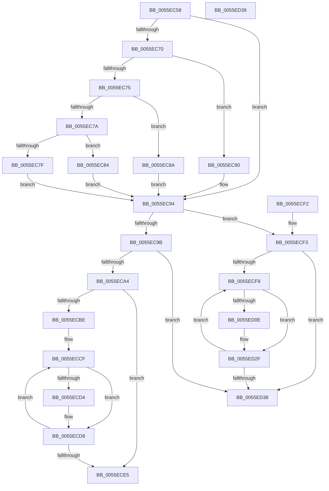

# EmonPauseProfilingInternalOriginal

- RVA: `0x0055EC58`–`0x0055ED3A` (길이 `226` bytes)
- VA: `0x000000014055EC58`
- 실행 섹션: `.text`
- PDB 이름 있음: `예`; PDB Function 태그: `아니요`
- unwind 정보 RVA: `0x000DB714`
- 디코드: `72`개 명령, `226/226` bytes 표시
- 미해석 바이트: `0` (있으면 어셈블리에 `.byte`로 보존)

> 이 문서는 커널 이미지의 기계어와 PDB 기호를 분석해 생성했습니다. 4번과 5번은 함수 원형과 자료형을 바이너리 사용 방식에서 추정한 C 해석이며 원본 소스 복구 결과는 아닙니다.

## 1. Dependencies

- 직접 호출 지점: **0**; 고유 호출 대상: **0**
- 직접 호출자로 확인된 함수: **1**
- RIP 상대 이미지 참조: **1**

### Outgoing calls
- 직접 디코드된 call 명령이 없습니다.

### Direct callers
- [EmonPauseProfilingOriginal](EmonPauseProfilingOriginal_function_0055ED40.md) at `0x0055ED52`
- [EmonPauseProfilingOriginal](EmonPauseProfilingOriginal_function_0055ED40.md) at `0x0055ED68`

### Static image references
- `0x0055EC5D` → RVA `0x00FC8C40` (`ALMOSTRO`; read)

## 2. Other-region calls and transfers

- 다른 실행 섹션으로 향하는 call: **0**
- 별도 외부 분기/꼬리 이동을 확인하지 못했습니다.

## 3. Assembly (complete function range)

```asm
0055EC58  8B C2                           mov eax, edx
0055EC5A  45 33 C9                        xor r9d, r9d
0055EC5D  48 8D 15 DC 9F A6 00            lea rdx, [rip + 0xa69fdc]
0055EC64  48 8B 04 C2                     mov rax, qword ptr [rdx + rax*8]
0055EC68  4C 8B 40 58                     mov r8, qword ptr [rax + 0x58]
0055EC6C  85 C9                           test ecx, ecx
0055EC6E  74 24                           je 0x14055ec94
0055EC70  83 E9 01                        sub ecx, 1
0055EC73  74 1B                           je 0x14055ec90
0055EC75  83 E9 63                        sub ecx, 0x63
0055EC78  74 10                           je 0x14055ec8a
0055EC7A  83 F9 01                        cmp ecx, 1
0055EC7D  74 05                           je 0x14055ec84
0055EC7F  45 8B C1                        mov r8d, r9d
0055EC82  EB 10                           jmp 0x14055ec94
0055EC84  49 83 C0 48                     add r8, 0x48
0055EC88  EB 0A                           jmp 0x14055ec94
0055EC8A  49 83 C0 30                     add r8, 0x30
0055EC8E  EB 04                           jmp 0x14055ec94
0055EC90  49 83 C0 18                     add r8, 0x18
0055EC94  41 8B 08                        mov ecx, dword ptr [r8]
0055EC97  85 C9                           test ecx, ecx
0055EC99  74 58                           je 0x14055ecf3
0055EC9B  83 F9 01                        cmp ecx, 1
0055EC9E  0F 85 94 00 00 00               jne 0x14055ed38
0055ECA4  41 BA 8F 03 00 00               mov r10d, 0x38f
0055ECAA  41 8B CA                        mov ecx, r10d
0055ECAD  0F 32                           rdmsr
0055ECAF  41 8B 48 04                     mov ecx, dword ptr [r8 + 4]
0055ECB3  48 C1 E2 20                     shl rdx, 0x20
0055ECB7  48 0B C2                        or rax, rdx
0055ECBA  85 C9                           test ecx, ecx
0055ECBC  74 27                           je 0x14055ece5
0055ECBE  49 8B 50 10                     mov rdx, qword ptr [r8 + 0x10]
0055ECC2  41 B9 20 00 00 00               mov r9d, 0x20
0055ECC8  48 83 C2 18                     add rdx, 0x18
0055ECCC  44 8B C1                        mov r8d, ecx
0055ECCF  83 3A 02                        cmp dword ptr [rdx], 2
0055ECD2  7D 04                           jge 0x14055ecd8
0055ECD4  4C 0F B3 C8                     btr rax, r9
0055ECD8  49 FF C1                        inc r9
0055ECDB  48 83 C2 30                     add rdx, 0x30
0055ECDF  49 83 E8 01                     sub r8, 1
0055ECE3  75 EA                           jne 0x14055eccf
0055ECE5  48 8B D0                        mov rdx, rax
0055ECE8  41 8B CA                        mov ecx, r10d
0055ECEB  48 C1 EA 20                     shr rdx, 0x20
0055ECEF  0F 30                           wrmsr
0055ECF1  C3                              ret
0055ECF2  CC                              int3
0055ECF3  45 39 48 04                     cmp dword ptr [r8 + 4], r9d
0055ECF7  76 3F                           jbe 0x14055ed38
0055ECF9  41 8B C1                        mov eax, r9d
0055ECFC  48 8D 0C 40                     lea rcx, [rax + rax*2]
0055ED00  49 8B 40 10                     mov rax, qword ptr [r8 + 0x10]
0055ED04  48 03 C9                        add rcx, rcx
0055ED07  83 7C C8 18 02                  cmp dword ptr [rax + rcx*8 + 0x18], 2
0055ED0C  7D 21                           jge 0x14055ed2f
0055ED0E  41 8D 89 86 01 00 00            lea ecx, [r9 + 0x186]
0055ED15  0F 32                           rdmsr
0055ED17  48 C1 E2 20                     shl rdx, 0x20
0055ED1B  48 0B C2                        or rax, rdx
0055ED1E  BA FF FF BF FF                  mov edx, 0xffbfffff
0055ED23  48 23 C2                        and rax, rdx
0055ED26  48 8B D0                        mov rdx, rax
0055ED29  48 C1 EA 20                     shr rdx, 0x20
0055ED2D  0F 30                           wrmsr
0055ED2F  41 FF C1                        inc r9d
0055ED32  45 3B 48 04                     cmp r9d, dword ptr [r8 + 4]
0055ED36  72 C1                           jb 0x14055ecf9
0055ED38  C3                              ret
0055ED39  CC                              int3
```

## 4. C-style interpretation (structured pseudocode)

```c
__int64 __fastcall EmonPauseProfilingInternalOriginal(int a1, int a2, __int64 a3, int a4)
{
    __int64 result;

    a4 = 0;
    if (a1 == 0) goto loc_0055EC94;
    a1 = (unsigned int)((a1) - (1));
    if (condition_is_equal) goto loc_0055EC90;
    a1 = (unsigned int)((a1) - (99));
    if (condition_is_equal) goto loc_0055EC8A;
    if (a1 == 1) goto loc_0055EC84;
    goto loc_0055EC94;
loc_0055EC84:
    a3 = (0) + (72);
    goto loc_0055EC94;
loc_0055EC8A:
    a3 = (a3) + (48);
    goto loc_0055EC94;
loc_0055EC90:
    a3 = (a3) + (24);
loc_0055EC94:
    if ((unsigned int)((unsigned int)(*(unsigned int *)(a3))) == 0) goto loc_0055ECF3;
    if (((unsigned int)((unsigned int)(*(unsigned int *)(a3)))) != 1) goto loc_0055ED38;
    a2 = (v_rip + 10919900) << (32);
    result = (*(unsigned __int64 *)(v_rip + 10919900 + (unsigned int)(a2) * 8)) | (a2);
    if ((unsigned int)((unsigned int)(*(unsigned int *)(a3 + 4))) == 0) goto loc_0055ECE5;
    a2 = (*(unsigned __int64 *)(a3 + 16)) + (24);
loc_0055ECCF:
    if ((*(unsigned int *)(a2)) < 2) {
    }
    a4 = (32) + 1;
    a2 = (a2) + (48);
    a3 = ((unsigned int)((unsigned int)((unsigned int)(*(unsigned int *)(a3 + 4))))) - (1);
    if (condition_is_not_equal) goto loc_0055ECCF;
loc_0055ECE5:
    a2 = (result) >> (32);
    return result;
loc_0055ECF3:
    if ((*(unsigned int *)(a3 + 4)) <= a4) goto loc_0055ED38;
loc_0055ECF9:
    a1 = ((unsigned int)(a4) + (unsigned int)(a4) * 2) + ((unsigned int)(a4) + (unsigned int)(a4) * 2);
    result = *(unsigned __int64 *)(a3 + 16);
    if ((*(unsigned int *)(*(unsigned __int64 *)(a3 + 16) + a1 * 8 + 24)) < 2) {
        a1 = a4 + 390;
        a2 = (a2) << (32);
        result = (*(unsigned __int64 *)(a3 + 16)) | (a2);
        a2 = 0xFFBFFFFFULL;
        result = (result) & (a2);
        a2 = result;
        a2 = (a2) >> (32);
    }
    a4 = (unsigned int)((a4) + 1);
    if (a4 < (*(unsigned int *)(a3 + 4))) goto loc_0055ECF9;
loc_0055ED38:
    return result;
}
```

## 5. (Beta) C Style

```c
int64_t EmonPauseProfilingInternalOriginal(int32_t Arg1, int32_t Arg2, int64_t Arg3, int32_t Arg4)
{
    int64_t result;

    Arg4 = 0;
    if (Arg1 == 0) goto loc_0055EC94;
    Arg1 = (uint32_t)((Arg1) - (1));
    if (condition_is_equal) goto loc_0055EC90;
    Arg1 = (uint32_t)((Arg1) - (99));
    if (condition_is_equal) goto loc_0055EC8A;
    if (Arg1 == 1) goto loc_0055EC84;
    goto loc_0055EC94;
loc_0055EC84:
    Arg3 = (0) + (72);
    goto loc_0055EC94;
loc_0055EC8A:
    Arg3 = (Arg3) + (48);
    goto loc_0055EC94;
loc_0055EC90:
    Arg3 = (Arg3) + (24);
loc_0055EC94:
    if ((uint32_t)((uint32_t)(*(uint32_t *)(Arg3))) == 0) goto loc_0055ECF3;
    if (((uint32_t)((uint32_t)(*(uint32_t *)(Arg3)))) != 1) goto loc_0055ED38;
    Arg2 = (v_rip + 10919900) << (32);
    result = (*(uint64_t *)(v_rip + 0xA69FDC + (uint32_t)(Arg2) * 8)) | (Arg2);
    if ((uint32_t)((uint32_t)(*(uint32_t *)(Arg3 + 0x4))) == 0) goto loc_0055ECE5;
    Arg2 = (*(uint64_t *)(Arg3 + 0x10)) + (24);
loc_0055ECCF:
    if ((*(uint32_t *)(Arg2)) < 2) {
    }
    Arg4 = (32) + 1;
    Arg2 = (Arg2) + (48);
    Arg3 = ((uint32_t)((uint32_t)((uint32_t)(*(uint32_t *)(Arg3 + 0x4))))) - (1);
    if (condition_is_not_equal) goto loc_0055ECCF;
loc_0055ECE5:
    Arg2 = (result) >> (32);
    return result;
loc_0055ECF3:
    if ((*(uint32_t *)(Arg3 + 0x4)) <= Arg4) goto loc_0055ED38;
loc_0055ECF9:
    Arg1 = ((uint32_t)(Arg4) + (uint32_t)(Arg4) * 2) + ((uint32_t)(Arg4) + (uint32_t)(Arg4) * 2);
    result = *(uint64_t *)(Arg3 + 0x10);
    if ((*(uint32_t *)(*(uint64_t *)(Arg3 + 0x10) + Arg1 * 8 + 0x18)) < 2) {
        Arg1 = Arg4 + 390;
        Arg2 = (Arg2) << (32);
        result = (*(uint64_t *)(Arg3 + 0x10)) | (Arg2);
        Arg2 = 0xFFBFFFFFULL;
        result = (result) & (Arg2);
        Arg2 = result;
        Arg2 = (Arg2) >> (32);
    }
    Arg4 = (uint32_t)((Arg4) + 1);
    if (Arg4 < (*(uint32_t *)(Arg3 + 0x4))) goto loc_0055ECF9;
loc_0055ED38:
    return result;
}
```

## 6. Execution-region graph

[열기: 2D/3D 그래프와 함수 탐색 컨트롤 패널](../../../control-panel.html?section=text&rva=0x0055EC58&view=graph)

- 2D 그래프는 위에서 아래로 흐르고, 3D 그래프는 빈 공간을 드래그해 회전합니다. Shift+드래그는 이동, 휠은 확대·축소, 함수 노드 선택은 대상 보고서 이동입니다.

### Static fallback


