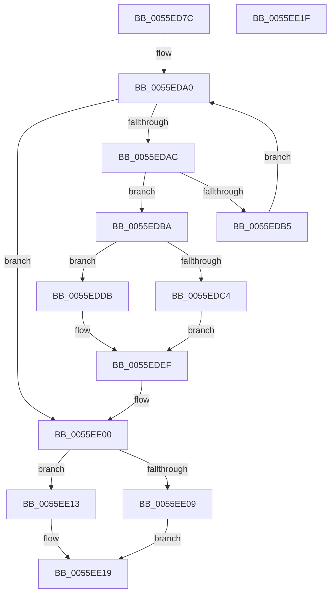

# EmonPebsOverflowHandler

- RVA: `0x0055ED7C`–`0x0055EE20` (길이 `164` bytes)
- VA: `0x000000014055ED7C`
- 실행 섹션: `.text`
- PDB 이름 있음: `예`; PDB Function 태그: `아니요`
- unwind 정보 RVA: `0x00064C80`
- 디코드: `45`개 명령, `164/164` bytes 표시
- 미해석 바이트: `0` (있으면 어셈블리에 `.byte`로 보존)

> 이 문서는 커널 이미지의 기계어와 PDB 기호를 분석해 생성했습니다. 4번과 5번은 함수 원형과 자료형을 바이너리 사용 방식에서 추정한 C 해석이며 원본 소스 복구 결과는 아닙니다.

## 1. Dependencies

- 직접 호출 지점: **1**; 고유 호출 대상: **1**
- 직접 호출자로 확인된 함수: **2**
- RIP 상대 이미지 참조: **4**

### Outgoing calls
- `0x0055EDFB` → [guard_dispatch_icall](../6B/guard_dispatch_icall_function_006BAAD0.md) (function, `0x006BAAD0`)

### Direct callers
- [EmonOverflowHandlerInternalV2Enhanced](EmonOverflowHandlerInternalV2Enhanced_function_0055E110.md) at `0x0055E15B`
- [EmonOverflowHandlerInternalV2Original](EmonOverflowHandlerInternalV2Original_function_0055E5BC.md) at `0x0055E607`

### Static image references
- `0x0055ED8A` → RVA `0x00F8FE00` (`.data`; read)
- `0x0055ED99` → RVA `0x00F8FDF0` (`.data`; read)
- `0x0055EDBC` → RVA `0x00F8FDF9` (`.data`; read)
- `0x0055EDCC` → RVA `0x00F8FE18` (`.data`; read)

## 2. Other-region calls and transfers

- 다른 실행 섹션으로 향하는 call: **0**
- 별도 외부 분기/꼬리 이동을 확인하지 못했습니다.

## 3. Assembly (complete function range)

```asm
0055ED7C  40 53                           push rbx
0055ED7E  48 83 EC 30                     sub rsp, 0x30
0055ED82  65 8B 04 25 A4 01 00 00         mov eax, dword ptr gs:[0x1a4]
0055ED8A  4C 8B 0D 6F 10 A3 00            mov r9, qword ptr [rip + 0xa3106f]
0055ED91  48 8D 1C 80                     lea rbx, [rax + rax*4]
0055ED95  48 C1 E3 05                     shl rbx, 5
0055ED99  48 03 1D 50 10 A3 00            add rbx, qword ptr [rip + 0xa31050]
0055EDA0  48 8D 05 59 10 A3 00            lea rax, [rip + 0xa31059]
0055EDA7  4C 3B C8                        cmp r9, rax
0055EDAA  74 54                           je 0x14055ee00
0055EDAC  4D 8B 51 18                     mov r10, qword ptr [r9 + 0x18]
0055EDB0  4D 85 D2                        test r10, r10
0055EDB3  75 05                           jne 0x14055edba
0055EDB5  4D 8B 09                        mov r9, qword ptr [r9]
0055EDB8  EB E6                           jmp 0x14055eda0
0055EDBA  33 D2                           xor edx, edx
0055EDBC  38 15 37 10 A3 00               cmp byte ptr [rip + 0xa31037], dl
0055EDC2  74 17                           je 0x14055eddb
0055EDC4  4C 8B 5B 20                     mov r11, qword ptr [rbx + 0x20]
0055EDC8  48 8B 43 28                     mov rax, qword ptr [rbx + 0x28]
0055EDCC  44 8B 05 45 10 A3 00            mov r8d, dword ptr [rip + 0xa31045]
0055EDD3  49 2B C3                        sub rax, r11
0055EDD6  49 F7 F0                        div r8
0055EDD9  EB 14                           jmp 0x14055edef
0055EDDB  44 8B 5B 10                     mov r11d, dword ptr [rbx + 0x10]
0055EDDF  8B 43 14                        mov eax, dword ptr [rbx + 0x14]
0055EDE2  44 8B 05 2F 10 A3 00            mov r8d, dword ptr [rip + 0xa3102f]
0055EDE9  41 2B C3                        sub eax, r11d
0055EDEC  41 F7 F0                        div r8d
0055EDEF  41 8B D0                        mov edx, r8d
0055EDF2  49 8B CB                        mov rcx, r11
0055EDF5  4C 8B C0                        mov r8, rax
0055EDF8  49 8B C2                        mov rax, r10
0055EDFB  E8 D0 BC 15 00                  call 0x1406baad0
0055EE00  80 3D F2 0F A3 00 00            cmp byte ptr [rip + 0xa30ff2], 0
0055EE07  74 0A                           je 0x14055ee13
0055EE09  48 8B 43 20                     mov rax, qword ptr [rbx + 0x20]
0055EE0D  48 89 43 28                     mov qword ptr [rbx + 0x28], rax
0055EE11  EB 06                           jmp 0x14055ee19
0055EE13  8B 43 10                        mov eax, dword ptr [rbx + 0x10]
0055EE16  89 43 14                        mov dword ptr [rbx + 0x14], eax
0055EE19  48 83 C4 30                     add rsp, 0x30
0055EE1D  5B                              pop rbx
0055EE1E  C3                              ret
0055EE1F  CC                              int3
```

## 4. C-style interpretation (structured pseudocode)

```c
__int64 __fastcall EmonPebsOverflowHandler(__int64 a1, int a2)
{
    __int64 result;
    __int64 v_rbx;
    __int64 v_rsp;

    v_rsp = (v_rsp) - (48);
    v_rbx = ((unsigned int)(*(unsigned int *)(gs_base + (0 + 420))) + (unsigned int)(*(unsigned int *)(gs_base + (0 + 420))) * 4) << (5);
    v_rbx = (v_rbx) + (*(unsigned __int64 *)(v_rip + 10686544));
loc_0055EDA0:
    if ((*(unsigned __int64 *)(v_rip + 10686575)) == (v_rip + 10686553)) goto loc_0055EE00;
    if (*(unsigned __int64 *)(*(unsigned __int64 *)(v_rip + 10686575) + 24) != 0) goto loc_0055EDBA;
    goto loc_0055EDA0;
loc_0055EDBA:
    a2 = 0;
    if ((*(unsigned __int8 *)(v_rip + 10686519)) == 0) goto loc_0055EDDB;
    result = (*(unsigned __int64 *)(v_rbx + 40)) - (*(unsigned __int64 *)(v_rbx + 32));
    goto loc_0055EDEF;
loc_0055EDDB:
    result = (unsigned int)(((unsigned int)(*(unsigned int *)(v_rbx + 20))) - ((unsigned int)((unsigned int)(*(unsigned int *)(v_rbx + 16)))));
loc_0055EDEF:
    result = guard_dispatch_icall((unsigned int)(*(unsigned int *)(v_rbx + 16)), (unsigned int)((unsigned int)((unsigned int)(*(unsigned int *)(v_rip + 10686511)))), result, *(unsigned __int64 *)(*(unsigned __int64 *)(v_rip + 10686575)));
loc_0055EE00:
    if ((*(unsigned __int8 *)(v_rip + 10686450)) == 0) goto loc_0055EE13;
    *(unsigned __int64 *)(v_rbx + 40) = *(unsigned __int64 *)(v_rbx + 32);
    goto loc_0055EE19;
loc_0055EE13:
    *(unsigned int *)(v_rbx + 20) = (unsigned int)((unsigned int)(*(unsigned int *)(v_rbx + 16)));
loc_0055EE19:
    v_rsp = (v_rsp) + (48);
    return (unsigned int)(*(unsigned int *)(v_rbx + 16));
}
```

## 5. (Beta) C Style

```c
int64_t EmonPebsOverflowHandler(int64_t Arg1, int32_t Arg2)
{
    int64_t result;
    int64_t local_rbx;
    int64_t local_rsp;

    local_rsp = (local_rsp) - (48);
    local_rbx = ((uint32_t)(*(uint32_t *)(gs_base + (0 + 0x1A4))) + (uint32_t)(*(uint32_t *)(gs_base + (0 + 0x1A4))) * 4) << (5);
    local_rbx = (local_rbx) + (*(uint64_t *)(v_rip + 0xA31050));
loc_0055EDA0:
    if ((*(uint64_t *)(v_rip + 0xA3106F)) == (v_rip + 10686553)) goto loc_0055EE00;
    if (*(uint64_t *)(*(uint64_t *)(v_rip + 0xA3106F) + 0x18) != 0) goto loc_0055EDBA;
    goto loc_0055EDA0;
loc_0055EDBA:
    Arg2 = 0;
    if ((*(uint8_t *)(v_rip + 0xA31037)) == 0) goto loc_0055EDDB;
    result = (*(uint64_t *)(local_rbx + 0x28)) - (*(uint64_t *)(local_rbx + 0x20));
    goto loc_0055EDEF;
loc_0055EDDB:
    result = (uint32_t)(((uint32_t)(*(uint32_t *)(local_rbx + 0x14))) - ((uint32_t)((uint32_t)(*(uint32_t *)(local_rbx + 0x10)))));
loc_0055EDEF:
    result = guard_dispatch_icall((uint32_t)(*(uint32_t *)(local_rbx + 0x10)), (uint32_t)((uint32_t)((uint32_t)(*(uint32_t *)(v_rip + 0xA3102F)))), result, *(uint64_t *)(*(uint64_t *)(v_rip + 0xA3106F)));
loc_0055EE00:
    if ((*(uint8_t *)(v_rip + 0xA30FF2)) == 0) goto loc_0055EE13;
    *(uint64_t *)(local_rbx + 0x28) = *(uint64_t *)(local_rbx + 0x20);
    goto loc_0055EE19;
loc_0055EE13:
    *(uint32_t *)(local_rbx + 0x14) = (uint32_t)((uint32_t)(*(uint32_t *)(local_rbx + 0x10)));
loc_0055EE19:
    local_rsp = (local_rsp) + (48);
    return (uint32_t)(*(uint32_t *)(local_rbx + 0x10));
}
```

## 6. Execution-region graph

[열기: 2D/3D 그래프와 함수 탐색 컨트롤 패널](../../../control-panel.html?section=text&rva=0x0055ED7C&view=graph)

- 2D 그래프는 위에서 아래로 흐르고, 3D 그래프는 빈 공간을 드래그해 회전합니다. Shift+드래그는 이동, 휠은 확대·축소, 함수 노드 선택은 대상 보고서 이동입니다.

### Static fallback


