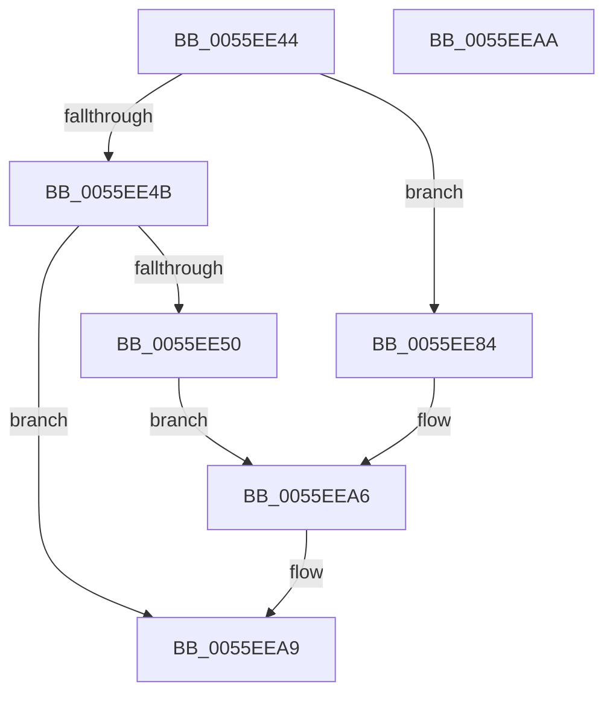

# EmonReadCounter

- RVA: `0x0055EE44`–`0x0055EEAB` (길이 `103` bytes)
- VA: `0x000000014055EE44`
- 실행 섹션: `.text`
- PDB 이름 있음: `예`; PDB Function 태그: `아니요`
- unwind 정보 RVA: `0x000DB714`
- 디코드: `31`개 명령, `103/103` bytes 표시
- 미해석 바이트: `0` (있으면 어셈블리에 `.byte`로 보존)

> 이 문서는 커널 이미지의 기계어와 PDB 기호를 분석해 생성했습니다. 4번과 5번은 함수 원형과 자료형을 바이너리 사용 방식에서 추정한 C 해석이며 원본 소스 복구 결과는 아닙니다.

## 1. Dependencies

- 직접 호출 지점: **0**; 고유 호출 대상: **0**
- 직접 호출자로 확인된 함수: **2**
- RIP 상대 이미지 참조: **0**

### Outgoing calls
- 직접 디코드된 call 명령이 없습니다.

### Direct callers
- [EmonSaveProfilingContextInternalEnhanced](EmonSaveProfilingContextInternalEnhanced_function_0055FC2C.md) at `0x0055FCC6`
- [EmonSaveProfilingContextInternalOriginal](EmonSaveProfilingContextInternalOriginal_function_0055FCE4.md) at `0x0055FD49`

### Static image references
- 디코드된 RIP-relative 메모리 참조가 없습니다.

## 2. Other-region calls and transfers

- 다른 실행 섹션으로 향하는 call: **0**
- 별도 외부 분기/꼬리 이동을 확인하지 못했습니다.

## 3. Assembly (complete function range)

```asm
0055EE44  44 8B D1                        mov r10d, ecx
0055EE47  85 D2                           test edx, edx
0055EE49  74 39                           je 0x14055ee84
0055EE4B  83 FA 01                        cmp edx, 1
0055EE4E  75 59                           jne 0x14055eea9
0055EE50  81 C1 09 03 00 00               add ecx, 0x309
0055EE56  0F 32                           rdmsr
0055EE58  48 C1 E2 20                     shl rdx, 0x20
0055EE5C  B9 8D 03 00 00                  mov ecx, 0x38d
0055EE61  48 0B C2                        or rax, rdx
0055EE64  49 89 00                        mov qword ptr [r8], rax
0055EE67  0F 32                           rdmsr
0055EE69  48 C1 E2 20                     shl rdx, 0x20
0055EE6D  42 8D 0C 95 00 00 00 00         lea ecx, [r10*4]
0055EE75  48 0B C2                        or rax, rdx
0055EE78  BA 0F 00 00 00                  mov edx, 0xf
0055EE7D  48 D3 E2                        shl rdx, cl
0055EE80  23 C2                           and eax, edx
0055EE82  EB 22                           jmp 0x14055eea6
0055EE84  81 C1 C1 00 00 00               add ecx, 0xc1
0055EE8A  0F 32                           rdmsr
0055EE8C  48 C1 E2 20                     shl rdx, 0x20
0055EE90  41 8D 8A 86 01 00 00            lea ecx, [r10 + 0x186]
0055EE97  48 0B C2                        or rax, rdx
0055EE9A  49 89 00                        mov qword ptr [r8], rax
0055EE9D  0F 32                           rdmsr
0055EE9F  48 C1 E2 20                     shl rdx, 0x20
0055EEA3  48 0B C2                        or rax, rdx
0055EEA6  41 89 01                        mov dword ptr [r9], eax
0055EEA9  C3                              ret
0055EEAA  CC                              int3
```

## 4. C-style interpretation (structured pseudocode)

```c
__int64 __fastcall EmonReadCounter(int a1, __int64 a2, __int64 a3, __int64 a4)
{
    __int64 result;

    if ((unsigned int)(a2) == 0) goto loc_0055EE84;
    if (((unsigned int)(a2)) != 1) goto loc_0055EEA9;
    a1 = (unsigned int)((a1) + (777));
    a2 = (a2) << (32);
    result = (result) | (a2);
    *(unsigned __int64 *)(a3) = result;
    a2 = (a2) << (32);
    result = (result) | (a2);
    a2 = (15) << ((unsigned __int8)((unsigned int)(a1) * 4));
    result = (unsigned int)((result) & ((unsigned int)(a2)));
    goto loc_0055EEA6;
loc_0055EE84:
    a1 = (unsigned int)(((unsigned int)(a1) * 4) + (193));
    a2 = (a2) << (32);
    result = (result) | (a2);
    *(unsigned __int64 *)(a3) = result;
    a2 = (a2) << (32);
    result = (result) | (a2);
loc_0055EEA6:
    *(unsigned int *)(a4) = (unsigned int)(result);
loc_0055EEA9:
    return result;
}
```

## 5. (Beta) C Style

```c
int64_t EmonReadCounter(void *Arg1, int64_t Arg2, void *Arg3, void *Arg4)
{
    uint8_t *arg1 = (uint8_t *)Arg1;
    uint8_t *arg3 = (uint8_t *)Arg3;
    uint8_t *arg4 = (uint8_t *)Arg4;

    int64_t result;

    if ((uint32_t)(Arg2) == 0) goto loc_0055EE84;
    if (((uint32_t)(Arg2)) != 1) goto loc_0055EEA9;
    Arg1 = (uint32_t)((Arg1) + (777));
    Arg2 = (Arg2) << (32);
    result = (result) | (Arg2);
    *(uint64_t *)(arg3) = result;
    Arg2 = (Arg2) << (32);
    result = (result) | (Arg2);
    Arg2 = (15) << ((uint8_t)((uint32_t)(Arg1) * 4));
    result = (uint32_t)((result) & ((uint32_t)(Arg2)));
    goto loc_0055EEA6;
loc_0055EE84:
    Arg1 = (uint32_t)(((uint32_t)(Arg1) * 4) + (193));
    Arg2 = (Arg2) << (32);
    result = (result) | (Arg2);
    *(uint64_t *)(arg3) = result;
    Arg2 = (Arg2) << (32);
    result = (result) | (Arg2);
loc_0055EEA6:
    *(uint32_t *)(arg4) = (uint32_t)(result);
loc_0055EEA9:
    return result;
}
```

### 관측된 메모리 오프셋

구조체 형식이 확인되지 않은 접근은 인자 기준의 오프셋으로만 기록했습니다.

| 기준 인자 | 오프셋 표현 | 폭 (bit) | 접근 |
|---|---:|---:|---|
| `Arg1` | `+ 0x186` | `32` | `R` |
| `Arg3` | `+ 0x0` | `64` | `W` |
| `Arg4` | `+ 0x0` | `32` | `W` |

## 6. Execution-region graph

[열기: 2D/3D 그래프와 함수 탐색 컨트롤 패널](../../../control-panel.html?section=text&rva=0x0055EE44&view=graph)

- 2D 그래프는 위에서 아래로 흐르고, 3D 그래프는 빈 공간을 드래그해 회전합니다. Shift+드래그는 이동, 휠은 확대·축소, 함수 노드 선택은 대상 보고서 이동입니다.

### Static fallback


