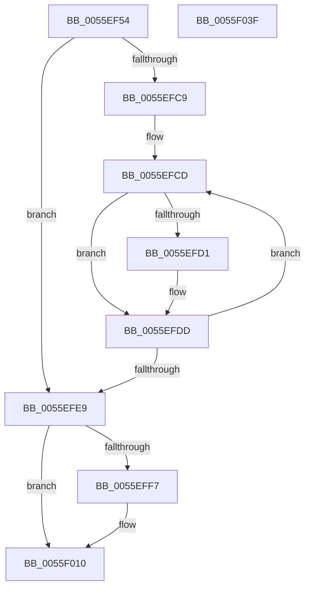

# EmonReleaseProfileResourcesInternal

- RVA: `0x0055EF54`–`0x0055F040` (길이 `236` bytes)
- VA: `0x000000014055EF54`
- 실행 섹션: `.text`
- PDB 이름 있음: `예`; PDB Function 태그: `아니요`
- unwind 정보 RVA: `0x000C4900`
- 디코드: `63`개 명령, `236/236` bytes 표시
- 미해석 바이트: `0` (있으면 어셈블리에 `.byte`로 보존)

> 이 문서는 커널 이미지의 기계어와 PDB 기호를 분석해 생성했습니다. 4번과 5번은 함수 원형과 자료형을 바이너리 사용 방식에서 추정한 C 해석이며 원본 소스 복구 결과는 아닙니다.

## 1. Dependencies

- 직접 호출 지점: **7**; 고유 호출 대상: **6**
- 직접 호출자로 확인된 함수: **2**
- RIP 상대 이미지 참조: **2**

### Outgoing calls
- `0x0055EF93` → [memset](../6C/memset_function_006C6C40.md) (function, `0x006C6C40`)
- `0x0055EFB1` → [memset](../6C/memset_function_006C6C40.md) (function, `0x006C6C40`)
- `0x0055EFBB` → [KeQueryActiveProcessorCountEx](../24/KeQueryActiveProcessorCountEx_function_00249EF0.md) (function, `0x00249EF0`)
- `0x0055EFD8` → [KeAddProcessorAffinityEx](../25/KeAddProcessorAffinityEx_function_0025B6F0.md) (function, `0x0025B6F0`)
- `0x0055EFEE` → [KeIsEmptyAffinityEx](../2D/KeIsEmptyAffinityEx_function_002D1580.md) (function, `0x002D1580`)
- `0x0055F009` → [HalpPmuReservedResourcesProcessorCallback](../54/HalpPmuReservedResourcesProcessorCallback_function_00547608.md) (function, `0x00547608`)
- `0x0055F01D` → [_security_check_cookie](../6A/_security_check_cookie_function_006AC640.md) (function, `0x006AC640`)

### Direct callers
- [EmonAllocateResources](EmonAllocateResources_function_0055C40C.md) at `0x0055C546`
- [EmonReleaseProfileResources](EmonReleaseProfileResources_function_0055EEC0.md) at `0x0055EEE4`

### Static image references
- `0x0055EF6F` → RVA `0x00E0A740` (`.data`; read)
- `0x0055EFFA` → RVA `0x0055F050` (`EmonReleaseReservedCounters`; read)

## 2. Other-region calls and transfers

- 다른 실행 섹션으로 향하는 call: **0**
- 별도 외부 분기/꼬리 이동을 확인하지 못했습니다.

## 3. Assembly (complete function range)

```asm
0055EF54  48 89 5C 24 10                  mov qword ptr [rsp + 0x10], rbx
0055EF59  48 89 6C 24 18                  mov qword ptr [rsp + 0x18], rbp
0055EF5E  48 89 74 24 20                  mov qword ptr [rsp + 0x20], rsi
0055EF63  57                              push rdi
0055EF64  41 56                           push r14
0055EF66  41 57                           push r15
0055EF68  48 81 EC 40 01 00 00            sub rsp, 0x140
0055EF6F  48 8B 05 CA B7 8A 00            mov rax, qword ptr [rip + 0x8ab7ca]
0055EF76  48 33 C4                        xor rax, rsp
0055EF79  48 89 84 24 30 01 00 00         mov qword ptr [rsp + 0x130], rax
0055EF81  48 8B E9                        mov rbp, rcx
0055EF84  BF 00 01 00 00                  mov edi, 0x100
0055EF89  44 8B C7                        mov r8d, edi
0055EF8C  48 8D 4C 24 28                  lea rcx, [rsp + 0x28]
0055EF91  33 D2                           xor edx, edx
0055EF93  E8 A8 7C 16 00                  call 0x1406c6c40
0055EF98  33 DB                           xor ebx, ebx
0055EF9A  48 C7 44 24 20 01 00 20 00      mov qword ptr [rsp + 0x20], 0x200001
0055EFA3  44 8B C7                        mov r8d, edi
0055EFA6  48 8D 4C 24 28                  lea rcx, [rsp + 0x28]
0055EFAB  33 D2                           xor edx, edx
0055EFAD  44 8D 7B 01                     lea r15d, [rbx + 1]
0055EFB1  E8 8A 7C 16 00                  call 0x1406c6c40
0055EFB6  B9 FF FF 00 00                  mov ecx, 0xffff
0055EFBB  E8 30 AF CE FF                  call 0x140249ef0
0055EFC0  44 8B F0                        mov r14d, eax
0055EFC3  8B FB                           mov edi, ebx
0055EFC5  85 C0                           test eax, eax
0055EFC7  74 20                           je 0x14055efe9
0055EFC9  48 8D 75 28                     lea rsi, [rbp + 0x28]
0055EFCD  38 1E                           cmp byte ptr [rsi], bl
0055EFCF  74 0C                           je 0x14055efdd
0055EFD1  8B D7                           mov edx, edi
0055EFD3  48 8D 4C 24 20                  lea rcx, [rsp + 0x20]
0055EFD8  E8 13 C7 CF FF                  call 0x14025b6f0
0055EFDD  41 03 FF                        add edi, r15d
0055EFE0  48 83 C6 50                     add rsi, 0x50
0055EFE4  41 3B FE                        cmp edi, r14d
0055EFE7  72 E4                           jb 0x14055efcd
0055EFE9  48 8D 4C 24 20                  lea rcx, [rsp + 0x20]
0055EFEE  E8 8D 25 D7 FF                  call 0x1402d1580
0055EFF3  85 C0                           test eax, eax
0055EFF5  75 19                           jne 0x14055f010
0055EFF7  4C 8B CD                        mov r9, rbp
0055EFFA  48 8D 15 4F 00 00 00            lea rdx, [rip + 0x4f]
0055F001  4C 8B C5                        mov r8, rbp
0055F004  48 8D 4C 24 20                  lea rcx, [rsp + 0x20]
0055F009  E8 FA 85 FE FF                  call 0x140547608
0055F00E  8B D8                           mov ebx, eax
0055F010  8B C3                           mov eax, ebx
0055F012  48 8B 8C 24 30 01 00 00         mov rcx, qword ptr [rsp + 0x130]
0055F01A  48 33 CC                        xor rcx, rsp
0055F01D  E8 1E D6 14 00                  call 0x1406ac640
0055F022  4C 8D 9C 24 40 01 00 00         lea r11, [rsp + 0x140]
0055F02A  49 8B 5B 28                     mov rbx, qword ptr [r11 + 0x28]
0055F02E  49 8B 6B 30                     mov rbp, qword ptr [r11 + 0x30]
0055F032  49 8B 73 38                     mov rsi, qword ptr [r11 + 0x38]
0055F036  49 8B E3                        mov rsp, r11
0055F039  41 5F                           pop r15
0055F03B  41 5E                           pop r14
0055F03D  5F                              pop rdi
0055F03E  C3                              ret
0055F03F  CC                              int3
```

## 4. C-style interpretation (structured pseudocode)

```c
__int64 __fastcall EmonReleaseProfileResourcesInternal(__int64 a1, int a2)
{
    __int64 result;
    __int64 v_rbx;
    __int64 v_rdi;
    __int64 v_rsi;
    __int64 v_rsp;
    unsigned __int64 v_stack_m130;
    unsigned __int64 v_stack_m138;
    unsigned __int64 v_stack_m18;
    unsigned __int64 v_stack_m28;
    unsigned __int64 v_stack_p10;
    unsigned __int64 v_stack_p18;
    unsigned __int64 v_stack_p20;

    v_stack_p10 = v_rbx;
    v_stack_p18 = v_rbp;
    v_stack_p20 = v_rsi;
    v_rsp = (v_rsp) - (320);
    result = (*(unsigned __int64 *)(v_rip + 9091018)) ^ (v_rsp);
    v_stack_m28 = result;
    a2 = 0;
    result = memset(v_stack_m130, a2, 256, a4);
    v_rbx = 0;
    v_stack_m138 = 0x200001ULL;
    a2 = 0;
    result = memset(v_stack_m130, a2, 256, a4);
    result = KeQueryActiveProcessorCountEx((unsigned int)(0xFFFFULL), a2, 256, a4);
    if ((unsigned int)(result) == 0) goto loc_0055EFE9;
loc_0055EFCD:
    if ((*(unsigned __int8 *)(a1 + 40)) != 0) {
        a2 = 0;
        a1 = v_stack_m138;
        result = KeAddProcessorAffinityEx(a1, a2, 256, a4);
    }
    v_rdi = (unsigned int)((0) + ((unsigned int)(v_rbx + 1)));
    v_rsi = (a1 + 40) + (80);
    if (((unsigned int)(v_rdi)) < ((unsigned int)((unsigned int)((unsigned int)(result))))) goto loc_0055EFCD;
loc_0055EFE9:
    result = KeIsEmptyAffinityEx(v_stack_m138, a2, 256, a4);
    if ((unsigned int)(result) == 0) {
        a4 = a1;
        a2 = v_rip + 79;
        a3 = a1;
        a1 = v_stack_m138;
        result = HalpPmuReservedResourcesProcessorCallback(a1, a2, a3, a4);
        v_rbx = (unsigned int)(result);
    }
    a1 = (v_stack_m28) ^ (v_rsp);
    result = _security_check_cookie(a1, a2, a3, a4);
    return result;
}
```

## 5. (Beta) C Style

```c
int64_t EmonReleaseProfileResourcesInternal(void *Arg1, int32_t Arg2)
{
    uint8_t *arg1 = (uint8_t *)Arg1;

    int64_t result;
    int64_t local_rbx;
    int64_t local_rdi;
    int64_t local_rsi;
    int64_t local_rsp;
    uint64_t v_stack_m130;
    uint64_t v_stack_m138;
    uint64_t v_stack_m18;
    uint64_t v_stack_m28;
    uint64_t v_stack_p10;
    uint64_t v_stack_p18;
    uint64_t v_stack_p20;

    v_stack_p10 = local_rbx;
    v_stack_p18 = local_rbp;
    v_stack_p20 = local_rsi;
    local_rsp = (local_rsp) - (320);
    result = (*(uint64_t *)(v_rip + 0x8AB7CA)) ^ (local_rsp);
    v_stack_m28 = result;
    Arg2 = 0;
    result = memset(v_stack_m130, Arg2, 256, a4);
    local_rbx = 0;
    v_stack_m138 = 0x200001ULL;
    Arg2 = 0;
    result = memset(v_stack_m130, Arg2, 256, a4);
    result = KeQueryActiveProcessorCountEx((uint32_t)(0xFFFFULL), Arg2, 256, a4);
    if ((uint32_t)(result) == 0) goto loc_0055EFE9;
loc_0055EFCD:
    if ((*(uint8_t *)(arg1 + 0x28)) != 0) {
        Arg2 = 0;
        Arg1 = v_stack_m138;
        result = KeAddProcessorAffinityEx(Arg1, Arg2, 256, a4);
    }
    local_rdi = (uint32_t)((0) + ((uint32_t)(local_rbx + 1)));
    local_rsi = (Arg1 + 40) + (80);
    if (((uint32_t)(local_rdi)) < ((uint32_t)((uint32_t)((uint32_t)(result))))) goto loc_0055EFCD;
loc_0055EFE9:
    result = KeIsEmptyAffinityEx(v_stack_m138, Arg2, 256, a4);
    if ((uint32_t)(result) == 0) {
        a4 = Arg1;
        Arg2 = v_rip + 79;
        a3 = Arg1;
        Arg1 = v_stack_m138;
        result = HalpPmuReservedResourcesProcessorCallback(Arg1, Arg2, a3, a4);
        local_rbx = (uint32_t)(result);
    }
    Arg1 = (v_stack_m28) ^ (local_rsp);
    result = _security_check_cookie(Arg1, Arg2, a3, a4);
    return result;
}
```

### 관측된 메모리 오프셋

구조체 형식이 확인되지 않은 접근은 인자 기준의 오프셋으로만 기록했습니다.

| 기준 인자 | 오프셋 표현 | 폭 (bit) | 접근 |
|---|---:|---:|---|
| `Arg1` | `+ 0x0` | `8` | `R` |
| `Arg1` | `+ 0x28` | `64` | `R` |

## 6. Execution-region graph

[열기: 2D/3D 그래프와 함수 탐색 컨트롤 패널](../../../control-panel.html?section=text&rva=0x0055EF54&view=graph)

- 2D 그래프는 위에서 아래로 흐르고, 3D 그래프는 빈 공간을 드래그해 회전합니다. Shift+드래그는 이동, 휠은 확대·축소, 함수 노드 선택은 대상 보고서 이동입니다.

### Static fallback


