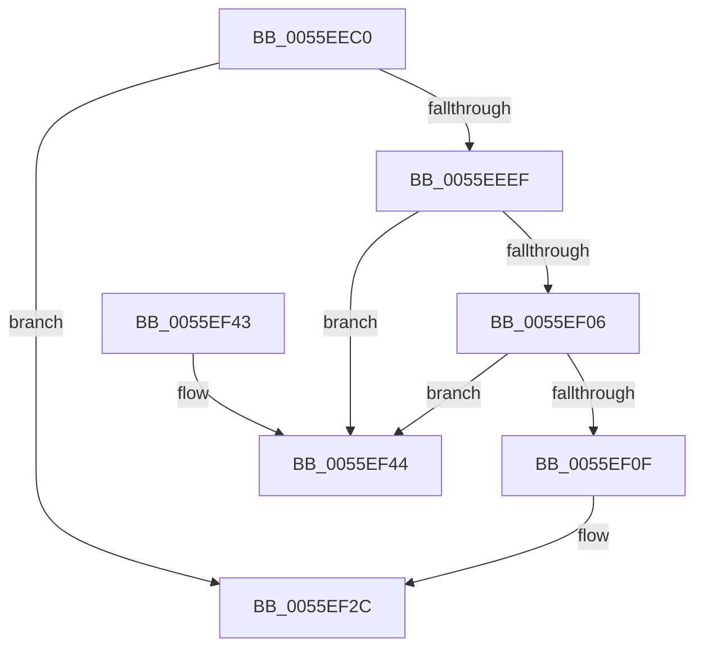

# EmonReleaseProfileResources

- RVA: `0x0055EEC0`–`0x0055EF4B` (길이 `139` bytes)
- VA: `0x000000014055EEC0`
- 실행 섹션: `.text`
- PDB 이름 있음: `예`; PDB Function 태그: `아니요`
- unwind 정보 RVA: `0x00069AD0`
- 디코드: `40`개 명령, `139/139` bytes 표시
- 미해석 바이트: `0` (있으면 어셈블리에 `.byte`로 보존)

> 이 문서는 커널 이미지의 기계어와 PDB 기호를 분석해 생성했습니다. 4번과 5번은 함수 원형과 자료형을 바이너리 사용 방식에서 추정한 C 해석이며 원본 소스 복구 결과는 아닙니다.

## 1. Dependencies

- 직접 호출 지점: **5**; 고유 호출 대상: **5**
- 직접 호출자로 확인된 함수: **0**
- RIP 상대 이미지 참조: **1**

### Outgoing calls
- `0x0055EEDA` → [HalpPmuGetNumberOfReservedCounters](../54/HalpPmuGetNumberOfReservedCounters_function_00547570.md) (function, `0x00547570`)
- `0x0055EEE4` → [EmonReleaseProfileResourcesInternal](EmonReleaseProfileResourcesInternal_function_0055EF54.md) (function, `0x0055EF54`)
- `0x0055EEF8` → [KeAcquireSpinLockRaiseToDpc](../20/KeAcquireSpinLockRaiseToDpc_function_00208470.md) (function, `0x00208470`)
- `0x0055EF1F` → [KeReleaseSpinLock](../39/KeReleaseSpinLock_function_00392BA0.md) (function, `0x00392BA0`)
- `0x0055EF27` → [HalpMmAllocCtxFree](../3E/HalpMmAllocCtxFree_function_003E1904.md) (function, `0x003E1904`)

### Direct callers
- 이 함수 시작 RVA로 연결되는 직접 call은 확인되지 않았습니다. 간접 호출은 완전히 역산할 수 없습니다.

### Static image references
- `0x0055EEEF` → RVA `0x00F8FDE8` (`.data`; read)

## 2. Other-region calls and transfers

- 다른 실행 섹션으로 향하는 call: **0**
- 별도 외부 분기/꼬리 이동을 확인하지 못했습니다.

## 3. Assembly (complete function range)

```asm
0055EEC0  48 89 5C 24 08                  mov qword ptr [rsp + 8], rbx
0055EEC5  48 89 6C 24 10                  mov qword ptr [rsp + 0x10], rbp
0055EECA  48 89 74 24 18                  mov qword ptr [rsp + 0x18], rsi
0055EECF  57                              push rdi
0055EED0  48 83 EC 20                     sub rsp, 0x20
0055EED4  48 8B F2                        mov rsi, rdx
0055EED7  48 8B D9                        mov rbx, rcx
0055EEDA  E8 91 86 FE FF                  call 0x140547570
0055EEDF  48 8B CB                        mov rcx, rbx
0055EEE2  8B E8                           mov ebp, eax
0055EEE4  E8 6B 00 00 00                  call 0x14055ef54
0055EEE9  8B F8                           mov edi, eax
0055EEEB  85 C0                           test eax, eax
0055EEED  78 3D                           js 0x14055ef2c
0055EEEF  48 8D 0D F2 0E A3 00            lea rcx, [rip + 0xa30ef2]
0055EEF6  89 2E                           mov dword ptr [rsi], ebp
0055EEF8  E8 73 95 CA FF                  call 0x140208470
0055EEFD  4C 8B 03                        mov r8, qword ptr [rbx]
0055EF00  49 39 58 08                     cmp qword ptr [r8 + 8], rbx
0055EF04  75 3E                           jne 0x14055ef44
0055EF06  48 8B 53 08                     mov rdx, qword ptr [rbx + 8]
0055EF0A  48 39 1A                        cmp qword ptr [rdx], rbx
0055EF0D  75 35                           jne 0x14055ef44
0055EF0F  4C 89 02                        mov qword ptr [rdx], r8
0055EF12  48 8D 0D CF 0E A3 00            lea rcx, [rip + 0xa30ecf]
0055EF19  49 89 50 08                     mov qword ptr [r8 + 8], rdx
0055EF1D  8A D0                           mov dl, al
0055EF1F  E8 7C 3C E3 FF                  call 0x140392ba0
0055EF24  48 8B D3                        mov rdx, rbx
0055EF27  E8 D8 29 E8 FF                  call 0x1403e1904
0055EF2C  48 8B 5C 24 30                  mov rbx, qword ptr [rsp + 0x30]
0055EF31  8B C7                           mov eax, edi
0055EF33  48 8B 6C 24 38                  mov rbp, qword ptr [rsp + 0x38]
0055EF38  48 8B 74 24 40                  mov rsi, qword ptr [rsp + 0x40]
0055EF3D  48 83 C4 20                     add rsp, 0x20
0055EF41  5F                              pop rdi
0055EF42  C3                              ret
0055EF43  CC                              int3
0055EF44  B9 03 00 00 00                  mov ecx, 3
0055EF49  CD 29                           int 0x29
```

## 4. C-style interpretation (structured pseudocode)

```c
__int64 __fastcall EmonReleaseProfileResources(__int64 a1, __int64 a2)
{
    __int64 result;
    __int64 v_rsp;
    unsigned __int64 v_stack_p10;
    unsigned __int64 v_stack_p18;
    unsigned __int64 v_stack_p8;

    v_stack_p8 = v_rbx;
    v_stack_p10 = v_rbp;
    v_stack_p18 = v_rsi;
    v_rsp = (v_rsp) - (32);
    result = HalpPmuGetNumberOfReservedCounters(a1, a2, a3, a4);
    result = EmonReleaseProfileResourcesInternal(a1, a2, a3, a4);
    if (sign_flag) goto loc_0055EF2C;
    *(unsigned int *)(a2) = (unsigned int)((unsigned int)((unsigned int)(result)));
    result = KeAcquireSpinLockRaiseToDpc(v_rip + 10686194, a2, a3, a4);
    if ((*(unsigned __int64 *)(*(unsigned __int64 *)(a1) + 8)) != a1) goto loc_0055EF44;
    if ((*(unsigned __int64 *)(*(unsigned __int64 *)(a1 + 8))) != a1) goto loc_0055EF44;
    *(unsigned __int64 *)(*(unsigned __int64 *)(a1 + 8)) = *(unsigned __int64 *)(a1);
    *(unsigned __int64 *)(*(unsigned __int64 *)(a1) + 8) = *(unsigned __int64 *)(a1 + 8);
    result = KeReleaseSpinLock(v_rip + 10686159, (unsigned __int8)(result), *(unsigned __int64 *)(a1), a4);
    result = HalpMmAllocCtxFree(v_rip + 10686159, a1, *(unsigned __int64 *)(a1), a4);
loc_0055EF2C:
    v_rsp = (v_rsp) + (32);
    return (unsigned int)((unsigned int)((unsigned int)((unsigned int)(result))));
loc_0055EF44:
    return (unsigned int)((unsigned int)((unsigned int)((unsigned int)(result))));
}
```

## 5. (Beta) C Style

```c
int64_t EmonReleaseProfileResources(void *Arg1, void *Arg2)
{
    uint8_t *arg1 = (uint8_t *)Arg1;
    uint8_t *arg2 = (uint8_t *)Arg2;

    int64_t result;
    int64_t local_rsp;
    uint64_t v_stack_p10;
    uint64_t v_stack_p18;
    uint64_t v_stack_p8;

    v_stack_p8 = local_rbx;
    v_stack_p10 = local_rbp;
    v_stack_p18 = local_rsi;
    local_rsp = (local_rsp) - (32);
    result = HalpPmuGetNumberOfReservedCounters(Arg1, Arg2, a3, a4);
    result = EmonReleaseProfileResourcesInternal(Arg1, Arg2, a3, a4);
    if (sign_flag) goto loc_0055EF2C;
    *(uint32_t *)(arg2) = (uint32_t)((uint32_t)((uint32_t)(result)));
    result = KeAcquireSpinLockRaiseToDpc(v_rip + 10686194, Arg2, a3, a4);
    if ((*(uint64_t *)(*(uint64_t *)(arg1) + 0x8)) != Arg1) goto loc_0055EF44;
    if ((*(uint64_t *)(*(uint64_t *)(arg1 + 0x8))) != Arg1) goto loc_0055EF44;
    *(uint64_t *)(*(uint64_t *)(arg1 + 0x8)) = *(uint64_t *)(arg1);
    *(uint64_t *)(*(uint64_t *)(arg1) + 0x8) = *(uint64_t *)(arg1 + 0x8);
    result = KeReleaseSpinLock(v_rip + 10686159, (uint8_t)(result), *(uint64_t *)(arg1), a4);
    result = HalpMmAllocCtxFree(v_rip + 10686159, Arg1, *(uint64_t *)(arg1), a4);
loc_0055EF2C:
    local_rsp = (local_rsp) + (32);
    return (uint32_t)((uint32_t)((uint32_t)((uint32_t)(result))));
loc_0055EF44:
    return (uint32_t)((uint32_t)((uint32_t)((uint32_t)(result))));
}
```

### 관측된 메모리 오프셋

구조체 형식이 확인되지 않은 접근은 인자 기준의 오프셋으로만 기록했습니다.

| 기준 인자 | 오프셋 표현 | 폭 (bit) | 접근 |
|---|---:|---:|---|
| `Arg1` | `+ 0x0` | `64` | `R` |
| `Arg1` | `+ 0x8` | `64` | `R` |
| `Arg2` | `+ 0x0` | `32` | `W` |

## 6. Execution-region graph

[열기: 2D/3D 그래프와 함수 탐색 컨트롤 패널](../../../control-panel.html?section=text&rva=0x0055EEC0&view=graph)

- 2D 그래프는 위에서 아래로 흐르고, 3D 그래프는 빈 공간을 드래그해 회전합니다. Shift+드래그는 이동, 휠은 확대·축소, 함수 노드 선택은 대상 보고서 이동입니다.

### Static fallback


