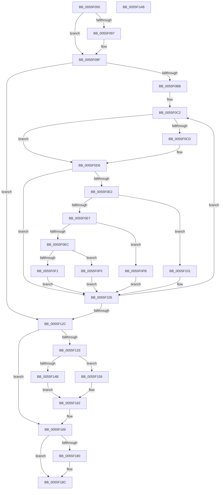

# EmonReleaseReservedCounters

- RVA: `0x0055F050`–`0x0055F1AC` (길이 `348` bytes)
- VA: `0x000000014055F050`
- 실행 섹션: `.text`
- PDB 이름 있음: `예`; PDB Function 태그: `아니요`
- unwind 정보 RVA: `0x0006C8E8`
- 디코드: `94`개 명령, `348/348` bytes 표시
- 미해석 바이트: `0` (있으면 어셈블리에 `.byte`로 보존)

> 이 문서는 커널 이미지의 기계어와 PDB 기호를 분석해 생성했습니다. 4번과 5번은 함수 원형과 자료형을 바이너리 사용 방식에서 추정한 C 해석이며 원본 소스 복구 결과는 아닙니다.

## 1. Dependencies

- 직접 호출 지점: **2**; 고유 호출 대상: **2**
- 직접 호출자로 확인된 함수: **0**
- RIP 상대 이미지 참조: **5**

### Outgoing calls
- `0x0055F09A` → [KiRaiseIrqlProcessIrqlFlags](../4F/KiRaiseIrqlProcessIrqlFlags_function_004F56FC.md) (function, `0x004F56FC`)
- `0x0055F187` → [KiLowerIrqlProcessIrqlFlags](../4F/KiLowerIrqlProcessIrqlFlags_function_004F5698.md) (function, `0x004F5698`)

### Direct callers
- 이 함수 시작 RVA로 연결되는 직접 call은 확인되지 않았습니다. 간접 호출은 완전히 역산할 수 없습니다.

### Static image references
- `0x0055F08E` → RVA `0x00FC6D20` (`ALMOSTRO`; read)
- `0x0055F0BB` → RVA `0x00FC8C40` (`ALMOSTRO`; read)
- `0x0055F13B` → RVA `0x00F8FDF0` (`.data`; read)
- `0x0055F142` → RVA `0x00F8FDF9` (`.data`; read)
- `0x0055F162` → RVA `0x00F8FE1C` (`.data`; read/write)

## 2. Other-region calls and transfers

- 다른 실행 섹션으로 향하는 call: **0**
- 별도 외부 분기/꼬리 이동을 확인하지 못했습니다.

## 3. Assembly (complete function range)

```asm
0055F050  48 8B C4                        mov rax, rsp
0055F053  48 89 58 10                     mov qword ptr [rax + 0x10], rbx
0055F057  48 89 68 18                     mov qword ptr [rax + 0x18], rbp
0055F05B  48 89 70 20                     mov qword ptr [rax + 0x20], rsi
0055F05F  57                              push rdi
0055F060  48 83 EC 20                     sub rsp, 0x20
0055F064  83 60 08 00                     and dword ptr [rax + 8], 0
0055F068  48 8B E9                        mov rbp, rcx
0055F06B  65 8B 04 25 A4 01 00 00         mov eax, dword ptr gs:[0x1a4]
0055F073  8B D8                           mov ebx, eax
0055F075  48 8D 04 80                     lea rax, [rax + rax*4]
0055F079  48 03 C0                        add rax, rax
0055F07C  48 8B 74 C1 20                  mov rsi, qword ptr [rcx + rax*8 + 0x20]
0055F081  44 0F 20 C7                     mov rdi, cr8
0055F085  BA 0F 00 00 00                  mov edx, 0xf
0055F08A  44 0F 22 C2                     mov cr8, rdx
0055F08E  83 3D 8B 7C A6 00 00            cmp dword ptr [rip + 0xa67c8b], 0
0055F095  74 08                           je 0x14055f09f
0055F097  40 8A CF                        mov cl, dil
0055F09A  E8 5D 66 F9 FF                  call 0x1404f56fc
0055F09F  48 8B D6                        mov rdx, rsi
0055F0A2  48 8B C6                        mov rax, rsi
0055F0A5  48 C1 EA 20                     shr rdx, 0x20
0055F0A9  B9 90 03 00 00                  mov ecx, 0x390
0055F0AE  0F 30                           wrmsr
0055F0B0  4C 0F BC C6                     bsf r8, rsi
0055F0B4  44 89 44 24 30                  mov dword ptr [rsp + 0x30], r8d
0055F0B9  74 71                           je 0x14055f12c
0055F0BB  4C 8D 15 7E 9B A6 00            lea r10, [rip + 0xa69b7e]
0055F0C2  33 C9                           xor ecx, ecx
0055F0C4  45 8B C8                        mov r9d, r8d
0055F0C7  41 83 F8 20                     cmp r8d, 0x20
0055F0CB  72 09                           jb 0x14055f0d6
0055F0CD  45 8D 41 E0                     lea r8d, [r9 - 0x20]
0055F0D1  B9 01 00 00 00                  mov ecx, 1
0055F0D6  49 8B 04 DA                     mov rax, qword ptr [r10 + rbx*8]
0055F0DA  48 8B 50 58                     mov rdx, qword ptr [rax + 0x58]
0055F0DE  85 C9                           test ecx, ecx
0055F0E0  74 23                           je 0x14055f105
0055F0E2  83 E9 01                        sub ecx, 1
0055F0E5  74 1A                           je 0x14055f101
0055F0E7  83 E9 63                        sub ecx, 0x63
0055F0EA  74 0F                           je 0x14055f0fb
0055F0EC  83 F9 01                        cmp ecx, 1
0055F0EF  74 04                           je 0x14055f0f5
0055F0F1  33 D2                           xor edx, edx
0055F0F3  EB 10                           jmp 0x14055f105
0055F0F5  48 83 C2 48                     add rdx, 0x48
0055F0F9  EB 0A                           jmp 0x14055f105
0055F0FB  48 83 C2 30                     add rdx, 0x30
0055F0FF  EB 04                           jmp 0x14055f105
0055F101  48 83 C2 18                     add rdx, 0x18
0055F105  41 8B C0                        mov eax, r8d
0055F108  4C 0F BB CE                     btc rsi, r9
0055F10C  48 8D 0C 40                     lea rcx, [rax + rax*2]
0055F110  48 8B 42 10                     mov rax, qword ptr [rdx + 0x10]
0055F114  48 03 C9                        add rcx, rcx
0055F117  C7 44 C8 18 03 00 00 00         mov dword ptr [rax + rcx*8 + 0x18], 3
0055F11F  48 0F BC C6                     bsf rax, rsi
0055F123  44 8B C0                        mov r8d, eax
0055F126  89 44 24 30                     mov dword ptr [rsp + 0x30], eax
0055F12A  75 96                           jne 0x14055f0c2
0055F12C  48 83 7D 18 00                  cmp qword ptr [rbp + 0x18], 0
0055F131  74 36                           je 0x14055f169
0055F133  48 8D 0C 9B                     lea rcx, [rbx + rbx*4]
0055F137  48 C1 E1 05                     shl rcx, 5
0055F13B  48 03 0D AE 0C A3 00            add rcx, qword ptr [rip + 0xa30cae]
0055F142  80 3D B0 0C A3 00 00            cmp byte ptr [rip + 0xa30cb0], 0
0055F149  74 0E                           je 0x14055f159
0055F14B  48 8B 41 20                     mov rax, qword ptr [rcx + 0x20]
0055F14F  48 89 41 28                     mov qword ptr [rcx + 0x28], rax
0055F153  48 89 41 38                     mov qword ptr [rcx + 0x38], rax
0055F157  EB 09                           jmp 0x14055f162
0055F159  8B 41 10                        mov eax, dword ptr [rcx + 0x10]
0055F15C  89 41 14                        mov dword ptr [rcx + 0x14], eax
0055F15F  89 41 1C                        mov dword ptr [rcx + 0x1c], eax
0055F162  83 25 B3 0C A3 00 00            and dword ptr [rip + 0xa30cb3], 0
0055F169  65 48 8B 04 25 20 00 00 00      mov rax, qword ptr gs:[0x20]
0055F172  F0 83 40 60 FE                  lock add dword ptr [rax + 0x60], -2
0055F177  83 3D A2 7B A6 00 00            cmp dword ptr [rip + 0xa67ba2], 0
0055F17E  74 0C                           je 0x14055f18c
0055F180  44 0F 20 C1                     mov rcx, cr8
0055F184  40 8A D7                        mov dl, dil
0055F187  E8 0C 65 F9 FF                  call 0x1404f5698
0055F18C  40 0F B6 C7                     movzx eax, dil
0055F190  44 0F 22 C0                     mov cr8, rax
0055F194  48 8B 5C 24 38                  mov rbx, qword ptr [rsp + 0x38]
0055F199  33 C0                           xor eax, eax
0055F19B  48 8B 6C 24 40                  mov rbp, qword ptr [rsp + 0x40]
0055F1A0  48 8B 74 24 48                  mov rsi, qword ptr [rsp + 0x48]
0055F1A5  48 83 C4 20                     add rsp, 0x20
0055F1A9  5F                              pop rdi
0055F1AA  C3                              ret
0055F1AB  CC                              int3
```

## 4. C-style interpretation (structured pseudocode)

```c
__int64 __fastcall EmonReleaseReservedCounters(__int64 a1)
{
    __int64 result;
    __int64 v_rsp;
    unsigned __int64 v_stack_p10;
    unsigned __int64 v_stack_p18;
    unsigned __int64 v_stack_p20;
    unsigned int v_stack_p8;

    *(unsigned __int64 *)(v_rsp + 16) = v_rbx;
    *(unsigned __int64 *)(v_rsp + 24) = v_rbp;
    *(unsigned __int64 *)(v_rsp + 32) = v_rsi;
    v_rsp = (v_rsp) - (32);
    result = ((unsigned int)(*(unsigned int *)(gs_base + (0 + 420))) + (unsigned int)(*(unsigned int *)(gs_base + (0 + 420))) * 4) + ((unsigned int)(*(unsigned int *)(gs_base + (0 + 420))) + (unsigned int)(*(unsigned int *)(gs_base + (0 + 420))) * 4);
    if ((*(unsigned int *)(v_rip + 10910859)) != 0) {
        a1 = (unsigned __int8)(v_cr8);
        result = KiRaiseIrqlProcessIrqlFlags(a1, 15, a3, a4);
    }
    a2 = (*(unsigned __int64 *)(a1 + result * 8 + 32)) >> (32);
    v_stack_p8 = (unsigned int)(a3);
    if (condition_is_equal) goto loc_0055F12C;
loc_0055F0C2:
    a1 = 0;
    if (((unsigned int)(a3)) >= 32) {
        a3 = (unsigned int)((unsigned int)(a3)) - 32;
        a1 = 1;
    }
    if ((unsigned int)(a1) == 0) goto loc_0055F105;
    a1 = (unsigned int)((a1) - (1));
    if (condition_is_equal) goto loc_0055F101;
    a1 = (unsigned int)((a1) - (99));
    if (condition_is_equal) goto loc_0055F0FB;
    if (((unsigned int)(a1)) == 1) goto loc_0055F0F5;
    a2 = 0;
    goto loc_0055F105;
loc_0055F0F5:
    a2 = (a2) + (72);
    goto loc_0055F105;
loc_0055F0FB:
    a2 = (a2) + (48);
    goto loc_0055F105;
loc_0055F101:
    a2 = (a2) + (24);
loc_0055F105:
    a1 = ((unsigned int)((unsigned int)(a3)) + (unsigned int)((unsigned int)(a3)) * 2) + ((unsigned int)((unsigned int)(a3)) + (unsigned int)((unsigned int)(a3)) * 2);
    *(unsigned int *)(*(unsigned __int64 *)(a2 + 16) + a1 * 8 + 24) = 3;
    v_stack_p8 = (unsigned int)(*(unsigned __int64 *)(a2 + 16));
    if (condition_is_not_equal) goto loc_0055F0C2;
loc_0055F12C:
    if ((*(unsigned __int64 *)(a1 + 24)) == 0) goto loc_0055F169;
    a1 = ((unsigned int)((unsigned int)((unsigned int)(*(unsigned int *)(gs_base + (0 + 420))))) + (unsigned int)((unsigned int)((unsigned int)(*(unsigned int *)(gs_base + (0 + 420))))) * 4) << (5);
    a1 = (a1) + (*(unsigned __int64 *)(v_rip + 10685614));
    if ((*(unsigned __int8 *)(v_rip + 10685616)) == 0) goto loc_0055F159;
    *(unsigned __int64 *)(a1 + 40) = *(unsigned __int64 *)(a1 + 32);
    *(unsigned __int64 *)(a1 + 56) = *(unsigned __int64 *)(a1 + 32);
    goto loc_0055F162;
loc_0055F159:
    *(unsigned int *)(a1 + 20) = (unsigned int)((unsigned int)(*(unsigned int *)(a1 + 16)));
    *(unsigned int *)(a1 + 28) = (unsigned int)((unsigned int)(*(unsigned int *)(a1 + 16)));
loc_0055F162:
loc_0055F169:
    result = *(unsigned __int64 *)(gs_base + (0 + 32));
    if ((*(unsigned int *)(v_rip + 10910626)) != 0) {
        a1 = 15;
        a2 = (unsigned __int8)(v_cr8);
        result = KiLowerIrqlProcessIrqlFlags(a1, a2, (unsigned int)((unsigned int)(*(unsigned __int64 *)(a2 + 16))), (unsigned int)((unsigned int)(a3)));
    }
    result = 0;
    v_rsp = (v_rsp) + (32);
    return result;
}
```

## 5. (Beta) C Style

```c
int64_t EmonReleaseReservedCounters(void *Arg1)
{
    uint8_t *arg1 = (uint8_t *)Arg1;

    int64_t result;
    int64_t local_rsp;
    uint64_t v_stack_p10;
    uint64_t v_stack_p18;
    uint64_t v_stack_p20;
    uint32_t v_stack_p8;

    *(uint64_t *)(local_rsp + 0x10) = local_rbx;
    *(uint64_t *)(local_rsp + 0x18) = local_rbp;
    *(uint64_t *)(local_rsp + 0x20) = local_rsi;
    local_rsp = (local_rsp) - (32);
    result = ((uint32_t)(*(uint32_t *)(gs_base + (0 + 0x1A4))) + (uint32_t)(*(uint32_t *)(gs_base + (0 + 0x1A4))) * 4) + ((uint32_t)(*(uint32_t *)(gs_base + (0 + 0x1A4))) + (uint32_t)(*(uint32_t *)(gs_base + (0 + 0x1A4))) * 4);
    if ((*(uint32_t *)(v_rip + 0xA67C8B)) != 0) {
        Arg1 = (uint8_t)(v_cr8);
        result = KiRaiseIrqlProcessIrqlFlags(Arg1, 15, a3, a4);
    }
    a2 = (*(uint64_t *)(arg1 + result * 8 + 0x20)) >> (32);
    v_stack_p8 = (uint32_t)(a3);
    if (condition_is_equal) goto loc_0055F12C;
loc_0055F0C2:
    Arg1 = 0;
    if (((uint32_t)(a3)) >= 32) {
        a3 = (uint32_t)((uint32_t)(a3)) - 32;
        Arg1 = 1;
    }
    if ((uint32_t)(Arg1) == 0) goto loc_0055F105;
    Arg1 = (uint32_t)((Arg1) - (1));
    if (condition_is_equal) goto loc_0055F101;
    Arg1 = (uint32_t)((Arg1) - (99));
    if (condition_is_equal) goto loc_0055F0FB;
    if (((uint32_t)(Arg1)) == 1) goto loc_0055F0F5;
    a2 = 0;
    goto loc_0055F105;
loc_0055F0F5:
    a2 = (a2) + (72);
    goto loc_0055F105;
loc_0055F0FB:
    a2 = (a2) + (48);
    goto loc_0055F105;
loc_0055F101:
    a2 = (a2) + (24);
loc_0055F105:
    Arg1 = ((uint32_t)((uint32_t)(a3)) + (uint32_t)((uint32_t)(a3)) * 2) + ((uint32_t)((uint32_t)(a3)) + (uint32_t)((uint32_t)(a3)) * 2);
    *(uint32_t *)(*(uint64_t *)(a2 + 0x10) + arg1 * 8 + 0x18) = 3;
    v_stack_p8 = (uint32_t)(*(uint64_t *)(a2 + 0x10));
    if (condition_is_not_equal) goto loc_0055F0C2;
loc_0055F12C:
    if ((*(uint64_t *)(arg1 + 0x18)) == 0) goto loc_0055F169;
    Arg1 = ((uint32_t)((uint32_t)((uint32_t)(*(uint32_t *)(gs_base + (0 + 0x1A4))))) + (uint32_t)((uint32_t)((uint32_t)(*(uint32_t *)(gs_base + (0 + 0x1A4))))) * 4) << (5);
    Arg1 = (Arg1) + (*(uint64_t *)(v_rip + 0xA30CAE));
    if ((*(uint8_t *)(v_rip + 0xA30CB0)) == 0) goto loc_0055F159;
    *(uint64_t *)(arg1 + 0x28) = *(uint64_t *)(arg1 + 0x20);
    *(uint64_t *)(arg1 + 0x38) = *(uint64_t *)(arg1 + 0x20);
    goto loc_0055F162;
loc_0055F159:
    *(uint32_t *)(arg1 + 0x14) = (uint32_t)((uint32_t)(*(uint32_t *)(arg1 + 0x10)));
    *(uint32_t *)(arg1 + 0x1C) = (uint32_t)((uint32_t)(*(uint32_t *)(arg1 + 0x10)));
loc_0055F162:
loc_0055F169:
    result = *(uint64_t *)(gs_base + (0 + 0x20));
    if ((*(uint32_t *)(v_rip + 0xA67BA2)) != 0) {
        Arg1 = 15;
        a2 = (uint8_t)(v_cr8);
        result = KiLowerIrqlProcessIrqlFlags(Arg1, a2, (uint32_t)((uint32_t)(*(uint64_t *)(a2 + 0x10))), (uint32_t)((uint32_t)(a3)));
    }
    result = 0;
    local_rsp = (local_rsp) + (32);
    return result;
}
```

### 관측된 메모리 오프셋

구조체 형식이 확인되지 않은 접근은 인자 기준의 오프셋으로만 기록했습니다.

| 기준 인자 | 오프셋 표현 | 폭 (bit) | 접근 |
|---|---:|---:|---|
| `Arg1` | `+ 0x18` | `64` | `R` |
| `Arg1` | `+ 0x20 + rax*8` | `64` | `R` |

## 6. Execution-region graph

[열기: 2D/3D 그래프와 함수 탐색 컨트롤 패널](../../../control-panel.html?section=text&rva=0x0055F050&view=graph)

- 2D 그래프는 위에서 아래로 흐르고, 3D 그래프는 빈 공간을 드래그해 회전합니다. Shift+드래그는 이동, 휠은 확대·축소, 함수 노드 선택은 대상 보고서 이동입니다.

### Static fallback


