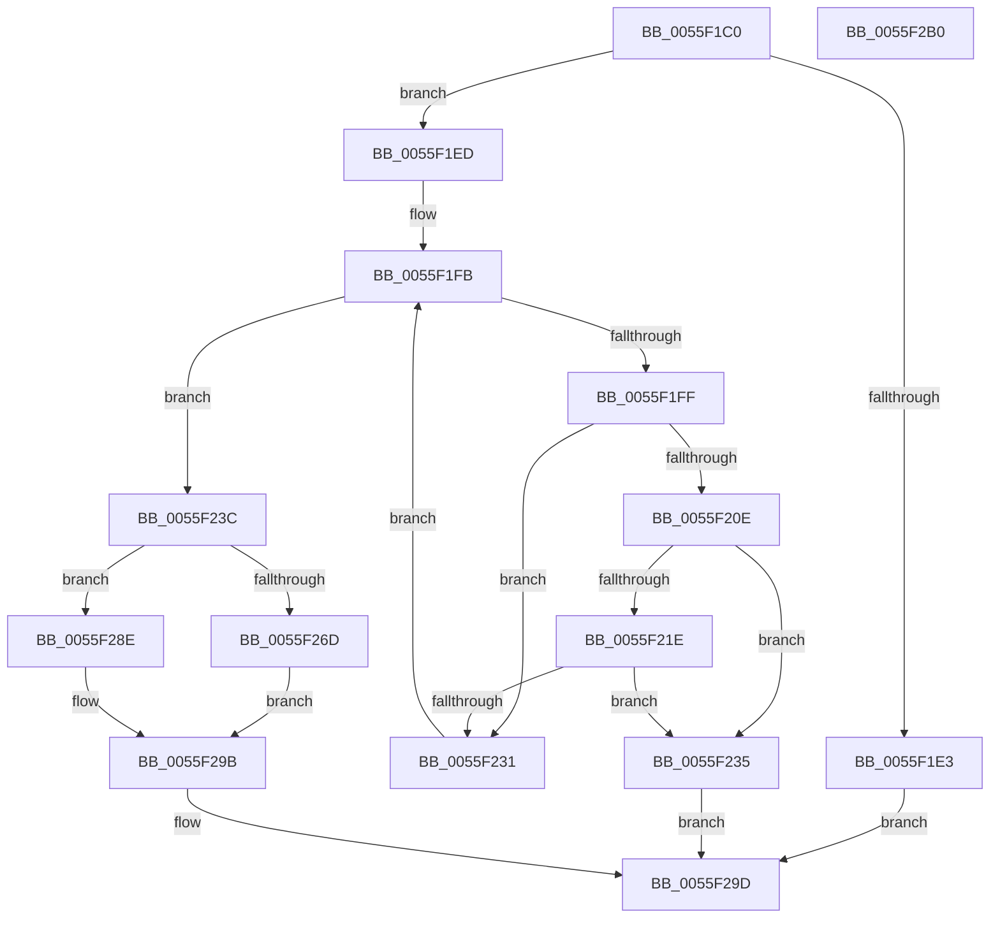

# EmonRemoveProfileSourceEnhanced

- RVA: `0x0055F1C0`–`0x0055F2B1` (길이 `241` bytes)
- VA: `0x000000014055F1C0`
- 실행 섹션: `.text`
- PDB 이름 있음: `예`; PDB Function 태그: `아니요`
- unwind 정보 RVA: `0x000701D4`
- 디코드: `72`개 명령, `241/241` bytes 표시
- 미해석 바이트: `0` (있으면 어셈블리에 `.byte`로 보존)

> 이 문서는 커널 이미지의 기계어와 PDB 기호를 분석해 생성했습니다. 4번과 5번은 함수 원형과 자료형을 바이너리 사용 방식에서 추정한 C 해석이며 원본 소스 복구 결과는 아닙니다.

## 1. Dependencies

- 직접 호출 지점: **9**; 고유 호출 대상: **7**
- 직접 호출자로 확인된 함수: **0**
- RIP 상대 이미지 참조: **2**

### Outgoing calls
- `0x0055F1F2` → [KeQueryActiveProcessorCountEx](../24/KeQueryActiveProcessorCountEx_function_00249EF0.md) (function, `0x00249EF0`)
- `0x0055F205` → [KeCheckProcessorAffinityEx](../30/KeCheckProcessorAffinityEx_function_00305150.md) (function, `0x00305150`)
- `0x0055F215` → [EmonIsProfileSourceInUseEnhanced](EmonIsProfileSourceInUseEnhanced_function_0055D4C4.md) (function, `0x0055D4C4`)
- `0x0055F228` → [EmonIsProfileSourceInUseEnhanced](EmonIsProfileSourceInUseEnhanced_function_0055D4C4.md) (function, `0x0055D4C4`)
- `0x0055F243` → [HalpAcquireHighLevelLock](../2D/HalpAcquireHighLevelLock_function_002D2390.md) (function, `0x002D2390`)
- `0x0055F253` → [HalpRemoveProfileSourceFromList](../54/HalpRemoveProfileSourceFromList_function_005477B8.md) (function, `0x005477B8`)
- `0x0055F264` → [HalpReleaseHighLevelLock](../2D/HalpReleaseHighLevelLock_function_002D1C58.md) (function, `0x002D1C58`)
- `0x0055F279` → [HalpMmAllocCtxFree](../3E/HalpMmAllocCtxFree_function_003E1904.md) (function, `0x003E1904`)
- `0x0055F281` → [HalpMmAllocCtxFree](../3E/HalpMmAllocCtxFree_function_003E1904.md) (function, `0x003E1904`)

### Direct callers
- 이 함수 시작 RVA로 연결되는 직접 call은 확인되지 않았습니다. 간접 호출은 완전히 역산할 수 없습니다.

### Static image references
- `0x0055F23C` → RVA `0x00FC2BD0` (`.data`; read)
- `0x0055F286` → RVA `0x00FC2C20` (`.data`; read/write)

## 2. Other-region calls and transfers

- 다른 실행 섹션으로 향하는 call: **0**
- 별도 외부 분기/꼬리 이동을 확인하지 못했습니다.

## 3. Assembly (complete function range)

```asm
0055F1C0  48 89 5C 24 10                  mov qword ptr [rsp + 0x10], rbx
0055F1C5  48 89 6C 24 18                  mov qword ptr [rsp + 0x18], rbp
0055F1CA  56                              push rsi
0055F1CB  57                              push rdi
0055F1CC  41 56                           push r14
0055F1CE  48 83 EC 20                     sub rsp, 0x20
0055F1D2  8B 39                           mov edi, dword ptr [rcx]
0055F1D4  33 F6                           xor esi, esi
0055F1D6  48 89 74 24 40                  mov qword ptr [rsp + 0x40], rsi
0055F1DB  4C 8B F1                        mov r14, rcx
0055F1DE  83 FF 24                        cmp edi, 0x24
0055F1E1  77 0A                           ja 0x14055f1ed
0055F1E3  B8 BB 00 00 C0                  mov eax, 0xc00000bb
0055F1E8  E9 B0 00 00 00                  jmp 0x14055f29d
0055F1ED  B9 FF FF 00 00                  mov ecx, 0xffff
0055F1F2  E8 F9 AC CE FF                  call 0x140249ef0
0055F1F7  8B E8                           mov ebp, eax
0055F1F9  8B DE                           mov ebx, esi
0055F1FB  3B DD                           cmp ebx, ebp
0055F1FD  73 3D                           jae 0x14055f23c
0055F1FF  49 8D 4E 08                     lea rcx, [r14 + 8]
0055F203  8B D3                           mov edx, ebx
0055F205  E8 46 5F DA FF                  call 0x140305150
0055F20A  85 C0                           test eax, eax
0055F20C  74 23                           je 0x14055f231
0055F20E  44 8B C7                        mov r8d, edi
0055F211  8B D3                           mov edx, ebx
0055F213  33 C9                           xor ecx, ecx
0055F215  E8 AA E2 FF FF                  call 0x14055d4c4
0055F21A  84 C0                           test al, al
0055F21C  75 17                           jne 0x14055f235
0055F21E  44 8B C7                        mov r8d, edi
0055F221  8B D3                           mov edx, ebx
0055F223  B9 01 00 00 00                  mov ecx, 1
0055F228  E8 97 E2 FF FF                  call 0x14055d4c4
0055F22D  84 C0                           test al, al
0055F22F  75 04                           jne 0x14055f235
0055F231  FF C3                           inc ebx
0055F233  EB C6                           jmp 0x14055f1fb
0055F235  B8 11 00 00 80                  mov eax, 0x80000011
0055F23A  EB 61                           jmp 0x14055f29d
0055F23C  48 8D 0D 8D 39 A6 00            lea rcx, [rip + 0xa6398d]
0055F243  E8 48 31 D7 FF                  call 0x1402d2390
0055F248  4C 8D 44 24 40                  lea r8, [rsp + 0x40]
0055F24D  49 8B CE                        mov rcx, r14
0055F250  40 8A F8                        mov dil, al
0055F253  E8 60 85 FE FF                  call 0x1405477b8
0055F258  40 8A D7                        mov dl, dil
0055F25B  48 8D 0D 6E 39 A6 00            lea rcx, [rip + 0xa6396e]
0055F262  8A D8                           mov bl, al
0055F264  E8 EF 29 D7 FF                  call 0x1402d1c58
0055F269  84 DB                           test bl, bl
0055F26B  74 21                           je 0x14055f28e
0055F26D  48 8B 5C 24 40                  mov rbx, qword ptr [rsp + 0x40]
0055F272  48 8B 93 28 01 00 00            mov rdx, qword ptr [rbx + 0x128]
0055F279  E8 86 26 E8 FF                  call 0x1403e1904
0055F27E  48 8B D3                        mov rdx, rbx
0055F281  E8 7E 26 E8 FF                  call 0x1403e1904
0055F286  FF 0D 94 39 A6 00               dec dword ptr [rip + 0xa63994]
0055F28C  EB 0D                           jmp 0x14055f29b
0055F28E  48 39 74 24 40                  cmp qword ptr [rsp + 0x40], rsi
0055F293  B8 01 00 00 C0                  mov eax, 0xc0000001
0055F298  0F 44 F0                        cmove esi, eax
0055F29B  8B C6                           mov eax, esi
0055F29D  48 8B 5C 24 48                  mov rbx, qword ptr [rsp + 0x48]
0055F2A2  48 8B 6C 24 50                  mov rbp, qword ptr [rsp + 0x50]
0055F2A7  48 83 C4 20                     add rsp, 0x20
0055F2AB  41 5E                           pop r14
0055F2AD  5F                              pop rdi
0055F2AE  5E                              pop rsi
0055F2AF  C3                              ret
0055F2B0  CC                              int3
```

## 4. C-style interpretation (structured pseudocode)

```c
__int64 __fastcall EmonRemoveProfileSourceEnhanced(__int64 a1)
{
    __int64 result;
    __int64 v_rbx;
    __int64 v_rsi;
    __int64 v_rsp;
    unsigned __int64 v_stack_p10;
    unsigned __int64 v_stack_p18;
    unsigned __int64 v_stack_p8;

    v_stack_p10 = v_rbx;
    v_stack_p18 = v_rbp;
    v_rsp = (v_rsp) - (32);
    v_rsi = 0;
    v_stack_p8 = 0;
    if (((unsigned int)((unsigned int)(*(unsigned int *)(a1)))) > 36) goto loc_0055F1ED;
    goto loc_0055F29D;
loc_0055F1ED:
    result = KeQueryActiveProcessorCountEx((unsigned int)(0xFFFFULL), a2, a3, a4);
loc_0055F1FB:
    if (0 >= ((unsigned int)((unsigned int)((unsigned int)(result))))) goto loc_0055F23C;
    result = KeCheckProcessorAffinityEx(a1 + 8, 0, a3, a4);
    if ((unsigned int)(result) == 0) goto loc_0055F231;
    a1 = 0;
    result = EmonIsProfileSourceInUseEnhanced(a1, 0, (unsigned int)((unsigned int)((unsigned int)(*(unsigned int *)(a1)))), a4);
    if ((unsigned __int8)(result) != 0) goto loc_0055F235;
    result = EmonIsProfileSourceInUseEnhanced(1, 0, (unsigned int)((unsigned int)((unsigned int)(*(unsigned int *)(a1)))), a4);
    if ((unsigned __int8)(result) != 0) goto loc_0055F235;
loc_0055F231:
    v_rbx = (unsigned int)((0) + 1);
    goto loc_0055F1FB;
loc_0055F235:
    goto loc_0055F29D;
loc_0055F23C:
    result = HalpAcquireHighLevelLock(v_rip + 10893709, 0, (unsigned int)((unsigned int)((unsigned int)(*(unsigned int *)(a1)))), a4);
    result = HalpRemoveProfileSourceFromList(0, 0, v_stack_p8, a4);
    result = HalpReleaseHighLevelLock(v_rip + 10893678, (unsigned __int8)((unsigned __int8)(result)), v_stack_p8, a4);
    if ((unsigned __int8)((unsigned __int8)(result)) == 0) goto loc_0055F28E;
    result = HalpMmAllocCtxFree(v_rip + 10893678, *(unsigned __int64 *)(v_stack_p8 + 296), v_stack_p8, a4);
    result = HalpMmAllocCtxFree(v_rip + 10893678, v_stack_p8, v_stack_p8, a4);
    goto loc_0055F29B;
loc_0055F28E:
    if (v_stack_p8 == 0) { v_rsi = (unsigned int)((unsigned int)(0xC0000001ULL)); }
loc_0055F29B:
loc_0055F29D:
    v_rsp = (v_rsp) + (32);
    return (unsigned int)((unsigned int)(v_rsi));
}
```

## 5. (Beta) C Style

```c
int64_t EmonRemoveProfileSourceEnhanced(void *Arg1)
{
    uint8_t *arg1 = (uint8_t *)Arg1;

    int64_t result;
    int64_t local_rbx;
    int64_t local_rsi;
    int64_t local_rsp;
    uint64_t v_stack_p10;
    uint64_t v_stack_p18;
    uint64_t v_stack_p8;

    v_stack_p10 = local_rbx;
    v_stack_p18 = local_rbp;
    local_rsp = (local_rsp) - (32);
    local_rsi = 0;
    v_stack_p8 = 0;
    if (((uint32_t)((uint32_t)(*(uint32_t *)(arg1)))) > 36) goto loc_0055F1ED;
    goto loc_0055F29D;
loc_0055F1ED:
    result = KeQueryActiveProcessorCountEx((uint32_t)(0xFFFFULL), a2, a3, a4);
loc_0055F1FB:
    if (0 >= ((uint32_t)((uint32_t)((uint32_t)(result))))) goto loc_0055F23C;
    result = KeCheckProcessorAffinityEx(Arg1 + 8, 0, a3, a4);
    if ((uint32_t)(result) == 0) goto loc_0055F231;
    Arg1 = 0;
    result = EmonIsProfileSourceInUseEnhanced(Arg1, 0, (uint32_t)((uint32_t)((uint32_t)(*(uint32_t *)(arg1)))), a4);
    if ((uint8_t)(result) != 0) goto loc_0055F235;
    result = EmonIsProfileSourceInUseEnhanced(1, 0, (uint32_t)((uint32_t)((uint32_t)(*(uint32_t *)(arg1)))), a4);
    if ((uint8_t)(result) != 0) goto loc_0055F235;
loc_0055F231:
    local_rbx = (uint32_t)((0) + 1);
    goto loc_0055F1FB;
loc_0055F235:
    goto loc_0055F29D;
loc_0055F23C:
    result = HalpAcquireHighLevelLock(v_rip + 10893709, 0, (uint32_t)((uint32_t)((uint32_t)(*(uint32_t *)(arg1)))), a4);
    result = HalpRemoveProfileSourceFromList(0, 0, v_stack_p8, a4);
    result = HalpReleaseHighLevelLock(v_rip + 10893678, (uint8_t)((uint8_t)(result)), v_stack_p8, a4);
    if ((uint8_t)((uint8_t)(result)) == 0) goto loc_0055F28E;
    result = HalpMmAllocCtxFree(v_rip + 10893678, *(uint64_t *)(v_stack_p8 + 0x128), v_stack_p8, a4);
    result = HalpMmAllocCtxFree(v_rip + 10893678, v_stack_p8, v_stack_p8, a4);
    goto loc_0055F29B;
loc_0055F28E:
    if (v_stack_p8 == 0) { local_rsi = (uint32_t)((uint32_t)(0xC0000001ULL)); }
loc_0055F29B:
loc_0055F29D:
    local_rsp = (local_rsp) + (32);
    return (uint32_t)((uint32_t)(local_rsi));
}
```

### 관측된 메모리 오프셋

구조체 형식이 확인되지 않은 접근은 인자 기준의 오프셋으로만 기록했습니다.

| 기준 인자 | 오프셋 표현 | 폭 (bit) | 접근 |
|---|---:|---:|---|
| `Arg1` | `+ 0x0` | `32` | `R` |
| `Arg1` | `+ 0x8` | `64` | `R` |

## 6. Execution-region graph

[열기: 2D/3D 그래프와 함수 탐색 컨트롤 패널](../../../control-panel.html?section=text&rva=0x0055F1C0&view=graph)

- 2D 그래프는 위에서 아래로 흐르고, 3D 그래프는 빈 공간을 드래그해 회전합니다. Shift+드래그는 이동, 휠은 확대·축소, 함수 노드 선택은 대상 보고서 이동입니다.

### Static fallback


