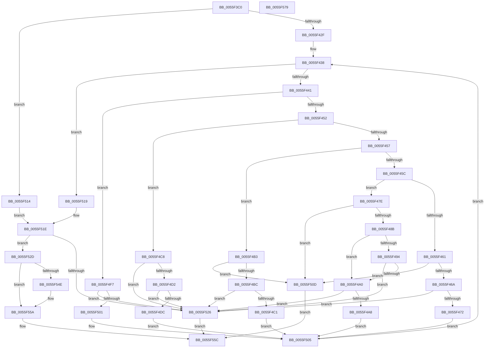

# EmonReserveProfileResourcesEnhanced

- RVA: `0x0055F3C0`–`0x0055F57A` (길이 `442` bytes)
- VA: `0x000000014055F3C0`
- 실행 섹션: `.text`
- PDB 이름 있음: `예`; PDB Function 태그: `아니요`
- unwind 정보 RVA: `0x000C4928`
- 디코드: `128`개 명령, `442/442` bytes 표시
- 미해석 바이트: `0` (있으면 어셈블리에 `.byte`로 보존)

> 이 문서는 커널 이미지의 기계어와 PDB 기호를 분석해 생성했습니다. 4번과 5번은 함수 원형과 자료형을 바이너리 사용 방식에서 추정한 C 해석이며 원본 소스 복구 결과는 아닙니다.

## 1. Dependencies

- 직접 호출 지점: **4**; 고유 호출 대상: **3**
- 직접 호출자로 확인된 함수: **0**
- RIP 상대 이미지 참조: **3**

### Outgoing calls
- `0x0055F40B` → [EmonGetCountersBitmap](EmonGetCountersBitmap_function_0055D068.md) (function, `0x0055D068`)
- `0x0055F41B` → [EmonGetCountersBitmap](EmonGetCountersBitmap_function_0055D068.md) (function, `0x0055D068`)
- `0x0055F543` → [EmonAllocateResources](EmonAllocateResources_function_0055C40C.md) (function, `0x0055C40C`)
- `0x0055F551` → [HalpPmuGetNumberOfReservedCounters](../54/HalpPmuGetNumberOfReservedCounters_function_00547570.md) (function, `0x00547570`)

### Direct callers
- 이 함수 시작 RVA로 연결되는 직접 call은 확인되지 않았습니다. 간접 호출은 완전히 역산할 수 없습니다.

### Static image references
- `0x0055F47E` → RVA `0x00F8FDF8` (`.data`; read)
- `0x0055F48B` → RVA `0x00F8FE20` (`.data`; read)
- `0x0055F4B3` → RVA `0x00F8FDE0` (`.data`; read)

## 2. Other-region calls and transfers

- 다른 실행 섹션으로 향하는 call: **0**
- 별도 외부 분기/꼬리 이동을 확인하지 못했습니다.

## 3. Assembly (complete function range)

```asm
0055F3C0  48 8B C4                        mov rax, rsp
0055F3C3  48 89 58 10                     mov qword ptr [rax + 0x10], rbx
0055F3C7  48 89 68 18                     mov qword ptr [rax + 0x18], rbp
0055F3CB  48 89 70 20                     mov qword ptr [rax + 0x20], rsi
0055F3CF  48 89 48 08                     mov qword ptr [rax + 8], rcx
0055F3D3  57                              push rdi
0055F3D4  41 54                           push r12
0055F3D6  41 55                           push r13
0055F3D8  41 56                           push r14
0055F3DA  41 57                           push r15
0055F3DC  48 83 EC 30                     sub rsp, 0x30
0055F3E0  49 83 08 FF                     or qword ptr [r8], 0xffffffffffffffff
0055F3E4  4C 8B DA                        mov r11, rdx
0055F3E7  65 44 8B 14 25 A4 01 00 00      mov r10d, dword ptr gs:[0x1a4]
0055F3F0  4C 8B E1                        mov r12, rcx
0055F3F3  33 FF                           xor edi, edi
0055F3F5  41 8B CA                        mov ecx, r10d
0055F3F8  4D 8B E9                        mov r13, r9
0055F3FB  4D 8B F0                        mov r14, r8
0055F3FE  41 BF 4E 6F 6E 65               mov r15d, 0x656e6f4e
0055F404  33 F6                           xor esi, esi
0055F406  33 ED                           xor ebp, ebp
0055F408  8D 57 01                        lea edx, [rdi + 1]
0055F40B  E8 58 DC FF FF                  call 0x14055d068
0055F410  8B D8                           mov ebx, eax
0055F412  33 D2                           xor edx, edx
0055F414  41 8B CA                        mov ecx, r10d
0055F417  48 C1 E3 20                     shl rbx, 0x20
0055F41B  E8 48 DC FF FF                  call 0x14055d068
0055F420  44 8B D0                        mov r10d, eax
0055F423  49 0B DA                        or rbx, r10
0055F426  4D 85 DB                        test r11, r11
0055F429  0F 84 E5 00 00 00               je 0x14055f514
0055F42F  45 8B 23                        mov r12d, dword ptr [r11]
0055F432  45 33 D2                        xor r10d, r10d
0055F435  45 33 C9                        xor r9d, r9d
0055F438  45 3B CC                        cmp r9d, r12d
0055F43B  0F 83 D8 00 00 00               jae 0x14055f519
0055F441  4B 8D 14 49                     lea rdx, [r9 + r9*2]
0055F445  41 8B 4C D3 08                  mov ecx, dword ptr [r11 + rdx*8 + 8]
0055F44A  85 C9                           test ecx, ecx
0055F44C  0F 84 A5 00 00 00               je 0x14055f4f7
0055F452  83 E9 01                        sub ecx, 1
0055F455  74 71                           je 0x14055f4c8
0055F457  83 E9 02                        sub ecx, 2
0055F45A  74 57                           je 0x14055f4b3
0055F45C  83 E9 01                        sub ecx, 1
0055F45F  74 1D                           je 0x14055f47e
0055F461  83 F9 01                        cmp ecx, 1
0055F464  0F 85 A3 00 00 00               jne 0x14055f50d
0055F46A  3B F9                           cmp edi, ecx
0055F46C  0F 83 B4 00 00 00               jae 0x14055f526
0055F472  45 8B 7C D3 10                  mov r15d, dword ptr [r11 + rdx*8 + 0x10]
0055F477  FF C7                           inc edi
0055F479  E9 87 00 00 00                  jmp 0x14055f505
0055F47E  80 3D 73 09 A3 00 00            cmp byte ptr [rip + 0xa30973], 0
0055F485  0F 84 82 00 00 00               je 0x14055f50d
0055F48B  83 3D 8E 09 A3 00 00            cmp dword ptr [rip + 0xa3098e], 0
0055F492  75 0C                           jne 0x14055f4a0
0055F494  41 83 7C D3 18 00               cmp dword ptr [r11 + rdx*8 + 0x18], 0
0055F49A  0F 84 86 00 00 00               je 0x14055f526
0055F4A0  41 83 7C D3 1C 00               cmp dword ptr [r11 + rdx*8 + 0x1c], 0
0055F4A6  74 7E                           je 0x14055f526
0055F4A8  49 8D 6B 10                     lea rbp, [r11 + 0x10]
0055F4AC  48 8D 6C D5 00                  lea rbp, [rbp + rdx*8]
0055F4B1  EB 52                           jmp 0x14055f505
0055F4B3  83 3D 26 09 A3 00 02            cmp dword ptr [rip + 0xa30926], 2
0055F4BA  72 51                           jb 0x14055f50d
0055F4BC  48 85 F6                        test rsi, rsi
0055F4BF  75 65                           jne 0x14055f526
0055F4C1  49 8B 74 D3 10                  mov rsi, qword ptr [r11 + rdx*8 + 0x10]
0055F4C6  EB 3D                           jmp 0x14055f505
0055F4C8  41 8B 4C D3 14                  mov ecx, dword ptr [r11 + rdx*8 + 0x14]
0055F4CD  83 F9 3F                        cmp ecx, 0x3f
0055F4D0  77 54                           ja 0x14055f526
0055F4D2  45 8B 44 D3 10                  mov r8d, dword ptr [r11 + rdx*8 + 0x10]
0055F4D7  41 3B C8                        cmp ecx, r8d
0055F4DA  72 4A                           jb 0x14055f526
0055F4DC  41 2B C8                        sub ecx, r8d
0055F4DF  B8 01 00 00 00                  mov eax, 1
0055F4E4  FF C1                           inc ecx
0055F4E6  48 D3 E0                        shl rax, cl
0055F4E9  41 8B C8                        mov ecx, r8d
0055F4EC  48 FF C8                        dec rax
0055F4EF  48 D3 E0                        shl rax, cl
0055F4F2  4C 0B D0                        or r10, rax
0055F4F5  EB 0E                           jmp 0x14055f505
0055F4F7  41 8B 44 D3 10                  mov eax, dword ptr [r11 + rdx*8 + 0x10]
0055F4FC  83 F8 3F                        cmp eax, 0x3f
0055F4FF  77 25                           ja 0x14055f526
0055F501  49 0F AB C2                     bts r10, rax
0055F505  41 FF C1                        inc r9d
0055F508  E9 2B FF FF FF                  jmp 0x14055f438
0055F50D  B8 BB 00 00 C0                  mov eax, 0xc00000bb
0055F512  EB 48                           jmp 0x14055f55c
0055F514  4C 8B D3                        mov r10, rbx
0055F517  EB 05                           jmp 0x14055f51e
0055F519  4C 8B 64 24 60                  mov r12, qword ptr [rsp + 0x60]
0055F51E  49 23 DA                        and rbx, r10
0055F521  49 3B DA                        cmp rbx, r10
0055F524  74 07                           je 0x14055f52d
0055F526  B8 0D 00 00 C0                  mov eax, 0xc000000d
0055F52B  EB 2F                           jmp 0x14055f55c
0055F52D  4C 89 74 24 28                  mov qword ptr [rsp + 0x28], r14
0055F532  4C 8B CD                        mov r9, rbp
0055F535  4D 8B C4                        mov r8, r12
0055F538  44 89 7C 24 20                  mov dword ptr [rsp + 0x20], r15d
0055F53D  48 8B D6                        mov rdx, rsi
0055F540  49 8B CA                        mov rcx, r10
0055F543  E8 C4 CE FF FF                  call 0x14055c40c
0055F548  8B D8                           mov ebx, eax
0055F54A  85 C0                           test eax, eax
0055F54C  78 0C                           js 0x14055f55a
0055F54E  49 8B 0E                        mov rcx, qword ptr [r14]
0055F551  E8 1A 80 FE FF                  call 0x140547570
0055F556  41 89 45 00                     mov dword ptr [r13], eax
0055F55A  8B C3                           mov eax, ebx
0055F55C  48 8B 5C 24 68                  mov rbx, qword ptr [rsp + 0x68]
0055F561  48 8B 6C 24 70                  mov rbp, qword ptr [rsp + 0x70]
0055F566  48 8B 74 24 78                  mov rsi, qword ptr [rsp + 0x78]
0055F56B  48 83 C4 30                     add rsp, 0x30
0055F56F  41 5F                           pop r15
0055F571  41 5E                           pop r14
0055F573  41 5D                           pop r13
0055F575  41 5C                           pop r12
0055F577  5F                              pop rdi
0055F578  C3                              ret
0055F579  CC                              int3
```

## 4. C-style interpretation (structured pseudocode)

```c
__int64 __fastcall EmonReserveProfileResourcesEnhanced(__int64 a1, __int64 a2, __int64 a3, __int64 a4)
{
    __int64 result;
    __int64 v_r10;
    __int64 v_rbp;
    __int64 v_rbx;
    __int64 v_rdi;
    __int64 v_rsi;
    __int64 v_rsp;
    unsigned __int64 v_stack_m30;
    unsigned int v_stack_m38;
    unsigned __int64 v_stack_p10;
    unsigned __int64 v_stack_p18;
    unsigned __int64 v_stack_p20;
    unsigned __int64 v_stack_p8;

    *(unsigned __int64 *)(v_rsp + 16) = v_rbx;
    *(unsigned __int64 *)(v_rsp + 24) = v_rbp;
    *(unsigned __int64 *)(v_rsp + 32) = v_rsi;
    *(unsigned __int64 *)(v_rsp + 8) = a1;
    v_rsp = (v_rsp) - (48);
    v_rdi = 0;
    v_rsi = 0;
    v_rbp = 0;
    result = EmonGetCountersBitmap((unsigned int)((unsigned int)((unsigned int)(*(unsigned int *)(gs_base + (0 + 420))))), v_rdi + 1, a3, a4);
    a2 = 0;
    v_rbx = ((unsigned int)((unsigned int)(result))) << (32);
    result = EmonGetCountersBitmap((unsigned int)((unsigned int)((unsigned int)(*(unsigned int *)(gs_base + (0 + 420))))), a2, a3, a4);
    v_rbx = (v_rbx) | ((unsigned int)((unsigned int)(result)));
    if (0 == 0) goto loc_0055F514;
    v_r10 = 0;
    a4 = 0;
loc_0055F438:
    if (0 >= ((unsigned int)((unsigned int)(*(unsigned int *)(a2))))) goto loc_0055F519;
    if ((unsigned int)((unsigned int)(*(unsigned int *)(a2 + a4 + a4 * 2 * 8 + 8))) == 0) goto loc_0055F4F7;
    a1 = (unsigned int)(((unsigned int)(*(unsigned int *)(a2 + a4 + a4 * 2 * 8 + 8))) - (1));
    if (condition_is_equal) goto loc_0055F4C8;
    a1 = (unsigned int)((a1) - (2));
    if (condition_is_equal) goto loc_0055F4B3;
    a1 = (unsigned int)((a1) - (1));
    if (condition_is_equal) goto loc_0055F47E;
    if (((unsigned int)(a1)) != 1) goto loc_0055F50D;
    if (0 >= ((unsigned int)(a1))) goto loc_0055F526;
    v_rdi = (unsigned int)((v_rdi) + 1);
    goto loc_0055F505;
loc_0055F47E:
    if ((*(unsigned __int8 *)(v_rip + 10684787)) == 0) goto loc_0055F50D;
    if ((*(unsigned int *)(v_rip + 10684814)) != 0) goto loc_0055F4A0;
    if ((*(unsigned int *)(a2 + a4 + a4 * 2 * 8 + 24)) == 0) goto loc_0055F526;
loc_0055F4A0:
    if ((*(unsigned int *)(a2 + a4 + a4 * 2 * 8 + 28)) == 0) goto loc_0055F526;
    goto loc_0055F505;
loc_0055F4B3:
    if ((*(unsigned int *)(v_rip + 10684710)) < 2) goto loc_0055F50D;
    if (0 != 0) goto loc_0055F526;
    goto loc_0055F505;
loc_0055F4C8:
    if (((unsigned int)((unsigned int)(*(unsigned int *)(a2 + a4 + a4 * 2 * 8 + 20)))) > 63) goto loc_0055F526;
    if (((unsigned int)((unsigned int)(*(unsigned int *)(a2 + a4 + a4 * 2 * 8 + 20)))) < ((unsigned int)((unsigned int)(*(unsigned int *)(a2 + a4 + a4 * 2 * 8 + 16))))) goto loc_0055F526;
    a1 = (unsigned int)(((unsigned int)(*(unsigned int *)(a2 + a4 + a4 * 2 * 8 + 20))) - ((unsigned int)((unsigned int)(*(unsigned int *)(a2 + a4 + a4 * 2 * 8 + 16)))));
    a1 = (unsigned int)((a1) + 1);
    result = (1) << ((unsigned __int8)(a1));
    result = (result) - 1;
    result = (result) << ((unsigned __int8)((unsigned int)((unsigned int)((unsigned int)(*(unsigned int *)(a2 + a4 + a4 * 2 * 8 + 16))))));
    v_r10 = (v_r10) | (result);
    goto loc_0055F505;
loc_0055F4F7:
    if (((unsigned int)((unsigned int)(*(unsigned int *)(a2 + a4 + a4 * 2 * 8 + 16)))) > 63) goto loc_0055F526;
loc_0055F505:
    a4 = (unsigned int)((a4) + 1);
    goto loc_0055F438;
loc_0055F50D:
    goto loc_0055F55C;
loc_0055F514:
    goto loc_0055F51E;
loc_0055F519:
loc_0055F51E:
    v_rbx = (v_rbx) & (v_rbx);
    if (v_rbx == v_rbx) goto loc_0055F52D;
loc_0055F526:
    goto loc_0055F55C;
loc_0055F52D:
    v_stack_m30 = a3;
    v_stack_m38 = (unsigned int)((unsigned int)(*(unsigned int *)(a2 + a4 + a4 * 2 * 8 + 16)));
    result = EmonAllocateResources(v_rbx, *(unsigned __int64 *)(a2 + a4 + a4 * 2 * 8 + 16), v_stack_p8, a2 + 16 + a4 + a4 * 2 * 8);
    if (!(sign_flag)) {
        a1 = *(unsigned __int64 *)(a3);
        result = HalpPmuGetNumberOfReservedCounters(a1, *(unsigned __int64 *)(a2 + a4 + a4 * 2 * 8 + 16), v_stack_p8, a2 + 16 + a4 + a4 * 2 * 8);
        *(unsigned int *)(a4) = (unsigned int)(result);
    }
loc_0055F55C:
    v_rsp = (v_rsp) + (48);
    return (unsigned int)((unsigned int)((unsigned int)((unsigned int)(result))));
}
```

## 5. (Beta) C Style

```c
int64_t EmonReserveProfileResourcesEnhanced(int64_t Arg1, int64_t Arg2, void *Arg3, void *Arg4)
{
    uint8_t *arg3 = (uint8_t *)Arg3;
    uint8_t *arg4 = (uint8_t *)Arg4;

    int64_t result;
    int64_t local_r10;
    int64_t local_rbp;
    int64_t local_rbx;
    int64_t local_rdi;
    int64_t local_rsi;
    int64_t local_rsp;
    uint64_t v_stack_m30;
    uint32_t v_stack_m38;
    uint64_t v_stack_p10;
    uint64_t v_stack_p18;
    uint64_t v_stack_p20;
    uint64_t v_stack_p8;

    *(uint64_t *)(local_rsp + 0x10) = local_rbx;
    *(uint64_t *)(local_rsp + 0x18) = local_rbp;
    *(uint64_t *)(local_rsp + 0x20) = local_rsi;
    *(uint64_t *)(local_rsp + 0x8) = Arg1;
    local_rsp = (local_rsp) - (48);
    local_rdi = 0;
    local_rsi = 0;
    local_rbp = 0;
    result = EmonGetCountersBitmap((uint32_t)((uint32_t)((uint32_t)(*(uint32_t *)(gs_base + (0 + 0x1A4))))), local_rdi + 1, Arg3, Arg4);
    Arg2 = 0;
    local_rbx = ((uint32_t)((uint32_t)(result))) << (32);
    result = EmonGetCountersBitmap((uint32_t)((uint32_t)((uint32_t)(*(uint32_t *)(gs_base + (0 + 0x1A4))))), Arg2, Arg3, Arg4);
    local_rbx = (local_rbx) | ((uint32_t)((uint32_t)(result)));
    if (0 == 0) goto loc_0055F514;
    local_r10 = 0;
    Arg4 = 0;
loc_0055F438:
    if (0 >= ((uint32_t)((uint32_t)(*(uint32_t *)(Arg2))))) goto loc_0055F519;
    if ((uint32_t)((uint32_t)(*(uint32_t *)(Arg2 + arg4 + arg4 * 2 * 8 + 0x8))) == 0) goto loc_0055F4F7;
    Arg1 = (uint32_t)(((uint32_t)(*(uint32_t *)(Arg2 + arg4 + arg4 * 2 * 8 + 0x8))) - (1));
    if (condition_is_equal) goto loc_0055F4C8;
    Arg1 = (uint32_t)((Arg1) - (2));
    if (condition_is_equal) goto loc_0055F4B3;
    Arg1 = (uint32_t)((Arg1) - (1));
    if (condition_is_equal) goto loc_0055F47E;
    if (((uint32_t)(Arg1)) != 1) goto loc_0055F50D;
    if (0 >= ((uint32_t)(Arg1))) goto loc_0055F526;
    local_rdi = (uint32_t)((local_rdi) + 1);
    goto loc_0055F505;
loc_0055F47E:
    if ((*(uint8_t *)(v_rip + 0xA30973)) == 0) goto loc_0055F50D;
    if ((*(uint32_t *)(v_rip + 0xA3098E)) != 0) goto loc_0055F4A0;
    if ((*(uint32_t *)(Arg2 + arg4 + arg4 * 2 * 8 + 0x18)) == 0) goto loc_0055F526;
loc_0055F4A0:
    if ((*(uint32_t *)(Arg2 + arg4 + arg4 * 2 * 8 + 0x1C)) == 0) goto loc_0055F526;
    goto loc_0055F505;
loc_0055F4B3:
    if ((*(uint32_t *)(v_rip + 0xA30926)) < 2) goto loc_0055F50D;
    if (0 != 0) goto loc_0055F526;
    goto loc_0055F505;
loc_0055F4C8:
    if (((uint32_t)((uint32_t)(*(uint32_t *)(Arg2 + arg4 + arg4 * 2 * 8 + 0x14)))) > 63) goto loc_0055F526;
    if (((uint32_t)((uint32_t)(*(uint32_t *)(Arg2 + arg4 + arg4 * 2 * 8 + 0x14)))) < ((uint32_t)((uint32_t)(*(uint32_t *)(Arg2 + arg4 + arg4 * 2 * 8 + 0x10))))) goto loc_0055F526;
    Arg1 = (uint32_t)(((uint32_t)(*(uint32_t *)(Arg2 + arg4 + arg4 * 2 * 8 + 0x14))) - ((uint32_t)((uint32_t)(*(uint32_t *)(Arg2 + arg4 + arg4 * 2 * 8 + 0x10)))));
    Arg1 = (uint32_t)((Arg1) + 1);
    result = (1) << ((uint8_t)(Arg1));
    result = (result) - 1;
    result = (result) << ((uint8_t)((uint32_t)((uint32_t)((uint32_t)(*(uint32_t *)(Arg2 + arg4 + arg4 * 2 * 8 + 0x10))))));
    local_r10 = (local_r10) | (result);
    goto loc_0055F505;
loc_0055F4F7:
    if (((uint32_t)((uint32_t)(*(uint32_t *)(Arg2 + arg4 + arg4 * 2 * 8 + 0x10)))) > 63) goto loc_0055F526;
loc_0055F505:
    Arg4 = (uint32_t)((Arg4) + 1);
    goto loc_0055F438;
loc_0055F50D:
    goto loc_0055F55C;
loc_0055F514:
    goto loc_0055F51E;
loc_0055F519:
loc_0055F51E:
    local_rbx = (local_rbx) & (local_rbx);
    if (local_rbx == local_rbx) goto loc_0055F52D;
loc_0055F526:
    goto loc_0055F55C;
loc_0055F52D:
    v_stack_m30 = Arg3;
    v_stack_m38 = (uint32_t)((uint32_t)(*(uint32_t *)(Arg2 + arg4 + arg4 * 2 * 8 + 0x10)));
    result = EmonAllocateResources(local_rbx, *(uint64_t *)(Arg2 + arg4 + arg4 * 2 * 8 + 0x10), v_stack_p8, Arg2 + 16 + Arg4 + Arg4 * 2 * 8);
    if (!(sign_flag)) {
        Arg1 = *(uint64_t *)(arg3);
        result = HalpPmuGetNumberOfReservedCounters(Arg1, *(uint64_t *)(Arg2 + arg4 + arg4 * 2 * 8 + 0x10), v_stack_p8, Arg2 + 16 + Arg4 + Arg4 * 2 * 8);
        *(uint32_t *)(arg4) = (uint32_t)(result);
    }
loc_0055F55C:
    local_rsp = (local_rsp) + (48);
    return (uint32_t)((uint32_t)((uint32_t)((uint32_t)(result))));
}
```

### 관측된 메모리 오프셋

구조체 형식이 확인되지 않은 접근은 인자 기준의 오프셋으로만 기록했습니다.

| 기준 인자 | 오프셋 표현 | 폭 (bit) | 접근 |
|---|---:|---:|---|
| `Arg3` | `+ 0x0` | `64` | `R` |
| `Arg3` | `+ 0x0` | `64` | `R/W` |
| `Arg4` | `+ 0x0` | `32` | `W` |

## 6. Execution-region graph

[열기: 2D/3D 그래프와 함수 탐색 컨트롤 패널](../../../control-panel.html?section=text&rva=0x0055F3C0&view=graph)

- 2D 그래프는 위에서 아래로 흐르고, 3D 그래프는 빈 공간을 드래그해 회전합니다. Shift+드래그는 이동, 휠은 확대·축소, 함수 노드 선택은 대상 보고서 이동입니다.

### Static fallback


