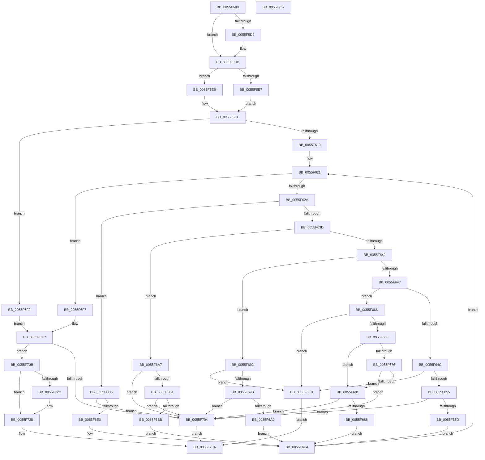

# EmonReserveProfileResourcesOriginal

- RVA: `0x0055F580`–`0x0055F758` (길이 `472` bytes)
- VA: `0x000000014055F580`
- 실행 섹션: `.text`
- PDB 이름 있음: `예`; PDB Function 태그: `아니요`
- unwind 정보 RVA: `0x000C4928`
- 디코드: `141`개 명령, `472/472` bytes 표시
- 미해석 바이트: `0` (있으면 어셈블리에 `.byte`로 보존)

> 이 문서는 커널 이미지의 기계어와 PDB 기호를 분석해 생성했습니다. 4번과 5번은 함수 원형과 자료형을 바이너리 사용 방식에서 추정한 C 해석이며 원본 소스 복구 결과는 아닙니다.

## 1. Dependencies

- 직접 호출 지점: **2**; 고유 호출 대상: **2**
- 직접 호출자로 확인된 함수: **0**
- RIP 상대 이미지 참조: **4**

### Outgoing calls
- `0x0055F721` → [EmonAllocateResources](EmonAllocateResources_function_0055C40C.md) (function, `0x0055C40C`)
- `0x0055F72F` → [HalpPmuGetNumberOfReservedCounters](../54/HalpPmuGetNumberOfReservedCounters_function_00547570.md) (function, `0x00547570`)

### Direct callers
- 이 함수 시작 RVA로 연결되는 직접 call은 확인되지 않았습니다. 간접 호출은 완전히 역산할 수 없습니다.

### Static image references
- `0x0055F5B6` → RVA `0x00FC8C40` (`ALMOSTRO`; read)
- `0x0055F666` → RVA `0x00F8FDF8` (`.data`; read)
- `0x0055F66E` → RVA `0x00F8FE20` (`.data`; read)
- `0x0055F692` → RVA `0x00F8FDE0` (`.data`; read)

## 2. Other-region calls and transfers

- 다른 실행 섹션으로 향하는 call: **0**
- 별도 외부 분기/꼬리 이동을 확인하지 못했습니다.

## 3. Assembly (complete function range)

```asm
0055F580  48 8B C4                        mov rax, rsp
0055F583  48 89 58 10                     mov qword ptr [rax + 0x10], rbx
0055F587  48 89 68 18                     mov qword ptr [rax + 0x18], rbp
0055F58B  48 89 70 20                     mov qword ptr [rax + 0x20], rsi
0055F58F  48 89 48 08                     mov qword ptr [rax + 8], rcx
0055F593  57                              push rdi
0055F594  41 54                           push r12
0055F596  41 55                           push r13
0055F598  41 56                           push r14
0055F59A  41 57                           push r15
0055F59C  48 83 EC 30                     sub rsp, 0x30
0055F5A0  49 83 08 FF                     or qword ptr [r8], 0xffffffffffffffff
0055F5A4  49 8B F8                        mov rdi, r8
0055F5A7  65 8B 04 25 A4 01 00 00         mov eax, dword ptr gs:[0x1a4]
0055F5AF  33 F6                           xor esi, esi
0055F5B1  44 8B D0                        mov r10d, eax
0055F5B4  33 ED                           xor ebp, ebp
0055F5B6  48 8D 05 83 96 A6 00            lea rax, [rip + 0xa69683]
0055F5BD  45 33 F6                        xor r14d, r14d
0055F5C0  4D 8B E9                        mov r13, r9
0055F5C3  4C 8B D9                        mov r11, rcx
0055F5C6  41 BF 4E 6F 6E 65               mov r15d, 0x656e6f4e
0055F5CC  4A 8B 04 D0                     mov rax, qword ptr [rax + r10*8]
0055F5D0  4C 8B 40 58                     mov r8, qword ptr [rax + 0x58]
0055F5D4  4D 85 C0                        test r8, r8
0055F5D7  74 04                           je 0x14055f5dd
0055F5D9  45 8B 40 04                     mov r8d, dword ptr [r8 + 4]
0055F5DD  48 8B 40 58                     mov rax, qword ptr [rax + 0x58]
0055F5E1  48 83 C0 18                     add rax, 0x18
0055F5E5  75 04                           jne 0x14055f5eb
0055F5E7  33 C9                           xor ecx, ecx
0055F5E9  EB 03                           jmp 0x14055f5ee
0055F5EB  8B 48 04                        mov ecx, dword ptr [rax + 4]
0055F5EE  41 BA 01 00 00 00               mov r10d, 1
0055F5F4  45 8B CA                        mov r9d, r10d
0055F5F7  41 8B C2                        mov eax, r10d
0055F5FA  49 D3 E1                        shl r9, cl
0055F5FD  41 8B C8                        mov ecx, r8d
0055F600  4D 2B CA                        sub r9, r10
0055F603  48 D3 E0                        shl rax, cl
0055F606  49 2B C2                        sub rax, r10
0055F609  49 C1 E1 20                     shl r9, 0x20
0055F60D  4C 0B C8                        or r9, rax
0055F610  48 85 D2                        test rdx, rdx
0055F613  0F 84 D9 00 00 00               je 0x14055f6f2
0055F619  44 8B 22                        mov r12d, dword ptr [rdx]
0055F61C  45 33 D2                        xor r10d, r10d
0055F61F  33 DB                           xor ebx, ebx
0055F621  41 3B DC                        cmp ebx, r12d
0055F624  0F 83 CD 00 00 00               jae 0x14055f6f7
0055F62A  4C 8D 04 5B                     lea r8, [rbx + rbx*2]
0055F62E  33 C0                           xor eax, eax
0055F630  42 8B 4C C2 08                  mov ecx, dword ptr [rdx + r8*8 + 8]
0055F635  85 C9                           test ecx, ecx
0055F637  0F 84 99 00 00 00               je 0x14055f6d6
0055F63D  83 E9 01                        sub ecx, 1
0055F640  74 65                           je 0x14055f6a7
0055F642  83 E9 02                        sub ecx, 2
0055F645  74 4B                           je 0x14055f692
0055F647  83 E9 01                        sub ecx, 1
0055F64A  74 1A                           je 0x14055f666
0055F64C  83 F9 01                        cmp ecx, 1
0055F64F  0F 85 96 00 00 00               jne 0x14055f6eb
0055F655  3B F1                           cmp esi, ecx
0055F657  0F 83 A7 00 00 00               jae 0x14055f704
0055F65D  46 8B 7C C2 10                  mov r15d, dword ptr [rdx + r8*8 + 0x10]
0055F662  FF C6                           inc esi
0055F664  EB 7E                           jmp 0x14055f6e4
0055F666  38 05 8C 07 A3 00               cmp byte ptr [rip + 0xa3078c], al
0055F66C  74 7D                           je 0x14055f6eb
0055F66E  39 05 AC 07 A3 00               cmp dword ptr [rip + 0xa307ac], eax
0055F674  75 0B                           jne 0x14055f681
0055F676  42 39 44 C2 18                  cmp dword ptr [rdx + r8*8 + 0x18], eax
0055F67B  0F 84 83 00 00 00               je 0x14055f704
0055F681  42 39 44 C2 1C                  cmp dword ptr [rdx + r8*8 + 0x1c], eax
0055F686  74 7C                           je 0x14055f704
0055F688  4C 8D 72 10                     lea r14, [rdx + 0x10]
0055F68C  4F 8D 34 C6                     lea r14, [r14 + r8*8]
0055F690  EB 52                           jmp 0x14055f6e4
0055F692  83 3D 47 07 A3 00 02            cmp dword ptr [rip + 0xa30747], 2
0055F699  72 50                           jb 0x14055f6eb
0055F69B  48 85 ED                        test rbp, rbp
0055F69E  75 64                           jne 0x14055f704
0055F6A0  4A 8B 6C C2 10                  mov rbp, qword ptr [rdx + r8*8 + 0x10]
0055F6A5  EB 3D                           jmp 0x14055f6e4
0055F6A7  42 8B 4C C2 14                  mov ecx, dword ptr [rdx + r8*8 + 0x14]
0055F6AC  83 F9 3F                        cmp ecx, 0x3f
0055F6AF  77 53                           ja 0x14055f704
0055F6B1  46 8B 5C C2 10                  mov r11d, dword ptr [rdx + r8*8 + 0x10]
0055F6B6  41 3B CB                        cmp ecx, r11d
0055F6B9  72 49                           jb 0x14055f704
0055F6BB  41 2B CB                        sub ecx, r11d
0055F6BE  B8 01 00 00 00                  mov eax, 1
0055F6C3  FF C1                           inc ecx
0055F6C5  48 D3 E0                        shl rax, cl
0055F6C8  41 8B CB                        mov ecx, r11d
0055F6CB  48 FF C8                        dec rax
0055F6CE  48 D3 E0                        shl rax, cl
0055F6D1  4C 0B D0                        or r10, rax
0055F6D4  EB 0E                           jmp 0x14055f6e4
0055F6D6  42 8B 44 C2 10                  mov eax, dword ptr [rdx + r8*8 + 0x10]
0055F6DB  83 F8 3F                        cmp eax, 0x3f
0055F6DE  77 24                           ja 0x14055f704
0055F6E0  49 0F AB C2                     bts r10, rax
0055F6E4  FF C3                           inc ebx
0055F6E6  E9 36 FF FF FF                  jmp 0x14055f621
0055F6EB  B8 BB 00 00 C0                  mov eax, 0xc00000bb
0055F6F0  EB 48                           jmp 0x14055f73a
0055F6F2  4D 8B D1                        mov r10, r9
0055F6F5  EB 05                           jmp 0x14055f6fc
0055F6F7  4C 8B 5C 24 60                  mov r11, qword ptr [rsp + 0x60]
0055F6FC  4D 23 CA                        and r9, r10
0055F6FF  4D 3B CA                        cmp r9, r10
0055F702  74 07                           je 0x14055f70b
0055F704  B8 0D 00 00 C0                  mov eax, 0xc000000d
0055F709  EB 2F                           jmp 0x14055f73a
0055F70B  48 89 7C 24 28                  mov qword ptr [rsp + 0x28], rdi
0055F710  4D 8B CE                        mov r9, r14
0055F713  4D 8B C3                        mov r8, r11
0055F716  44 89 7C 24 20                  mov dword ptr [rsp + 0x20], r15d
0055F71B  48 8B D5                        mov rdx, rbp
0055F71E  49 8B CA                        mov rcx, r10
0055F721  E8 E6 CC FF FF                  call 0x14055c40c
0055F726  8B D8                           mov ebx, eax
0055F728  85 C0                           test eax, eax
0055F72A  78 0C                           js 0x14055f738
0055F72C  48 8B 0F                        mov rcx, qword ptr [rdi]
0055F72F  E8 3C 7E FE FF                  call 0x140547570
0055F734  41 89 45 00                     mov dword ptr [r13], eax
0055F738  8B C3                           mov eax, ebx
0055F73A  48 8B 5C 24 68                  mov rbx, qword ptr [rsp + 0x68]
0055F73F  48 8B 6C 24 70                  mov rbp, qword ptr [rsp + 0x70]
0055F744  48 8B 74 24 78                  mov rsi, qword ptr [rsp + 0x78]
0055F749  48 83 C4 30                     add rsp, 0x30
0055F74D  41 5F                           pop r15
0055F74F  41 5E                           pop r14
0055F751  41 5D                           pop r13
0055F753  41 5C                           pop r12
0055F755  5F                              pop rdi
0055F756  C3                              ret
0055F757  CC                              int3
```

## 4. C-style interpretation (structured pseudocode)

```c
__int64 __fastcall EmonReserveProfileResourcesOriginal(__int64 a1, __int64 a2, __int64 a3, __int64 a4)
{
    __int64 result;
    __int64 v_r10;
    __int64 v_r14;
    __int64 v_rbp;
    __int64 v_rbx;
    __int64 v_rsi;
    __int64 v_rsp;
    unsigned __int64 v_stack_m30;
    unsigned int v_stack_m38;
    unsigned __int64 v_stack_p10;
    unsigned __int64 v_stack_p18;
    unsigned __int64 v_stack_p20;
    unsigned __int64 v_stack_p8;

    *(unsigned __int64 *)(v_rsp + 16) = v_rbx;
    *(unsigned __int64 *)(v_rsp + 24) = v_rbp;
    *(unsigned __int64 *)(v_rsp + 32) = v_rsi;
    *(unsigned __int64 *)(v_rsp + 8) = a1;
    v_rsp = (v_rsp) - (48);
    v_rsi = 0;
    v_rbp = 0;
    v_r14 = 0;
    if (*(unsigned __int64 *)(*(unsigned __int64 *)(v_rip + 10917507 + (unsigned int)((unsigned int)((unsigned int)(*(unsigned int *)(gs_base + (0 + 420))))) * 8) + 88) != 0) {
        a3 = *(unsigned int *)(*(unsigned __int64 *)(*(unsigned __int64 *)(v_rip + 10917507 + (unsigned int)((unsigned int)((unsigned int)(*(unsigned int *)(gs_base + (0 + 420))))) * 8) + 88) + 4);
    }
    result = (*(unsigned __int64 *)(*(unsigned __int64 *)(v_rip + 10917507 + (unsigned int)((unsigned int)((unsigned int)(*(unsigned int *)(gs_base + (0 + 420))))) * 8) + 88)) + (24);
    if (condition_is_not_equal) goto loc_0055F5EB;
    a1 = 0;
    goto loc_0055F5EE;
loc_0055F5EB:
loc_0055F5EE:
    a4 = (1) << ((unsigned __int8)((unsigned int)(*(unsigned int *)(result + 4))));
    a4 = (a4) - (1);
    result = (1) << ((unsigned __int8)((unsigned int)((unsigned int)(a3))));
    result = (result) - (1);
    a4 = (a4) << (32);
    a4 = (a4) | (result);
    if (a2 == 0) goto loc_0055F6F2;
    v_r10 = 0;
    v_rbx = 0;
loc_0055F621:
    if (0 >= ((unsigned int)((unsigned int)(*(unsigned int *)(a2))))) goto loc_0055F6F7;
    result = 0;
    if ((unsigned int)((unsigned int)(*(unsigned int *)(a2 + v_rbx + v_rbx * 2 * 8 + 8))) == 0) goto loc_0055F6D6;
    a1 = (unsigned int)(((unsigned int)(*(unsigned int *)(a2 + v_rbx + v_rbx * 2 * 8 + 8))) - (1));
    if (condition_is_equal) goto loc_0055F6A7;
    a1 = (unsigned int)((a1) - (2));
    if (condition_is_equal) goto loc_0055F692;
    a1 = (unsigned int)((a1) - (1));
    if (condition_is_equal) goto loc_0055F666;
    if (((unsigned int)(a1)) != 1) goto loc_0055F6EB;
    if (0 >= ((unsigned int)(a1))) goto loc_0055F704;
    v_rsi = (unsigned int)((v_rsi) + 1);
    goto loc_0055F6E4;
loc_0055F666:
    if ((*(unsigned __int8 *)(v_rip + 10684300)) == 0) goto loc_0055F6EB;
    if ((*(unsigned int *)(v_rip + 10684332)) != 0) goto loc_0055F681;
    if ((*(unsigned int *)(a2 + v_rbx + v_rbx * 2 * 8 + 24)) == 0) goto loc_0055F704;
loc_0055F681:
    if ((*(unsigned int *)(a2 + v_rbx + v_rbx * 2 * 8 + 28)) == 0) goto loc_0055F704;
    goto loc_0055F6E4;
loc_0055F692:
    if ((*(unsigned int *)(v_rip + 10684231)) < 2) goto loc_0055F6EB;
    if (0 != 0) goto loc_0055F704;
    goto loc_0055F6E4;
loc_0055F6A7:
    if (((unsigned int)((unsigned int)(*(unsigned int *)(a2 + v_rbx + v_rbx * 2 * 8 + 20)))) > 63) goto loc_0055F704;
    if (((unsigned int)((unsigned int)(*(unsigned int *)(a2 + v_rbx + v_rbx * 2 * 8 + 20)))) < ((unsigned int)((unsigned int)(*(unsigned int *)(a2 + v_rbx + v_rbx * 2 * 8 + 16))))) goto loc_0055F704;
    a1 = (unsigned int)(((unsigned int)(*(unsigned int *)(a2 + v_rbx + v_rbx * 2 * 8 + 20))) - ((unsigned int)((unsigned int)(*(unsigned int *)(a2 + v_rbx + v_rbx * 2 * 8 + 16)))));
    a1 = (unsigned int)((a1) + 1);
    result = (1) << ((unsigned __int8)(a1));
    result = (result) - 1;
    result = (result) << ((unsigned __int8)((unsigned int)((unsigned int)((unsigned int)(*(unsigned int *)(a2 + v_rbx + v_rbx * 2 * 8 + 16))))));
    v_r10 = (v_r10) | (result);
    goto loc_0055F6E4;
loc_0055F6D6:
    if (((unsigned int)((unsigned int)(*(unsigned int *)(a2 + v_rbx + v_rbx * 2 * 8 + 16)))) > 63) goto loc_0055F704;
loc_0055F6E4:
    v_rbx = (unsigned int)((v_rbx) + 1);
    goto loc_0055F621;
loc_0055F6EB:
    goto loc_0055F73A;
loc_0055F6F2:
    goto loc_0055F6FC;
loc_0055F6F7:
loc_0055F6FC:
    a4 = (a4) & (a4);
    if (a4 == a4) goto loc_0055F70B;
loc_0055F704:
    goto loc_0055F73A;
loc_0055F70B:
    v_stack_m30 = a3;
    v_stack_m38 = (unsigned int)((unsigned int)(*(unsigned int *)(a2 + v_rbx + v_rbx * 2 * 8 + 16)));
    result = EmonAllocateResources(a4, *(unsigned __int64 *)(a2 + v_rbx + v_rbx * 2 * 8 + 16), v_stack_p8, a2 + 16 + v_rbx + v_rbx * 2 * 8);
    if (!(sign_flag)) {
        a1 = *(unsigned __int64 *)(a3);
        result = HalpPmuGetNumberOfReservedCounters(a1, *(unsigned __int64 *)(a2 + v_rbx + v_rbx * 2 * 8 + 16), v_stack_p8, a2 + 16 + v_rbx + v_rbx * 2 * 8);
        *(unsigned int *)(a4) = (unsigned int)(result);
    }
loc_0055F73A:
    v_rsp = (v_rsp) + (48);
    return (unsigned int)((unsigned int)((unsigned int)((unsigned int)(result))));
}
```

## 5. (Beta) C Style

```c
int64_t EmonReserveProfileResourcesOriginal(int64_t Arg1, int64_t Arg2, void *Arg3, void *Arg4)
{
    uint8_t *arg3 = (uint8_t *)Arg3;
    uint8_t *arg4 = (uint8_t *)Arg4;

    int64_t result;
    int64_t local_r10;
    int64_t local_r14;
    int64_t local_rbp;
    int64_t local_rbx;
    int64_t local_rsi;
    int64_t local_rsp;
    uint64_t v_stack_m30;
    uint32_t v_stack_m38;
    uint64_t v_stack_p10;
    uint64_t v_stack_p18;
    uint64_t v_stack_p20;
    uint64_t v_stack_p8;

    *(uint64_t *)(local_rsp + 0x10) = local_rbx;
    *(uint64_t *)(local_rsp + 0x18) = local_rbp;
    *(uint64_t *)(local_rsp + 0x20) = local_rsi;
    *(uint64_t *)(local_rsp + 0x8) = Arg1;
    local_rsp = (local_rsp) - (48);
    local_rsi = 0;
    local_rbp = 0;
    local_r14 = 0;
    if (*(uint64_t *)(*(uint64_t *)(v_rip + 0xA69683 + (uint32_t)((uint32_t)((uint32_t)(*(uint32_t *)(gs_base + (0 + 0x1A4))))) * 8) + 0x58) != 0) {
        Arg3 = *(uint32_t *)(*(uint64_t *)(*(uint64_t *)(v_rip + 0xA69683 + (uint32_t)((uint32_t)((uint32_t)(*(uint32_t *)(gs_base + (0 + 0x1A4))))) * 8) + 0x58) + 0x4);
    }
    result = (*(uint64_t *)(*(uint64_t *)(v_rip + 0xA69683 + (uint32_t)((uint32_t)((uint32_t)(*(uint32_t *)(gs_base + (0 + 0x1A4))))) * 8) + 0x58)) + (24);
    if (condition_is_not_equal) goto loc_0055F5EB;
    Arg1 = 0;
    goto loc_0055F5EE;
loc_0055F5EB:
loc_0055F5EE:
    Arg4 = (1) << ((uint8_t)((uint32_t)(*(uint32_t *)(result + 0x4))));
    Arg4 = (Arg4) - (1);
    result = (1) << ((uint8_t)((uint32_t)((uint32_t)(Arg3))));
    result = (result) - (1);
    Arg4 = (Arg4) << (32);
    Arg4 = (Arg4) | (result);
    if (Arg2 == 0) goto loc_0055F6F2;
    local_r10 = 0;
    local_rbx = 0;
loc_0055F621:
    if (0 >= ((uint32_t)((uint32_t)(*(uint32_t *)(Arg2))))) goto loc_0055F6F7;
    result = 0;
    if ((uint32_t)((uint32_t)(*(uint32_t *)(Arg2 + local_rbx + local_rbx * 2 * 8 + 0x8))) == 0) goto loc_0055F6D6;
    Arg1 = (uint32_t)(((uint32_t)(*(uint32_t *)(Arg2 + local_rbx + local_rbx * 2 * 8 + 0x8))) - (1));
    if (condition_is_equal) goto loc_0055F6A7;
    Arg1 = (uint32_t)((Arg1) - (2));
    if (condition_is_equal) goto loc_0055F692;
    Arg1 = (uint32_t)((Arg1) - (1));
    if (condition_is_equal) goto loc_0055F666;
    if (((uint32_t)(Arg1)) != 1) goto loc_0055F6EB;
    if (0 >= ((uint32_t)(Arg1))) goto loc_0055F704;
    local_rsi = (uint32_t)((local_rsi) + 1);
    goto loc_0055F6E4;
loc_0055F666:
    if ((*(uint8_t *)(v_rip + 0xA3078C)) == 0) goto loc_0055F6EB;
    if ((*(uint32_t *)(v_rip + 0xA307AC)) != 0) goto loc_0055F681;
    if ((*(uint32_t *)(Arg2 + local_rbx + local_rbx * 2 * 8 + 0x18)) == 0) goto loc_0055F704;
loc_0055F681:
    if ((*(uint32_t *)(Arg2 + local_rbx + local_rbx * 2 * 8 + 0x1C)) == 0) goto loc_0055F704;
    goto loc_0055F6E4;
loc_0055F692:
    if ((*(uint32_t *)(v_rip + 0xA30747)) < 2) goto loc_0055F6EB;
    if (0 != 0) goto loc_0055F704;
    goto loc_0055F6E4;
loc_0055F6A7:
    if (((uint32_t)((uint32_t)(*(uint32_t *)(Arg2 + local_rbx + local_rbx * 2 * 8 + 0x14)))) > 63) goto loc_0055F704;
    if (((uint32_t)((uint32_t)(*(uint32_t *)(Arg2 + local_rbx + local_rbx * 2 * 8 + 0x14)))) < ((uint32_t)((uint32_t)(*(uint32_t *)(Arg2 + local_rbx + local_rbx * 2 * 8 + 0x10))))) goto loc_0055F704;
    Arg1 = (uint32_t)(((uint32_t)(*(uint32_t *)(Arg2 + local_rbx + local_rbx * 2 * 8 + 0x14))) - ((uint32_t)((uint32_t)(*(uint32_t *)(Arg2 + local_rbx + local_rbx * 2 * 8 + 0x10)))));
    Arg1 = (uint32_t)((Arg1) + 1);
    result = (1) << ((uint8_t)(Arg1));
    result = (result) - 1;
    result = (result) << ((uint8_t)((uint32_t)((uint32_t)((uint32_t)(*(uint32_t *)(Arg2 + local_rbx + local_rbx * 2 * 8 + 0x10))))));
    local_r10 = (local_r10) | (result);
    goto loc_0055F6E4;
loc_0055F6D6:
    if (((uint32_t)((uint32_t)(*(uint32_t *)(Arg2 + local_rbx + local_rbx * 2 * 8 + 0x10)))) > 63) goto loc_0055F704;
loc_0055F6E4:
    local_rbx = (uint32_t)((local_rbx) + 1);
    goto loc_0055F621;
loc_0055F6EB:
    goto loc_0055F73A;
loc_0055F6F2:
    goto loc_0055F6FC;
loc_0055F6F7:
loc_0055F6FC:
    Arg4 = (Arg4) & (Arg4);
    if (Arg4 == Arg4) goto loc_0055F70B;
loc_0055F704:
    goto loc_0055F73A;
loc_0055F70B:
    v_stack_m30 = Arg3;
    v_stack_m38 = (uint32_t)((uint32_t)(*(uint32_t *)(Arg2 + local_rbx + local_rbx * 2 * 8 + 0x10)));
    result = EmonAllocateResources(Arg4, *(uint64_t *)(Arg2 + local_rbx + local_rbx * 2 * 8 + 0x10), v_stack_p8, Arg2 + 16 + local_rbx + local_rbx * 2 * 8);
    if (!(sign_flag)) {
        Arg1 = *(uint64_t *)(arg3);
        result = HalpPmuGetNumberOfReservedCounters(Arg1, *(uint64_t *)(Arg2 + local_rbx + local_rbx * 2 * 8 + 0x10), v_stack_p8, Arg2 + 16 + local_rbx + local_rbx * 2 * 8);
        *(uint32_t *)(arg4) = (uint32_t)(result);
    }
loc_0055F73A:
    local_rsp = (local_rsp) + (48);
    return (uint32_t)((uint32_t)((uint32_t)((uint32_t)(result))));
}
```

### 관측된 메모리 오프셋

구조체 형식이 확인되지 않은 접근은 인자 기준의 오프셋으로만 기록했습니다.

| 기준 인자 | 오프셋 표현 | 폭 (bit) | 접근 |
|---|---:|---:|---|
| `Arg3` | `+ 0x0` | `64` | `R` |
| `Arg3` | `+ 0x0` | `64` | `R/W` |
| `Arg4` | `+ 0x0` | `32` | `W` |

## 6. Execution-region graph

[열기: 2D/3D 그래프와 함수 탐색 컨트롤 패널](../../../control-panel.html?section=text&rva=0x0055F580&view=graph)

- 2D 그래프는 위에서 아래로 흐르고, 3D 그래프는 빈 공간을 드래그해 회전합니다. Shift+드래그는 이동, 휠은 확대·축소, 함수 노드 선택은 대상 보고서 이동입니다.

### Static fallback


