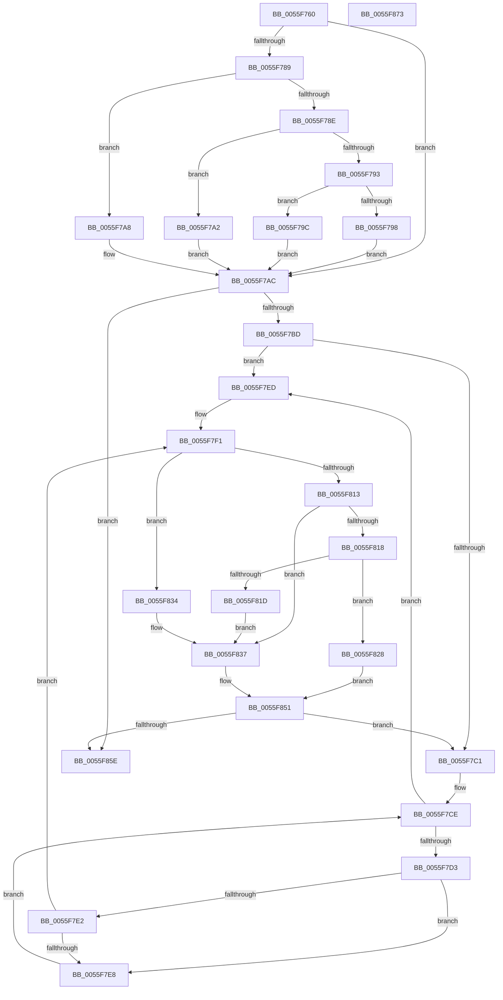

# EmonRestartProfilingInternalEnhanced

- RVA: `0x0055F760`–`0x0055F874` (길이 `276` bytes)
- VA: `0x000000014055F760`
- 실행 섹션: `.text`
- PDB 이름 있음: `예`; PDB Function 태그: `아니요`
- unwind 정보 RVA: `0x00066400`
- 디코드: `88`개 명령, `276/276` bytes 표시
- 미해석 바이트: `0` (있으면 어셈블리에 `.byte`로 보존)

> 이 문서는 커널 이미지의 기계어와 PDB 기호를 분석해 생성했습니다. 4번과 5번은 함수 원형과 자료형을 바이너리 사용 방식에서 추정한 C 해석이며 원본 소스 복구 결과는 아닙니다.

## 1. Dependencies

- 직접 호출 지점: **2**; 고유 호출 대상: **2**
- 직접 호출자로 확인된 함수: **1**
- RIP 상대 이미지 참조: **1**

### Outgoing calls
- `0x0055F82D` → [EmonWriteCounter](../56/EmonWriteCounter_function_005600A4.md) (function, `0x005600A4`)
- `0x0055F84C` → [EmonConfigureCounter](EmonConfigureCounter_function_0055C590.md) (function, `0x0055C590`)

### Direct callers
- [EmonRestartProfilingEnhanced](../../pagelk/B5/EmonRestartProfilingEnhanced_function_00B5FA50.md) at `0x00B5FA62`
- [EmonRestartProfilingEnhanced](../../pagelk/B5/EmonRestartProfilingEnhanced_function_00B5FA50.md) at `0x00B5FA6E`

### Static image references
- `0x0055F776` → RVA `0x00FC8C40` (`ALMOSTRO`; read)

## 2. Other-region calls and transfers

- 다른 실행 섹션으로 향하는 call: **0**
- 별도 외부 분기/꼬리 이동을 확인하지 못했습니다.

## 3. Assembly (complete function range)

```asm
0055F760  48 89 5C 24 08                  mov qword ptr [rsp + 8], rbx
0055F765  48 89 6C 24 10                  mov qword ptr [rsp + 0x10], rbp
0055F76A  48 89 74 24 18                  mov qword ptr [rsp + 0x18], rsi
0055F76F  57                              push rdi
0055F770  48 83 EC 30                     sub rsp, 0x30
0055F774  8B C2                           mov eax, edx
0055F776  48 8D 15 C3 94 A6 00            lea rdx, [rip + 0xa694c3]
0055F77D  48 8B 04 C2                     mov rax, qword ptr [rdx + rax*8]
0055F781  48 8B 58 58                     mov rbx, qword ptr [rax + 0x58]
0055F785  85 C9                           test ecx, ecx
0055F787  74 23                           je 0x14055f7ac
0055F789  83 E9 01                        sub ecx, 1
0055F78C  74 1A                           je 0x14055f7a8
0055F78E  83 E9 63                        sub ecx, 0x63
0055F791  74 0F                           je 0x14055f7a2
0055F793  83 F9 01                        cmp ecx, 1
0055F796  74 04                           je 0x14055f79c
0055F798  33 DB                           xor ebx, ebx
0055F79A  EB 10                           jmp 0x14055f7ac
0055F79C  48 83 C3 48                     add rbx, 0x48
0055F7A0  EB 0A                           jmp 0x14055f7ac
0055F7A2  48 83 C3 30                     add rbx, 0x30
0055F7A6  EB 04                           jmp 0x14055f7ac
0055F7A8  48 83 C3 18                     add rbx, 0x18
0055F7AC  8B 43 04                        mov eax, dword ptr [rbx + 4]
0055F7AF  33 FF                           xor edi, edi
0055F7B1  48 8B 6B 10                     mov rbp, qword ptr [rbx + 0x10]
0055F7B5  85 C0                           test eax, eax
0055F7B7  0F 84 A1 00 00 00               je 0x14055f85e
0055F7BD  3B F8                           cmp edi, eax
0055F7BF  73 2C                           jae 0x14055f7ed
0055F7C1  4C 8B 4B 10                     mov r9, qword ptr [rbx + 0x10]
0055F7C5  33 D2                           xor edx, edx
0055F7C7  44 8B 43 08                     mov r8d, dword ptr [rbx + 8]
0055F7CB  45 33 D2                        xor r10d, r10d
0055F7CE  45 3B D0                        cmp r10d, r8d
0055F7D1  77 1A                           ja 0x14055f7ed
0055F7D3  4B 8D 0C 52                     lea rcx, [r10 + r10*2]
0055F7D7  48 03 C9                        add rcx, rcx
0055F7DA  41 83 7C C9 1C 03               cmp dword ptr [r9 + rcx*8 + 0x1c], 3
0055F7E0  74 06                           je 0x14055f7e8
0055F7E2  FF C2                           inc edx
0055F7E4  3B D7                           cmp edx, edi
0055F7E6  77 09                           ja 0x14055f7f1
0055F7E8  41 FF C2                        inc r10d
0055F7EB  EB E1                           jmp 0x14055f7ce
0055F7ED  41 83 CA FF                     or r10d, 0xffffffff
0055F7F1  4B 8D 0C 52                     lea rcx, [r10 + r10*2]
0055F7F5  40 32 F6                        xor sil, sil
0055F7F8  48 03 C9                        add rcx, rcx
0055F7FB  41 B3 01                        mov r11b, 1
0055F7FE  48 8B 44 CD 10                  mov rax, qword ptr [rbp + rcx*8 + 0x10]
0055F803  8B 54 CD 18                     mov edx, dword ptr [rbp + rcx*8 + 0x18]
0055F807  4C 8B 44 CD 00                  mov r8, qword ptr [rbp + rcx*8]
0055F80C  44 8B 08                        mov r9d, dword ptr [rax]
0055F80F  85 D2                           test edx, edx
0055F811  74 21                           je 0x14055f834
0055F813  83 EA 01                        sub edx, 1
0055F816  74 1F                           je 0x14055f837
0055F818  83 FA 01                        cmp edx, 1
0055F81B  74 0B                           je 0x14055f828
0055F81D  45 32 DB                        xor r11b, r11b
0055F820  45 33 C0                        xor r8d, r8d
0055F823  45 33 C9                        xor r9d, r9d
0055F826  EB 0F                           jmp 0x14055f837
0055F828  8B 13                           mov edx, dword ptr [rbx]
0055F82A  41 8B CA                        mov ecx, r10d
0055F82D  E8 72 08 00 00                  call 0x1405600a4
0055F832  EB 1D                           jmp 0x14055f851
0055F834  41 8A F3                        mov sil, r11b
0055F837  8B 13                           mov edx, dword ptr [rbx]
0055F839  41 8B CA                        mov ecx, r10d
0055F83C  40 88 74 24 28                  mov byte ptr [rsp + 0x28], sil
0055F841  44 89 4C 24 20                  mov dword ptr [rsp + 0x20], r9d
0055F846  4D 8B C8                        mov r9, r8
0055F849  45 8A C3                        mov r8b, r11b
0055F84C  E8 3F CD FF FF                  call 0x14055c590
0055F851  8B 43 04                        mov eax, dword ptr [rbx + 4]
0055F854  FF C7                           inc edi
0055F856  3B F8                           cmp edi, eax
0055F858  0F 82 63 FF FF FF               jb 0x14055f7c1
0055F85E  48 8B 5C 24 40                  mov rbx, qword ptr [rsp + 0x40]
0055F863  48 8B 6C 24 48                  mov rbp, qword ptr [rsp + 0x48]
0055F868  48 8B 74 24 50                  mov rsi, qword ptr [rsp + 0x50]
0055F86D  48 83 C4 30                     add rsp, 0x30
0055F871  5F                              pop rdi
0055F872  C3                              ret
0055F873  CC                              int3
```

## 4. C-style interpretation (structured pseudocode)

```c
__int64 __fastcall EmonRestartProfilingInternalEnhanced(int a1, int a2)
{
    __int64 result;
    __int64 v_r10;
    __int64 v_r11;
    __int64 v_rbx;
    __int64 v_rdi;
    __int64 v_rsi;
    __int64 v_rsp;
    unsigned __int8 v_stack_m10;
    unsigned int v_stack_m18;
    unsigned __int64 v_stack_p10;
    unsigned __int64 v_stack_p18;
    unsigned __int64 v_stack_p8;

    v_stack_p8 = v_rbx;
    v_stack_p10 = v_rbp;
    v_stack_p18 = v_rsi;
    v_rsp = (v_rsp) - (48);
    if (a1 == 0) goto loc_0055F7AC;
    a1 = (unsigned int)((a1) - (1));
    if (condition_is_equal) goto loc_0055F7A8;
    a1 = (unsigned int)((a1) - (99));
    if (condition_is_equal) goto loc_0055F7A2;
    if (a1 == 1) goto loc_0055F79C;
    v_rbx = 0;
    goto loc_0055F7AC;
loc_0055F79C:
    v_rbx = (v_rbx) + (72);
    goto loc_0055F7AC;
loc_0055F7A2:
    v_rbx = (v_rbx) + (48);
    goto loc_0055F7AC;
loc_0055F7A8:
    v_rbx = (v_rbx) + (24);
loc_0055F7AC:
    v_rdi = 0;
    if ((unsigned int)((unsigned int)(*(unsigned int *)(v_rbx + 4))) == 0) goto loc_0055F85E;
    if (0 >= ((unsigned int)((unsigned int)(*(unsigned int *)(v_rbx + 4))))) goto loc_0055F7ED;
loc_0055F7C1:
    a2 = 0;
    v_r10 = 0;
loc_0055F7CE:
    if (0 > ((unsigned int)((unsigned int)(*(unsigned int *)(v_rbx + 8))))) goto loc_0055F7ED;
    a1 = (v_r10 + v_r10 * 2) + (v_r10 + v_r10 * 2);
    if ((*(unsigned int *)(*(unsigned __int64 *)(v_rbx + 16) + a1 * 8 + 28)) == 3) goto loc_0055F7E8;
    a2 = (unsigned int)((a2) + 1);
    if (a2 > 0) goto loc_0055F7F1;
loc_0055F7E8:
    v_r10 = (unsigned int)((v_r10) + 1);
    goto loc_0055F7CE;
loc_0055F7ED:
    v_r10 = (unsigned int)((v_r10) | (0xFFFFFFFFULL));
loc_0055F7F1:
    v_rsi = 0;
    a1 = (v_r10 + v_r10 * 2) + (v_r10 + v_r10 * 2);
    if ((unsigned int)((unsigned int)(*(unsigned int *)(*(unsigned __int64 *)(v_rbx + 16) + a1 * 8 + 24))) == 0) goto loc_0055F834;
    a2 = (unsigned int)(((unsigned int)(*(unsigned int *)(*(unsigned __int64 *)(v_rbx + 16) + a1 * 8 + 24))) - (1));
    if (condition_is_equal) goto loc_0055F837;
    if (a2 == 1) goto loc_0055F828;
    v_r11 = 0;
    a3 = 0;
    a4 = 0;
    goto loc_0055F837;
loc_0055F828:
    result = EmonWriteCounter((unsigned int)((unsigned int)(v_r10)), (unsigned int)(*(unsigned int *)(v_rbx)), a3, a4);
    goto loc_0055F851;
loc_0055F834:
loc_0055F837:
    v_stack_m10 = 0;
    v_stack_m18 = 0;
    result = EmonConfigureCounter((unsigned int)((unsigned int)(v_r10)), (unsigned int)(*(unsigned int *)(v_rbx)), 0, 0);
loc_0055F851:
    v_rdi = (unsigned int)((v_rdi) + 1);
    if (((unsigned int)(v_rdi)) < ((unsigned int)((unsigned int)(*(unsigned int *)(v_rbx + 4))))) goto loc_0055F7C1;
loc_0055F85E:
    v_rsp = (v_rsp) + (48);
    return (unsigned int)(*(unsigned int *)(v_rbx + 4));
}
```

## 5. (Beta) C Style

```c
int64_t EmonRestartProfilingInternalEnhanced(int32_t Arg1, int32_t Arg2)
{
    int64_t result;
    int64_t local_r10;
    int64_t local_r11;
    int64_t local_rbx;
    int64_t local_rdi;
    int64_t local_rsi;
    int64_t local_rsp;
    uint8_t v_stack_m10;
    uint32_t v_stack_m18;
    uint64_t v_stack_p10;
    uint64_t v_stack_p18;
    uint64_t v_stack_p8;

    v_stack_p8 = local_rbx;
    v_stack_p10 = local_rbp;
    v_stack_p18 = local_rsi;
    local_rsp = (local_rsp) - (48);
    if (Arg1 == 0) goto loc_0055F7AC;
    Arg1 = (uint32_t)((Arg1) - (1));
    if (condition_is_equal) goto loc_0055F7A8;
    Arg1 = (uint32_t)((Arg1) - (99));
    if (condition_is_equal) goto loc_0055F7A2;
    if (Arg1 == 1) goto loc_0055F79C;
    local_rbx = 0;
    goto loc_0055F7AC;
loc_0055F79C:
    local_rbx = (local_rbx) + (72);
    goto loc_0055F7AC;
loc_0055F7A2:
    local_rbx = (local_rbx) + (48);
    goto loc_0055F7AC;
loc_0055F7A8:
    local_rbx = (local_rbx) + (24);
loc_0055F7AC:
    local_rdi = 0;
    if ((uint32_t)((uint32_t)(*(uint32_t *)(local_rbx + 0x4))) == 0) goto loc_0055F85E;
    if (0 >= ((uint32_t)((uint32_t)(*(uint32_t *)(local_rbx + 0x4))))) goto loc_0055F7ED;
loc_0055F7C1:
    Arg2 = 0;
    local_r10 = 0;
loc_0055F7CE:
    if (0 > ((uint32_t)((uint32_t)(*(uint32_t *)(local_rbx + 0x8))))) goto loc_0055F7ED;
    Arg1 = (local_r10 + local_r10 * 2) + (local_r10 + local_r10 * 2);
    if ((*(uint32_t *)(*(uint64_t *)(local_rbx + 0x10) + Arg1 * 8 + 0x1C)) == 3) goto loc_0055F7E8;
    Arg2 = (uint32_t)((Arg2) + 1);
    if (Arg2 > 0) goto loc_0055F7F1;
loc_0055F7E8:
    local_r10 = (uint32_t)((local_r10) + 1);
    goto loc_0055F7CE;
loc_0055F7ED:
    local_r10 = (uint32_t)((local_r10) | (0xFFFFFFFFULL));
loc_0055F7F1:
    local_rsi = 0;
    Arg1 = (local_r10 + local_r10 * 2) + (local_r10 + local_r10 * 2);
    if ((uint32_t)((uint32_t)(*(uint32_t *)(*(uint64_t *)(local_rbx + 0x10) + Arg1 * 8 + 0x18))) == 0) goto loc_0055F834;
    Arg2 = (uint32_t)(((uint32_t)(*(uint32_t *)(*(uint64_t *)(local_rbx + 0x10) + Arg1 * 8 + 0x18))) - (1));
    if (condition_is_equal) goto loc_0055F837;
    if (Arg2 == 1) goto loc_0055F828;
    local_r11 = 0;
    a3 = 0;
    a4 = 0;
    goto loc_0055F837;
loc_0055F828:
    result = EmonWriteCounter((uint32_t)((uint32_t)(local_r10)), (uint32_t)(*(uint32_t *)(local_rbx)), a3, a4);
    goto loc_0055F851;
loc_0055F834:
loc_0055F837:
    v_stack_m10 = 0;
    v_stack_m18 = 0;
    result = EmonConfigureCounter((uint32_t)((uint32_t)(local_r10)), (uint32_t)(*(uint32_t *)(local_rbx)), 0, 0);
loc_0055F851:
    local_rdi = (uint32_t)((local_rdi) + 1);
    if (((uint32_t)(local_rdi)) < ((uint32_t)((uint32_t)(*(uint32_t *)(local_rbx + 0x4))))) goto loc_0055F7C1;
loc_0055F85E:
    local_rsp = (local_rsp) + (48);
    return (uint32_t)(*(uint32_t *)(local_rbx + 0x4));
}
```

## 6. Execution-region graph

[열기: 2D/3D 그래프와 함수 탐색 컨트롤 패널](../../../control-panel.html?section=text&rva=0x0055F760&view=graph)

- 2D 그래프는 위에서 아래로 흐르고, 3D 그래프는 빈 공간을 드래그해 회전합니다. Shift+드래그는 이동, 휠은 확대·축소, 함수 노드 선택은 대상 보고서 이동입니다.

### Static fallback


