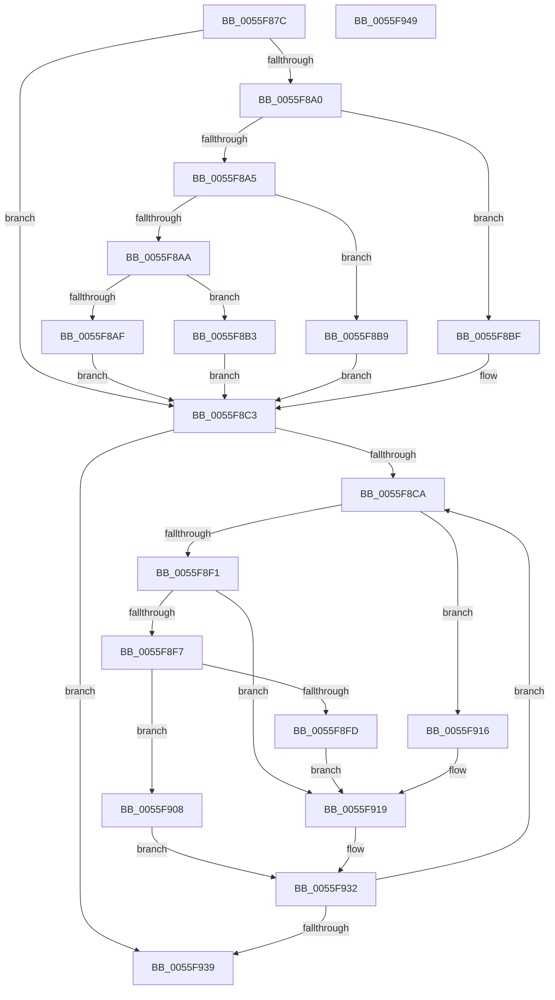

# EmonRestartProfilingInternalOriginal

- RVA: `0x0055F87C`–`0x0055F94A` (길이 `206` bytes)
- VA: `0x000000014055F87C`
- 실행 섹션: `.text`
- PDB 이름 있음: `예`; PDB Function 태그: `아니요`
- unwind 정보 RVA: `0x000794E0`
- 디코드: `67`개 명령, `206/206` bytes 표시
- 미해석 바이트: `0` (있으면 어셈블리에 `.byte`로 보존)

> 이 문서는 커널 이미지의 기계어와 PDB 기호를 분석해 생성했습니다. 4번과 5번은 함수 원형과 자료형을 바이너리 사용 방식에서 추정한 C 해석이며 원본 소스 복구 결과는 아닙니다.

## 1. Dependencies

- 직접 호출 지점: **2**; 고유 호출 대상: **2**
- 직접 호출자로 확인된 함수: **1**
- RIP 상대 이미지 참조: **1**

### Outgoing calls
- `0x0055F90F` → [EmonWriteCounter](../56/EmonWriteCounter_function_005600A4.md) (function, `0x005600A4`)
- `0x0055F92D` → [EmonConfigureCounter](EmonConfigureCounter_function_0055C590.md) (function, `0x0055C590`)

### Direct callers
- [EmonRestartProfilingOriginal](../../pagelk/B5/EmonRestartProfilingOriginal_function_00B5FAB0.md) at `0x00B5FAC2`
- [EmonRestartProfilingOriginal](../../pagelk/B5/EmonRestartProfilingOriginal_function_00B5FAB0.md) at `0x00B5FACE`

### Static image references
- `0x0055F88D` → RVA `0x00FC8C40` (`ALMOSTRO`; read)

## 2. Other-region calls and transfers

- 다른 실행 섹션으로 향하는 call: **0**
- 별도 외부 분기/꼬리 이동을 확인하지 못했습니다.

## 3. Assembly (complete function range)

```asm
0055F87C  48 89 5C 24 08                  mov qword ptr [rsp + 8], rbx
0055F881  48 89 74 24 10                  mov qword ptr [rsp + 0x10], rsi
0055F886  57                              push rdi
0055F887  48 83 EC 30                     sub rsp, 0x30
0055F88B  8B C2                           mov eax, edx
0055F88D  48 8D 15 AC 93 A6 00            lea rdx, [rip + 0xa693ac]
0055F894  48 8B 04 C2                     mov rax, qword ptr [rdx + rax*8]
0055F898  48 8B 58 58                     mov rbx, qword ptr [rax + 0x58]
0055F89C  85 C9                           test ecx, ecx
0055F89E  74 23                           je 0x14055f8c3
0055F8A0  83 E9 01                        sub ecx, 1
0055F8A3  74 1A                           je 0x14055f8bf
0055F8A5  83 E9 63                        sub ecx, 0x63
0055F8A8  74 0F                           je 0x14055f8b9
0055F8AA  83 F9 01                        cmp ecx, 1
0055F8AD  74 04                           je 0x14055f8b3
0055F8AF  33 DB                           xor ebx, ebx
0055F8B1  EB 10                           jmp 0x14055f8c3
0055F8B3  48 83 C3 48                     add rbx, 0x48
0055F8B7  EB 0A                           jmp 0x14055f8c3
0055F8B9  48 83 C3 30                     add rbx, 0x30
0055F8BD  EB 04                           jmp 0x14055f8c3
0055F8BF  48 83 C3 18                     add rbx, 0x18
0055F8C3  33 FF                           xor edi, edi
0055F8C5  39 7B 04                        cmp dword ptr [rbx + 4], edi
0055F8C8  76 6F                           jbe 0x14055f939
0055F8CA  48 8B 4B 10                     mov rcx, qword ptr [rbx + 0x10]
0055F8CE  48 8D 14 7F                     lea rdx, [rdi + rdi*2]
0055F8D2  48 03 D2                        add rdx, rdx
0055F8D5  40 32 F6                        xor sil, sil
0055F8D8  41 B3 01                        mov r11b, 1
0055F8DB  48 8B 44 D1 10                  mov rax, qword ptr [rcx + rdx*8 + 0x10]
0055F8E0  44 8B 44 D1 18                  mov r8d, dword ptr [rcx + rdx*8 + 0x18]
0055F8E5  4C 8B 14 D1                     mov r10, qword ptr [rcx + rdx*8]
0055F8E9  44 8B 08                        mov r9d, dword ptr [rax]
0055F8EC  45 85 C0                        test r8d, r8d
0055F8EF  74 25                           je 0x14055f916
0055F8F1  41 83 E8 01                     sub r8d, 1
0055F8F5  74 22                           je 0x14055f919
0055F8F7  41 83 F8 01                     cmp r8d, 1
0055F8FB  74 0B                           je 0x14055f908
0055F8FD  45 32 DB                        xor r11b, r11b
0055F900  45 33 D2                        xor r10d, r10d
0055F903  45 33 C9                        xor r9d, r9d
0055F906  EB 11                           jmp 0x14055f919
0055F908  8B 13                           mov edx, dword ptr [rbx]
0055F90A  4D 8B C2                        mov r8, r10
0055F90D  8B CF                           mov ecx, edi
0055F90F  E8 90 07 00 00                  call 0x1405600a4
0055F914  EB 1C                           jmp 0x14055f932
0055F916  41 8A F3                        mov sil, r11b
0055F919  8B 13                           mov edx, dword ptr [rbx]
0055F91B  45 8A C3                        mov r8b, r11b
0055F91E  40 88 74 24 28                  mov byte ptr [rsp + 0x28], sil
0055F923  8B CF                           mov ecx, edi
0055F925  44 89 4C 24 20                  mov dword ptr [rsp + 0x20], r9d
0055F92A  4D 8B CA                        mov r9, r10
0055F92D  E8 5E CC FF FF                  call 0x14055c590
0055F932  FF C7                           inc edi
0055F934  3B 7B 04                        cmp edi, dword ptr [rbx + 4]
0055F937  72 91                           jb 0x14055f8ca
0055F939  48 8B 5C 24 40                  mov rbx, qword ptr [rsp + 0x40]
0055F93E  48 8B 74 24 48                  mov rsi, qword ptr [rsp + 0x48]
0055F943  48 83 C4 30                     add rsp, 0x30
0055F947  5F                              pop rdi
0055F948  C3                              ret
0055F949  CC                              int3
```

## 4. C-style interpretation (structured pseudocode)

```c
__int64 __fastcall EmonRestartProfilingInternalOriginal(int a1, int a2)
{
    __int64 result;
    __int64 v_r10;
    __int64 v_r11;
    __int64 v_rbx;
    __int64 v_rdi;
    __int64 v_rsi;
    __int64 v_rsp;
    unsigned __int8 v_stack_m10;
    unsigned int v_stack_m18;
    unsigned __int64 v_stack_p10;
    unsigned __int64 v_stack_p8;

    v_stack_p8 = v_rbx;
    v_stack_p10 = v_rsi;
    v_rsp = (v_rsp) - (48);
    if (a1 == 0) goto loc_0055F8C3;
    a1 = (unsigned int)((a1) - (1));
    if (condition_is_equal) goto loc_0055F8BF;
    a1 = (unsigned int)((a1) - (99));
    if (condition_is_equal) goto loc_0055F8B9;
    if (a1 == 1) goto loc_0055F8B3;
    v_rbx = 0;
    goto loc_0055F8C3;
loc_0055F8B3:
    v_rbx = (v_rbx) + (72);
    goto loc_0055F8C3;
loc_0055F8B9:
    v_rbx = (v_rbx) + (48);
    goto loc_0055F8C3;
loc_0055F8BF:
    v_rbx = (v_rbx) + (24);
loc_0055F8C3:
    v_rdi = 0;
    if ((*(unsigned int *)(v_rbx + 4)) <= 0) goto loc_0055F939;
loc_0055F8CA:
    a2 = (v_rdi + v_rdi * 2) + (v_rdi + v_rdi * 2);
    v_rsi = 0;
    if ((unsigned int)((unsigned int)(*(unsigned int *)(*(unsigned __int64 *)(v_rbx + 16) + a2 * 8 + 24))) == 0) goto loc_0055F916;
    a3 = (unsigned int)(((unsigned int)(*(unsigned int *)(*(unsigned __int64 *)(v_rbx + 16) + a2 * 8 + 24))) - (1));
    if (condition_is_equal) goto loc_0055F919;
    if (((unsigned int)(a3)) == 1) goto loc_0055F908;
    v_r11 = 0;
    v_r10 = 0;
    a4 = 0;
    goto loc_0055F919;
loc_0055F908:
    result = EmonWriteCounter(0, (unsigned int)(*(unsigned int *)(v_rbx)), 0, a4);
    goto loc_0055F932;
loc_0055F916:
loc_0055F919:
    v_stack_m10 = 0;
    v_stack_m18 = 0;
    result = EmonConfigureCounter(0, (unsigned int)(*(unsigned int *)(v_rbx)), 0, 0);
loc_0055F932:
    v_rdi = (unsigned int)((v_rdi) + 1);
    if (((unsigned int)(v_rdi)) < (*(unsigned int *)(v_rbx + 4))) goto loc_0055F8CA;
loc_0055F939:
    v_rsp = (v_rsp) + (48);
    return result;
}
```

## 5. (Beta) C Style

```c
int64_t EmonRestartProfilingInternalOriginal(int32_t Arg1, int32_t Arg2)
{
    int64_t result;
    int64_t local_r10;
    int64_t local_r11;
    int64_t local_rbx;
    int64_t local_rdi;
    int64_t local_rsi;
    int64_t local_rsp;
    uint8_t v_stack_m10;
    uint32_t v_stack_m18;
    uint64_t v_stack_p10;
    uint64_t v_stack_p8;

    v_stack_p8 = local_rbx;
    v_stack_p10 = local_rsi;
    local_rsp = (local_rsp) - (48);
    if (Arg1 == 0) goto loc_0055F8C3;
    Arg1 = (uint32_t)((Arg1) - (1));
    if (condition_is_equal) goto loc_0055F8BF;
    Arg1 = (uint32_t)((Arg1) - (99));
    if (condition_is_equal) goto loc_0055F8B9;
    if (Arg1 == 1) goto loc_0055F8B3;
    local_rbx = 0;
    goto loc_0055F8C3;
loc_0055F8B3:
    local_rbx = (local_rbx) + (72);
    goto loc_0055F8C3;
loc_0055F8B9:
    local_rbx = (local_rbx) + (48);
    goto loc_0055F8C3;
loc_0055F8BF:
    local_rbx = (local_rbx) + (24);
loc_0055F8C3:
    local_rdi = 0;
    if ((*(uint32_t *)(local_rbx + 0x4)) <= 0) goto loc_0055F939;
loc_0055F8CA:
    Arg2 = (local_rdi + local_rdi * 2) + (local_rdi + local_rdi * 2);
    local_rsi = 0;
    if ((uint32_t)((uint32_t)(*(uint32_t *)(*(uint64_t *)(local_rbx + 0x10) + Arg2 * 8 + 0x18))) == 0) goto loc_0055F916;
    a3 = (uint32_t)(((uint32_t)(*(uint32_t *)(*(uint64_t *)(local_rbx + 0x10) + Arg2 * 8 + 0x18))) - (1));
    if (condition_is_equal) goto loc_0055F919;
    if (((uint32_t)(a3)) == 1) goto loc_0055F908;
    local_r11 = 0;
    local_r10 = 0;
    a4 = 0;
    goto loc_0055F919;
loc_0055F908:
    result = EmonWriteCounter(0, (uint32_t)(*(uint32_t *)(local_rbx)), 0, a4);
    goto loc_0055F932;
loc_0055F916:
loc_0055F919:
    v_stack_m10 = 0;
    v_stack_m18 = 0;
    result = EmonConfigureCounter(0, (uint32_t)(*(uint32_t *)(local_rbx)), 0, 0);
loc_0055F932:
    local_rdi = (uint32_t)((local_rdi) + 1);
    if (((uint32_t)(local_rdi)) < (*(uint32_t *)(local_rbx + 0x4))) goto loc_0055F8CA;
loc_0055F939:
    local_rsp = (local_rsp) + (48);
    return result;
}
```

## 6. Execution-region graph

[열기: 2D/3D 그래프와 함수 탐색 컨트롤 패널](../../../control-panel.html?section=text&rva=0x0055F87C&view=graph)

- 2D 그래프는 위에서 아래로 흐르고, 3D 그래프는 빈 공간을 드래그해 회전합니다. Shift+드래그는 이동, 휠은 확대·축소, 함수 노드 선택은 대상 보고서 이동입니다.

### Static fallback


