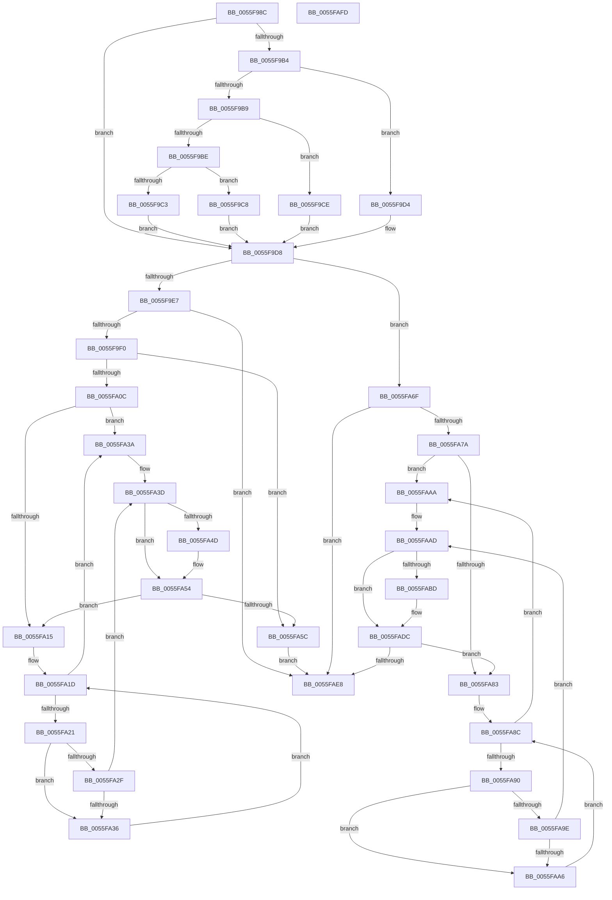

# EmonResumeProfilingInternalEnhanced

- RVA: `0x0055F98C`–`0x0055FAFE` (길이 `370` bytes)
- VA: `0x000000014055F98C`
- 실행 섹션: `.text`
- PDB 이름 있음: `예`; PDB Function 태그: `아니요`
- unwind 정보 RVA: `0x000A5A38`
- 디코드: `119`개 명령, `370/370` bytes 표시
- 미해석 바이트: `0` (있으면 어셈블리에 `.byte`로 보존)

> 이 문서는 커널 이미지의 기계어와 PDB 기호를 분석해 생성했습니다. 4번과 5번은 함수 원형과 자료형을 바이너리 사용 방식에서 추정한 C 해석이며 원본 소스 복구 결과는 아닙니다.

## 1. Dependencies

- 직접 호출 지점: **0**; 고유 호출 대상: **0**
- 직접 호출자로 확인된 함수: **1**
- RIP 상대 이미지 참조: **1**

### Outgoing calls
- 직접 디코드된 call 명령이 없습니다.

### Direct callers
- [EmonResumeProfilingEnhanced](EmonResumeProfilingEnhanced_function_0055F950.md) at `0x0055F962`
- [EmonResumeProfilingEnhanced](EmonResumeProfilingEnhanced_function_0055F950.md) at `0x0055F977`

### Static image references
- `0x0055F9A1` → RVA `0x00FC8C40` (`ALMOSTRO`; read)

## 2. Other-region calls and transfers

- 다른 실행 섹션으로 향하는 call: **0**
- 별도 외부 분기/꼬리 이동을 확인하지 못했습니다.

## 3. Assembly (complete function range)

```asm
0055F98C  48 8B C4                        mov rax, rsp
0055F98F  48 89 58 08                     mov qword ptr [rax + 8], rbx
0055F993  48 89 68 10                     mov qword ptr [rax + 0x10], rbp
0055F997  48 89 70 18                     mov qword ptr [rax + 0x18], rsi
0055F99B  48 89 78 20                     mov qword ptr [rax + 0x20], rdi
0055F99F  8B C2                           mov eax, edx
0055F9A1  48 8D 15 98 92 A6 00            lea rdx, [rip + 0xa69298]
0055F9A8  48 8B 04 C2                     mov rax, qword ptr [rdx + rax*8]
0055F9AC  4C 8B 40 58                     mov r8, qword ptr [rax + 0x58]
0055F9B0  85 C9                           test ecx, ecx
0055F9B2  74 24                           je 0x14055f9d8
0055F9B4  83 E9 01                        sub ecx, 1
0055F9B7  74 1B                           je 0x14055f9d4
0055F9B9  83 E9 63                        sub ecx, 0x63
0055F9BC  74 10                           je 0x14055f9ce
0055F9BE  83 F9 01                        cmp ecx, 1
0055F9C1  74 05                           je 0x14055f9c8
0055F9C3  45 33 C0                        xor r8d, r8d
0055F9C6  EB 10                           jmp 0x14055f9d8
0055F9C8  49 83 C0 48                     add r8, 0x48
0055F9CC  EB 0A                           jmp 0x14055f9d8
0055F9CE  49 83 C0 30                     add r8, 0x30
0055F9D2  EB 04                           jmp 0x14055f9d8
0055F9D4  49 83 C0 18                     add r8, 0x18
0055F9D8  41 8B 08                        mov ecx, dword ptr [r8]
0055F9DB  49 8B 68 10                     mov rbp, qword ptr [r8 + 0x10]
0055F9DF  85 C9                           test ecx, ecx
0055F9E1  0F 84 88 00 00 00               je 0x14055fa6f
0055F9E7  83 F9 01                        cmp ecx, 1
0055F9EA  0F 85 F8 00 00 00               jne 0x14055fae8
0055F9F0  B9 8F 03 00 00                  mov ecx, 0x38f
0055F9F5  0F 32                           rdmsr
0055F9F7  41 8B 78 04                     mov edi, dword ptr [r8 + 4]
0055F9FB  45 33 C9                        xor r9d, r9d
0055F9FE  48 C1 E2 20                     shl rdx, 0x20
0055FA02  48 0B C2                        or rax, rdx
0055FA05  4C 8B D0                        mov r10, rax
0055FA08  85 FF                           test edi, edi
0055FA0A  74 50                           je 0x14055fa5c
0055FA0C  41 83 CB FF                     or r11d, 0xffffffff
0055FA10  44 3B CF                        cmp r9d, edi
0055FA13  73 25                           jae 0x14055fa3a
0055FA15  41 8B 70 08                     mov esi, dword ptr [r8 + 8]
0055FA19  33 DB                           xor ebx, ebx
0055FA1B  33 D2                           xor edx, edx
0055FA1D  3B D6                           cmp edx, esi
0055FA1F  77 19                           ja 0x14055fa3a
0055FA21  48 8D 0C 52                     lea rcx, [rdx + rdx*2]
0055FA25  48 03 C9                        add rcx, rcx
0055FA28  83 7C CD 1C 03                  cmp dword ptr [rbp + rcx*8 + 0x1c], 3
0055FA2D  74 07                           je 0x14055fa36
0055FA2F  FF C3                           inc ebx
0055FA31  41 3B D9                        cmp ebx, r9d
0055FA34  77 07                           ja 0x14055fa3d
0055FA36  FF C2                           inc edx
0055FA38  EB E3                           jmp 0x14055fa1d
0055FA3A  41 8B D3                        mov edx, r11d
0055FA3D  8B C2                           mov eax, edx
0055FA3F  48 8D 0C 40                     lea rcx, [rax + rax*2]
0055FA43  48 03 C9                        add rcx, rcx
0055FA46  83 7C CD 18 02                  cmp dword ptr [rbp + rcx*8 + 0x18], 2
0055FA4B  7D 07                           jge 0x14055fa54
0055FA4D  83 C2 20                        add edx, 0x20
0055FA50  49 0F AB D2                     bts r10, rdx
0055FA54  41 FF C1                        inc r9d
0055FA57  44 3B CF                        cmp r9d, edi
0055FA5A  72 B9                           jb 0x14055fa15
0055FA5C  49 8B D2                        mov rdx, r10
0055FA5F  49 8B C2                        mov rax, r10
0055FA62  48 C1 EA 20                     shr rdx, 0x20
0055FA66  B9 8F 03 00 00                  mov ecx, 0x38f
0055FA6B  0F 30                           wrmsr
0055FA6D  EB 79                           jmp 0x14055fae8
0055FA6F  41 8B 40 04                     mov eax, dword ptr [r8 + 4]
0055FA73  45 33 C9                        xor r9d, r9d
0055FA76  85 C0                           test eax, eax
0055FA78  74 6E                           je 0x14055fae8
0055FA7A  41 83 CB FF                     or r11d, 0xffffffff
0055FA7E  44 3B C8                        cmp r9d, eax
0055FA81  73 27                           jae 0x14055faaa
0055FA83  41 8B 58 08                     mov ebx, dword ptr [r8 + 8]
0055FA87  45 33 D2                        xor r10d, r10d
0055FA8A  33 D2                           xor edx, edx
0055FA8C  3B D3                           cmp edx, ebx
0055FA8E  77 1A                           ja 0x14055faaa
0055FA90  48 8D 0C 52                     lea rcx, [rdx + rdx*2]
0055FA94  48 03 C9                        add rcx, rcx
0055FA97  83 7C CD 1C 03                  cmp dword ptr [rbp + rcx*8 + 0x1c], 3
0055FA9C  74 08                           je 0x14055faa6
0055FA9E  41 FF C2                        inc r10d
0055FAA1  45 3B D1                        cmp r10d, r9d
0055FAA4  77 07                           ja 0x14055faad
0055FAA6  FF C2                           inc edx
0055FAA8  EB E2                           jmp 0x14055fa8c
0055FAAA  41 8B D3                        mov edx, r11d
0055FAAD  8B C2                           mov eax, edx
0055FAAF  48 8D 0C 40                     lea rcx, [rax + rax*2]
0055FAB3  48 03 C9                        add rcx, rcx
0055FAB6  83 7C CD 18 02                  cmp dword ptr [rbp + rcx*8 + 0x18], 2
0055FABB  7D 1F                           jge 0x14055fadc
0055FABD  8D 8A 86 01 00 00               lea ecx, [rdx + 0x186]
0055FAC3  0F 32                           rdmsr
0055FAC5  48 C1 E2 20                     shl rdx, 0x20
0055FAC9  48 0B D0                        or rdx, rax
0055FACC  8B D2                           mov edx, edx
0055FACE  48 0F BA EA 16                  bts rdx, 0x16
0055FAD3  48 8B C2                        mov rax, rdx
0055FAD6  48 C1 EA 20                     shr rdx, 0x20
0055FADA  0F 30                           wrmsr
0055FADC  41 8B 40 04                     mov eax, dword ptr [r8 + 4]
0055FAE0  41 FF C1                        inc r9d
0055FAE3  44 3B C8                        cmp r9d, eax
0055FAE6  72 9B                           jb 0x14055fa83
0055FAE8  48 8B 5C 24 08                  mov rbx, qword ptr [rsp + 8]
0055FAED  48 8B 6C 24 10                  mov rbp, qword ptr [rsp + 0x10]
0055FAF2  48 8B 74 24 18                  mov rsi, qword ptr [rsp + 0x18]
0055FAF7  48 8B 7C 24 20                  mov rdi, qword ptr [rsp + 0x20]
0055FAFC  C3                              ret
0055FAFD  CC                              int3
```

## 4. C-style interpretation (structured pseudocode)

```c
__int64 __fastcall EmonResumeProfilingInternalEnhanced(int a1, int a2, __int64 a3, int a4)
{
    __int64 result;
    __int64 v_r10;
    __int64 v_r11;
    __int64 v_rbx;
    unsigned __int64 v_stack_p10;
    unsigned __int64 v_stack_p18;
    unsigned __int64 v_stack_p20;
    unsigned __int64 v_stack_p8;

    *(unsigned __int64 *)(v_rsp + 8) = v_rbx;
    *(unsigned __int64 *)(v_rsp + 16) = v_rbp;
    *(unsigned __int64 *)(v_rsp + 24) = v_rsi;
    *(unsigned __int64 *)(v_rsp + 32) = v_rdi;
    if (a1 == 0) goto loc_0055F9D8;
    a1 = (unsigned int)((a1) - (1));
    if (condition_is_equal) goto loc_0055F9D4;
    a1 = (unsigned int)((a1) - (99));
    if (condition_is_equal) goto loc_0055F9CE;
    if (a1 == 1) goto loc_0055F9C8;
    a3 = 0;
    goto loc_0055F9D8;
loc_0055F9C8:
    a3 = (a3) + (72);
    goto loc_0055F9D8;
loc_0055F9CE:
    a3 = (a3) + (48);
    goto loc_0055F9D8;
loc_0055F9D4:
    a3 = (a3) + (24);
loc_0055F9D8:
    if ((unsigned int)((unsigned int)(*(unsigned int *)(a3))) == 0) goto loc_0055FA6F;
    if (((unsigned int)((unsigned int)(*(unsigned int *)(a3)))) != 1) goto loc_0055FAE8;
    a4 = 0;
    a2 = (v_rip + 10916504) << (32);
    result = (*(unsigned __int64 *)(v_rip + 10916504 + (unsigned int)(a2) * 8)) | (a2);
    if ((unsigned int)((unsigned int)(*(unsigned int *)(a3 + 4))) == 0) goto loc_0055FA5C;
    v_r11 = (unsigned int)((v_r11) | (0xFFFFFFFFULL));
    if (0 >= ((unsigned int)((unsigned int)(*(unsigned int *)(a3 + 4))))) goto loc_0055FA3A;
loc_0055FA15:
    v_rbx = 0;
    a2 = 0;
loc_0055FA1D:
    if (0 > ((unsigned int)((unsigned int)(*(unsigned int *)(a3 + 8))))) goto loc_0055FA3A;
    a1 = (a2 + a2 * 2) + (a2 + a2 * 2);
    if ((*(unsigned int *)(*(unsigned __int64 *)(a3 + 16) + a1 * 8 + 28)) == 3) goto loc_0055FA36;
    v_rbx = (unsigned int)((v_rbx) + 1);
    if (((unsigned int)(v_rbx)) > 0) goto loc_0055FA3D;
loc_0055FA36:
    a2 = (unsigned int)((a2) + 1);
    goto loc_0055FA1D;
loc_0055FA3A:
loc_0055FA3D:
    a1 = ((unsigned int)((unsigned int)((unsigned int)((unsigned int)(v_r11)))) + (unsigned int)((unsigned int)((unsigned int)((unsigned int)(v_r11)))) * 2) + ((unsigned int)((unsigned int)((unsigned int)((unsigned int)(v_r11)))) + (unsigned int)((unsigned int)((unsigned int)((unsigned int)(v_r11)))) * 2);
    if ((*(unsigned int *)(*(unsigned __int64 *)(a3 + 16) + a1 * 8 + 24)) < 2) {
        a2 = (unsigned int)(((unsigned int)((unsigned int)(v_r11))) + (32));
    }
    a4 = (unsigned int)((a4) + 1);
    if (a4 < ((unsigned int)((unsigned int)(*(unsigned int *)(a3 + 4))))) goto loc_0055FA15;
loc_0055FA5C:
    a2 = (result) >> (32);
    goto loc_0055FAE8;
loc_0055FA6F:
    a4 = 0;
    if ((unsigned int)((unsigned int)(*(unsigned int *)(a3 + 4))) == 0) goto loc_0055FAE8;
    v_r11 = (unsigned int)((v_r11) | (0xFFFFFFFFULL));
    if (0 >= ((unsigned int)((unsigned int)(*(unsigned int *)(a3 + 4))))) goto loc_0055FAAA;
loc_0055FA83:
    v_r10 = 0;
    a2 = 0;
loc_0055FA8C:
    if (0 > ((unsigned int)((unsigned int)(*(unsigned int *)(a3 + 8))))) goto loc_0055FAAA;
    a1 = (a2 + a2 * 2) + (a2 + a2 * 2);
    if ((*(unsigned int *)(*(unsigned __int64 *)(a3 + 16) + a1 * 8 + 28)) == 3) goto loc_0055FAA6;
    v_r10 = (unsigned int)((v_r10) + 1);
    if (((unsigned int)(v_r10)) > 0) goto loc_0055FAAD;
loc_0055FAA6:
    a2 = (unsigned int)((a2) + 1);
    goto loc_0055FA8C;
loc_0055FAAA:
loc_0055FAAD:
    a1 = ((unsigned int)((unsigned int)((unsigned int)((unsigned int)(v_r11)))) + (unsigned int)((unsigned int)((unsigned int)((unsigned int)(v_r11)))) * 2) + ((unsigned int)((unsigned int)((unsigned int)((unsigned int)(v_r11)))) + (unsigned int)((unsigned int)((unsigned int)((unsigned int)(v_r11)))) * 2);
    result = (unsigned int)((unsigned int)((unsigned int)((unsigned int)(v_r11))));
    if ((*(unsigned int *)(*(unsigned __int64 *)(a3 + 16) + a1 * 8 + 24)) < 2) {
        a1 = (unsigned int)((unsigned int)(v_r11)) + 390;
        a2 = ((unsigned int)((unsigned int)(v_r11))) << (32);
        a2 = (a2) | ((unsigned int)((unsigned int)((unsigned int)((unsigned int)(v_r11)))));
        a2 = a2;
        result = a2;
        a2 = (a2) >> (32);
    }
    a4 = (unsigned int)((a4) + 1);
    if (a4 < ((unsigned int)((unsigned int)(*(unsigned int *)(a3 + 4))))) goto loc_0055FA83;
loc_0055FAE8:
    return (unsigned int)(*(unsigned int *)(a3 + 4));
}
```

## 5. (Beta) C Style

```c
int64_t EmonResumeProfilingInternalEnhanced(int32_t Arg1, int32_t Arg2, int64_t Arg3, int32_t Arg4)
{
    int64_t result;
    int64_t local_r10;
    int64_t local_r11;
    int64_t local_rbx;
    uint64_t v_stack_p10;
    uint64_t v_stack_p18;
    uint64_t v_stack_p20;
    uint64_t v_stack_p8;

    *(uint64_t *)(local_rsp + 0x8) = local_rbx;
    *(uint64_t *)(local_rsp + 0x10) = local_rbp;
    *(uint64_t *)(local_rsp + 0x18) = local_rsi;
    *(uint64_t *)(local_rsp + 0x20) = local_rdi;
    if (Arg1 == 0) goto loc_0055F9D8;
    Arg1 = (uint32_t)((Arg1) - (1));
    if (condition_is_equal) goto loc_0055F9D4;
    Arg1 = (uint32_t)((Arg1) - (99));
    if (condition_is_equal) goto loc_0055F9CE;
    if (Arg1 == 1) goto loc_0055F9C8;
    Arg3 = 0;
    goto loc_0055F9D8;
loc_0055F9C8:
    Arg3 = (Arg3) + (72);
    goto loc_0055F9D8;
loc_0055F9CE:
    Arg3 = (Arg3) + (48);
    goto loc_0055F9D8;
loc_0055F9D4:
    Arg3 = (Arg3) + (24);
loc_0055F9D8:
    if ((uint32_t)((uint32_t)(*(uint32_t *)(Arg3))) == 0) goto loc_0055FA6F;
    if (((uint32_t)((uint32_t)(*(uint32_t *)(Arg3)))) != 1) goto loc_0055FAE8;
    Arg4 = 0;
    Arg2 = (v_rip + 10916504) << (32);
    result = (*(uint64_t *)(v_rip + 0xA69298 + (uint32_t)(Arg2) * 8)) | (Arg2);
    if ((uint32_t)((uint32_t)(*(uint32_t *)(Arg3 + 0x4))) == 0) goto loc_0055FA5C;
    local_r11 = (uint32_t)((local_r11) | (0xFFFFFFFFULL));
    if (0 >= ((uint32_t)((uint32_t)(*(uint32_t *)(Arg3 + 0x4))))) goto loc_0055FA3A;
loc_0055FA15:
    local_rbx = 0;
    Arg2 = 0;
loc_0055FA1D:
    if (0 > ((uint32_t)((uint32_t)(*(uint32_t *)(Arg3 + 0x8))))) goto loc_0055FA3A;
    Arg1 = (Arg2 + Arg2 * 2) + (Arg2 + Arg2 * 2);
    if ((*(uint32_t *)(*(uint64_t *)(Arg3 + 0x10) + Arg1 * 8 + 0x1C)) == 3) goto loc_0055FA36;
    local_rbx = (uint32_t)((local_rbx) + 1);
    if (((uint32_t)(local_rbx)) > 0) goto loc_0055FA3D;
loc_0055FA36:
    Arg2 = (uint32_t)((Arg2) + 1);
    goto loc_0055FA1D;
loc_0055FA3A:
loc_0055FA3D:
    Arg1 = ((uint32_t)((uint32_t)((uint32_t)((uint32_t)(local_r11)))) + (uint32_t)((uint32_t)((uint32_t)((uint32_t)(local_r11)))) * 2) + ((uint32_t)((uint32_t)((uint32_t)((uint32_t)(local_r11)))) + (uint32_t)((uint32_t)((uint32_t)((uint32_t)(local_r11)))) * 2);
    if ((*(uint32_t *)(*(uint64_t *)(Arg3 + 0x10) + Arg1 * 8 + 0x18)) < 2) {
        Arg2 = (uint32_t)(((uint32_t)((uint32_t)(local_r11))) + (32));
    }
    Arg4 = (uint32_t)((Arg4) + 1);
    if (Arg4 < ((uint32_t)((uint32_t)(*(uint32_t *)(Arg3 + 0x4))))) goto loc_0055FA15;
loc_0055FA5C:
    Arg2 = (result) >> (32);
    goto loc_0055FAE8;
loc_0055FA6F:
    Arg4 = 0;
    if ((uint32_t)((uint32_t)(*(uint32_t *)(Arg3 + 0x4))) == 0) goto loc_0055FAE8;
    local_r11 = (uint32_t)((local_r11) | (0xFFFFFFFFULL));
    if (0 >= ((uint32_t)((uint32_t)(*(uint32_t *)(Arg3 + 0x4))))) goto loc_0055FAAA;
loc_0055FA83:
    local_r10 = 0;
    Arg2 = 0;
loc_0055FA8C:
    if (0 > ((uint32_t)((uint32_t)(*(uint32_t *)(Arg3 + 0x8))))) goto loc_0055FAAA;
    Arg1 = (Arg2 + Arg2 * 2) + (Arg2 + Arg2 * 2);
    if ((*(uint32_t *)(*(uint64_t *)(Arg3 + 0x10) + Arg1 * 8 + 0x1C)) == 3) goto loc_0055FAA6;
    local_r10 = (uint32_t)((local_r10) + 1);
    if (((uint32_t)(local_r10)) > 0) goto loc_0055FAAD;
loc_0055FAA6:
    Arg2 = (uint32_t)((Arg2) + 1);
    goto loc_0055FA8C;
loc_0055FAAA:
loc_0055FAAD:
    Arg1 = ((uint32_t)((uint32_t)((uint32_t)((uint32_t)(local_r11)))) + (uint32_t)((uint32_t)((uint32_t)((uint32_t)(local_r11)))) * 2) + ((uint32_t)((uint32_t)((uint32_t)((uint32_t)(local_r11)))) + (uint32_t)((uint32_t)((uint32_t)((uint32_t)(local_r11)))) * 2);
    result = (uint32_t)((uint32_t)((uint32_t)((uint32_t)(local_r11))));
    if ((*(uint32_t *)(*(uint64_t *)(Arg3 + 0x10) + Arg1 * 8 + 0x18)) < 2) {
        Arg1 = (uint32_t)((uint32_t)(local_r11)) + 390;
        Arg2 = ((uint32_t)((uint32_t)(local_r11))) << (32);
        Arg2 = (Arg2) | ((uint32_t)((uint32_t)((uint32_t)((uint32_t)(local_r11)))));
        Arg2 = Arg2;
        result = Arg2;
        Arg2 = (Arg2) >> (32);
    }
    Arg4 = (uint32_t)((Arg4) + 1);
    if (Arg4 < ((uint32_t)((uint32_t)(*(uint32_t *)(Arg3 + 0x4))))) goto loc_0055FA83;
loc_0055FAE8:
    return (uint32_t)(*(uint32_t *)(Arg3 + 0x4));
}
```

## 6. Execution-region graph

[열기: 2D/3D 그래프와 함수 탐색 컨트롤 패널](../../../control-panel.html?section=text&rva=0x0055F98C&view=graph)

- 2D 그래프는 위에서 아래로 흐르고, 3D 그래프는 빈 공간을 드래그해 회전합니다. Shift+드래그는 이동, 휠은 확대·축소, 함수 노드 선택은 대상 보고서 이동입니다.

### Static fallback


