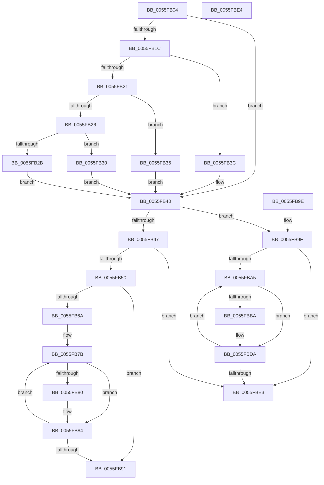

# EmonResumeProfilingInternalOriginal

- RVA: `0x0055FB04`–`0x0055FBE5` (길이 `225` bytes)
- VA: `0x000000014055FB04`
- 실행 섹션: `.text`
- PDB 이름 있음: `예`; PDB Function 태그: `아니요`
- unwind 정보 RVA: `0x000DB714`
- 디코드: `72`개 명령, `225/225` bytes 표시
- 미해석 바이트: `0` (있으면 어셈블리에 `.byte`로 보존)

> 이 문서는 커널 이미지의 기계어와 PDB 기호를 분석해 생성했습니다. 4번과 5번은 함수 원형과 자료형을 바이너리 사용 방식에서 추정한 C 해석이며 원본 소스 복구 결과는 아닙니다.

## 1. Dependencies

- 직접 호출 지점: **0**; 고유 호출 대상: **0**
- 직접 호출자로 확인된 함수: **1**
- RIP 상대 이미지 참조: **1**

### Outgoing calls
- 직접 디코드된 call 명령이 없습니다.

### Direct callers
- [EmonResumeProfilingOriginal](EmonResumeProfilingOriginal_function_0055FBF0.md) at `0x0055FC02`
- [EmonResumeProfilingOriginal](EmonResumeProfilingOriginal_function_0055FBF0.md) at `0x0055FC18`

### Static image references
- `0x0055FB09` → RVA `0x00FC8C40` (`ALMOSTRO`; read)

## 2. Other-region calls and transfers

- 다른 실행 섹션으로 향하는 call: **0**
- 별도 외부 분기/꼬리 이동을 확인하지 못했습니다.

## 3. Assembly (complete function range)

```asm
0055FB04  8B C2                           mov eax, edx
0055FB06  45 33 C9                        xor r9d, r9d
0055FB09  48 8D 15 30 91 A6 00            lea rdx, [rip + 0xa69130]
0055FB10  48 8B 04 C2                     mov rax, qword ptr [rdx + rax*8]
0055FB14  4C 8B 40 58                     mov r8, qword ptr [rax + 0x58]
0055FB18  85 C9                           test ecx, ecx
0055FB1A  74 24                           je 0x14055fb40
0055FB1C  83 E9 01                        sub ecx, 1
0055FB1F  74 1B                           je 0x14055fb3c
0055FB21  83 E9 63                        sub ecx, 0x63
0055FB24  74 10                           je 0x14055fb36
0055FB26  83 F9 01                        cmp ecx, 1
0055FB29  74 05                           je 0x14055fb30
0055FB2B  45 8B C1                        mov r8d, r9d
0055FB2E  EB 10                           jmp 0x14055fb40
0055FB30  49 83 C0 48                     add r8, 0x48
0055FB34  EB 0A                           jmp 0x14055fb40
0055FB36  49 83 C0 30                     add r8, 0x30
0055FB3A  EB 04                           jmp 0x14055fb40
0055FB3C  49 83 C0 18                     add r8, 0x18
0055FB40  41 8B 08                        mov ecx, dword ptr [r8]
0055FB43  85 C9                           test ecx, ecx
0055FB45  74 58                           je 0x14055fb9f
0055FB47  83 F9 01                        cmp ecx, 1
0055FB4A  0F 85 93 00 00 00               jne 0x14055fbe3
0055FB50  41 BA 8F 03 00 00               mov r10d, 0x38f
0055FB56  41 8B CA                        mov ecx, r10d
0055FB59  0F 32                           rdmsr
0055FB5B  41 8B 48 04                     mov ecx, dword ptr [r8 + 4]
0055FB5F  48 C1 E2 20                     shl rdx, 0x20
0055FB63  48 0B C2                        or rax, rdx
0055FB66  85 C9                           test ecx, ecx
0055FB68  74 27                           je 0x14055fb91
0055FB6A  49 8B 50 10                     mov rdx, qword ptr [r8 + 0x10]
0055FB6E  41 B9 20 00 00 00               mov r9d, 0x20
0055FB74  48 83 C2 18                     add rdx, 0x18
0055FB78  44 8B C1                        mov r8d, ecx
0055FB7B  83 3A 02                        cmp dword ptr [rdx], 2
0055FB7E  7D 04                           jge 0x14055fb84
0055FB80  4C 0F AB C8                     bts rax, r9
0055FB84  49 FF C1                        inc r9
0055FB87  48 83 C2 30                     add rdx, 0x30
0055FB8B  49 83 E8 01                     sub r8, 1
0055FB8F  75 EA                           jne 0x14055fb7b
0055FB91  48 8B D0                        mov rdx, rax
0055FB94  41 8B CA                        mov ecx, r10d
0055FB97  48 C1 EA 20                     shr rdx, 0x20
0055FB9B  0F 30                           wrmsr
0055FB9D  C3                              ret
0055FB9E  CC                              int3
0055FB9F  45 39 48 04                     cmp dword ptr [r8 + 4], r9d
0055FBA3  76 3E                           jbe 0x14055fbe3
0055FBA5  41 8B C1                        mov eax, r9d
0055FBA8  48 8D 0C 40                     lea rcx, [rax + rax*2]
0055FBAC  49 8B 40 10                     mov rax, qword ptr [r8 + 0x10]
0055FBB0  48 03 C9                        add rcx, rcx
0055FBB3  83 7C C8 18 02                  cmp dword ptr [rax + rcx*8 + 0x18], 2
0055FBB8  7D 20                           jge 0x14055fbda
0055FBBA  41 8D 89 86 01 00 00            lea ecx, [r9 + 0x186]
0055FBC1  0F 32                           rdmsr
0055FBC3  48 C1 E2 20                     shl rdx, 0x20
0055FBC7  48 0B D0                        or rdx, rax
0055FBCA  8B D2                           mov edx, edx
0055FBCC  48 0F BA EA 16                  bts rdx, 0x16
0055FBD1  48 8B C2                        mov rax, rdx
0055FBD4  48 C1 EA 20                     shr rdx, 0x20
0055FBD8  0F 30                           wrmsr
0055FBDA  41 FF C1                        inc r9d
0055FBDD  45 3B 48 04                     cmp r9d, dword ptr [r8 + 4]
0055FBE1  72 C2                           jb 0x14055fba5
0055FBE3  C3                              ret
0055FBE4  CC                              int3
```

## 4. C-style interpretation (structured pseudocode)

```c
__int64 __fastcall EmonResumeProfilingInternalOriginal(int a1, int a2, __int64 a3, int a4)
{
    __int64 result;

    a4 = 0;
    if (a1 == 0) goto loc_0055FB40;
    a1 = (unsigned int)((a1) - (1));
    if (condition_is_equal) goto loc_0055FB3C;
    a1 = (unsigned int)((a1) - (99));
    if (condition_is_equal) goto loc_0055FB36;
    if (a1 == 1) goto loc_0055FB30;
    goto loc_0055FB40;
loc_0055FB30:
    a3 = (0) + (72);
    goto loc_0055FB40;
loc_0055FB36:
    a3 = (a3) + (48);
    goto loc_0055FB40;
loc_0055FB3C:
    a3 = (a3) + (24);
loc_0055FB40:
    if ((unsigned int)((unsigned int)(*(unsigned int *)(a3))) == 0) goto loc_0055FB9F;
    if (((unsigned int)((unsigned int)(*(unsigned int *)(a3)))) != 1) goto loc_0055FBE3;
    a2 = (v_rip + 10916144) << (32);
    result = (*(unsigned __int64 *)(v_rip + 10916144 + (unsigned int)(a2) * 8)) | (a2);
    if ((unsigned int)((unsigned int)(*(unsigned int *)(a3 + 4))) == 0) goto loc_0055FB91;
    a2 = (*(unsigned __int64 *)(a3 + 16)) + (24);
loc_0055FB7B:
    if ((*(unsigned int *)(a2)) < 2) {
    }
    a4 = (32) + 1;
    a2 = (a2) + (48);
    a3 = ((unsigned int)((unsigned int)((unsigned int)(*(unsigned int *)(a3 + 4))))) - (1);
    if (condition_is_not_equal) goto loc_0055FB7B;
loc_0055FB91:
    a2 = (result) >> (32);
    return result;
loc_0055FB9F:
    if ((*(unsigned int *)(a3 + 4)) <= a4) goto loc_0055FBE3;
loc_0055FBA5:
    a1 = ((unsigned int)(a4) + (unsigned int)(a4) * 2) + ((unsigned int)(a4) + (unsigned int)(a4) * 2);
    result = *(unsigned __int64 *)(a3 + 16);
    if ((*(unsigned int *)(*(unsigned __int64 *)(a3 + 16) + a1 * 8 + 24)) < 2) {
        a1 = a4 + 390;
        a2 = (a2) << (32);
        a2 = (a2) | (*(unsigned __int64 *)(a3 + 16));
        a2 = a2;
        result = a2;
        a2 = (a2) >> (32);
    }
    a4 = (unsigned int)((a4) + 1);
    if (a4 < (*(unsigned int *)(a3 + 4))) goto loc_0055FBA5;
loc_0055FBE3:
    return result;
}
```

## 5. (Beta) C Style

```c
int64_t EmonResumeProfilingInternalOriginal(int32_t Arg1, int32_t Arg2, int64_t Arg3, int32_t Arg4)
{
    int64_t result;

    Arg4 = 0;
    if (Arg1 == 0) goto loc_0055FB40;
    Arg1 = (uint32_t)((Arg1) - (1));
    if (condition_is_equal) goto loc_0055FB3C;
    Arg1 = (uint32_t)((Arg1) - (99));
    if (condition_is_equal) goto loc_0055FB36;
    if (Arg1 == 1) goto loc_0055FB30;
    goto loc_0055FB40;
loc_0055FB30:
    Arg3 = (0) + (72);
    goto loc_0055FB40;
loc_0055FB36:
    Arg3 = (Arg3) + (48);
    goto loc_0055FB40;
loc_0055FB3C:
    Arg3 = (Arg3) + (24);
loc_0055FB40:
    if ((uint32_t)((uint32_t)(*(uint32_t *)(Arg3))) == 0) goto loc_0055FB9F;
    if (((uint32_t)((uint32_t)(*(uint32_t *)(Arg3)))) != 1) goto loc_0055FBE3;
    Arg2 = (v_rip + 10916144) << (32);
    result = (*(uint64_t *)(v_rip + 0xA69130 + (uint32_t)(Arg2) * 8)) | (Arg2);
    if ((uint32_t)((uint32_t)(*(uint32_t *)(Arg3 + 0x4))) == 0) goto loc_0055FB91;
    Arg2 = (*(uint64_t *)(Arg3 + 0x10)) + (24);
loc_0055FB7B:
    if ((*(uint32_t *)(Arg2)) < 2) {
    }
    Arg4 = (32) + 1;
    Arg2 = (Arg2) + (48);
    Arg3 = ((uint32_t)((uint32_t)((uint32_t)(*(uint32_t *)(Arg3 + 0x4))))) - (1);
    if (condition_is_not_equal) goto loc_0055FB7B;
loc_0055FB91:
    Arg2 = (result) >> (32);
    return result;
loc_0055FB9F:
    if ((*(uint32_t *)(Arg3 + 0x4)) <= Arg4) goto loc_0055FBE3;
loc_0055FBA5:
    Arg1 = ((uint32_t)(Arg4) + (uint32_t)(Arg4) * 2) + ((uint32_t)(Arg4) + (uint32_t)(Arg4) * 2);
    result = *(uint64_t *)(Arg3 + 0x10);
    if ((*(uint32_t *)(*(uint64_t *)(Arg3 + 0x10) + Arg1 * 8 + 0x18)) < 2) {
        Arg1 = Arg4 + 390;
        Arg2 = (Arg2) << (32);
        Arg2 = (Arg2) | (*(uint64_t *)(Arg3 + 0x10));
        Arg2 = Arg2;
        result = Arg2;
        Arg2 = (Arg2) >> (32);
    }
    Arg4 = (uint32_t)((Arg4) + 1);
    if (Arg4 < (*(uint32_t *)(Arg3 + 0x4))) goto loc_0055FBA5;
loc_0055FBE3:
    return result;
}
```

## 6. Execution-region graph

[열기: 2D/3D 그래프와 함수 탐색 컨트롤 패널](../../../control-panel.html?section=text&rva=0x0055FB04&view=graph)

- 2D 그래프는 위에서 아래로 흐르고, 3D 그래프는 빈 공간을 드래그해 회전합니다. Shift+드래그는 이동, 휠은 확대·축소, 함수 노드 선택은 대상 보고서 이동입니다.

### Static fallback


