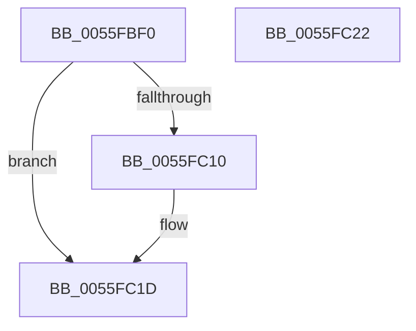

# EmonResumeProfilingOriginal

- RVA: `0x0055FBF0`–`0x0055FC23` (길이 `51` bytes)
- VA: `0x000000014055FBF0`
- 실행 섹션: `.text`
- PDB 이름 있음: `예`; PDB Function 태그: `아니요`
- unwind 정보 RVA: `0x0005C788`
- 디코드: `13`개 명령, `51/51` bytes 표시
- 미해석 바이트: `0` (있으면 어셈블리에 `.byte`로 보존)

> 이 문서는 커널 이미지의 기계어와 PDB 기호를 분석해 생성했습니다. 4번과 5번은 함수 원형과 자료형을 바이너리 사용 방식에서 추정한 C 해석이며 원본 소스 복구 결과는 아닙니다.

## 1. Dependencies

- 직접 호출 지점: **2**; 고유 호출 대상: **1**
- 직접 호출자로 확인된 함수: **0**
- RIP 상대 이미지 참조: **1**

### Outgoing calls
- `0x0055FC02` → [EmonResumeProfilingInternalOriginal](EmonResumeProfilingInternalOriginal_function_0055FB04.md) (function, `0x0055FB04`)
- `0x0055FC18` → [EmonResumeProfilingInternalOriginal](EmonResumeProfilingInternalOriginal_function_0055FB04.md) (function, `0x0055FB04`)

### Direct callers
- 이 함수 시작 RVA로 연결되는 직접 call은 확인되지 않았습니다. 간접 호출은 완전히 역산할 수 없습니다.

### Static image references
- `0x0055FC07` → RVA `0x00F8FDE0` (`.data`; read)

## 2. Other-region calls and transfers

- 다른 실행 섹션으로 향하는 call: **0**
- 별도 외부 분기/꼬리 이동을 확인하지 못했습니다.

## 3. Assembly (complete function range)

```asm
0055FBF0  48 83 EC 28                     sub rsp, 0x28
0055FBF4  65 44 8B 1C 25 A4 01 00 00      mov r11d, dword ptr gs:[0x1a4]
0055FBFD  33 C9                           xor ecx, ecx
0055FBFF  41 8B D3                        mov edx, r11d
0055FC02  E8 FD FE FF FF                  call 0x14055fb04
0055FC07  83 3D D2 01 A3 00 02            cmp dword ptr [rip + 0xa301d2], 2
0055FC0E  72 0D                           jb 0x14055fc1d
0055FC10  41 8B D3                        mov edx, r11d
0055FC13  B9 01 00 00 00                  mov ecx, 1
0055FC18  E8 E7 FE FF FF                  call 0x14055fb04
0055FC1D  48 83 C4 28                     add rsp, 0x28
0055FC21  C3                              ret
0055FC22  CC                              int3
```

## 4. C-style interpretation (structured pseudocode)

```c
__int64 __fastcall EmonResumeProfilingOriginal(int a1)
{
    __int64 result;
    __int64 v_rsp;

    v_rsp = (v_rsp) - (40);
    a1 = 0;
    result = EmonResumeProfilingInternalOriginal(a1, (unsigned int)((unsigned int)((unsigned int)(*(unsigned int *)(gs_base + (0 + 420))))), a3, a4);
    if ((*(unsigned int *)(v_rip + 10682834)) >= 2) {
        a2 = (unsigned int)((unsigned int)(*(unsigned int *)(gs_base + (0 + 420))));
        a1 = 1;
        result = EmonResumeProfilingInternalOriginal(a1, a2, a3, a4);
    }
    v_rsp = (v_rsp) + (40);
    return result;
}
```

## 5. (Beta) C Style

```c
int64_t EmonResumeProfilingOriginal(int32_t Arg1)
{
    int64_t result;
    int64_t local_rsp;

    local_rsp = (local_rsp) - (40);
    Arg1 = 0;
    result = EmonResumeProfilingInternalOriginal(Arg1, (uint32_t)((uint32_t)((uint32_t)(*(uint32_t *)(gs_base + (0 + 0x1A4))))), a3, a4);
    if ((*(uint32_t *)(v_rip + 0xA301D2)) >= 2) {
        a2 = (uint32_t)((uint32_t)(*(uint32_t *)(gs_base + (0 + 0x1A4))));
        Arg1 = 1;
        result = EmonResumeProfilingInternalOriginal(Arg1, a2, a3, a4);
    }
    local_rsp = (local_rsp) + (40);
    return result;
}
```

## 6. Execution-region graph

[열기: 2D/3D 그래프와 함수 탐색 컨트롤 패널](../../../control-panel.html?section=text&rva=0x0055FBF0&view=graph)

- 2D 그래프는 위에서 아래로 흐르고, 3D 그래프는 빈 공간을 드래그해 회전합니다. Shift+드래그는 이동, 휠은 확대·축소, 함수 노드 선택은 대상 보고서 이동입니다.

### Static fallback


