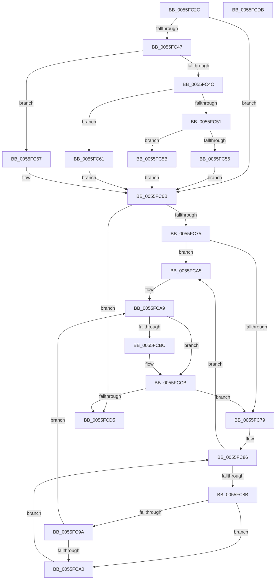

# EmonSaveProfilingContextInternalEnhanced

- RVA: `0x0055FC2C`–`0x0055FCDC` (길이 `176` bytes)
- VA: `0x000000014055FC2C`
- 실행 섹션: `.text`
- PDB 이름 있음: `예`; PDB Function 태그: `아니요`
- unwind 정보 RVA: `0x0005CF00`
- 디코드: `60`개 명령, `176/176` bytes 표시
- 미해석 바이트: `0` (있으면 어셈블리에 `.byte`로 보존)

> 이 문서는 커널 이미지의 기계어와 PDB 기호를 분석해 생성했습니다. 4번과 5번은 함수 원형과 자료형을 바이너리 사용 방식에서 추정한 C 해석이며 원본 소스 복구 결과는 아닙니다.

## 1. Dependencies

- 직접 호출 지점: **1**; 고유 호출 대상: **1**
- 직접 호출자로 확인된 함수: **1**
- RIP 상대 이미지 참조: **1**

### Outgoing calls
- `0x0055FCC6` → [EmonReadCounter](EmonReadCounter_function_0055EE44.md) (function, `0x0055EE44`)

### Direct callers
- [EmonSaveProfilingContextEnhanced](../../pagelk/B5/EmonSaveProfilingContextEnhanced_function_00B5FB10.md) at `0x00B5FB22`
- [EmonSaveProfilingContextEnhanced](../../pagelk/B5/EmonSaveProfilingContextEnhanced_function_00B5FB10.md) at `0x00B5FB2E`

### Static image references
- `0x0055FC34` → RVA `0x00FC8C40` (`ALMOSTRO`; read)

## 2. Other-region calls and transfers

- 다른 실행 섹션으로 향하는 call: **0**
- 별도 외부 분기/꼬리 이동을 확인하지 못했습니다.

## 3. Assembly (complete function range)

```asm
0055FC2C  40 53                           push rbx
0055FC2E  48 83 EC 20                     sub rsp, 0x20
0055FC32  8B C2                           mov eax, edx
0055FC34  48 8D 15 05 90 A6 00            lea rdx, [rip + 0xa69005]
0055FC3B  48 8B 04 C2                     mov rax, qword ptr [rdx + rax*8]
0055FC3F  4C 8B 58 58                     mov r11, qword ptr [rax + 0x58]
0055FC43  85 C9                           test ecx, ecx
0055FC45  74 24                           je 0x14055fc6b
0055FC47  83 E9 01                        sub ecx, 1
0055FC4A  74 1B                           je 0x14055fc67
0055FC4C  83 E9 63                        sub ecx, 0x63
0055FC4F  74 10                           je 0x14055fc61
0055FC51  83 F9 01                        cmp ecx, 1
0055FC54  74 05                           je 0x14055fc5b
0055FC56  45 33 DB                        xor r11d, r11d
0055FC59  EB 10                           jmp 0x14055fc6b
0055FC5B  49 83 C3 48                     add r11, 0x48
0055FC5F  EB 0A                           jmp 0x14055fc6b
0055FC61  49 83 C3 30                     add r11, 0x30
0055FC65  EB 04                           jmp 0x14055fc6b
0055FC67  49 83 C3 18                     add r11, 0x18
0055FC6B  41 8B 43 04                     mov eax, dword ptr [r11 + 4]
0055FC6F  33 DB                           xor ebx, ebx
0055FC71  85 C0                           test eax, eax
0055FC73  74 60                           je 0x14055fcd5
0055FC75  3B D8                           cmp ebx, eax
0055FC77  73 2C                           jae 0x14055fca5
0055FC79  4D 8B 4B 10                     mov r9, qword ptr [r11 + 0x10]
0055FC7D  33 D2                           xor edx, edx
0055FC7F  45 8B 43 08                     mov r8d, dword ptr [r11 + 8]
0055FC83  45 33 D2                        xor r10d, r10d
0055FC86  45 3B D0                        cmp r10d, r8d
0055FC89  77 1A                           ja 0x14055fca5
0055FC8B  4B 8D 0C 52                     lea rcx, [r10 + r10*2]
0055FC8F  48 03 C9                        add rcx, rcx
0055FC92  41 83 7C C9 1C 03               cmp dword ptr [r9 + rcx*8 + 0x1c], 3
0055FC98  74 06                           je 0x14055fca0
0055FC9A  FF C2                           inc edx
0055FC9C  3B D3                           cmp edx, ebx
0055FC9E  77 09                           ja 0x14055fca9
0055FCA0  41 FF C2                        inc r10d
0055FCA3  EB E1                           jmp 0x14055fc86
0055FCA5  41 83 CA FF                     or r10d, 0xffffffff
0055FCA9  4F 8D 04 52                     lea r8, [r10 + r10*2]
0055FCAD  49 C1 E0 04                     shl r8, 4
0055FCB1  4D 03 43 10                     add r8, qword ptr [r11 + 0x10]
0055FCB5  41 83 78 18 02                  cmp dword ptr [r8 + 0x18], 2
0055FCBA  75 0F                           jne 0x14055fccb
0055FCBC  4D 8B 48 10                     mov r9, qword ptr [r8 + 0x10]
0055FCC0  41 8B CA                        mov ecx, r10d
0055FCC3  41 8B 13                        mov edx, dword ptr [r11]
0055FCC6  E8 79 F1 FF FF                  call 0x14055ee44
0055FCCB  41 8B 43 04                     mov eax, dword ptr [r11 + 4]
0055FCCF  FF C3                           inc ebx
0055FCD1  3B D8                           cmp ebx, eax
0055FCD3  72 A4                           jb 0x14055fc79
0055FCD5  48 83 C4 20                     add rsp, 0x20
0055FCD9  5B                              pop rbx
0055FCDA  C3                              ret
0055FCDB  CC                              int3
```

## 4. C-style interpretation (structured pseudocode)

```c
__int64 __fastcall EmonSaveProfilingContextInternalEnhanced(int a1, int a2)
{
    __int64 result;
    __int64 v_r10;
    __int64 v_r11;
    __int64 v_rbx;
    __int64 v_rsp;

    v_rsp = (v_rsp) - (32);
    if (a1 == 0) goto loc_0055FC6B;
    a1 = (unsigned int)((a1) - (1));
    if (condition_is_equal) goto loc_0055FC67;
    a1 = (unsigned int)((a1) - (99));
    if (condition_is_equal) goto loc_0055FC61;
    if (a1 == 1) goto loc_0055FC5B;
    v_r11 = 0;
    goto loc_0055FC6B;
loc_0055FC5B:
    v_r11 = (v_r11) + (72);
    goto loc_0055FC6B;
loc_0055FC61:
    v_r11 = (v_r11) + (48);
    goto loc_0055FC6B;
loc_0055FC67:
    v_r11 = (v_r11) + (24);
loc_0055FC6B:
    v_rbx = 0;
    if ((unsigned int)((unsigned int)(*(unsigned int *)(v_r11 + 4))) == 0) goto loc_0055FCD5;
    if (0 >= ((unsigned int)((unsigned int)(*(unsigned int *)(v_r11 + 4))))) goto loc_0055FCA5;
loc_0055FC79:
    a2 = 0;
    v_r10 = 0;
loc_0055FC86:
    if (0 > ((unsigned int)((unsigned int)(*(unsigned int *)(v_r11 + 8))))) goto loc_0055FCA5;
    a1 = (v_r10 + v_r10 * 2) + (v_r10 + v_r10 * 2);
    if ((*(unsigned int *)(*(unsigned __int64 *)(v_r11 + 16) + a1 * 8 + 28)) == 3) goto loc_0055FCA0;
    a2 = (unsigned int)((a2) + 1);
    if (a2 > 0) goto loc_0055FCA9;
loc_0055FCA0:
    v_r10 = (unsigned int)((v_r10) + 1);
    goto loc_0055FC86;
loc_0055FCA5:
    v_r10 = (unsigned int)((v_r10) | (0xFFFFFFFFULL));
loc_0055FCA9:
    a3 = (v_r10 + v_r10 * 2) << (4);
    a3 = (a3) + (*(unsigned __int64 *)(v_r11 + 16));
    result = (unsigned int)(*(unsigned int *)(v_r11 + 4));
    if ((*(unsigned int *)(a3 + 24)) == 2) {
        a4 = *(unsigned __int64 *)(a3 + 16);
        a1 = (unsigned int)(v_r10);
        a2 = *(unsigned int *)(v_r11);
        result = EmonReadCounter(a1, a2, a3, a4);
    }
    v_rbx = (unsigned int)((v_rbx) + 1);
    if (((unsigned int)(v_rbx)) < ((unsigned int)((unsigned int)(*(unsigned int *)(v_r11 + 4))))) goto loc_0055FC79;
loc_0055FCD5:
    v_rsp = (v_rsp) + (32);
    return (unsigned int)(*(unsigned int *)(v_r11 + 4));
}
```

## 5. (Beta) C Style

```c
int64_t EmonSaveProfilingContextInternalEnhanced(int32_t Arg1, int32_t Arg2)
{
    int64_t result;
    int64_t local_r10;
    int64_t local_r11;
    int64_t local_rbx;
    int64_t local_rsp;

    local_rsp = (local_rsp) - (32);
    if (Arg1 == 0) goto loc_0055FC6B;
    Arg1 = (uint32_t)((Arg1) - (1));
    if (condition_is_equal) goto loc_0055FC67;
    Arg1 = (uint32_t)((Arg1) - (99));
    if (condition_is_equal) goto loc_0055FC61;
    if (Arg1 == 1) goto loc_0055FC5B;
    local_r11 = 0;
    goto loc_0055FC6B;
loc_0055FC5B:
    local_r11 = (local_r11) + (72);
    goto loc_0055FC6B;
loc_0055FC61:
    local_r11 = (local_r11) + (48);
    goto loc_0055FC6B;
loc_0055FC67:
    local_r11 = (local_r11) + (24);
loc_0055FC6B:
    local_rbx = 0;
    if ((uint32_t)((uint32_t)(*(uint32_t *)(local_r11 + 0x4))) == 0) goto loc_0055FCD5;
    if (0 >= ((uint32_t)((uint32_t)(*(uint32_t *)(local_r11 + 0x4))))) goto loc_0055FCA5;
loc_0055FC79:
    Arg2 = 0;
    local_r10 = 0;
loc_0055FC86:
    if (0 > ((uint32_t)((uint32_t)(*(uint32_t *)(local_r11 + 0x8))))) goto loc_0055FCA5;
    Arg1 = (local_r10 + local_r10 * 2) + (local_r10 + local_r10 * 2);
    if ((*(uint32_t *)(*(uint64_t *)(local_r11 + 0x10) + Arg1 * 8 + 0x1C)) == 3) goto loc_0055FCA0;
    Arg2 = (uint32_t)((Arg2) + 1);
    if (Arg2 > 0) goto loc_0055FCA9;
loc_0055FCA0:
    local_r10 = (uint32_t)((local_r10) + 1);
    goto loc_0055FC86;
loc_0055FCA5:
    local_r10 = (uint32_t)((local_r10) | (0xFFFFFFFFULL));
loc_0055FCA9:
    a3 = (local_r10 + local_r10 * 2) << (4);
    a3 = (a3) + (*(uint64_t *)(local_r11 + 0x10));
    result = (uint32_t)(*(uint32_t *)(local_r11 + 0x4));
    if ((*(uint32_t *)(a3 + 0x18)) == 2) {
        a4 = *(uint64_t *)(a3 + 0x10);
        Arg1 = (uint32_t)(local_r10);
        Arg2 = *(uint32_t *)(local_r11);
        result = EmonReadCounter(Arg1, Arg2, a3, a4);
    }
    local_rbx = (uint32_t)((local_rbx) + 1);
    if (((uint32_t)(local_rbx)) < ((uint32_t)((uint32_t)(*(uint32_t *)(local_r11 + 0x4))))) goto loc_0055FC79;
loc_0055FCD5:
    local_rsp = (local_rsp) + (32);
    return (uint32_t)(*(uint32_t *)(local_r11 + 0x4));
}
```

## 6. Execution-region graph

[열기: 2D/3D 그래프와 함수 탐색 컨트롤 패널](../../../control-panel.html?section=text&rva=0x0055FC2C&view=graph)

- 2D 그래프는 위에서 아래로 흐르고, 3D 그래프는 빈 공간을 드래그해 회전합니다. Shift+드래그는 이동, 휠은 확대·축소, 함수 노드 선택은 대상 보고서 이동입니다.

### Static fallback


