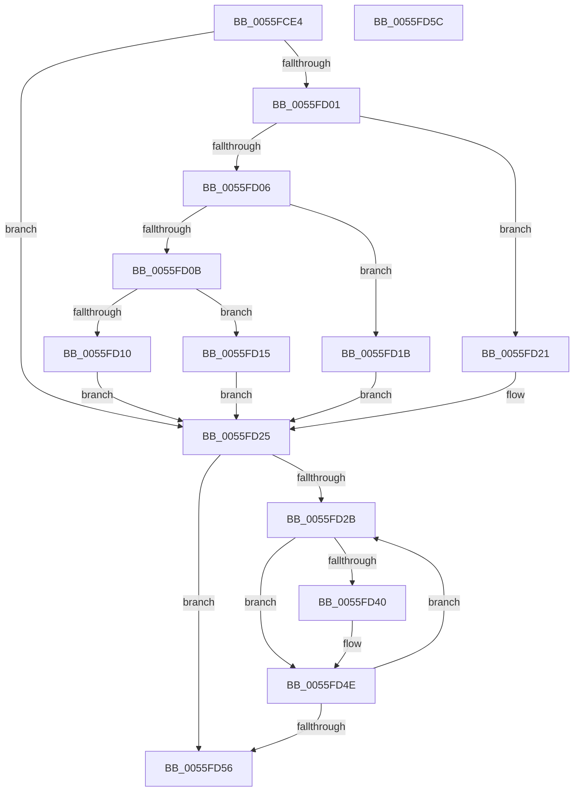

# EmonSaveProfilingContextInternalOriginal

- RVA: `0x0055FCE4`–`0x0055FD5D` (길이 `121` bytes)
- VA: `0x000000014055FCE4`
- 실행 섹션: `.text`
- PDB 이름 있음: `예`; PDB Function 태그: `아니요`
- unwind 정보 RVA: `0x0005CF00`
- 디코드: `41`개 명령, `121/121` bytes 표시
- 미해석 바이트: `0` (있으면 어셈블리에 `.byte`로 보존)

> 이 문서는 커널 이미지의 기계어와 PDB 기호를 분석해 생성했습니다. 4번과 5번은 함수 원형과 자료형을 바이너리 사용 방식에서 추정한 C 해석이며 원본 소스 복구 결과는 아닙니다.

## 1. Dependencies

- 직접 호출 지점: **1**; 고유 호출 대상: **1**
- 직접 호출자로 확인된 함수: **1**
- RIP 상대 이미지 참조: **1**

### Outgoing calls
- `0x0055FD49` → [EmonReadCounter](EmonReadCounter_function_0055EE44.md) (function, `0x0055EE44`)

### Direct callers
- [EmonSaveProfilingContextOriginal](../../pagelk/B5/EmonSaveProfilingContextOriginal_function_00B5FB40.md) at `0x00B5FB52`
- [EmonSaveProfilingContextOriginal](../../pagelk/B5/EmonSaveProfilingContextOriginal_function_00B5FB40.md) at `0x00B5FB5E`

### Static image references
- `0x0055FCEE` → RVA `0x00FC8C40` (`ALMOSTRO`; read)

## 2. Other-region calls and transfers

- 다른 실행 섹션으로 향하는 call: **0**
- 별도 외부 분기/꼬리 이동을 확인하지 못했습니다.

## 3. Assembly (complete function range)

```asm
0055FCE4  40 53                           push rbx
0055FCE6  48 83 EC 20                     sub rsp, 0x20
0055FCEA  8B C2                           mov eax, edx
0055FCEC  33 DB                           xor ebx, ebx
0055FCEE  48 8D 15 4B 8F A6 00            lea rdx, [rip + 0xa68f4b]
0055FCF5  48 8B 04 C2                     mov rax, qword ptr [rdx + rax*8]
0055FCF9  4C 8B 58 58                     mov r11, qword ptr [rax + 0x58]
0055FCFD  85 C9                           test ecx, ecx
0055FCFF  74 24                           je 0x14055fd25
0055FD01  83 E9 01                        sub ecx, 1
0055FD04  74 1B                           je 0x14055fd21
0055FD06  83 E9 63                        sub ecx, 0x63
0055FD09  74 10                           je 0x14055fd1b
0055FD0B  83 F9 01                        cmp ecx, 1
0055FD0E  74 05                           je 0x14055fd15
0055FD10  44 8B DB                        mov r11d, ebx
0055FD13  EB 10                           jmp 0x14055fd25
0055FD15  49 83 C3 48                     add r11, 0x48
0055FD19  EB 0A                           jmp 0x14055fd25
0055FD1B  49 83 C3 30                     add r11, 0x30
0055FD1F  EB 04                           jmp 0x14055fd25
0055FD21  49 83 C3 18                     add r11, 0x18
0055FD25  41 39 5B 04                     cmp dword ptr [r11 + 4], ebx
0055FD29  76 2B                           jbe 0x14055fd56
0055FD2B  8B C3                           mov eax, ebx
0055FD2D  4C 8D 04 40                     lea r8, [rax + rax*2]
0055FD31  49 C1 E0 04                     shl r8, 4
0055FD35  4D 03 43 10                     add r8, qword ptr [r11 + 0x10]
0055FD39  41 83 78 18 02                  cmp dword ptr [r8 + 0x18], 2
0055FD3E  75 0E                           jne 0x14055fd4e
0055FD40  4D 8B 48 10                     mov r9, qword ptr [r8 + 0x10]
0055FD44  8B CB                           mov ecx, ebx
0055FD46  41 8B 13                        mov edx, dword ptr [r11]
0055FD49  E8 F6 F0 FF FF                  call 0x14055ee44
0055FD4E  FF C3                           inc ebx
0055FD50  41 3B 5B 04                     cmp ebx, dword ptr [r11 + 4]
0055FD54  72 D5                           jb 0x14055fd2b
0055FD56  48 83 C4 20                     add rsp, 0x20
0055FD5A  5B                              pop rbx
0055FD5B  C3                              ret
0055FD5C  CC                              int3
```

## 4. C-style interpretation (structured pseudocode)

```c
__int64 __fastcall EmonSaveProfilingContextInternalOriginal(int a1, int a2)
{
    __int64 result;
    __int64 v_r11;
    __int64 v_rbx;
    __int64 v_rsp;

    v_rsp = (v_rsp) - (32);
    v_rbx = 0;
    if (a1 == 0) goto loc_0055FD25;
    a1 = (unsigned int)((a1) - (1));
    if (condition_is_equal) goto loc_0055FD21;
    a1 = (unsigned int)((a1) - (99));
    if (condition_is_equal) goto loc_0055FD1B;
    if (a1 == 1) goto loc_0055FD15;
    goto loc_0055FD25;
loc_0055FD15:
    v_r11 = (0) + (72);
    goto loc_0055FD25;
loc_0055FD1B:
    v_r11 = (v_r11) + (48);
    goto loc_0055FD25;
loc_0055FD21:
    v_r11 = (v_r11) + (24);
loc_0055FD25:
    if ((*(unsigned int *)(v_r11 + 4)) <= 0) goto loc_0055FD56;
loc_0055FD2B:
    a3 = (0 + 0 * 2) << (4);
    a3 = (a3) + (*(unsigned __int64 *)(v_r11 + 16));
    result = 0;
    if ((*(unsigned int *)(a3 + 24)) == 2) {
        a4 = *(unsigned __int64 *)(a3 + 16);
        a1 = 0;
        a2 = *(unsigned int *)(v_r11);
        result = EmonReadCounter(a1, a2, a3, a4);
    }
    v_rbx = (unsigned int)((v_rbx) + 1);
    if (((unsigned int)(v_rbx)) < (*(unsigned int *)(v_r11 + 4))) goto loc_0055FD2B;
loc_0055FD56:
    v_rsp = (v_rsp) + (32);
    return result;
}
```

## 5. (Beta) C Style

```c
int64_t EmonSaveProfilingContextInternalOriginal(int32_t Arg1, int32_t Arg2)
{
    int64_t result;
    int64_t local_r11;
    int64_t local_rbx;
    int64_t local_rsp;

    local_rsp = (local_rsp) - (32);
    local_rbx = 0;
    if (Arg1 == 0) goto loc_0055FD25;
    Arg1 = (uint32_t)((Arg1) - (1));
    if (condition_is_equal) goto loc_0055FD21;
    Arg1 = (uint32_t)((Arg1) - (99));
    if (condition_is_equal) goto loc_0055FD1B;
    if (Arg1 == 1) goto loc_0055FD15;
    goto loc_0055FD25;
loc_0055FD15:
    local_r11 = (0) + (72);
    goto loc_0055FD25;
loc_0055FD1B:
    local_r11 = (local_r11) + (48);
    goto loc_0055FD25;
loc_0055FD21:
    local_r11 = (local_r11) + (24);
loc_0055FD25:
    if ((*(uint32_t *)(local_r11 + 0x4)) <= 0) goto loc_0055FD56;
loc_0055FD2B:
    a3 = (0 + 0 * 2) << (4);
    a3 = (a3) + (*(uint64_t *)(local_r11 + 0x10));
    result = 0;
    if ((*(uint32_t *)(a3 + 0x18)) == 2) {
        a4 = *(uint64_t *)(a3 + 0x10);
        Arg1 = 0;
        Arg2 = *(uint32_t *)(local_r11);
        result = EmonReadCounter(Arg1, Arg2, a3, a4);
    }
    local_rbx = (uint32_t)((local_rbx) + 1);
    if (((uint32_t)(local_rbx)) < (*(uint32_t *)(local_r11 + 0x4))) goto loc_0055FD2B;
loc_0055FD56:
    local_rsp = (local_rsp) + (32);
    return result;
}
```

## 6. Execution-region graph

[열기: 2D/3D 그래프와 함수 탐색 컨트롤 패널](../../../control-panel.html?section=text&rva=0x0055FCE4&view=graph)

- 2D 그래프는 위에서 아래로 흐르고, 3D 그래프는 빈 공간을 드래그해 회전합니다. Shift+드래그는 이동, 휠은 확대·축소, 함수 노드 선택은 대상 보고서 이동입니다.

### Static fallback


