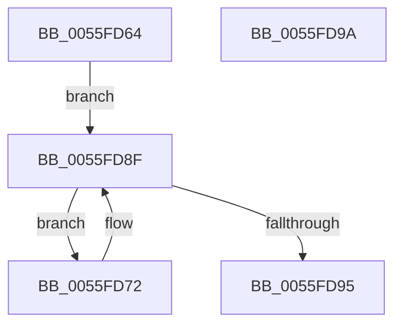

# EmonSetAllocatedCounters

- RVA: `0x0055FD64`–`0x0055FD9B` (길이 `55` bytes)
- VA: `0x000000014055FD64`
- 실행 섹션: `.text`
- PDB 이름 있음: `예`; PDB Function 태그: `아니요`
- unwind 정보 RVA: `0x000DB714`
- 디코드: `19`개 명령, `55/55` bytes 표시
- 미해석 바이트: `0` (있으면 어셈블리에 `.byte`로 보존)

> 이 문서는 커널 이미지의 기계어와 PDB 기호를 분석해 생성했습니다. 4번과 5번은 함수 원형과 자료형을 바이너리 사용 방식에서 추정한 C 해석이며 원본 소스 복구 결과는 아닙니다.

## 1. Dependencies

- 직접 호출 지점: **0**; 고유 호출 대상: **0**
- 직접 호출자로 확인된 함수: **1**
- RIP 상대 이미지 참조: **0**

### Outgoing calls
- 직접 디코드된 call 명령이 없습니다.

### Direct callers
- [EmonInitializeProfilingEnhanced](../../pagelk/B5/EmonInitializeProfilingEnhanced_function_00B5F320.md) at `0x00B5F49B`
- [EmonInitializeProfilingEnhanced](../../pagelk/B5/EmonInitializeProfilingEnhanced_function_00B5F320.md) at `0x00B5F4A6`

### Static image references
- 디코드된 RIP-relative 메모리 참조가 없습니다.

## 2. Other-region calls and transfers

- 다른 실행 섹션으로 향하는 call: **0**
- 별도 외부 분기/꼬리 이동을 확인하지 못했습니다.

## 3. Assembly (complete function range)

```asm
0055FD64  44 8B 11                        mov r10d, dword ptr [rcx]
0055FD67  4C 8B C1                        mov r8, rcx
0055FD6A  4C 8B 59 10                     mov r11, qword ptr [rcx + 0x10]
0055FD6E  33 C0                           xor eax, eax
0055FD70  EB 1D                           jmp 0x14055fd8f
0055FD72  41 8B C9                        mov ecx, r9d
0055FD75  B8 01 00 00 00                  mov eax, 1
0055FD7A  D3 E0                           shl eax, cl
0055FD7C  4B 8D 0C 49                     lea rcx, [r9 + r9*2]
0055FD80  F7 D0                           not eax
0055FD82  23 D0                           and edx, eax
0055FD84  41 8B C1                        mov eax, r9d
0055FD87  48 03 C9                        add rcx, rcx
0055FD8A  45 89 54 CB 1C                  mov dword ptr [r11 + rcx*8 + 0x1c], r10d
0055FD8F  44 0F BC CA                     bsf r9d, edx
0055FD93  75 DD                           jne 0x14055fd72
0055FD95  41 89 40 08                     mov dword ptr [r8 + 8], eax
0055FD99  C3                              ret
0055FD9A  CC                              int3
```

## 4. C-style interpretation (structured pseudocode)

```c
__int64 __fastcall EmonSetAllocatedCounters(__int64 a1, int a2, __int64 a3, __int64 a4)
{
    __int64 result;

    result = 0;
    goto loc_0055FD8F;
loc_0055FD72:
    result = (unsigned int)((1) << ((unsigned __int8)((unsigned int)((unsigned int)(a4)))));
    result = (unsigned int)(~(result));
    a2 = (unsigned int)((a2) & ((unsigned int)(result)));
    a1 = (a4 + a4 * 2) + (a4 + a4 * 2);
    *(unsigned int *)(*(unsigned __int64 *)(a1 + 16) + a1 * 8 + 28) = (unsigned int)((unsigned int)(*(unsigned int *)(a1)));
loc_0055FD8F:
    if (condition_is_not_equal) goto loc_0055FD72;
    *(unsigned int *)(a1 + 8) = (unsigned int)((unsigned int)((unsigned int)(a4)));
    return (unsigned int)((unsigned int)(a4));
}
```

## 5. (Beta) C Style

```c
int64_t EmonSetAllocatedCounters(void *Arg1, int32_t Arg2, int64_t Arg3, int64_t Arg4)
{
    uint8_t *arg1 = (uint8_t *)Arg1;

    int64_t result;

    result = 0;
    goto loc_0055FD8F;
loc_0055FD72:
    result = (uint32_t)((1) << ((uint8_t)((uint32_t)((uint32_t)(Arg4)))));
    result = (uint32_t)(~(result));
    Arg2 = (uint32_t)((Arg2) & ((uint32_t)(result)));
    Arg1 = (Arg4 + Arg4 * 2) + (Arg4 + Arg4 * 2);
    *(uint32_t *)(*(uint64_t *)(arg1 + 0x10) + arg1 * 8 + 0x1C) = (uint32_t)((uint32_t)(*(uint32_t *)(arg1)));
loc_0055FD8F:
    if (condition_is_not_equal) goto loc_0055FD72;
    *(uint32_t *)(arg1 + 0x8) = (uint32_t)((uint32_t)((uint32_t)(Arg4)));
    return (uint32_t)((uint32_t)(Arg4));
}
```

### 관측된 메모리 오프셋

구조체 형식이 확인되지 않은 접근은 인자 기준의 오프셋으로만 기록했습니다.

| 기준 인자 | 오프셋 표현 | 폭 (bit) | 접근 |
|---|---:|---:|---|
| `Arg1` | `+ 0x0` | `32` | `R` |
| `Arg1` | `+ 0x8` | `32` | `W` |
| `Arg1` | `+ 0x10` | `64` | `R` |

## 6. Execution-region graph

[열기: 2D/3D 그래프와 함수 탐색 컨트롤 패널](../../../control-panel.html?section=text&rva=0x0055FD64&view=graph)

- 2D 그래프는 위에서 아래로 흐르고, 3D 그래프는 빈 공간을 드래그해 회전합니다. Shift+드래그는 이동, 휠은 확대·축소, 함수 노드 선택은 대상 보고서 이동입니다.

### Static fallback


