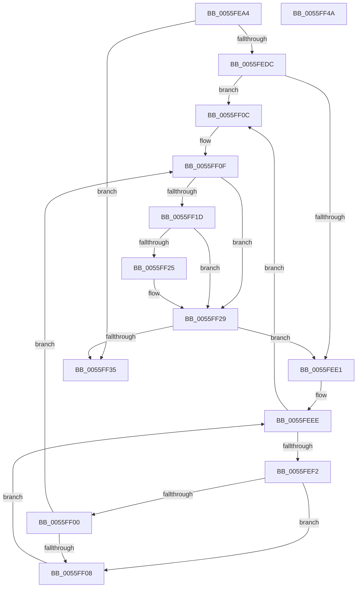

# EmonSetIntervalInternalEnhanced

- RVA: `0x0055FEA4`–`0x0055FF4B` (길이 `167` bytes)
- VA: `0x000000014055FEA4`
- 실행 섹션: `.text`
- PDB 이름 있음: `예`; PDB Function 태그: `아니요`
- unwind 정보 RVA: `0x000A5A38`
- 디코드: `51`개 명령, `167/167` bytes 표시
- 미해석 바이트: `0` (있으면 어셈블리에 `.byte`로 보존)

> 이 문서는 커널 이미지의 기계어와 PDB 기호를 분석해 생성했습니다. 4번과 5번은 함수 원형과 자료형을 바이너리 사용 방식에서 추정한 C 해석이며 원본 소스 복구 결과는 아닙니다.

## 1. Dependencies

- 직접 호출 지점: **0**; 고유 호출 대상: **0**
- 직접 호출자로 확인된 함수: **1**
- RIP 상대 이미지 참조: **1**

### Outgoing calls
- 직접 디코드된 call 명령이 없습니다.

### Direct callers
- [EmonSetIntervalEnhanced](EmonSetIntervalEnhanced_function_0055FDB0.md) at `0x0055FE7A`
- [EmonSetIntervalEnhanced](EmonSetIntervalEnhanced_function_0055FDB0.md) at `0x0055FE86`

### Static image references
- `0x0055FEBC` → RVA `0x00FC8C40` (`ALMOSTRO`; read)

## 2. Other-region calls and transfers

- 다른 실행 섹션으로 향하는 call: **0**
- 별도 외부 분기/꼬리 이동을 확인하지 못했습니다.

## 3. Assembly (complete function range)

```asm
0055FEA4  48 8B C4                        mov rax, rsp
0055FEA7  48 89 58 08                     mov qword ptr [rax + 8], rbx
0055FEAB  48 89 68 10                     mov qword ptr [rax + 0x10], rbp
0055FEAF  48 89 70 18                     mov qword ptr [rax + 0x18], rsi
0055FEB3  48 89 78 20                     mov qword ptr [rax + 0x20], rdi
0055FEB7  41 8B C1                        mov eax, r9d
0055FEBA  8B E9                           mov ebp, ecx
0055FEBC  48 8D 0D 7D 8D A6 00            lea rcx, [rip + 0xa68d7d]
0055FEC3  8B F2                           mov esi, edx
0055FEC5  45 33 C0                        xor r8d, r8d
0055FEC8  48 8B 04 C1                     mov rax, qword ptr [rcx + rax*8]
0055FECC  4C 8B 50 58                     mov r10, qword ptr [rax + 0x58]
0055FED0  41 8B 42 04                     mov eax, dword ptr [r10 + 4]
0055FED4  4D 8B 5A 10                     mov r11, qword ptr [r10 + 0x10]
0055FED8  85 C0                           test eax, eax
0055FEDA  74 59                           je 0x14055ff35
0055FEDC  44 3B C0                        cmp r8d, eax
0055FEDF  73 2B                           jae 0x14055ff0c
0055FEE1  49 8B 7A 10                     mov rdi, qword ptr [r10 + 0x10]
0055FEE5  45 33 C9                        xor r9d, r9d
0055FEE8  41 8B 5A 08                     mov ebx, dword ptr [r10 + 8]
0055FEEC  33 D2                           xor edx, edx
0055FEEE  3B D3                           cmp edx, ebx
0055FEF0  77 1A                           ja 0x14055ff0c
0055FEF2  48 8D 0C 52                     lea rcx, [rdx + rdx*2]
0055FEF6  48 03 C9                        add rcx, rcx
0055FEF9  83 7C CF 1C 03                  cmp dword ptr [rdi + rcx*8 + 0x1c], 3
0055FEFE  74 08                           je 0x14055ff08
0055FF00  41 FF C1                        inc r9d
0055FF03  45 3B C8                        cmp r9d, r8d
0055FF06  77 07                           ja 0x14055ff0f
0055FF08  FF C2                           inc edx
0055FF0A  EB E2                           jmp 0x14055feee
0055FF0C  83 CA FF                        or edx, 0xffffffff
0055FF0F  48 8D 0C 52                     lea rcx, [rdx + rdx*2]
0055FF13  48 03 C9                        add rcx, rcx
0055FF16  41 39 6C CB 24                  cmp dword ptr [r11 + rcx*8 + 0x24], ebp
0055FF1B  75 0C                           jne 0x14055ff29
0055FF1D  41 83 7C CB 18 00               cmp dword ptr [r11 + rcx*8 + 0x18], 0
0055FF23  75 04                           jne 0x14055ff29
0055FF25  49 89 34 CB                     mov qword ptr [r11 + rcx*8], rsi
0055FF29  41 8B 42 04                     mov eax, dword ptr [r10 + 4]
0055FF2D  41 FF C0                        inc r8d
0055FF30  44 3B C0                        cmp r8d, eax
0055FF33  72 AC                           jb 0x14055fee1
0055FF35  48 8B 5C 24 08                  mov rbx, qword ptr [rsp + 8]
0055FF3A  48 8B 6C 24 10                  mov rbp, qword ptr [rsp + 0x10]
0055FF3F  48 8B 74 24 18                  mov rsi, qword ptr [rsp + 0x18]
0055FF44  48 8B 7C 24 20                  mov rdi, qword ptr [rsp + 0x20]
0055FF49  C3                              ret
0055FF4A  CC                              int3
```

## 4. C-style interpretation (structured pseudocode)

```c
__int64 __fastcall EmonSetIntervalInternalEnhanced(int a1, int a2, int a3, int a4)
{
    unsigned __int64 v_stack_p10;
    unsigned __int64 v_stack_p18;
    unsigned __int64 v_stack_p20;
    unsigned __int64 v_stack_p8;

    *(unsigned __int64 *)(v_rsp + 8) = v_rbx;
    *(unsigned __int64 *)(v_rsp + 16) = v_rbp;
    *(unsigned __int64 *)(v_rsp + 24) = v_rsi;
    *(unsigned __int64 *)(v_rsp + 32) = v_rdi;
    a3 = 0;
    if ((unsigned int)((unsigned int)(*(unsigned int *)(*(unsigned __int64 *)(*(unsigned __int64 *)(v_rip + 10915197 + (unsigned int)(a4) * 8) + 88) + 4))) == 0) goto loc_0055FF35;
    if (0 >= ((unsigned int)((unsigned int)(*(unsigned int *)(*(unsigned __int64 *)(*(unsigned __int64 *)(v_rip + 10915197 + (unsigned int)(a4) * 8) + 88) + 4))))) goto loc_0055FF0C;
loc_0055FEE1:
    a4 = 0;
    a2 = 0;
loc_0055FEEE:
    if (0 > ((unsigned int)((unsigned int)(*(unsigned int *)(*(unsigned __int64 *)(*(unsigned __int64 *)(v_rip + 10915197 + (unsigned int)(a4) * 8) + 88) + 8))))) goto loc_0055FF0C;
    a1 = (a2 + a2 * 2) + (a2 + a2 * 2);
    if ((*(unsigned int *)(*(unsigned __int64 *)(*(unsigned __int64 *)(*(unsigned __int64 *)(v_rip + 10915197 + (unsigned int)(a4) * 8) + 88) + 16) + a1 * 8 + 28)) == 3) goto loc_0055FF08;
    a4 = (unsigned int)((a4) + 1);
    if (a4 > 0) goto loc_0055FF0F;
loc_0055FF08:
    a2 = (unsigned int)((a2) + 1);
    goto loc_0055FEEE;
loc_0055FF0C:
    a2 = (unsigned int)((a2) | (0xFFFFFFFFULL));
loc_0055FF0F:
    a1 = (a2 + a2 * 2) + (a2 + a2 * 2);
    if ((*(unsigned int *)(*(unsigned __int64 *)(*(unsigned __int64 *)(*(unsigned __int64 *)(v_rip + 10915197 + (unsigned int)(a4) * 8) + 88) + 16) + a1 * 8 + 36)) != ((unsigned int)((unsigned int)(a1)))) goto loc_0055FF29;
    if ((*(unsigned int *)(*(unsigned __int64 *)(*(unsigned __int64 *)(*(unsigned __int64 *)(v_rip + 10915197 + (unsigned int)(a4) * 8) + 88) + 16) + a1 * 8 + 24)) == 0) {
        *(unsigned __int64 *)(*(unsigned __int64 *)(*(unsigned __int64 *)(*(unsigned __int64 *)(v_rip + 10915197 + (unsigned int)(a4) * 8) + 88) + 16) + a1 * 8) = (unsigned int)(a2);
    }
    a3 = (unsigned int)((a3) + 1);
    if (a3 < ((unsigned int)((unsigned int)(*(unsigned int *)(*(unsigned __int64 *)(*(unsigned __int64 *)(v_rip + 10915197 + (unsigned int)(a4) * 8) + 88) + 4))))) goto loc_0055FEE1;
loc_0055FF35:
    return (unsigned int)(*(unsigned int *)(*(unsigned __int64 *)(*(unsigned __int64 *)(v_rip + 10915197 + (unsigned int)(a4) * 8) + 88) + 4));
}
```

## 5. (Beta) C Style

```c
int64_t EmonSetIntervalInternalEnhanced(int32_t Arg1, int32_t Arg2, int32_t Arg3, int32_t Arg4)
{
    uint64_t v_stack_p10;
    uint64_t v_stack_p18;
    uint64_t v_stack_p20;
    uint64_t v_stack_p8;

    *(uint64_t *)(local_rsp + 0x8) = local_rbx;
    *(uint64_t *)(local_rsp + 0x10) = local_rbp;
    *(uint64_t *)(local_rsp + 0x18) = local_rsi;
    *(uint64_t *)(local_rsp + 0x20) = local_rdi;
    Arg3 = 0;
    if ((uint32_t)((uint32_t)(*(uint32_t *)(*(uint64_t *)(*(uint64_t *)(v_rip + 0xA68D7D + (uint32_t)(Arg4) * 8) + 0x58) + 0x4))) == 0) goto loc_0055FF35;
    if (0 >= ((uint32_t)((uint32_t)(*(uint32_t *)(*(uint64_t *)(*(uint64_t *)(v_rip + 0xA68D7D + (uint32_t)(Arg4) * 8) + 0x58) + 0x4))))) goto loc_0055FF0C;
loc_0055FEE1:
    Arg4 = 0;
    Arg2 = 0;
loc_0055FEEE:
    if (0 > ((uint32_t)((uint32_t)(*(uint32_t *)(*(uint64_t *)(*(uint64_t *)(v_rip + 0xA68D7D + (uint32_t)(Arg4) * 8) + 0x58) + 0x8))))) goto loc_0055FF0C;
    Arg1 = (Arg2 + Arg2 * 2) + (Arg2 + Arg2 * 2);
    if ((*(uint32_t *)(*(uint64_t *)(*(uint64_t *)(*(uint64_t *)(v_rip + 0xA68D7D + (uint32_t)(Arg4) * 8) + 0x58) + 0x10) + Arg1 * 8 + 0x1C)) == 3) goto loc_0055FF08;
    Arg4 = (uint32_t)((Arg4) + 1);
    if (Arg4 > 0) goto loc_0055FF0F;
loc_0055FF08:
    Arg2 = (uint32_t)((Arg2) + 1);
    goto loc_0055FEEE;
loc_0055FF0C:
    Arg2 = (uint32_t)((Arg2) | (0xFFFFFFFFULL));
loc_0055FF0F:
    Arg1 = (Arg2 + Arg2 * 2) + (Arg2 + Arg2 * 2);
    if ((*(uint32_t *)(*(uint64_t *)(*(uint64_t *)(*(uint64_t *)(v_rip + 0xA68D7D + (uint32_t)(Arg4) * 8) + 0x58) + 0x10) + Arg1 * 8 + 0x24)) != ((uint32_t)((uint32_t)(Arg1)))) goto loc_0055FF29;
    if ((*(uint32_t *)(*(uint64_t *)(*(uint64_t *)(*(uint64_t *)(v_rip + 0xA68D7D + (uint32_t)(Arg4) * 8) + 0x58) + 0x10) + Arg1 * 8 + 0x18)) == 0) {
        *(uint64_t *)(*(uint64_t *)(*(uint64_t *)(*(uint64_t *)(v_rip + 0xA68D7D + (uint32_t)(Arg4) * 8) + 0x58) + 0x10) + Arg1 * 8) = (uint32_t)(Arg2);
    }
    Arg3 = (uint32_t)((Arg3) + 1);
    if (Arg3 < ((uint32_t)((uint32_t)(*(uint32_t *)(*(uint64_t *)(*(uint64_t *)(v_rip + 0xA68D7D + (uint32_t)(Arg4) * 8) + 0x58) + 0x4))))) goto loc_0055FEE1;
loc_0055FF35:
    return (uint32_t)(*(uint32_t *)(*(uint64_t *)(*(uint64_t *)(v_rip + 0xA68D7D + (uint32_t)(Arg4) * 8) + 0x58) + 0x4));
}
```

## 6. Execution-region graph

[열기: 2D/3D 그래프와 함수 탐색 컨트롤 패널](../../../control-panel.html?section=text&rva=0x0055FEA4&view=graph)

- 2D 그래프는 위에서 아래로 흐르고, 3D 그래프는 빈 공간을 드래그해 회전합니다. Shift+드래그는 이동, 휠은 확대·축소, 함수 노드 선택은 대상 보고서 이동입니다.

### Static fallback


