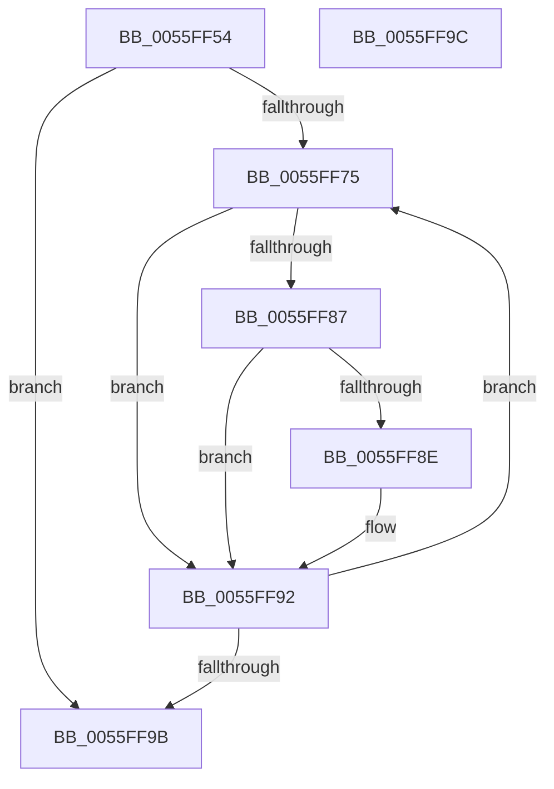

# EmonSetIntervalInternalOriginal

- RVA: `0x0055FF54`–`0x0055FF9D` (길이 `73` bytes)
- VA: `0x000000014055FF54`
- 실행 섹션: `.text`
- PDB 이름 있음: `예`; PDB Function 태그: `아니요`
- unwind 정보 RVA: `0x000DB714`
- 디코드: `22`개 명령, `73/73` bytes 표시
- 미해석 바이트: `0` (있으면 어셈블리에 `.byte`로 보존)

> 이 문서는 커널 이미지의 기계어와 PDB 기호를 분석해 생성했습니다. 4번과 5번은 함수 원형과 자료형을 바이너리 사용 방식에서 추정한 C 해석이며 원본 소스 복구 결과는 아닙니다.

## 1. Dependencies

- 직접 호출 지점: **0**; 고유 호출 대상: **0**
- 직접 호출자로 확인된 함수: **1**
- RIP 상대 이미지 참조: **1**

### Outgoing calls
- 직접 디코드된 call 명령이 없습니다.

### Direct callers
- [EmonSetIntervalOriginal](EmonSetIntervalOriginal_function_0055FFB0.md) at `0x0056007A`
- [EmonSetIntervalOriginal](EmonSetIntervalOriginal_function_0055FFB0.md) at `0x00560086`

### Static image references
- `0x0055FF5A` → RVA `0x00FC8C40` (`ALMOSTRO`; read)

## 2. Other-region calls and transfers

- 다른 실행 섹션으로 향하는 call: **0**
- 별도 외부 분기/꼬리 이동을 확인하지 못했습니다.

## 3. Assembly (complete function range)

```asm
0055FF54  41 8B C1                        mov eax, r9d
0055FF57  44 8B D9                        mov r11d, ecx
0055FF5A  48 8D 0D DF 8C A6 00            lea rcx, [rip + 0xa68cdf]
0055FF61  44 8B D2                        mov r10d, edx
0055FF64  45 33 C0                        xor r8d, r8d
0055FF67  48 8B 04 C1                     mov rax, qword ptr [rcx + rax*8]
0055FF6B  4C 8B 48 58                     mov r9, qword ptr [rax + 0x58]
0055FF6F  45 39 41 04                     cmp dword ptr [r9 + 4], r8d
0055FF73  76 26                           jbe 0x14055ff9b
0055FF75  49 8B 51 10                     mov rdx, qword ptr [r9 + 0x10]
0055FF79  4B 8D 0C 40                     lea rcx, [r8 + r8*2]
0055FF7D  48 03 C9                        add rcx, rcx
0055FF80  44 39 5C CA 24                  cmp dword ptr [rdx + rcx*8 + 0x24], r11d
0055FF85  75 0B                           jne 0x14055ff92
0055FF87  83 7C CA 18 00                  cmp dword ptr [rdx + rcx*8 + 0x18], 0
0055FF8C  75 04                           jne 0x14055ff92
0055FF8E  4C 89 14 CA                     mov qword ptr [rdx + rcx*8], r10
0055FF92  41 FF C0                        inc r8d
0055FF95  45 3B 41 04                     cmp r8d, dword ptr [r9 + 4]
0055FF99  72 DA                           jb 0x14055ff75
0055FF9B  C3                              ret
0055FF9C  CC                              int3
```

## 4. C-style interpretation (structured pseudocode)

```c
__int64 __fastcall EmonSetIntervalInternalOriginal(int a1, int a2, int a3, int a4)
{
    a3 = 0;
    if ((*(unsigned int *)(*(unsigned __int64 *)(*(unsigned __int64 *)(v_rip + 10915039 + (unsigned int)(a4) * 8) + 88) + 4)) <= 0) goto loc_0055FF9B;
loc_0055FF75:
    a1 = (a3 + a3 * 2) + (a3 + a3 * 2);
    if ((*(unsigned int *)(*(unsigned __int64 *)(*(unsigned __int64 *)(*(unsigned __int64 *)(v_rip + 10915039 + (unsigned int)(a4) * 8) + 88) + 16) + a1 * 8 + 36)) != ((unsigned int)((unsigned int)(a1)))) goto loc_0055FF92;
    if ((*(unsigned int *)(*(unsigned __int64 *)(*(unsigned __int64 *)(*(unsigned __int64 *)(v_rip + 10915039 + (unsigned int)(a4) * 8) + 88) + 16) + a1 * 8 + 24)) == 0) {
        *(unsigned __int64 *)(*(unsigned __int64 *)(*(unsigned __int64 *)(*(unsigned __int64 *)(v_rip + 10915039 + (unsigned int)(a4) * 8) + 88) + 16) + a1 * 8) = (unsigned int)(a2);
    }
    a3 = (unsigned int)((a3) + 1);
    if (a3 < (*(unsigned int *)(*(unsigned __int64 *)(*(unsigned __int64 *)(v_rip + 10915039 + (unsigned int)(a4) * 8) + 88) + 4))) goto loc_0055FF75;
loc_0055FF9B:
    return *(unsigned __int64 *)(v_rip + 10915039 + (unsigned int)(a4) * 8);
}
```

## 5. (Beta) C Style

```c
int64_t EmonSetIntervalInternalOriginal(int32_t Arg1, int32_t Arg2, int32_t Arg3, int32_t Arg4)
{
    Arg3 = 0;
    if ((*(uint32_t *)(*(uint64_t *)(*(uint64_t *)(v_rip + 0xA68CDF + (uint32_t)(Arg4) * 8) + 0x58) + 0x4)) <= 0) goto loc_0055FF9B;
loc_0055FF75:
    Arg1 = (Arg3 + Arg3 * 2) + (Arg3 + Arg3 * 2);
    if ((*(uint32_t *)(*(uint64_t *)(*(uint64_t *)(*(uint64_t *)(v_rip + 0xA68CDF + (uint32_t)(Arg4) * 8) + 0x58) + 0x10) + Arg1 * 8 + 0x24)) != ((uint32_t)((uint32_t)(Arg1)))) goto loc_0055FF92;
    if ((*(uint32_t *)(*(uint64_t *)(*(uint64_t *)(*(uint64_t *)(v_rip + 0xA68CDF + (uint32_t)(Arg4) * 8) + 0x58) + 0x10) + Arg1 * 8 + 0x18)) == 0) {
        *(uint64_t *)(*(uint64_t *)(*(uint64_t *)(*(uint64_t *)(v_rip + 0xA68CDF + (uint32_t)(Arg4) * 8) + 0x58) + 0x10) + Arg1 * 8) = (uint32_t)(Arg2);
    }
    Arg3 = (uint32_t)((Arg3) + 1);
    if (Arg3 < (*(uint32_t *)(*(uint64_t *)(*(uint64_t *)(v_rip + 0xA68CDF + (uint32_t)(Arg4) * 8) + 0x58) + 0x4))) goto loc_0055FF75;
loc_0055FF9B:
    return *(uint64_t *)(v_rip + 0xA68CDF + (uint32_t)(Arg4) * 8);
}
```

## 6. Execution-region graph

[열기: 2D/3D 그래프와 함수 탐색 컨트롤 패널](../../../control-panel.html?section=text&rva=0x0055FF54&view=graph)

- 2D 그래프는 위에서 아래로 흐르고, 3D 그래프는 빈 공간을 드래그해 회전합니다. Shift+드래그는 이동, 휠은 확대·축소, 함수 노드 선택은 대상 보고서 이동입니다.

### Static fallback


