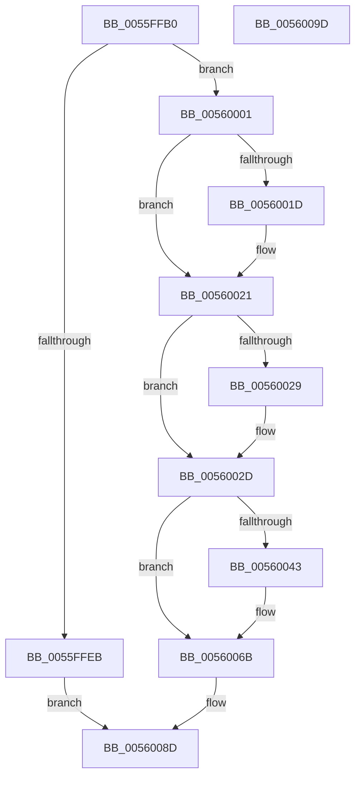

# EmonSetIntervalOriginal

- RVA: `0x0055FFB0`–`0x0056009E` (길이 `238` bytes)
- VA: `0x000000014055FFB0`
- 실행 섹션: `.text`
- PDB 이름 있음: `예`; PDB Function 태그: `아니요`
- unwind 정보 RVA: `0x00060BC4`
- 디코드: `65`개 명령, `238/238` bytes 표시
- 미해석 바이트: `0` (있으면 어셈블리에 `.byte`로 보존)

> 이 문서는 커널 이미지의 기계어와 PDB 기호를 분석해 생성했습니다. 4번과 5번은 함수 원형과 자료형을 바이너리 사용 방식에서 추정한 C 해석이며 원본 소스 복구 결과는 아닙니다.

## 1. Dependencies

- 직접 호출 지점: **7**; 고유 호출 대상: **5**
- 직접 호출자로 확인된 함수: **0**
- RIP 상대 이미지 참조: **2**

### Outgoing calls
- `0x0055FFD1` → [HalpAcquireHighLevelLock](../2D/HalpAcquireHighLevelLock_function_002D2390.md) (function, `0x002D2390`)
- `0x0055FFE0` → [HalpGetProfileDescriptor](../4B/HalpGetProfileDescriptor_function_004BB170.md) (function, `0x004BB170`)
- `0x0055FFF5` → [HalpReleaseHighLevelLock](../2D/HalpReleaseHighLevelLock_function_002D1C58.md) (function, `0x002D1C58`)
- `0x0056003A` → [HalpReleaseHighLevelLock](../2D/HalpReleaseHighLevelLock_function_002D1C58.md) (function, `0x002D1C58`)
- `0x00560066` → [HalpTimerSetProfilingTarget](../4C/HalpTimerSetProfilingTarget_function_004CAE84.md) (function, `0x004CAE84`)
- `0x0056007A` → [EmonSetIntervalInternalOriginal](EmonSetIntervalInternalOriginal_function_0055FF54.md) (function, `0x0055FF54`)
- `0x00560086` → [EmonSetIntervalInternalOriginal](EmonSetIntervalInternalOriginal_function_0055FF54.md) (function, `0x0055FF54`)

### Direct callers
- 이 함수 시작 RVA로 연결되는 직접 call은 확인되지 않았습니다. 간접 호출은 완전히 역산할 수 없습니다.

### Static image references
- `0x0055FFC7` → RVA `0x00FC2BD0` (`.data`; read)
- `0x00560006` → RVA `0x00025D68` (`.rdata`; read)

## 2. Other-region calls and transfers

- 다른 실행 섹션으로 향하는 call: **0**
- 별도 외부 분기/꼬리 이동을 확인하지 못했습니다.

## 3. Assembly (complete function range)

```asm
0055FFB0  48 89 5C 24 08                  mov qword ptr [rsp + 8], rbx
0055FFB5  48 89 74 24 10                  mov qword ptr [rsp + 0x10], rsi
0055FFBA  57                              push rdi
0055FFBB  48 83 EC 20                     sub rsp, 0x20
0055FFBF  48 83 64 24 40 00               and qword ptr [rsp + 0x40], 0
0055FFC5  8B F1                           mov esi, ecx
0055FFC7  48 8D 0D 02 2C A6 00            lea rcx, [rip + 0xa62c02]
0055FFCE  48 8B FA                        mov rdi, rdx
0055FFD1  E8 BA 23 D7 FF                  call 0x1402d2390
0055FFD6  4C 8D 44 24 40                  lea r8, [rsp + 0x40]
0055FFDB  8B CE                           mov ecx, esi
0055FFDD  44 8A C8                        mov r9b, al
0055FFE0  E8 8B B1 F5 FF                  call 0x1404bb170
0055FFE5  8B D8                           mov ebx, eax
0055FFE7  85 C0                           test eax, eax
0055FFE9  79 16                           jns 0x140560001
0055FFEB  41 8A D1                        mov dl, r9b
0055FFEE  48 8D 0D DB 2B A6 00            lea rcx, [rip + 0xa62bdb]
0055FFF5  E8 5E 1C D7 FF                  call 0x1402d1c58
0055FFFA  8B C3                           mov eax, ebx
0055FFFC  E9 8C 00 00 00                  jmp 0x14056008d
00560001  48 8B 54 24 40                  mov rdx, qword ptr [rsp + 0x40]
00560006  4C 8D 15 5B 5D AC FF            lea r10, [rip - 0x53a2a5]
0056000D  8B 07                           mov eax, dword ptr [rdi]
0056000F  44 0F B6 42 1C                  movzx r8d, byte ptr [rdx + 0x1c]
00560014  43 8B 4C C2 04                  mov ecx, dword ptr [r10 + r8*8 + 4]
00560019  3B C1                           cmp eax, ecx
0056001B  73 04                           jae 0x140560021
0056001D  89 0F                           mov dword ptr [rdi], ecx
0056001F  8B C1                           mov eax, ecx
00560021  43 8B 0C C2                     mov ecx, dword ptr [r10 + r8*8]
00560025  3B C1                           cmp eax, ecx
00560027  76 04                           jbe 0x14056002d
00560029  89 0F                           mov dword ptr [rdi], ecx
0056002B  8B C1                           mov eax, ecx
0056002D  89 42 18                        mov dword ptr [rdx + 0x18], eax
00560030  48 8D 0D 99 2B A6 00            lea rcx, [rip + 0xa62b99]
00560037  41 8A D1                        mov dl, r9b
0056003A  E8 19 1C D7 FF                  call 0x1402d1c58
0056003F  85 F6                           test esi, esi
00560041  75 28                           jne 0x14056006b
00560043  65 48 8B 04 25 20 00 00 00      mov rax, qword ptr gs:[0x20]
0056004C  8B 0F                           mov ecx, dword ptr [rdi]
0056004E  8B 50 44                        mov edx, dword ptr [rax + 0x44]
00560051  48 B8 CD CC CC CC CC CC CC CC   movabs rax, 0xcccccccccccccccd
0056005B  48 0F AF D1                     imul rdx, rcx
0056005F  48 F7 E2                        mul rdx
00560062  48 C1 EA 03                     shr rdx, 3
00560066  E8 19 AE F6 FF                  call 0x1404cae84
0056006B  65 8B 1C 25 A4 01 00 00         mov ebx, dword ptr gs:[0x1a4]
00560073  8B CE                           mov ecx, esi
00560075  8B 17                           mov edx, dword ptr [rdi]
00560077  44 8B CB                        mov r9d, ebx
0056007A  E8 D5 FE FF FF                  call 0x14055ff54
0056007F  8B 17                           mov edx, dword ptr [rdi]
00560081  44 8B CB                        mov r9d, ebx
00560084  8B CE                           mov ecx, esi
00560086  E8 C9 FE FF FF                  call 0x14055ff54
0056008B  33 C0                           xor eax, eax
0056008D  48 8B 5C 24 30                  mov rbx, qword ptr [rsp + 0x30]
00560092  48 8B 74 24 38                  mov rsi, qword ptr [rsp + 0x38]
00560097  48 83 C4 20                     add rsp, 0x20
0056009B  5F                              pop rdi
0056009C  C3                              ret
0056009D  CC                              int3
```

## 4. C-style interpretation (structured pseudocode)

```c
__int64 __fastcall EmonSetIntervalOriginal(int a1, __int64 a2)
{
    __int64 result;
    __int64 v_rsp;
    unsigned __int64 v_stack_p10;
    unsigned __int64 v_stack_p18;
    unsigned __int64 v_stack_p8;

    v_stack_p8 = v_rbx;
    v_stack_p10 = v_rsi;
    v_rsp = (v_rsp) - (32);
    result = HalpAcquireHighLevelLock(v_rip + 10890242, a2, a3, a4);
    result = HalpGetProfileDescriptor((unsigned int)((unsigned int)((unsigned int)(a1))), a2, v_stack_p18, (unsigned __int8)(result));
    if (!sign_flag) goto loc_00560001;
    result = HalpReleaseHighLevelLock(v_rip + 10890203, (unsigned __int8)((unsigned __int8)(result)), v_stack_p18, (unsigned __int8)(result));
    goto loc_0056008D;
loc_00560001:
    result = (unsigned int)(*(unsigned int *)(a2));
    if (((unsigned int)((unsigned int)(*(unsigned int *)(a2)))) < ((unsigned int)((unsigned int)(*(unsigned int *)(v_rip - 5481125 + *(unsigned __int8 *)(v_stack_p18 + 28) * 8 + 4))))) {
        *(unsigned int *)(a2) = (unsigned int)((unsigned int)(*(unsigned int *)(v_rip - 5481125 + *(unsigned __int8 *)(v_stack_p18 + 28) * 8 + 4)));
        result = (unsigned int)((unsigned int)(*(unsigned int *)(v_rip - 5481125 + *(unsigned __int8 *)(v_stack_p18 + 28) * 8 + 4)));
    }
    if (((unsigned int)(result)) >= = ((unsigned int)((unsigned int)(*(unsigned int *)(v_rip - 5481125 + *(unsigned __int8 *)(v_stack_p18 + 28) * 8))))) {
        *(unsigned int *)(a2) = (unsigned int)((unsigned int)(*(unsigned int *)(v_rip - 5481125 + *(unsigned __int8 *)(v_stack_p18 + 28) * 8)));
        result = (unsigned int)((unsigned int)(*(unsigned int *)(v_rip - 5481125 + *(unsigned __int8 *)(v_stack_p18 + 28) * 8)));
    }
    *(unsigned int *)(v_stack_p18 + 24) = (unsigned int)(result);
    result = HalpReleaseHighLevelLock(v_rip + 10890137, (unsigned __int8)((unsigned __int8)(result)), *(unsigned __int8 *)(v_stack_p18 + 28), (unsigned __int8)(result));
    if ((unsigned int)((unsigned int)(a1)) == 0) {
        result = *(unsigned __int64 *)(gs_base + (0 + 32));
        a1 = *(unsigned int *)(a2);
        a2 = *(unsigned int *)(result + 68);
        a2 = (a2) * (a1);
        a2 = (a2) >> (3);
        result = HalpTimerSetProfilingTarget(a1, a2, *(unsigned __int8 *)(v_stack_p18 + 28), (unsigned __int8)(result));
    }
    result = EmonSetIntervalInternalOriginal((unsigned int)((unsigned int)((unsigned int)(a1))), (unsigned int)(*(unsigned int *)(a2)), *(unsigned __int8 *)(v_stack_p18 + 28), (unsigned int)((unsigned int)((unsigned int)(*(unsigned int *)(gs_base + (0 + 420))))));
    result = EmonSetIntervalInternalOriginal((unsigned int)((unsigned int)((unsigned int)(a1))), (unsigned int)(*(unsigned int *)(a2)), *(unsigned __int8 *)(v_stack_p18 + 28), (unsigned int)((unsigned int)((unsigned int)(*(unsigned int *)(gs_base + (0 + 420))))));
    result = 0;
loc_0056008D:
    v_rsp = (v_rsp) + (32);
    return result;
}
```

## 5. (Beta) C Style

```c
int64_t EmonSetIntervalOriginal(int32_t Arg1, void *Arg2)
{
    uint8_t *arg2 = (uint8_t *)Arg2;

    int64_t result;
    int64_t local_rsp;
    uint64_t v_stack_p10;
    uint64_t v_stack_p18;
    uint64_t v_stack_p8;

    v_stack_p8 = local_rbx;
    v_stack_p10 = local_rsi;
    local_rsp = (local_rsp) - (32);
    result = HalpAcquireHighLevelLock(v_rip + 10890242, Arg2, a3, a4);
    result = HalpGetProfileDescriptor((uint32_t)((uint32_t)((uint32_t)(Arg1))), Arg2, v_stack_p18, (uint8_t)(result));
    if (!sign_flag) goto loc_00560001;
    result = HalpReleaseHighLevelLock(v_rip + 10890203, (uint8_t)((uint8_t)(result)), v_stack_p18, (uint8_t)(result));
    goto loc_0056008D;
loc_00560001:
    result = (uint32_t)(*(uint32_t *)(arg2));
    if (((uint32_t)((uint32_t)(*(uint32_t *)(arg2)))) < ((uint32_t)((uint32_t)(*(uint32_t *)(v_rip - 0x53A2A5 + *(uint8_t *)(v_stack_p18 + 0x1C) * 8 + 0x4))))) {
        *(uint32_t *)(arg2) = (uint32_t)((uint32_t)(*(uint32_t *)(v_rip - 0x53A2A5 + *(uint8_t *)(v_stack_p18 + 0x1C) * 8 + 0x4)));
        result = (uint32_t)((uint32_t)(*(uint32_t *)(v_rip - 0x53A2A5 + *(uint8_t *)(v_stack_p18 + 0x1C) * 8 + 0x4)));
    }
    if (((uint32_t)(result)) >= = ((uint32_t)((uint32_t)(*(uint32_t *)(v_rip - 0x53A2A5 + *(uint8_t *)(v_stack_p18 + 0x1C) * 8))))) {
        *(uint32_t *)(arg2) = (uint32_t)((uint32_t)(*(uint32_t *)(v_rip - 0x53A2A5 + *(uint8_t *)(v_stack_p18 + 0x1C) * 8)));
        result = (uint32_t)((uint32_t)(*(uint32_t *)(v_rip - 0x53A2A5 + *(uint8_t *)(v_stack_p18 + 0x1C) * 8)));
    }
    *(uint32_t *)(v_stack_p18 + 0x18) = (uint32_t)(result);
    result = HalpReleaseHighLevelLock(v_rip + 10890137, (uint8_t)((uint8_t)(result)), *(uint8_t *)(v_stack_p18 + 0x1C), (uint8_t)(result));
    if ((uint32_t)((uint32_t)(Arg1)) == 0) {
        result = *(uint64_t *)(gs_base + (0 + 0x20));
        Arg1 = *(uint32_t *)(arg2);
        Arg2 = *(uint32_t *)(result + 0x44);
        Arg2 = (Arg2) * (Arg1);
        Arg2 = (Arg2) >> (3);
        result = HalpTimerSetProfilingTarget(Arg1, Arg2, *(uint8_t *)(v_stack_p18 + 0x1C), (uint8_t)(result));
    }
    result = EmonSetIntervalInternalOriginal((uint32_t)((uint32_t)((uint32_t)(Arg1))), (uint32_t)(*(uint32_t *)(arg2)), *(uint8_t *)(v_stack_p18 + 0x1C), (uint32_t)((uint32_t)((uint32_t)(*(uint32_t *)(gs_base + (0 + 0x1A4))))));
    result = EmonSetIntervalInternalOriginal((uint32_t)((uint32_t)((uint32_t)(Arg1))), (uint32_t)(*(uint32_t *)(arg2)), *(uint8_t *)(v_stack_p18 + 0x1C), (uint32_t)((uint32_t)((uint32_t)(*(uint32_t *)(gs_base + (0 + 0x1A4))))));
    result = 0;
loc_0056008D:
    local_rsp = (local_rsp) + (32);
    return result;
}
```

### 관측된 메모리 오프셋

구조체 형식이 확인되지 않은 접근은 인자 기준의 오프셋으로만 기록했습니다.

| 기준 인자 | 오프셋 표현 | 폭 (bit) | 접근 |
|---|---:|---:|---|
| `Arg2` | `+ 0x0` | `32` | `R` |
| `Arg2` | `+ 0x0` | `32` | `W` |

## 6. Execution-region graph

[열기: 2D/3D 그래프와 함수 탐색 컨트롤 패널](../../../control-panel.html?section=text&rva=0x0055FFB0&view=graph)

- 2D 그래프는 위에서 아래로 흐르고, 3D 그래프는 빈 공간을 드래그해 회전합니다. Shift+드래그는 이동, 휠은 확대·축소, 함수 노드 선택은 대상 보고서 이동입니다.

### Static fallback


