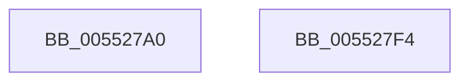

# HalAllocateDomainCommonBufferDmaThin

- RVA: `0x005527A0`–`0x005527F5` (길이 `85` bytes)
- VA: `0x00000001405527A0`
- 실행 섹션: `.text`
- PDB 이름 있음: `예`; PDB Function 태그: `아니요`
- unwind 정보 RVA: `0x0006C2A4`
- 디코드: `17`개 명령, `85/85` bytes 표시
- 미해석 바이트: `0` (있으면 어셈블리에 `.byte`로 보존)

> 이 문서는 커널 이미지의 기계어와 PDB 기호를 분석해 생성했습니다. 4번과 5번은 함수 원형과 자료형을 바이너리 사용 방식에서 추정한 C 해석이며 원본 소스 복구 결과는 아닙니다.

## 1. Dependencies

- 직접 호출 지점: **1**; 고유 호출 대상: **1**
- 직접 호출자로 확인된 함수: **0**
- RIP 상대 이미지 참조: **0**

### Outgoing calls
- `0x005527EA` → [HalpAllocateCommonBufferDmaThin](../3E/HalpAllocateCommonBufferDmaThin_function_003E9788.md) (function, `0x003E9788`)

### Direct callers
- 이 함수 시작 RVA로 연결되는 직접 call은 확인되지 않았습니다. 간접 호출은 완전히 역산할 수 없습니다.

### Static image references
- 디코드된 RIP-relative 메모리 참조가 없습니다.

## 2. Other-region calls and transfers

- 다른 실행 섹션으로 향하는 call: **0**
- 별도 외부 분기/꼬리 이동을 확인하지 못했습니다.

## 3. Assembly (complete function range)

```asm
005527A0  48 83 EC 58                     sub rsp, 0x58
005527A4  48 8B 84 24 A0 00 00 00         mov rax, qword ptr [rsp + 0xa0]
005527AC  33 D2                           xor edx, edx
005527AE  48 8B 89 00 02 00 00            mov rcx, qword ptr [rcx + 0x200]
005527B5  48 89 44 24 40                  mov qword ptr [rsp + 0x40], rax
005527BA  48 8B 84 24 98 00 00 00         mov rax, qword ptr [rsp + 0x98]
005527C2  48 89 44 24 38                  mov qword ptr [rsp + 0x38], rax
005527C7  8B 84 24 90 00 00 00            mov eax, dword ptr [rsp + 0x90]
005527CE  89 44 24 30                     mov dword ptr [rsp + 0x30], eax
005527D2  48 8B 84 24 88 00 00 00         mov rax, qword ptr [rsp + 0x88]
005527DA  48 89 44 24 28                  mov qword ptr [rsp + 0x28], rax
005527DF  8B 84 24 80 00 00 00            mov eax, dword ptr [rsp + 0x80]
005527E6  89 44 24 20                     mov dword ptr [rsp + 0x20], eax
005527EA  E8 99 6F E9 FF                  call 0x1403e9788
005527EF  48 83 C4 58                     add rsp, 0x58
005527F3  C3                              ret
005527F4  CC                              int3
```

## 4. C-style interpretation (structured pseudocode)

```c
__int64 __fastcall HalAllocateDomainCommonBufferDmaThin(__int64 a1, int a2, __int64 a3, __int64 a4, unsigned int a5, __int64 a6, unsigned int a7, __int64 a8, __int64 a9)
{
    __int64 result;
    __int64 v_rsp;
    unsigned __int64 v_stack_m18;
    unsigned __int64 v_stack_m20;
    unsigned int v_stack_m28;
    unsigned __int64 v_stack_m30;
    unsigned int v_stack_m38;

    v_rsp = (v_rsp) - (88);
    a2 = 0;
    v_stack_m18 = a9;
    v_stack_m20 = a8;
    v_stack_m28 = (unsigned int)((unsigned int)(a7));
    v_stack_m30 = a6;
    v_stack_m38 = (unsigned int)((unsigned int)(a5));
    result = HalpAllocateCommonBufferDmaThin(*(unsigned __int64 *)(a1 + 512), a2, a3, a4);
    v_rsp = (v_rsp) + (88);
    return result;
}
```

## 5. (Beta) C Style

```c
int64_t HalAllocateDomainCommonBufferDmaThin(void *Arg1, int32_t Arg2, int64_t Arg3, int64_t Arg4, uint32_t Arg5, int64_t Arg6, uint32_t Arg7, int64_t Arg8, int64_t Arg9)
{
    uint8_t *arg1 = (uint8_t *)Arg1;

    int64_t result;
    int64_t local_rsp;
    uint64_t v_stack_m18;
    uint64_t v_stack_m20;
    uint32_t v_stack_m28;
    uint64_t v_stack_m30;
    uint32_t v_stack_m38;

    local_rsp = (local_rsp) - (88);
    Arg2 = 0;
    v_stack_m18 = Arg9;
    v_stack_m20 = Arg8;
    v_stack_m28 = (uint32_t)((uint32_t)(Arg7));
    v_stack_m30 = Arg6;
    v_stack_m38 = (uint32_t)((uint32_t)(Arg5));
    result = HalpAllocateCommonBufferDmaThin(*(uint64_t *)(arg1 + 0x200), Arg2, Arg3, Arg4);
    local_rsp = (local_rsp) + (88);
    return result;
}
```

### 관측된 메모리 오프셋

구조체 형식이 확인되지 않은 접근은 인자 기준의 오프셋으로만 기록했습니다.

| 기준 인자 | 오프셋 표현 | 폭 (bit) | 접근 |
|---|---:|---:|---|
| `Arg1` | `+ 0x200` | `64` | `R` |

## 6. Execution-region graph

[열기: 2D/3D 그래프와 함수 탐색 컨트롤 패널](../../../control-panel.html?section=text&rva=0x005527A0&view=graph)

- 2D 그래프는 위에서 아래로 흐르고, 3D 그래프는 빈 공간을 드래그해 회전합니다. Shift+드래그는 이동, 휠은 확대·축소, 함수 노드 선택은 대상 보고서 이동입니다.

### Static fallback


